# PlanetX. Manual

[Русская версия](MANUAL.md)

Version 0.88.0

PlanetX is a 3D globe inside QGIS. The
globe opens in its own window and shows the whole Earth with terrain
and atmosphere, from space down to single streets. Layers of the current
project, your own placemarks, paths and polygons lie on the globe. Tours
fly over the places, and a tour recording gives frames for a video.

Plugin page - [www.informpp.ru](https://www.informpp.ru/главная-страница/qgis-planetx).

---

## Installation

The plugin runs in QGIS 3.36 and newer, including QGIS 4. It is tested on
QGIS 3.36 with Qt 5 and on QGIS 4.0 with Qt 6. It needs a graphics card
with OpenGL 3.3 and the Python module PyOpenGL. QGIS builds for Windows
include PyOpenGL.

Open **Plugins → Manage and Install Plugins**, search for PlanetX and
install it. QGIS does not need a restart.

The globe opens with the button on the PlanetX toolbar or from
**Web → PlanetX**. The same menu holds About PlanetX. If the QGIS build
has no PyOpenGL, the plugin says so and does not open the window.

## Interface language

The language follows the QGIS settings, not the system. With Russian in
QGIS the plugin is in Russian, with any other language it is in English.
The label language on the globe is set separately, in the view
properties.

---

## The globe window

The panel is on the left, the globe view on the right. The icon bar
sits in the top left corner of the view. The bottom right corner holds
the PlanetX mark, to its left a short faint credit line of the sources of what
the globe shows now. A click on the credits opens the Data sources window
with the full credits, links and terms, a click on PlanetX opens the
About window. The border between the panel and the view is dragged with
the mouse.

The properties of a placemark, folder, image, water body bathymetry
and layer extrusion open in the panel to the right of the view. The
view narrows by its width, the panel width is changed with the
splitter and remembered. The panel holds one properties window. A
new one closes the previous one with its Cancel - changes of the
previous one without OK are not saved. The ✕ button in the panel
header works as Cancel.

When the window opens for the first time in a QGIS profile, an
introduction to the plugin runs - five hints over the window. They show
the globe under the mouse, the Search field, the Layers section, the
right-click menu and the time slider. A hint shades the window except
its place, and the globe under it can be tried. The Back and Next
buttons turn the hints, Close and Escape end the introduction. It is
repeated from the Search field with the action Getting to know the
plugin.

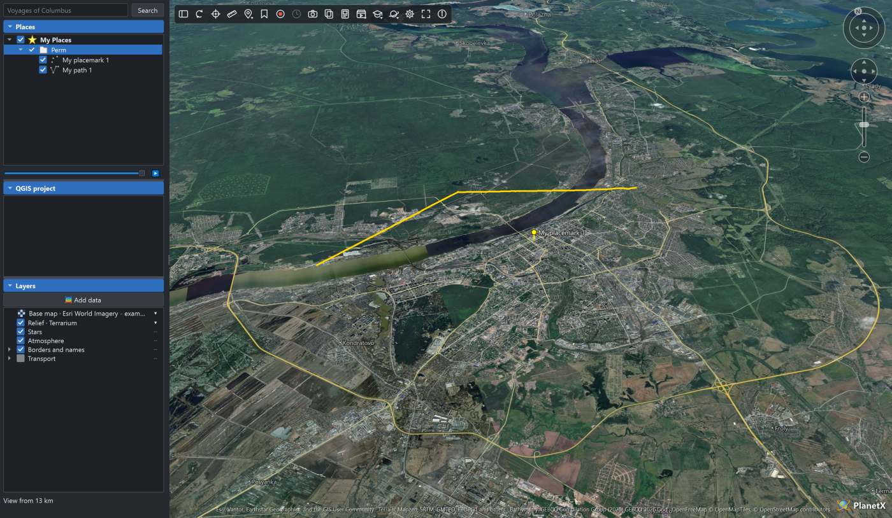

### Icon bar

| Icon | What it does |
|---|---|
| Sidebar | Hides and shows the left panel, the view takes its place |
| Refresh | Shows new settings and layers. The icon is visible only when automatic update is off in the View properties window. It turns orange when there is something to show |
| Synchronization | Links the globe with the QGIS map window |
| Identify features | Turns on identify by a click on the globe |
| Ruler | Opens the Ruler window |
| New placemark | Opens the New placemark window |
| Save view | Puts a placemark at the look-at point with height, heading and tilt |
| Record a flight | Records the camera movement as a tour into My Places. The ⏺ button of the tour bar records a tour to video |
| Time slider | Opens and closes the time slider. The slider is shared by placemarks, tracks, project layers, events, maps and the globe clock. It is available when visible data has a time |
| View snapshot | Saves the view to a PNG or JPEG file |
| Copy view | Puts the view on the clipboard without the tools |
| View to layout | Puts the view into a QGIS layout as a picture |
| Scene | The menu Save Scene… and Open Scene… |
| Demo | Ready scenes by body, see [Demo](#demo) |
| Body | The menu of planets, moons, asteroids and Sky, see [Other bodies](#other-bodies) and [Starry sky](#starry-sky) |
| View properties | Base map and data sources, terrain, labels, link with the map, update, coordinate format, subsurface mode, assistant |
| Full screen | The globe view over the whole screen for a presentation, the F11 key, see [Full screen](#full-screen) |
| About | Controls, data sources, buttons for the manual, the log and web pages |

### Full screen

The Full screen icon or the F11 key spreads the globe window over the
whole screen of the monitor it stands on. The left panel, the icon bar
and the loading icon hide. The navigation controls, the time slider,
the tour bar, the layer legends and the source credits stay, a tour can
be played and stopped. The Esc key or F11 again brings back the window
and the panels. The Search line finds the same action by the words
full screen and presentation.

### Status line

The status line sits under the left panel. It usually shows the camera
height, for example "Overview from 2 000 km". The second line shows the
coordinates and elevation of the point under the cursor. The coordinate
format is chosen in the view properties.

The line also reports loading:

- "loading 12" - this many tiles, layer pictures and labels still wait
  for loading.
- "loading has stalled for 7 s" - data waits and nothing has arrived for
  5 seconds or longer.
- "places are heavy, 250 thousand vertices" - your own objects exceed
  200 thousand vertices, turning may become slow.
- "The base map did not load" and "The vector base did not load" - the
  source answered with an error.

While loading goes on, a blue icon spins to the right of the icon bar.
A short load does not light it, it appears after half a second. When
loading stalls, the icon turns orange. Its tooltip tells how much still
waits.

Messages of search, scenes, tours and recording stay for 5 seconds.

---

## Navigation

Navigation uses the mouse, the keys and the navigation controls.

### Mouse

| Action | What happens |
|---|---|
| Left button drag | The Earth follows the cursor. After release it spins on by inertia |
| Wheel | Zooms in and out. The point under the cursor stays in place |
| Left double click | Flies to the point under the cursor and zooms in 2.5 times |
| Right double click | Zooms out 2.5 times |
| Right button drag | Up - closer, down - farther, toward the press point |
| Right click | The menu of the point under the cursor |
| Middle button or left with Shift | Turn and tilt around the look-at point |
| Left button with Ctrl | Moves the view along the screen, the view direction stays |
| Left button with Ctrl and Shift | Looks around, the eye stays in place |

Moving the view with Ctrl drags the picture under the cursor like a
sheet of paper and does not turn the Earth around its centre. This way
a part of the Earth cutaway at the window edge comes to the middle under
the same view angle. After a sideways move the frame can be turned
relative to north, the N and R keys put north up again.

The camera does not go lower than 50 m above the terrain. The tilt is
limited to 85°. While the ruler, drawing or identify is on, a double
click stays two plain clicks and places points.

### Keys

Keys work when the globe view has focus. A click on the globe gives it
focus.

| Key | What happens |
|---|---|
| Arrows | Move the view by a twentieth of the window width |
| Shift and arrows | Turn and tilt by 3° |
| Ctrl and arrows | Look around by 3° |
| PageUp, plus | Zoom in by a wheel step |
| PageDown, minus | Zoom out by a wheel step |
| N | North up |
| U | Look straight down |
| R | North up and look straight down |
| Space | Stop inertia and flight |

### On-screen controls

The navigation controls stand in the top right corner of the view.

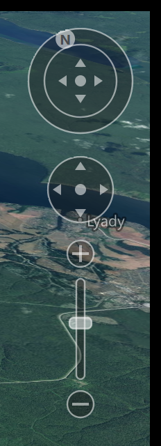

| Control | What it does |
|---|---|
| Compass ring | Dragging turns the view. The letter N shows north |
| Letter N | A click puts north up |
| Stick inside the ring | While the button is held, the view looks toward the press |
| Dot in the middle of the ring | A click returns the vertical view without tilt and roll, like the U key. The heading and height stay |
| Lower stick | While the button is held, the view moves toward the press |
| Plus and minus | While the button is held, the camera zooms in or out smoothly |
| Slider | The thumb stands at the camera height, dragging sets a new one |

The speed of the sticks grows with the distance from the middle. From
space the lower stick moves the view no faster than the Earth radius
per second. The controls are always shown. While the cursor is far away, they stand
as a faint outline and do not cover the view. When the cursor comes
near the corner of the view, they are drawn in full.

### Place search

Type a place name into the Search field at the top of the panel, for
example `Perm`, coordinates or a topic, for example "Voyages of
Columbus" - this example stands grey in the empty field. Enter or the
Search button starts the search. A topic without a place on the map
becomes placemarks, see Places from a description.

| Format | Example |
|---|---|
| Decimal degrees | `58.0105, 56.2294` |
| Degrees, minutes, seconds | `58°00′37.8″ N, 56°13′45.8″ E` or `58 00 37.8 N 56 13 45.8 E` |
| UTM | `40V 454464 6430139` |
| MGRS | `40V DK 54464 30138` |

Search also understands the coordinates copied from the status line
of the globe together with the elevation.

- Coordinates start a flight at once. The camera lands no higher than
  2 km from the point.
- A name goes to the Nominatim service in the label language. The camera
  flies to the first place found and frames it whole.
- When several places are found, they are listed under the field. A
  click on a row starts a flight.
- The found place carries a red pin. Clearing the field removes the pin
  and closes the list.

Suggestions of five kinds appear below the field while typing:

- Placemarks of My Places on the body on the screen with a matching
  name.
- Actions of the plugin - layers, catalogue maps, windows, icon bar
  tools, demos and globe bodies. The suggestion names the action and
  what it will do, for example "Currents - turn on" or "Ruler - open
  the window". An action is also found by a related word - "power
  lines", "power plants", "imagery", "contours", "iss".
- Earlier queries.
- Stars and constellations when the sky view is open.
- Sections of this manual, no more than three, at the end of the list,
  for example for the question "how to add a wind turbine model".
  A section fits if it has at least half of the query words, words in
  the title weigh more. Words are compared by their beginning, so
  "model" also finds "models". Question words such as "how" and
  "where" do not count. The suggestion tooltip shows the paragraph with
  the query words.

A click on a suggestion or Enter on it starts a flight to the placemark
or the sky object or runs the action, an earlier query is searched
again. A manual section opens to the right of the view at the paragraph
with the query words. A link to another section opens it in the same
place, the Open on GitHub button shows the section in the browser with
pictures. The manual in the plugin is in the QGIS interface language,
without pictures, and needs no network. Ctrl+K from anywhere in the globe window puts the cursor into
the field and shows the layers that are on and the earlier queries. The Down key
moves into the list of suggestions, in an empty field it shows the
earlier queries. Escape closes the list. Place names from the network
are not suggested while typing. The Nominatim service takes a query
only on Enter.

Enter in the field handles the query in this order:

1. Coordinates start a flight.
2. The exact name of an own placemark starts a flight to it with no
   network request. In the sky view the name of a star or
   a constellation works the same way.
3. The exact name of an action or its word runs the action. Demos do
   not open on Enter, "Perm" stays a place search.
4. A request in words goes to the assistant, the Assistant section
   describes it.
5. Anything else is searched as a place name.

Queries entered with Enter are kept in the QGIS profile, 30 at most.
The Clear search history button of the Assistant group in the View
properties window erases them.

Over a long distance the camera rises and lands smoothly. The mouse interrupts a flight.

---

## Left panel

The panel has three sections - Places, QGIS project and Layers. A click
on a header collapses the section, and the open sections take its place. The globe
remembers which sections are collapsed.

### Layers section

The section shows in one list what is on the globe now. Its check boxes
take effect at once, without the Refresh button. The rows go like this:

| Rows | What they hold |
|---|---|
| Base map | The base map - imagery or a map. A click on the row opens a menu - Esri World Imagery, OpenStreetMap, the QGIS XYZ Tiles connections and Add tile source… |
| Relief | The check box turns heights and hill shading on. A click on the name opens a menu - land heights Terrarium, Copernicus DEM 30 m or GEDTM30, Sea and ocean depths with the depth source - the height tiles or GEBCO 2026 - and Data sources… |
| Layers that are on | Layers and the map of the catalogue, the coordinate grid, 3D buildings, contours - everything that is switched on |
| Vector base groups | Borders and names, Transport, Nature, while something in them is on |

A row takes one line. The ⋯ on the right of a row opens its menu, the
right button opens the same menu. Clearing the check box switches the
layer off, the row stays, and the same check box switches the layer on
again. The Remove from the globe item of the menu removes the row too.
The Opacity slider of the menu changes the opacity of the layer -
points, surface colouring or lines, the value is remembered. For
mineral deposits, power plants, mines, earthquakes, fires, plate
boundaries, mining areas, power lines and cables the menu also saves
what is in view to the QGIS project. The To QGIS project… item asks for a GeoPackage
file and writes the objects inside the view frame with the record
fields into it. The layer goes into the PlanetX - globe layers group at
the top of the project tree. Points keep the globe colour and size,
lines and outlines keep their style. Colourings go to the project too.
A weather forecast field and currents go as a raster of values inside
the view frame (degrees, mm/h, m/s, for wind and currents also bands of
the eastward and northward speeds) with the globe legend. A NASA theme,
clouds and surface temperature go as a NASA GIBS image of the same date,
the temperature as two rasters - sea and land.

The Add data button at the top of the section opens the catalogue
window, see Add data catalogue. The vector base groups hold
rows. Borders and names holds Borders, Places and Water names.
Transport holds Roads, Road numbers, Railways and Airports. Nature
holds Rivers, Lakes and reservoirs, Peaks, Reserves and national parks.

The vector base comes from OpenFreeMap tiles. On the first opening
borders, places, terrain and stars are on. The tooltip of each row
tells how the feature is drawn and from what height it is visible.

The grid step follows the camera height, from 30° from space to
seconds near the ground. The stars stand where they stand over the
Earth at this minute and fade when the camera goes below 150 km. The
Milky Way image, about 10 MB, is downloaded when the stars are first
shown and comes from the QGIS cache afterwards. The Atmosphere row is
on by default. Without it there is no air glow at the edge of the
globe, no sky above the horizon and no haze over the distant surface,
the view background is black space.
Clouds lie as a veil over the imagery. Snow and ice get into the
clouds too, they have the same colour.

The Surface temperature map of the catalogue colours land and sea with
their own scales. The scales in degrees Celsius are in the bottom left
corner of the view. Land shows
the temperature of the surface itself by day, not of the air, over 8
days. Land may have gaps under clouds. Sea shows the water temperature
near the surface over a day.

The Sun layer lights the terrain and buildings from the side of the
sun. The night side of the Earth is dark, the air over it does not
glow. City lights shine on it - the NASA Black Marble image of 2016,
pixel about 600 m. In the twilight the lights fade together with the
night, under clouds they are weaker. The sun time is the end of the interval of the open time
slider, so the light of the hour of a placemark shows. Without the
slider the sun follows the computer clock. Without the Sun layer the
light falls from the north-west at 45°, as on a relief map. The
position of the sun is computed to about 0.01°, there are no
shadows.

Labels stay level at any turn and tilt and do not overlap. A place
behind a mountain or beyond the horizon has no label.

The Slope and Aspect layers colour the surface by the terrain heights.
Slope is the angle of the surface to the horizontal, in classes 0-2°,
2-5°, 5-10°, 10-15°, 15-25°, 25-35° and steeper than 35°, from green
to purple. Aspect is the compass direction a slope faces downhill,
each of the eight directions has its colour, ground flatter than 0.5°
is grey. The scale is in the bottom left corner of the view. The slope
is computed from the true heights, without the vertical exaggeration
of the view. The layer exists on the Earth, Mars and the Moon, other
bodies have no heights. The accuracy is limited by the height pixel.
It is about 5 m at the equator on the most detailed level on the Earth,
2.6 km on Mars, 1.3 km on the Moon.

Slope and contours are drawn no farther than three distances from the
camera to the look-at point. In a view tilted to the horizon the far
terrain stays without them. So the computation does not hold the view
on hundreds of far tiles.

The Contours layer of the Map category of the catalogue draws lines of equal height on the
surface, as on
a topographic map. The contour interval depends on the zoom. It is
1, 2, 2.5 or 5 metres times a power of ten. Close up at middle
latitudes it is 5 m, from tens of kilometres up it is 20-50 m. Every
fifth contour is thicker. Below sea level the lines are blue, these
are depth contours. Where contours merge on a steep slope, they fade.
Contours are built from the same heights as the slope and have the
same accuracy. The layer exists on the Earth, Mars and the Moon.

The interval is never finer than 5 m. The open Earth heights were
surveyed with a 20-90 m spacing, detailed tiles are their resampling.
Close up the contours are therefore built from smoothed heights with
about a 20 m spacing, resampled smoothly. The lines have no steps,
small terrain forms do not show on them. Open sea depths exist in these
data only on overview levels, so depth contours in the open sea are
built from them close up too. Own terrain from a project
raster and an own height source give contours at full detail.

Thicker contours are labelled with their height, as on a topographic
map. The number stands in a gap of the line, the top of the digits
faces uphill. There is no label at a tile edge, on a sharp bend of
the line and where the neighbouring contours are closer than the
height of the digits. A flat lake surface at a contour height does
not count as a line and is not filled.

On satellite imagery contours are yellow and depth contours light
blue, on a map they are brown and blue. Imagery means Esri World
Imagery and the imagery of other bodies. Basemaps with imagery,
satellite, aerial, ortho and similar words in the name or address
count as imagery too.

While the layer is on, its scale stands in the bottom left corner of
the view. It shows the line colour, the interval in the middle of the
view and the step of thicker contours. The cross of the scale switches
the contours off.

The To the QGIS project… link of the scale exports the contours of an
area around the view point as a GeoPackage layer. The View contours to
the QGIS project… item of the globe menu does the same. Export exists
only on the Earth.
The area is the view strip at the view point with the width and height
of the window, the interval is as on the screen. Heights are loaded for
up to 30 s. The layer goes to the PlanetX - contours group at the top
of the layer tree. The `elev` field is the height, thicker lines are
wider and labelled.

Sea and ocean depths are part of the terrain. The floor lies at its
depths, and semi-transparent water lies above it at sea level. Water
shallower than 200 m is more transparent, the floor shows near the
shore. Below sea level the status bar shows the depth under the
cursor. The depths come from the GEBCO 2026 grid with a step of about
450 m over the Terrarium tiles, coarser than level 5 - from the tiles
themselves, in the ocean these are ETOPO1 data. The menu of the Relief
row and the Data sources window choose the depth source. The depths are
not fit for navigation. Sea names stay at sea
level. The elevation profile, the ruler and the slope use the floor,
the viewshed and insolation use the water surface. A profile below
sea level shows the water and a dashed sea level line. Dry
depressions below zero, for example the Dead Sea, are not told apart
from the sea by the heights and are filled on the profile. On the
globe water lies only where the vector base map has it. The bottom of
a quarry and a dry depression below zero stay land, placemarks, paths
and labels on them stand on the relief. Until the water layer of the
base map is loaded, such a place is shown as water. The
Sea and ocean depths box in the Terrain group of the view properties
switches them off, then heights below sea level count as zero and the
sea is flat. Depths exist only on the Earth.

The Paleogeography layer shows the Earth in the past, up to 540 million
years ago, after the PALEOMAP PaleoDEM maps (Scotese and Wright, 2018).
The map of an age holds land heights and sea depths on a 0.1° grid,
about 11 km, coloured by height with hill shading. A slider in the
bottom left corner of the view sets the age in millions of years in
steps of 5 million years, the geological period is named next to it.
The ▶ button shows the ages one after another towards the present.
Today's imagery, borders, labels and relief are removed for that time,
the relief setting itself does not change. The maps lie as tiles in
the planetx-terrain repository, the first showing of an age needs the
internet. A new age appears at once in a coarse form and sharpens as
it loads. When the window opens, the row is off.

#### Add data catalogue

The Add data button of the Layers section opens the catalogue as a
separate window over the globe. The window is not modal - the globe, the
panel and the Layers list stay as they were, the catalogue can stay
open. The window remembers its place and size. The categories stand on
the
left - Map (the vector base, coordinate grid, 3D buildings, contours),
Weather, NASA themes by groups, Sky and light (Stars, Atmosphere,
Clouds, Sun, Satellites), Inside the Earth (Geological map, Earthquakes,
Plate boundaries, Active faults, Plate motion, Volcanoes, Magnetic poles, Declination lines,
Magnetic anomalies, Gravity anomalies, Bouguer anomalies, Geoid, Ocean
floor age, Heat flow, Mineral deposits, Mining areas, OSM mines and quarries, Earth cutaway,
Paleogeography), Energy (Power plants, Power lines and pipelines,
Submarine cables), Terrain analysis (Slope, Aspect) and Satellites -
the satellite groups. The search field looks for a name and a
description across the whole catalogue.

The rows are split into One map on the globe and Layers - switched on
together. A row has a check box, a preview, the name and the source
and day of the map on a second line. The preview of a map is its tile
over Eurasia on the latest ready day over the base map, forecast fields
and fires show a strip of the scale colours. The check box shows a map
or a layer on the globe. A click on a row shows its description under
the list with the Show on the globe or Remove from the globe and To
QGIS project… buttons. The globe shows one map of the catalogue, the
cross on its scale in the lower left corner of the view also removes
it. A satellite group card shows or removes the group. The first group
switches the Satellites layer on, the last removed one switches it off.

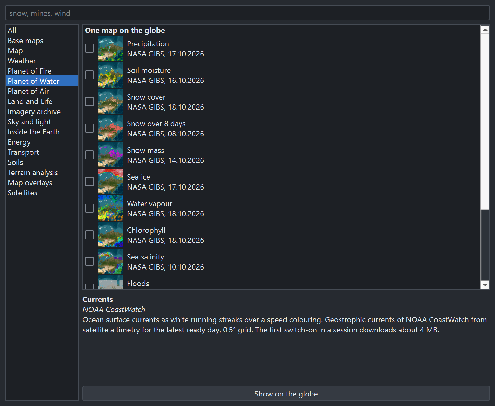

NASA themes are rasters by days, months or years from the NASA GIBS
service. A day of a series counts as ready a day later, before that
its image is empty. The NASA theme groups of the catalogue hold:
- Planet of Fire - fire spots, smoke, aerosol optical depth, carbon
  monoxide and its emission.
- Planet of Water - precipitation, soil moisture, daily snow, snow over
  8 days, snow mass, sea ice, water vapour, chlorophyll, sea salinity
  and floods.
- Planet of Air - nitrogen dioxide, sulphur dioxide, methane, carbon
  dioxide and ozone.
- Land and Life - vegetation, dust and night lights.

The theme lies as semi-transparent colouring over the
imagery, where there is no data the imagery shows. A legend with the
name, units and date stands in the bottom left corner of the view. The
day of the theme is set by the right handle of the time slider, see
Placemark time and the time slider. A chosen theme opens the slider on
the last day of its series. The handle gives the nearest day of the
series that is not later, missing days of the series are skipped. A new
theme takes the same moment while the slider is open. Some series lag
behind today by months, the tooltip of the theme says so. Themes exist only on the Earth.

Daily snow from MODIS imagery shows only where the day had no clouds
and was light. On 15 January 2026 over West Siberia clouds and the
polar night hid snow on 78 % of the area. The 8-day summary is hidden
on 40 %. Snow mass is a SMAP model calculation from satellite data,
it has no gaps under clouds. The snow themes show land only. Lake ice
is in the 8-day summary, sea ice is the Sea ice theme.

#### Comparison swipe

The ⇆ button of the time slider splits the view with a swipe. Right
of the swipe the theme is shown for the day of the slider, left of it
for a day of its own. By default this is the same day a year ago, for
a series shorter than a year its first day. Tags with the days of both
sides stand above the swipe. The ‹ and › buttons of the left tag move
its day along the theme series, the cross removes the swipe. The swipe
is dragged with the mouse by the strip with a circle.

The white line along the border is also on a view snapshot and in
a tour recording. The swipe works with NASA themes. GFS forecast
fields, fires and surface temperature have no swipe. A change of
theme keeps the swipe, its day is looked up in the series of the new
theme. Switching the theme off removes the swipe.

#### Esri Wayback imagery archive

The Esri Wayback map of the Imagery archive category in the catalog
shows past releases of the Esri World Imagery basemap. The releases
start on 20 February 2014, in October 2026 there are 197 of them. The
map opens the time slider at the latest release. The right handle
selects the release not later than its day.

The ‹ and › steps of the slider go only through the releases in which
the image at the centre of the view changed. When the view has stood
still for 0.7 s, the plugin asks the Esri service which release the
tile at the centre of the view actually comes from. The closer the
view, the smaller this tile. At the centre of Perm from 3 km there are
12 such releases out of 197. Until the service answers, the steps go
through all releases.

The ⇆ swipe compares two releases in the same way as two days of a
NASA theme. By default the left part shows the release a year earlier.

The release date is not the capture date. What's here? and the
Identify features mode give the Esri Wayback imagery archive group -
the capture date, the provider, the imaging system, the resolution and
the accuracy of the release image at the clicked point. Add to QGIS
project… of the On the globe row adds the release as an XYZ tile
layer, no file is written.

The terms are the same as for Esri World Imagery, see Data sources.

#### Weather

The Weather category stands in the catalogue before the NASA themes. Its first map is
Surface temperature of land and sea from NASA. The others are Air
temperature at 2 m, Precipitation in mm/h, Wind at 10 m in m/s
and Clouds in percent. The fields come from the NOAA GFS forecast
model with a 0.25° grid, about 28 km. A field is chosen in the
catalogue, as a NASA theme.

The Aurora map shows the probability of a visible aurora in percent by
the OVATION forecast of the NOAA Space Weather Prediction Center for
the next 30-90 minutes, 1° grid. Below 3 % the field is transparent,
a weak aurora is green, a strong one yellow and red. There is one
forecast, for now, the time slider does not change it. The map asks
for a new forecast at most once in 10 minutes. City lights on the
night side come with the Sun layer, they can be on together with the
aurora.

White streaks run over the Wind colouring - particles that float with
the wind and drag a trail. A streak of a weak wind is paler. The streaks
are sped up - in a second a wind of typical strength passes about an
eighth of the view width, so they are visible both from afar and close
up. They are born within the view and follow it.

The Currents layer of the Planet of water group of the catalogue shows
ocean surface currents with the same white streaks over a speed
colouring from dark blue for slow ones to red for 2.5 m/s. Slow water is
almost not coloured, the streak of a slow current is paler. From afar
the particles are born within the visible circle of the Earth and pass
no more than a third of a grid cell per frame, so the trail does not
loop through the eddies. The currents are
geostrophic, NOAA CoastWatch calculates them from satellite altimetry
for a day, the data lag two to three weeks. The series starts on 13
February 2017, the day of the currents is set by the right handle of
the time slider, without the slider it is the latest ready day. The
0.25° grid is taken at
every other node, 0.5°. The first switch-on in a QGIS session downloads
about 4 MB. The Gulf Stream, Kuroshio, the current around Antarctica
and eddies tens of kilometres across are visible. Near the coasts and
under ice there is no data.

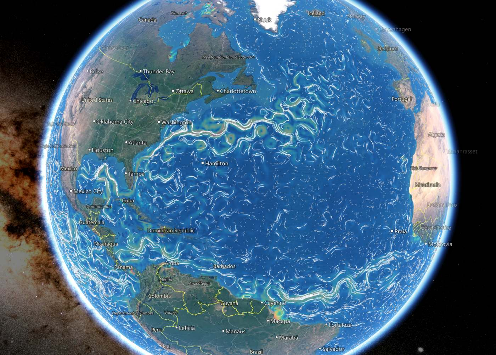

The time slider sets the moment of the field. A chosen field opens
the slider at the present moment. The slider spans 10 days before
the latest model run and 16 days of forecast after it. The future is
the forecast of the latest run, hourly for the first 5 days, then
every 3 hours. The past is the model analysis for the nearest hour.
The ‹ and › buttons of the slider move the moment by an hour, ▶ shows
the hours one after another and waits for each to load. The model
runs 4 times a day, a new run is published 4-5 hours later.

A field for the whole world weighs 0.5-0.8 MB and arrives in a few
seconds. The legend in the bottom left corner shows the units and the
valid time of the field in UTC. It is a model calculation. Model
clouds are not a cloud image, the Clouds layer gives the image.

The values of the field stand over its colours. Temperature is in
degrees, precipitation in mm/h, wind in m/s, clouds in percent. The
values stand at the nodes of a latitude and longitude grid, about six
across the view. The node step changes with the eye height, from 30°
from space to 0.25° close up. The values come from the same field,
there are no new network requests. Where precipitation is below
0.1 mm/h, there are no precipitation values.

The first map of the Planet of Fire is Fires. It shows
fire spots over the last 24 hours from VIIRS
images of the NOAA-20 satellite from the NASA FIRMS feed, about 78
thousand spots. A dot stands at the fire, its colour and size show the
radiative power from 1 to 1000 MW, the legend stands in the bottom left
corner of the view. The feed, about 6 MB, is loaded each time the row is
switched on. The spots stand on the time slider by the image time. A
click on a spot in the Identify mode shows its power, image time and
confidence.

The Plate boundaries layer shows the lithospheric plate boundaries after
the PB2002 model (Bird, 2003). Red lines are plates moving apart at
oceanic ridges and continental rifts, green - plates sliding along
transform faults, blue - plates converging in subduction and collision
zones. Plate names show as labels. A click near a boundary in the
Identify mode shows the boundary type, the plate pair and the speed of
their relative motion in mm/yr. In the plate pair a slash in Bird's
notation shows which plate goes under which. "PA\OK" is the Pacific
plate under the Okhotsk plate.

The Active faults layer shows about 13.7 thousand faults of the world
from the GEM Global Active Faults database (Styron and Pagani, 2020)
compiled from regional catalogues. The line colour shows the kind of
slip. Blue lines are normal faults, red ones reverse faults, thrusts and
subduction zones, green ones strike-slip faults, orange ones spreading
ridges, purple ones folds, grey ones have no kind given. The legend
stands in the lower left corner of the view. A click on a line shows
the name, the kind of slip, the database entry, the slip rate in mm/yr,
the dip and the source catalogue. The database file, about 11 MB, is
downloaded on the first switch-on and kept in the QGIS profile. The
database licence is CC BY-SA 4.0.

The Magnetic poles layer shows the north and south magnetic poles - the
points where a compass needle stands vertical. The red point is the
north pole, the blue one is the south pole, each trails its path since
1590. The time slider opens by itself. The right handle moves the poles
over the years, the left one cuts the start of the path - the path
starts at the year of the left handle. The positions of 1590-2025 come from the NOAA NCEI tables
(the gufm1 and IGRF models), after 2025 the pole is computed with the
IGRF-14 model up to 2030. A click on the globe in the Identify mode
shows in the Magnetic field group the declination - the angle between
compass north and geographic north, the inclination and the field
intensity at the point for the slider year. The field is computed with
the IGRF-14 model for 1900-2030 and with the gufm1 model (Jackson et
al., 2000) for 1590-1899. The gufm1 file, about 1 MB, is downloaded from
the authors' site on the first request for a year before 1900, until it
arrives the window shows only the year. From 1900 to 2025 the north
pole shifted 2475 km in a straight line, from the Canadian Arctic
towards Siberia.

The Declination lines layer shows lines of equal magnetic declination
every 10° for the year of the right handle of the time slider. The
slider opens by itself, as for the poles. Red lines mean east
declination, blue lines west declination, the green line zero
declination, where the compass points to geographic north. Labels on the
lines give the declination in degrees. The lines converge at the
magnetic poles. They are computed with the same gufm1 and IGRF-14
models on a 2° grid, from 1590 to 2030. In 1800 the declination near
London was about 24° west, by 2020 it came close to zero.

The Plate motion layer shows arrows of the motion of lithospheric plates
after the NNR-MORVEL56 model (Argus, Gordon and DeMets, 2011) - the velocity
relative to the mean motion of all plates. The arrows stand at grid
nodes, about seven across the view, the grid step changes with the eye
height. The arrow length grows with the speed, the number at the arrow
start is the speed in mm/yr. The plate at a point is found from the
PB2002 outlines. The Pacific plate near Hawaii moves northwest at about
70 mm/yr, the Eurasian plate at about 25 mm/yr. A click in the Identify
mode shows the plate, speed and direction of motion in the Place group.

The Volcanoes layer shows about 1200 volcanoes that erupted during the
last 12 thousand years, after the list of the Global Volcanism Program
of the Smithsonian Institution. The point colour shows the time of the
last eruption. A red point means an eruption after 1900, orange - from
1500 to 1899, yellow - earlier, grey - the time is unknown. The point
size grows with the volcano height. The legend stands in the lower left
corner of the view. A click on a point shows the name, volcano type,
height, year of the last eruption, tectonic setting and a link to the
volcano page on the GVP site. The list is downloaded on the first
switch-on, about 2 MB, and kept as a file in the QGIS profile.

The Magnetic anomalies layer shows the departure of the Earth magnetic
field from the normal one after the NOAA NCEI EMAG2v3 grid at 4 km above
the ellipsoid, a grid step of about 4 km. Red places mean a stronger
field than normal, blue a weaker one, the legend in the corner of the
view runs from -250 to +250 nT. The anomalies reveal the crust, for
example the Kursk magnetic anomaly, the stripes of the ocean floor on
both sides of the mid-ocean ridges, ancient shields. Where there is no
survey the layer is empty. A click in the Identify mode shows the value
at the point, near Kursk about +270 nT. The tiles lie in the
planetx-terrain repository, about 50 MB for the whole world, and load as
they are shown.

The Gravity anomalies, Bouguer anomalies, Ocean floor age and Heat flow
layers are value maps, like the magnetic anomalies. The globe shows one value map at a
time, switching on another one removes the previous one. Each has its
own legend in the corner of the view, a click in the Identify mode
shows the value at the point. The tiles lie in the planetx-terrain
repository and load as they are shown.

The Geological map layer shows the Macrostrat geological map of the
world (University of Wisconsin-Madison) compiled from maps of different
scales. The colour shows the age of the rocks on the stratigraphic
scale. From afar the overview map of the world is visible, closer up -
detailed maps where they exist. In Russia and Europe the most detailed
map is the International Geological Map of Europe 1:5 000 000, in the
USA the maps are much more detailed. Deeper than the most detailed map
of a place the tiles are empty, and the enlarged coarser map stays on
the screen. A click in the Identify mode shows in the Geology group the
unit, the lithology, the age on the scale and in Ma, the source map and
a link to the Macrostrat page at the point. Near Perm these are Permian
clays, 274-252 Ma, after the map of Europe. The geological map shares
its place with the geophysical value maps, the globe shows one of them.
Add to QGIS project… of the On the globe row adds the map as an XYZ tile
layer. The Macrostrat data are CC BY 4.0.

The Lithology layer shows the GLiM lithological map of the world
(Hartmann and Moosdorf, 2012) - surface rocks in 16 classes. These are
unconsolidated sediments, siliciclastic, mixed and carbonate
sedimentary rocks, evaporites, pyroclastics, acid, intermediate and
basic volcanic and plutonic rocks, metamorphic rocks, ice and glaciers.
The map is compiled from 92 regional maps at a scale of about
1:3 750 000. The class legend sits in the lower left corner of the
view. A click in the Identify mode shows the rock class at the
point in the Lithology group. The tiles are kept in the planetx-terrain
repository. Like the geological map, the lithology shares its place
with the geophysical value maps.

The Historical earthquakes layer shows the ISC-GEM catalogue - about
74 thousand strong earthquakes of the world from 1904 to 2024 of
magnitude 5 and above, with locations, depths and moment magnitudes
recomputed in one way. The circles stand as in the Earthquakes layer,
the colour shows the depth and the size the magnitude. The catalogue enters the time slider range, and its
handles select the events by year. A click on a circle shows the place,
date, magnitude, depth and a link to the USGS event page. The first use
downloads the catalogue in parts, about 13 MB, and keeps it as a file
in the QGIS profile. The catalogue licence is CC BY-SA 3.0.

The Land cover layer of the Earth and life group shows the ESA WorldCover map for 2021 from Sentinel-1 and Sentinel-2 images with a 10 m pixel. There are 11 classes - forest, shrubland, grassland, cropland, built-up, bare and sparse vegetation, snow and ice, permanent water bodies, herbaceous wetland, mangroves, moss and lichen. The class legend sits in the lower left corner of the view. From afar the map comes from the planetx-terrain repository, close up from the Microsoft Planetary Computer service. A click in the Identify mode shows the class at the point. The map licence is CC BY 4.0.

The Water occurrence and Water transitions layers of the Planet of
water group show the JRC Global Surface Water dataset (Pekel et al.,
2016) from Landsat images of 1984-2021 with a 30 m pixel. Occurrence
is the share of observations when the place was under water, from red
(rarely) to blue (always). Transitions divide water into classes - permanent and
seasonal water, new and lost, seasonal to permanent and back, and
ephemeral water. They show new reservoirs, shrunken lakes such as the
Aral Sea, and migrating channels. A click in the Identify mode
shows the occurrence in percent or the class.

The layers of the Soils group - Clay in soil, Sand in soil, Soil organic
carbon and Soil pH - show properties of the soil layer 0-5 cm from
ISRIC SoilGrids 2.0, a model built on soil profiles of the world with a
250 m grid. Clay and sand are in percent, organic carbon in g/kg, pH is
measured in water. The pictures come from the SoilGrids WMS service,
and a click in the Identify mode asks it for the value at the
point. Water and places without data are transparent. The SoilGrids
licence is CC BY 4.0.

The globe shows one map out of the lithological, geological, water,
soil and geophysical value maps, turning on another one removes the
previous one. Add to QGIS project… of the On the globe row adds such a
map to the project as an XYZ tile layer or a WMS layer of the service.

The Gravity anomalies layer shows the free-air gravity anomaly - the
departure of gravity from the normal one after the XGM2019e model
(Zingerle et al., 2020), computed to degree 719, a step of about 28 km.
Red places mean gravity above normal, blue below normal, the legend runs
from -200 to +200 mGal. Over deep-sea trenches the anomaly drops to
-300 mGal, near the Mariana Trench to about -305 mGal, over Hawaii it
rises to +370 mGal. Seamounts show as red spots.

The Bouguer anomalies layer shows the same anomaly minus the attraction
of the relief - the simple Bouguer correction 2πGρh after the NOAA ETOPO
2022 relief. Rock above sea level is removed with a density of
2670 kg/m³, ice with 917 kg/m³, water and ice below sea level are
replaced by rock. The correction is computed on 1' cells and averaged to
0.25° cells. The terrain correction for the surrounding relief within
167 km is added to it - mountains and valleys near the point, 10 to
25 mGal per cell in mountains and almost 0 on plains. Under mountains the anomaly is negative, about -510 mGal at Tibet and about
-155 mGal at the Alps - this is the thick light crust beneath them. Over
the ocean it is positive, about +330 mGal in the middle of the Pacific.
The legend runs from -400 to +400 mGal.

The Ocean floor age layer shows the age of the oceanic crust after the
grid of Seton et al. 2020, a 0.1° step. Young floor at mid-ocean ridges
is red, old floor at ocean margins is blue and purple, the oldest
floor, about 180 Ma, lies in the western Pacific. Land and continental
crust are not coloured.

The Heat flow layer shows the heat flow from the interior through the
Earth's surface in mW/m² on a 0.5° grid built by kriging from 91
thousand measurements of the IHFC 2024 database. Blue places are cold
old shields, red ones are rifts, mid-ocean ridges and volcanic areas,
near Yellowstone about 180 mW/m². Far from measurements the grid is
smoothed.

The Geoid layer shows the shape of the geoid - the Earth level surface
from which heights above sea level are counted - after the NGA EGM2008
model. While the row is on, the globe heights are the geoid heights
above the ellipsoid, from -107 to +86 m, stretched 10 000 times, and the
Earth looks crumpled. Bulges stand where gravity is stronger, for
example near New Guinea and in the North Atlantic, hollows where it is
weaker, the deepest one south of India. Terrain, water and the haze
over the surface are removed for this time, the atmosphere glow at the
edge of the globe stays. The Scale slider in the ⋯ menu of the Geoid
row stretches the heights from 1000 to 20 000 times. The Earth cutaway
in this mode reaches the crumpled surface, all shells are stretched in
the same proportion. Switching the row off brings back terrain, scale
and sea depths. A click in the
Identify mode shows the geoid height above the ellipsoid at the point in
the Geoid group.

The Mineral deposits layer shows mineral deposits, mines and
occurrences of the U.S. Geological Survey (USGS) from three datasets. The
MRDS database is about 300 thousand points, about 267 thousand of them
in the USA and about 1400 in Russia, USGS has not updated it since
2011. Major mineral deposits of the world (USGS OFR 2005-1294) is 3161
deposits, 300 of them in Russia, they show as large points. World
mines and plants (USGS Mineral operations outside the United States)
is 6478 mines, processing and metallurgical plants outside the USA for
2006-2010 with the operator and capacity, among them the Verkhnekamsk
deposit, the North Urals bauxite and the Saranovsky chromite complex.
For some records the place is given by district, the information
window then says approximate, by district. The point
colour is the group of the first commodity, the group scale is in the
lower left corner of the view. The size of an MRDS point is the
development status, a producing mine is larger than an occurrence. A
click on a point shows the name, commodities, type, status, operator,
capacity, country and a link to the USGS record, the Identify mode is
not needed for it. Earthquake foci, fires and satellites open the same
way. The first switch-on downloads
the USGS archives, about 25 MB, and parses them in a background thread,
which takes 15-20 s. The result is kept as a file in the QGIS profile,
later switch-ons read it in 1-2 s. Over a large area, for example the
whole USA, no more than 80 thousand points show. The major deposits,
world mines and plants come first, then the rest. Large points are
drawn over small ones.

The Mining areas layer shows outlines of open pits, waste dumps,
tailings and industrial sites of the world - about 45 thousand areas
outlined on Sentinel-2 images of 2019 (Maus et al., 2022, CC BY-SA
4.0). The outlines lie as an orange fill in the tile image. A click on
an outline shows the country and area. The first switch-on downloads
a file of about 25 MB into the QGIS profile.

The OSM mines and quarries layer shows mines, shafts and quarries
from OpenStreetMap with their names. They load for the place of the
view when the camera is below 150 km - an area of about 100 km around
the look point in one request to an Overpass server. The point colour
is the commodity group from the resource tag, without it the point is
white, Other. A click on a point shows the name, kind, operator and a
link to the OpenStreetMap object. In busy hours the Overpass server
answers with a delay or a refusal. The request then repeats by itself
on another Overpass server or on the same one after a pause.

The Energy category of the catalogue holds the Power plants, OSM power
lines, cables and pipelines and Submarine cables layers.

The Submarine cables layer shows submarine communication
lines in turquoise and submarine power cables in purple from any
altitude. The data is OpenStreetMap, extracted on 11 October 2026 - 909
communication lines and 1040 power cables longer than 5 km. OSM holds
part of the world's cables, most of them in the Atlantic and near
Europe. A click on a line shows the name, kind, owner and a link to the
OpenStreetMap object.

The Power plants layer shows about 35 thousand power plants of the
world from the WRI Global Power Plant Database, data as of 2021 (CC BY
4.0). The point colour is the fuel, the size is the capacity. The
points are visible from any altitude, a click on a point shows the
name, capacity, commissioning year, owner and a link to the source of
the record. Some plants are placed wrongly in the database. The first
switch-on downloads an archive of about 4 MB, the result is kept as a
file in the QGIS profile.

The OSM power lines, cables and pipelines layer shows power lines, substations, cables and pipelines
from OpenStreetMap. A power cable, underground or under water, is a
purple dashed line, a communication line is turquoise. The line colour
and width show the
voltage class - 500 kV and above, 220-330 kV, 110-150 kV or below. A
pipeline is dashed, its colour shows the substance - gas, oil and
products, water and heat. A substation is a square in the colour of
its voltage. The objects load for the place of the view when the
camera is below 150 km, the same way as the OSM mines. A click on a
line or substation shows the kind, voltage, substance, owner and a
link to the OpenStreetMap object.

The Earthquakes layer shows earthquakes of magnitude 4.5 and above
over the last 30 days from the feed of the U.S. Geological Survey
(USGS). The feed is loaded each time the row is switched on. A circle
marks the epicentre on the surface. The colour of the circle shows
the focus depth, from red near the surface to purple at 700 km, the
scale is in the bottom left corner of the view. The circle grows with
the magnitude. Foci on the far side of the Earth are hidden. A focus
is seen at its depth in the removed sector of the Earth cutaway row -
there the circle sits at the focus. The depth is stretched by the vertical exaggeration of
the terrain, like the heights. Each event has a time. With the row
on, the time slider becomes available, and it shows the events of the
chosen interval. The row exists only on the Earth.

The Earth cutaway layer removes a sector of the Earth under the look-at
point. The sector is a quarter of a hemisphere 90° wide in longitude,
from the equator to the pole of the hemisphere of the look-at point.
Its three faces are coloured by shells after the radii of the PREM
model. These are the crust to 24.4 km, the upper mantle to 400 km,
the transition zone to 670 km, the lower mantle to 2891 km, the outer
core to 5149.5 km and the inner core. The shell scale is in the bottom
left corner of the view. The edge of the faces lies on the ellipsoid,
the depths are not stretched by the vertical exaggeration. The crust
on the faces comes from the CRUST1.0 model in 1° cells. These are
water, ice, upper, middle and lower sediments, upper, middle and lower
crust, below the Moho the mantle begins. The crust is 6-7 km thick
under the ocean and about 70 km under Tibet. Continental and oceanic
crust have different colours, the oceanic crust is grey-green. The
crust type comes from the P-wave speed in the upper crust of the same
model. In the oceanic crust it is below 5.5 km/s, these are basalts.
Where a face crosses a subduction zone, the subducting
slab from the Slab2 model of the U.S. Geological Survey shows on it as
a band from the upper surface of the slab down by its thickness. Slabs
exist in 27 zones. The file of a zone is requested when a face touches
it, the loading icon shows this. The model is downloaded
from the site of its authors when the row is first switched on, until
then the crust is the 24.4 km PREM layer. If the model has not
arrived, the first row of the scale names the reason, and the crust
stays a layer of constant thickness. The next time the row is switched
on, the model is requested again. The received archive is saved to the
PlanetX folder of the QGIS profile, later sessions take it from there
without the network. If the authors' site does not answer, the archive
crust1.0.tar.gz can be downloaded with a browser from
https://igppweb.ucsd.edu/~gabi/crust1/crust1.0.tar.gz and put into this
folder under the same name, then the Earth cutaway row is switched off
and on. QGIS opens the profile folder with the menu item Settings -
User Profiles - Open Active Profile Folder, the PlanetX folder lies in
it.
The crust layers can be told
apart up close, where the depths on the faces are true. As the camera
moves away, depths to 400 km are stretched so that the crust stays
visible. At the surface the stretch reaches 8 times, towards 400 km
it fades out, below the scale is true. The shell scale shows the
factor, earthquake foci are stretched the same way. The Stretch the
crust item of the «⋯» menu of the Earth cutaway row in the Layers
section turns the stretch off, then all depths are true at any
distance.
The Mantle tomography item of the same menu colours the mantle on the
faces after seismic tomography - the deviation of the shear wave speed
from the PREM model after the SEISGLOB2 model (Durand et al., 2017).
Red mantle is slower and usually hotter, blue mantle is faster and
colder, the legend runs from -2 to +2 %. Slow columns show under Iceland
and Hawaii, a fast sinking slab under Japan, and two large slow regions
at the core boundary under Africa and the Pacific. The model is
downloaded from the EarthScope site on the first switch-on, about 28 MB,
and kept as a file in the QGIS profile. The crust and the core on the
faces keep their colours.

The CRUST1.0 crust to the QGIS project item of the same menu writes the
crust surfaces within the view frame into a chosen folder - GeoTIFF
rasters of elevations in metres above sea level with a 1° step. There
are seven surfaces - the tops of the upper, middle and lower sediments,
the tops of the upper, middle and lower crust and the Moho. The rasters
go into the project as the PlanetX - CRUST1.0 crust group. The sediment
and crust layers of CRUST1.0 are set apart by seismic wave speed, they
are not stratigraphy. Where a layer is absent, its top matches the top
of the next one. Near Perm, for example, the top of the upper crust lies
at -3850 m and the Moho at -40 870 m. The rasters can be shown on the
globe with the Surface by elevations item of the raster menu.
Labels of
places in the removed sector are not shown. The sector is placed anew
each time the row is switched on. The corners of the sector are
marked with points showing their latitude and longitude, and they can
be dragged with the mouse. A corner changes its own longitude and its
own latitude. If the latitude is neither 0° nor a pole, the lower or
upper face becomes a cone towards the centre of the Earth. The row
exists only on the Earth.

The Section down… item in the menu of a path in My Places opens the
Section window. It shows a section of the Earth down along the path.
The distance from the start of the path runs across, the depth runs
down.
The section shows the CRUST1.0 crust layers, the PREM shells, the
Slab2 slabs and earthquake foci from a band along the path. The
colours are those of the Earth cutaway faces, the layer scale is to
the right of the chart. The Depth list sets the depth of the section,
from 100 km to the centre of the Earth. The Foci band field sets the
width of the band. A focus is moved onto the section at the nearest
point of the path. While the Historical earthquakes row is on, the
foci of the ISC-GEM catalogue since 1904 are put onto the section too.
They have a light outline and lie under the foci of the 30-day feed,
the line under the chart counts them separately. With the time slider
open, the section shows only the foci of its interval, as on the
globe. The section is rebuilt when the handles stop. The cursor over the chart marks the point on the
globe and shows the Moho and slab depths there. The crust, the slabs
and the earthquake feed are loaded when the window opens, if they are
not there yet, the line under the chart tells what is still loading.
While the window is open, a wall of the same section hangs along the
path on the globe. It shows through the surface, its depths are true.
When the window closes, the wall disappears.

### Base map and a tile source of your own

The menu of the Base map row lists Esri World Imagery, OpenStreetMap
and the XYZ Tiles connections of the QGIS browser, the chosen base map
is checked. A choice changes the base map on the globe at once. On other
bodies the row shows the imagery of the body, there is no choice.

The same base maps with previews are gathered in the Base maps
category of the Add data catalog, a click on a row sets the base map
of the globe. The Local data category of the same catalog holds
detailed imagery of separate areas from the services of their owners.
The first row is the spring 2020 orthophoto of nine counties around
Philadelphia (PASDA DVRPC 2020). The row sets the base map, outside
the area the globe shows Esri imagery.

The Ready sources submenu adds a base map with one click. The sources
are gathered in the OpenStreetMap, Esri, NASA and USGS, and Google,
Bing, Yandex, 2GIS submenus:

| Source | What it shows | Warning |
|---|---|---|
| Google Satellite, Hybrid, Map, Terrain | imagery, imagery with labels, map, map with hill shading | yes |
| Bing Aerial, Map | Microsoft imagery and map | yes |
| Yandex Satellite, Map | Yandex imagery and map | yes |
| 2GIS Map | city map | yes |
| OpenTopoMap | topographic map from OpenStreetMap and SRTM, up to level 17 | no |
| Esri World Topo Map | Esri topographic map | no |
| Esri World Street Map, Light Gray Canvas, Dark Gray Canvas, National Geographic, Ocean, World Terrain, Shaded Relief, Physical, World Hillshade | Esri maps, the ocean, terrain and shaded relief maps up to level 13, the physical map up to 8 | no |
| OSM Humanitarian, OSM France, CyclOSM | maps from OpenStreetMap - humanitarian, French and cycling | no |
| NASA Blue Marble | cloud-free image of the Earth with shaded relief and depths, up to level 8 | no |
| USGS Imagery, Imagery Topo, Topo, Shaded Relief | maps of the US National Map, the USA only, up to level 16 | no |

The terms of Google, Bing, Yandex and 2GIS do not allow taking their
tiles into third-party programs by the direct address. Before the first
addition of such a source the window says so and gives a link to the
service terms. The source is added only by the Add button, the decision
and the responsibility for its use stay with the user. The window keeps
the answer and does not ask a second time. Yandex imagery is made in
another projection, the elliptical Mercator. The plugin builds a globe
tile from two Yandex tiles and recomputes it by latitude, otherwise near
Perm the imagery would lie 36 km south of its place. An added ready
source stands in the base map list and in the Data sources window, where
the Remove button takes it out of the list. The Search line finds ready
sources too - by name, for example yandex or bing.

The assistant sets a base map as well - a ready source or a template
address of your own, if asked, for example, "set Bing imagery". A ready
source goes through the same warning, an address of your own is first
shown to the user and added only after the Yes answer.

The Map overlays category of the Add data catalog lays transparent
maps over the base map - OpenSeaMap sea marks, Waymarked Trails hiking
and cycling routes. Several can be on at once, the opacity is in the ⋯
menu of the row, To QGIS project… adds an XYZ tile layer. Sea marks are
seen close up, from the scale of about 1:500 000.

The Add tile source… item of the menu opens the new source window. The Address
field takes an address in any of these forms:

- a template with `{z}`, `{x}`, `{y}`, for example
  `https://{s}.tile.opentopomap.org/{z}/{x}/{y}.png`
- the address of one tile copied from a browser, for example
  `https://server.arcgisonline.com/ArcGIS/rest/services/World_Topo_Map/MapServer/tile/5/10/17`
- an address with the level, column and row in the query
- the address of a WMS service, for example
  `https://imagery.pasda.psu.edu/arcgis/services/pasda/DVRPC2020/MapServer/WMSServer`

The window turns the address into a template and suggests a name from
the server name. Below it builds a mosaic of the whole world from four
level 1 tiles. If north is at the bottom of the mosaic, the server
rows go from the bottom up, the box Rows from the bottom up (TMS)
fixes this. The window finds the most detailed level itself by asking
for tiles at the look point of the globe. No-data placeholders do not
count. The source credit is in the corner of the view and on
snapshots, for known servers it is filled in by itself.

The source is saved as a QGIS XYZ Tiles connection and becomes the
base map at once. It is also visible in the QGIS browser, where it can
be edited or removed. The owner of the tiles sets their terms of use.

The window recognises a WMS service address by the words `WMSServer`,
`/wms` or `service=WMS` and reads the layer list of the service
(GetCapabilities). The layer is chosen in the Layer list. The All
layers row shows all layers of the group together. Instead of the
mosaic the window shows one picture of the layer extent. The globe asks
the service for a picture of every tile in the Web Mercator projection
(EPSG:3857). Many services cover only their own area. Outside the layer
extent and at small scales the globe shows Esri World Imagery, at the
edge of the area the service picture lies over it. Such a source is
kept in the PlanetX settings, not as a QGIS connection. It can be
edited or removed in the Data sources window. A WMS service draws every
picture anew, so a base map from it loads slower than tiles.

### Rosreestr cadastre

The Rosreestr cadastre row of the Map category of the Add data catalogue
puts over the imagery the land parcels from the National spatial data
system of Rosreestr (NSPD, nspd.gov.ru) - borders in red, parcels with a
pale fill. Data exist only for Russia. Parcels are seen up close, from
about 10 km and lower. Coarser tiles are not requested, they hold
thousands of parcels. The service refuses frequent requests in a row, so
the plugin asks for tiles one at a time with a 0.5 s pause, the view
fills with parcels in 30-60 s. The NSPD server certificate is issued by
the certification centre of the Russian Ministry of Digital Development,
which Windows does not trust by default. The Ministry root certificate
lies in the plugin and acts only on the plugin requests to nspd.gov.ru,
it is not installed into the system or the rest of QGIS. The layer
opacity is set by the slider of its row in the Layers list. The credit
Rosreestr NSPD is in the corner of the view.

With the cadastre on, a click in the Identify features mode or the What's
here? item of the globe menu asks NSPD about the parcel under the
point. The Features window shows the Rosreestr cadastre group. It holds
the cadastral number, the address, the area, the land category and the
permitted use. It also holds the form of ownership, the type of right,
the cadastral value with its dates, the status and the cadastral block.
The parcel outline is highlighted on the globe. The NSPD map row leads
to this parcel on the Rosreestr map. A double click on a row of the
Features window copies the value, for example the cadastral number, to
the clipboard and opens a link in the browser. One request goes per
click, the information arrives in 1-3 s.

### 3D buildings

The 3D buildings row of the Layers section puts OpenStreetMap buildings
on the globe as blocks. Outlines and heights come from the same
OpenFreeMap vector tiles as the vector base. The row is off by default.

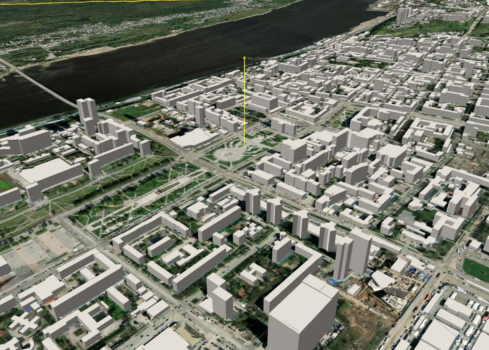

Buildings show when the camera is closer than 6 km to the ground. The
globe keeps up to 32 building tiles around the camera, the nearest
first. Tiles behind the camera are not loaded.

The height of a building is its height in OpenStreetMap, otherwise the
number of floors times 3.66 m. A building without either gets a height
of 5 m. In the centre of Perm two thirds of the buildings have a height
of their own, in the centre of Moscow almost all. In the outskirts many
houses have the same height. The colour of a building comes from
OpenStreetMap, otherwise the building is light grey. Roofs are flat.

The bottom of a building stands at the lowest point of the terrain
under its outline. A view snapshot waits until all buildings of the
frame are loaded. A scene remembers whether buildings are on.

### View properties

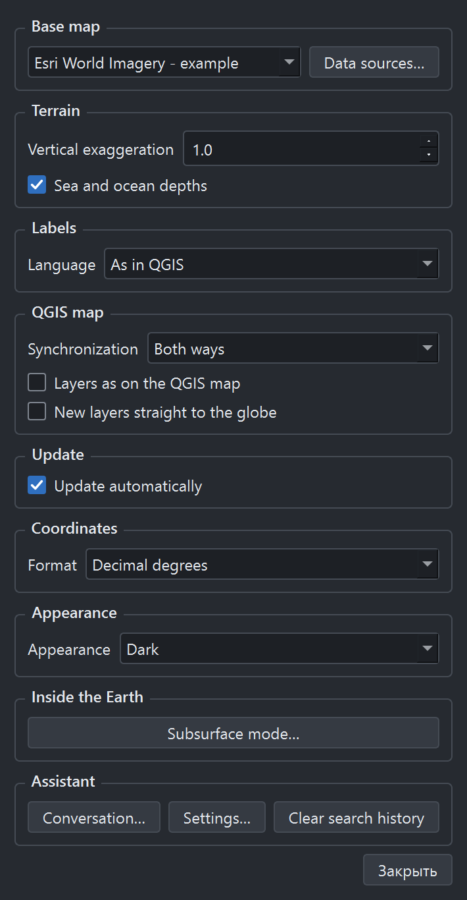

The View properties icon on the icon bar opens the View properties
window. The window does not block work with the globe.

| Group | Field | What it sets |
|---|---|---|
| Base map | List | Source of imagery or map |
| Terrain | Vertical exaggeration | Height multiplier from 0.5 to 10 |
| Terrain | Sea and ocean depths | The floor at its depths with water above it, on by default |
| Labels | Language | Language of labels and search |
| QGIS map | Synchronization | Direction of the link with the map |
| QGIS map | Layers as on the QGIS map | The globe shows the layers switched on in the QGIS legend |
| QGIS map | New layers straight to the globe | A new project layer is checked on the globe at once |
| Update | Update automatically | The globe refreshes after every change without the Refresh button, on by default |
| Coordinates | Format | Decimal degrees, degrees-minutes-seconds, UTM or MGRS in the status line and the Features window. North of 84° and south of 80° UTM and MGRS are replaced with decimal degrees |
| Look | Look | Dark (the default) - dark plates on the view and dark module windows. Light - grey plates with dark icons and light windows. As in QGIS - dark plates, module windows in the QGIS look. The look changes at once |
| Inside the Earth | Subsurface mode… | Opens the Subsurface mode window, see [Subsurface mode](#subsurface-mode) |

The default base map is Esri World Imagery, listed as an example. Esri
sets its terms of use. OpenStreetMap comes next, then the XYZ Tiles
connections from the QGIS browser. Terrain connections are not listed.
A new connection appears in the list the next time the window opens.

The Data sources… button next to the base map list opens a window with
all globe sources. Its table lists by groups the base maps, terrain,
vector base, NASA data and Earth science data. Each source shows what
it gives and an open link to its terms of use. The Check button
requests one tile or file from each source bypassing the cache and
writes the answer time and size or an error. Large files, the star sky
image, are not requested.

The same window sets own terrain - a height tile template with {z},
{x}, {y} in Terrarium or Mapbox Terrain-RGB encoding - and an own
vector base - a TileJSON address in the OpenMapTiles schema. Each has a
credit for the view corner. Apply takes the data from the new address,
Reset returns the default source. The Add base map…, Edit… and Remove
buttons work with the QGIS XYZ Tiles connections, a removed connection
disappears from the QGIS browser too.

The Terrain - where the heights come from group of the same window
explains that the heights are built from four layers - the world height
tiles, the 30 m land refinement, the GEBCO sea depths and an own raster
of the project. The
30 m land refinement list puts a 30 m terrain model over the height
tiles:

- No - height tiles only - the Mapzen Terrain Tiles relief, as before. It
  loads the fastest. North of 60° on land its data is about 250 m.
- Copernicus DEM 30 m - the Copernicus GLO-30 surface model, files per
  degree on the open AWS storage. Forest and buildings are part of the
  height.
- GEDTM30 30 m - the model of the bare ground without forest and buildings,
  OpenGeoHub, CC BY 4.0. It is one large file, its pieces take longer
  to read.

The height tiles still give the sea floor and the view from afar. From
level 9 the model gives the land heights, deeper than level 12 the model
pieces are not read again but resampled from the ones already read. The
model credit stands in the view corner. The model is read from the
network for every new area, without the network the height tiles
remain. At Mount Narodnaya the height tiles give 1816 m, Copernicus and
GEDTM30 give 1888 m, the summit is 1895 m.

The Sea depths list chooses the floor of seas and oceans:

- Height tiles - sea floor up to level 10 - the floor from the same
  Mapzen tiles. Closer than level 10 they have empty spots at zero in the
  open sea, for example at the Japan Trench.
- GEBCO 2026 - a grid of about 450 m - the GEBCO 2026 Grid of world
  depths, public domain with a credit of the source. From level 5 it
  replaces the floor of the tiles where both the tile and the grid are
  below zero, the land and the shore stay from the tiles. The grid is
  read from the network by areas. This is the default.

The label language is chosen from a list. As in QGIS takes the QGIS
interface language, Local names keep the names in the language of the
country. Fifteen languages follow. When there is no name in the chosen
language, Latin-script languages get the Latin name, the others the
local one.

Labels of a new place load when the camera stops. During a flyover and
a flight their loading takes no time from the frames, at a stop they
appear in a fraction of a second.

Without automatic update a change of base map, terrain exaggeration or
project layers shows after the Refresh button on the icon bar. The status line reminds about it.
The label language changes at once.

### QGIS project section

The QGIS project section stands between Places and Layers. It lists the
layers of the current project in the order of the
QGIS map, each with its type - raster, points, lines, polygons, point
cloud or table. The check box of a layer shows it on the globe and does not
change its visibility on the map. In a new project the boxes are clear.
The checks are stored in the project.

Layers lie on the globe as a picture drawn by QGIS, with the styles of
the map. The picture lies on the terrain, it cannot be raised or
extruded.

Labels of vector layers come separately, like city names. They stay
level at any turn and tilt, do not overlap and hide behind mountains
and the horizon. The text, colour and size come from the layer labels
in QGIS, rule-based labels too. A point label stands to the right of
the point, a line label at its middle, a polygon label inside it.
Features around the view point are labelled, at most 500 per layer.
The scale visibility of QGIS labels is not used on the globe.

A double click on a layer flies to its extent, looking straight down.
The right-click menu:

- Fly to - a flight to the extent of the layer.
- Transparency slider - the transparency of the QGIS layer itself, it
  changes on the map too.
- Track… - for point layers, see [Tracks](#tracks).
- Globe terrain - for rasters, see [Own terrain](#own-terrain).
- Extrusion… - for vector layers, see
  [Extrusion by field](#extrusion-by-field).
- To My Places… - for vector layers. The layer features go into My
  Places as a folder named after the layer, the selected ones,
  otherwise all. The folder can then be saved to KML, see
  [KML and KMZ](#kml-and-kmz).
- Point colour, Point size, Point classes - for point clouds, see
  [Point clouds](#point-clouds).
- Layer Properties… - the standard QGIS layer properties window.

### Point clouds

A point cloud is a lidar or drone survey in a LAS, LAZ or COPC file. It
is added to the project as an ordinary QGIS point cloud layer and
checked in the QGIS project section. On the globe the cloud stands as
points in space at their own elevations, with depth testing, like 3D
models.

The points are read by the PDAL program shipped with QGIS, in separate
processes, and the window does not wait for them. A COPC file is read
at once. A LAS or LAZ file is converted to COPC once, the copy goes to
the PlanetX/pointclouds folder of the QGIS profile, the source file does
not change. A drone tile of 5.7 million points is converted in about
15 s, later views take the copy.

The detail of the cloud depends on the distance. The cloud is divided
into cells, near cells are smaller and hold more points, far cells the
other way round. A frame holds at most 3 million points. While cells
load, the loading icon to the right of the icon bar is shown.

The elevations of the cloud are converted to metres by the coordinate
system of the file, for example from feet. With terrain the heights are
stretched by the terrain scale, like 3D models, without terrain the
cloud stands with its bottom on the surface. The points are moved
slightly towards the eye, about 0.5 % of the distance. The globe
terrain is smoothed over tens of metres, and without this the ground
points of the survey would go under it.

The menu of a cloud layer:

- Point colour - the survey colour (RGB from the file, without it - by
  class), by ASPRS class, by height from blue to red or by intensity in
  shades of grey.
- Point size - from 1 to 6 pixels.
- Point classes - all classes, ground only or chosen classes among those
  met in the cloud.

The legend in the corner of the view shows the classes of the cloud or
the heights in metres. A click in the Identify features mode gives the
cloud point under the cursor - class, elevation, latitude and longitude,
intensity, return number and colour. The cloud settings are stored in
the project.

### Extrusion by field

Features of a project vector layer rise above the terrain to a height
from a numeric field. A polygon becomes a prism, a point an octagonal
column, a line a wall. The Extrusion… item of the layer menu opens a
window with the height field and a factor. The height in metres is
the field value times the factor. For a field of storeys the factor
is about 3. A feature with an empty, zero or negative value is not
extruded. The No extrusion row removes the extrusion.

The colour of a feature is its symbol in the QGIS layer style, as on
the map. The bottom of a prism and a column lies at the lowest terrain
point under the feature, the roof is flat. A line wall follows the
terrain. The column radius is 1/150 of the layer span, from 2 m to
2 km. The layer is extruded while it is checked on the globe. The
settings are kept in the project. Up to 20 000 features of a layer are
read.

### Own terrain

A height raster of the QGIS project becomes the globe terrain within
its extent. An example is a quarry with a mine survey. The Globe
terrain item of the raster menu in the QGIS project section turns the
inset on and off. The raster can be in any coordinate system, it needs
a file that GDAL reads. The checkbox that shows the layer on the globe
is not needed for the inset.

Where the raster has data, its heights replace the common terrain.
Along a band at the edge of the data the heights change smoothly to the
common terrain, the band is 5 % of the smaller side of the extent.
Within the extent the terrain is more detailed than the common one,
down to the raster pixel, but not finer than the pixel of level 17
(about 0.6 m at latitude 60°). The raster heights are taken as they
are. If the survey has its own height system, the band at the edge
smooths the difference with the common terrain.

The inset is seen by the surface mesh, the height under the cursor, the
ruler, the elevation profile, the viewshed, the insolation, the slope
and the aspect. With several insets the one higher in the project lies
on top. The choice is kept in the project and in the scene.

On the first switch-on the raster is converted into a file of the QGIS
profile. For a survey of 2400 × 2400 pixels this takes about 2 s.

### Cut and fill

Two surveys of one site, for example a quarry with dumps, give the cut
and fill volumes. The Cut and fill… item of the menu of the new survey
raster in the QGIS project section opens a window:

- Earlier survey - a raster of the same site at an earlier date.
- Site - polygons outside which the difference is not computed, or the
  whole extent of the new survey.
- Threshold - a difference smaller than the threshold in absolute value
  does not enter the volumes, it is survey noise. The default is 0.1 m.

The earlier survey is resampled to the grid of the new one. The
computation goes in metres, in the coordinate system of the new survey
or in the UTM zone if it is in degrees. The summary window shows the
cut and fill volumes, their areas, the greatest cut depth and fill
height and the difference of the volumes. The difference raster goes
into the project in the PlanetX - cut and fill group and is shown on
the globe, the cut in red, the fill in blue.

### Own bathymetry

A raster of depths or bed elevations of a lake, sea or reservoir goes
into the globe terrain like own terrain, and semi-transparent water at
the water body level is drawn above it. The Water body bathymetry… item
of the raster menu in the QGIS project section opens a window with
three fields:

- Values are depths - the depth below the water surface, with a plus or
  minus sign. The bed elevation is the water level minus the absolute
  depth.
- Values are bed elevations - the bed height above sea level.
- Water level - the height of the water surface. The default is the
  terrain height in the middle of the raster, for a lake it is usually
  the water surface.

The water is drawn over all raster points where the bed is below the
level, the bed is seen through it. Without terrain no water is drawn -
the bed and the water would lie in one plane. Remove bathymetry turns
off both the inset and the water. The choice is kept in the project.
The elevation profile across the water body shows the water above the
bed and a dashed line of the water body level with a label.

The Lake Brienz, own bathymetry demo of the Demo icon is the bed of Lake
Brienz in Switzerland from swisstopo swissBATHY3D data with a 10 m step,
water at 564 m. The deepest point is 308 m, 256 m below the water. The
elevation profile across the lake shows the basin.

#### Bathymetry from soundings

Echo sounder soundings are a point layer of the project with the depth
in a field or in the point Z, for example a CSV with latitude,
longitude and depth opened in QGIS as a delimited text layer. The
Bathymetry from soundings… item of the point layer menu builds a depth
raster from them and makes it own bathymetry. The window sets:

- Depth - the field with the depth or the point Z. The sign of the
  depth does not matter.
- Cell - the raster cell size. The default is the square root of the
  sounding area per point. For tracks 20 m apart with a point every
  metre it is 5 m.
- Limit from sounding - a cell farther than this distance from the
  nearest sounding stays empty. The default is 10 cells. The limit has
  to be larger than the distance between tracks.
- Water level - the water height on the day of the soundings.
- File - the GeoTIFF of the depth raster, by default in the QGIS
  profile.

The raster is built by triangulation in metres of the UTM zone of the
middle of the soundings and goes into the project in the PlanetX -
bathymetry group.

### Places section

The section holds the My Places folder, described in the chapter
[My Places](#my-places).

---

## Link with the QGIS map

### Synchronization

The synchronization icon on the icon bar links the globe with the QGIS
map window. The direction is chosen in the view properties:

- Both ways - the default.
- Map leads the globe - the globe moves to the map extent and keeps its
  tilt and heading.
- Globe leads the map - the map centers on the look-at point of the
  globe once the globe stops.

Any map coordinate system works. The map width on the ground equals the
width of the globe view.

### Selection

Features selected on the QGIS map are highlighted on the globe.

### Identify features

The Identify features icon turns identify on, the cursor becomes a
cross. A click on the globe puts a pin with the coordinates and opens
the Features window.

- The top of the window shows the coordinates and elevation of the
  point.
- Below are the project layers checked on the globe, their features
  under the point and the feature fields. A raster shows its values at
  the point.
- The Select on map button selects the found features in the QGIS
  layers. The selection shows on the map, in the attribute table and on
  the globe.
- The My Places group lists the visible placemarks, paths and
  polygons under the point. Each shows its type, coordinates or length,
  measurement and description.
- The Earthquakes group lists the foci near the click point on the
  screen. Each shows its magnitude, depth, UTC time, place and the USGS
  event page.
- The Site group shows the elevation or sea depth, the Moho depth, the
  crust and sediment thickness, the crust type after CRUST1.0 and the
  Slab2 slab under
  the point. The crust model and the slab zone file load on the first
  click, the window updates when they arrive.

---

## My Places

My Places is the folder at the top of the Places section, marked with a
star. It holds placemarks, paths, polygons, saved views and
measurements. The places are kept in one file `PlanetX/myplaces.gpkg`
in the QGIS profile folder and are visible in any project.

The icon of a point placemark is always visible, even with thousands of
placemarks on the screen. A label stands at the placemarks that have
room for it, the other labels appear when zooming in.

### List rows

The row icon shows the kind of object - placemark, path, polygon, saved
view or folder. A check box shows and hides the object on the globe, a
folder check box does it for the whole folder. A double click on a
place flies there.

Places and folders are rearranged by dragging, including from folder to
folder. The tour follows the list order.

Several rows are selected with Ctrl and Shift. The selection is dragged
together, and the Del key deletes it after a question.

The slider under the list changes the opacity of the selection -
placemarks, paths, polygons, images and the whole contents of
selected folders. It stands at the opacity of the selection, to the
left is more transparent. A polygon fill stays more transparent than
its line in the same share. The value is kept in My Places and in KML
as the colour alpha, Google Earth sees it too.

### Menus

| Where | Items |
|---|---|
| My Places | Add, Play tour, Sort A-Z, Open KML or KMZ…, Save as KML…, Copy, Paste, Add the places layers to the project, Clear My Places… |
| Folder | Fly to, Add, Cut, Copy, Paste, Delete, Open KML or KMZ…, Save as KML…, Snapshot folder view, Sort A-Z, Play tour, Properties… |
| Place | Fly to, Tour along the path, Snapshot view, Properties…, New Folder, Cut, Copy, Paste, Delete |
| Several rows | Copy, Show selected, Hide selected, Delete selected |
| Empty space | New Folder, Open KML or KMZ…, Paste |

Only paths have Tour along the path. The Add submenu creates a
folder, placemark, path, polygon or recorded tour in the folder. The
placemark, path and polygon are drawn in the New place window, the
tour is recorded with the record button. Cut copies the row to the
clipboard and removes it from the list, Paste puts it in a new place.
Sort A-Z orders places and folders by name.

### Folder properties

The Folder properties window opens from the folder menu:

| Field | What it sets |
|---|---|
| Name | The folder name in the list |
| Allow the folder to be expanded | Without the box the folder does not expand in the list, the folder box shows and hides all its contents |
| Show contents as option buttons | One row of the folder shows on the globe, checking one clears the others |
| Hide beyond | All placemarks of the folder are visible only while the eye is closer than this distance. In KML the field is written as the Region of the folder |
| Description | Text about the folder, the tooltip of its row |
| View | Look point, range, heading and tilt, buttons Snapshot current view and Reset |

A double click on a folder and Fly to in its menu fly to the folder
view. Without a view of its own the flight frames all places of the
folder. The view is set by hand with numbers on the View tab or by a
snapshot. Snapshot folder view sets the folder view to the view of
the globe. The
description, the view and the way contents show go to KML and back.

A new folder appears at once with the name New Folder, the name is
changed in the Properties… window. On a folder it is created inside, on a place right below it. A
folder is deleted with its contents after a question.

Add the places layers to the project adds the three layers of the places
file to the project - points, lines and polygons. Their attributes and
undo are the standard ones.

### New placemark

The New placemark icon opens a window with the tabs Placemark, Path,
Polygon and Circle.

- A placemark is put with a click on the globe, a new click moves it.
- Path points and polygon vertices are put with clicks on the globe.
- A circle is set by two clicks - the centre and a point of the
  circle. Both points can be dragged with the mouse. The circle is
  saved as a polygon of 128 vertices along the circle on the
  ellipsoid.
- The Name field is filled at once with a numbered name - My placemark
  1, My path 1, My polygon 1, My circle 1. Each kind counts on its own. The name can
  be changed in the same field.
- Color sets the color of the line and outline, the polygon fill has the
  same color, half transparent. Width is set in screen pixels.

The Save button writes the object to the selected folder of My Places.
The window stays open for the next object. The Clear button removes the
points put so far.

Vertices are shown as circles and are dragged with the mouse. The
circle in the middle of a segment adds a new vertex there. A click on
the first point closes the shape, and a path becomes a polygon. A click
on the last point finishes the path. A hint stands at the cursor. After
finishing, clicks add no points, and the vertices can still be edited.

### Right-click menu on the globe

A right click on the globe opens a menu.

| Item | What it does |
|---|---|
| Point coordinates, the first line | A click copies them to the clipboard in the format of the status line |
| Delete vertex | Removes the vertex of the drawn object under the cursor |
| Finish drawing, Continue drawing | Stops and resumes adding points with clicks |
| Properties… | Opens the properties of the placemark under the cursor |
| Add placemark here | Opens the New placemark window with the point under the cursor |
| Measure distance | Opens the Ruler with its first point here |
| Fly here | Flies to the point with the same altitude and tilt |
| Orbit around | Flies to the point and circles it slowly, one turn a minute. Any mouse or key movement stops it |
| Directions from here, Directions to here | The start and the end of a route, see Route |
| What's here? | The Identify window for the point under the cursor without the Identify features mode. The Site group holds the address from Nominatim, the OpenStreetMap geocoder |
| Viewshed from here… | The Viewshed from a point window for the point under the cursor, see Viewshed from a point |
| Satellite images here… | The Satellite images window for an area around the point under the cursor - Sentinel-2, Landsat, ASTER and MODIS, the satellite is chosen in the window, see Satellite images |
| Insolation here… | The Insolation window for the point under the cursor, only on the Earth, see Insolation |
| Open in browser | A submenu of sites. An item opens in the browser the site at the point under the cursor, for example Google Maps or the weather forecast on windy.com. The Add or edit sites… item opens the list window. The Add site button puts a ready site - Google Maps, Yandex Maps, 2GIS, OpenStreetMap, Windy - or an empty row for your own address, a double click on a cell changes the name or the address. In the address `{lat}` and `{lon}` are the latitude and longitude in degrees, `{zoom}` is the map scale by the view. The address starts with https:// or http://, the list is kept in the QGIS settings |
| Map sheet designation | A submenu with map sheet numbers at the point. The International Map of the World 1:1,000,000 (IMW), the Russian designation at 1:1,000,000, 1:500,000 and 1:200,000, the NATO JOG 1:250,000 sheet and the MGRS 100 km square. A click on a row copies the number. The All numbers in a window… item opens a window with the same numbers |

The shape of a 3D path, a 3D polygon and a tour is not edited this way.
A placemark with a saved measurement loses the measurement text after
its shape is edited.

### Satellite images

The Satellite images window looks for scenes of the
Sentinel-2 or Landsat satellites over an area and adds the chosen bands and indices to the
QGIS project. The scenes are L2A, that is surface reflectance, 10-20 m
per pixel. Two items open the window:

- Satellite images here… of the globe menu takes a square around the
  point. The square side equals the width of the visible strip of the
  globe, from 1 to 100 km. The Area side field changes it.
- Satellite images… of the menu of a path or a polygon in My Places
  takes the area from the placemark. A polygon gives its outline,
  a path gives its bounding box.

The Acquired from and to fields set the date range. Scene cloud cover
up to limits the cloud cover of the whole 110 × 110 km scene by the
catalogue. Over the area up to limits clouds and shadows over the area
itself. The window computes it from the SCL scene class mask after the
search and hides scenes above the limit. The Find button fills the
list, newest first. The columns are the acquisition date and time in
UTC, the cloud cover over the area, the scene cloud cover, the Sun
elevation and the MGRS tile. The chosen row shows a natural colour
preview of the area.

The checkboxes of the product list choose what goes to the project:

| Product | Bands | What it shows |
|---|---|---|
| Natural colour | B4 B3 B2 | as the eye sees |
| False colour, near infrared | B8 B4 B3 | vegetation in red |
| Agriculture | B11 B8 B2 | crops and ploughland |
| Shortwave infrared | B12 B8A B4 | moisture and burns, haze is almost transparent |
| Geology | B12 B11 B2 | rocks and outcrops |
| Urban | B12 B11 B4 | built-up areas and bare soil |
| NDVI - vegetation | (B8 - B4) / (B8 + B4) | green biomass |
| NDWI - open water | (B3 - B8) / (B3 + B8) | water above zero |
| NDMI - vegetation moisture | (B8A - B11) / (B8A + B11) | moisture in foliage |
| NBR - burned areas | (B8 - B12) / (B8 + B12) | burns lower, the difference of two dates gives burn severity |
| NDSI - snow | (B3 - B11) / (B3 + B11) | snow and ice above 0.4 |
| All scene bands | B1-B12 and B8A | 12 bands in one file for own computations |

All scene bands is one GeoTIFF with all bands in the order of their
numbers, each band in the file carries a name like "B8A nir08", it is
seen in the QGIS layer properties. For Sentinel-2 these are the 12
bands of the L2A product (band B10 is not in it), the 20 and 60 m
bands are resampled to a 10 m step. Landsat 8-9 has 8 bands, Landsat
4-7 has 7, the thermal band in the file is the surface temperature in
kelvins. The layer shows natural colours, another combination is chosen
in the layer properties without a new download. The file is large -
for Sentinel-2 an area of 3 km takes about 1.5 MB, 20 km about 190 MB,
so an area with a side over 20 km goes at a 20 m step with All scene
bands.

The list at the bottom of the window chooses the method:

- Clip to the area, GeoTIFF writes float32 reflectance files to the
  folder set by the Folder… button. Pixels outside the polygon are
  empty. With the Clouds and shadows empty checkbox the pixels of
  clouds, shadows and snow by the SCL mask are empty too. The pixel
  size is 10 m, for a large area 20 or 60 m, so that a side stays
  within 4000 pixels.
- Whole scene by link, no download writes a VRT file, links to the
  scene bands on the network. Only band combinations go by link,
  indices go by clipping to the area. The method exists only for
  Sentinel-2.
- Whole scene, source files writes the scene files as they are, in
  the source values and resolution, to a scene folder inside the
  Folder… folder. These are all bands, the cloud mask and for Landsat
  the MTL metadata file. One VRT layer set of all bands goes to the
  project, it shows natural colours, for MSS and ASTER false colours,
  for MODIS the first layer of the product in grey. The checked
  products are not built then. A Sentinel-2 scene weighs about 1 GB,
  Landsat about 0.8 GB, ASTER 50-200 MB, MSS about 30 MB. For MODIS the
  files of all tiles of the day are downloaded. The status line shows
  how many files are downloaded. A file already downloaded is not
  downloaded again on a repeat. The method exists for all satellites
  of the list.

The To QGIS project button puts the layers into a group of the day
inside the Sentinel-2 group. Band combinations are stretched by 2-98 %
of the values, indices are coloured with their own scale. The layers
are checked on the globe, their metadata carry the notice «Contains
modified Copernicus Sentinel data» with the acquisition year. Loading
a 3 km area takes 10-20 s.

The scene catalogue is Earth Search (Element 84), the images are
Copernicus Sentinel-2 (ESA), Element 84 files on the open AWS storage.
No key or account is needed.

The Satellite list at the top of the window switches to Landsat 4-9 -
images since 1982, 30 m per pixel, surface reflectance and surface
temperature of the Collection 2 Level-2 processing of the U.S.
Geological Survey (USGS). The catalogue and the files are Microsoft
Planetary Computer. The files are read with a temporary access key,
the window gets it from Planetary Computer by itself, without an
account, and asks again every 45 minutes. When the key service has
not answered three times, the line at the bottom of the window says
so. Over the area, Landsat cloud cover is computed from the qa_pixel
mask - clouds, cirrus and shadows. The tile column shows the
satellite, the WRS path and row, for example "L9 167/020". The
products are those of Sentinel-2 without band numbers, as Landsat 4-7
and 8-9 number them differently, plus Surface temperature, °C from
the thermal band. This is the surface temperature of the USGS Level-2
product (ST_B10 of Landsat 8-9, ST_B6 of Landsat 4-7), not brightness
temperature. USGS has already converted the radiance with the surface
emissivity from the ASTER GED database and the atmosphere. The plugin
converts the file value to kelvins by the scale and offset of the
product and subtracts 273.15. Where the ASTER GED database has no
emissivity, USGS does not compute the temperature. Over most of Russia
that is half of the area or more, at Yakutsk in summer 2024 it is
86-100 %. The Temperature gaps by formula check box, on by default,
computes such pixels by the same USGS formula from the radiance and
atmosphere of the scene (the ST_TRAD, ST_ATRAN, ST_URAD, ST_DRAD layers),
the emissivity comes from NDVI. It is 0.991 for water, 0.973 for bare
soil and 0.986-0.99 for vegetation. Where USGS computed the value itself, the mean difference is
below 0.5 °C, for 95 % of the pixels not above 1.9 °C. The layer
description tells what share of the pixels the formula computed. The
layers go to the Landsat group with the credit
"Landsat N image courtesy of the U.S. Geological Survey". The Whole
scene by link method is not available for Landsat - the key lives an
hour, and a layer of a saved project would not open later. Landsat 7
images after May 2003 have empty stripes from an instrument failure.
Over water, the near infrared reflectance of Landsat 4-5 can be above
red, and the NDVI of water comes out about +0.1.

The action of the Search line by the words ASTER, minerals, kaolinite
opens the window right on these images.
The ASTER line of the same list gives ASTER images of the Terra
satellite of 2000-2006 - 14 bands, visible and near infrared at 15 m,
six shortwave infrared at 30 m, five thermal at 90 m. The catalogue and
files are Microsoft Planetary Computer, no sign-in is needed. ASTER
imaged on request, there are few scenes - 5 near Perm, 24 at Cuprite
in Nevada. The VNIR and TIR bands work after 2006 too, but in the open
copy imaging ends in 2006, later scenes exist only at NASA and in Earth
Engine with a sign-in. If the search dates are later than 2006, the
window sets 2000-2006 when this line is chosen. Products:

| Product | Bands | What is seen |
|---|---|---|
| False colours (3N 2 1) | 3N 2 1 | vegetation is red, 15 m |
| Shortwave infrared (4 6 8) | 4 6 8 | rocks and minerals |
| Kaolinite, alunite | (4 + 6) / 5 | argillic alteration |
| Sericite, muscovite | (5 + 7) / 6 | sericitic alteration |
| Mg-OH and carbonates | (7 + 9) / 8 | carbonates, chlorite, epidote |
| Iron oxides | 2 / 1 | hematite, goethite |
| Quartz | 11² / (10 × 12) | quartz from the thermal bands |
| All scene bands | 1-14 | 14 bands in one file |

The band ratios are those used in ore exploration (Rowan, Mars 2003,
Ninomiya 2003), the scale is stretched over the area, warm colours mean
more of the mineral. At Cuprite the kaolinite and alunite index shows
both known zones of altered rocks. The values are top of atmosphere
reflectance and brightness temperature in K, computed for the normal
band gain. The gain mode of a scene is not recorded in the open copy,
with another gain the reflectance of a band differs by a constant
factor, so ASTER gives no NDVI. ASTER L1T has no cloud mask, the cloud
cover over the area is the cloud cover of the scene, the Clouds and
shadows empty check box is not available. Some scenes have no
shortwave bands, products from them are not built then. The layers go
to the ASTER group with the credit "ASTER data courtesy of
NASA/METI/AIST/Japan Spacesystems and U.S./Japan ASTER Science Team".

The ASTER since 2007 - NASA, an Earthdata key is needed line gives
ASTER images after 2006 from the NASA LP DAAC archive. The search in
the NASA CMR catalogue goes without sign-in, the preview is the open
picture of the whole scene. NASA gives the files only by an Earthdata
key. The key is free, how to get and enter it is told in the NASA
Earthdata key section. If NASA does not accept the key, the window
erases it and asks for a new one at the next load. The files are
read by temporary addresses that NASA gives. The ASTER shortwave bands failed in 2008, so these scenes have
only the VNIR and TIR bands - false colours, iron oxides, quartz and 8
bands in All scene bands, the tile column says ASTER VNIR TIR. The
2026 scenes at Cuprite have no thermal bands either, then All scene
bands holds the three VNIR bands, and quartz is not built. Night
scenes with only thermal bands are not listed. The NASA catalogue knows
only the scene frame, and the ASTER imaged strip is turned inside it.
An area near the frame edge may lie beyond the edge of the image. Then
the window adds no layers and says that the bands hold no data.

The action of the Search line by the words MSS, early images, old
images opens the window right on these images.
The Landsat 1-5 MSS line of the same list gives the oldest Landsat
images - the MSS scanner, 1972-1993, 60 m per pixel, USGS Collection 2
Level-1 processing from the same Planetary Computer catalogue. Near Perm
there are 778 scenes of 1973-1993. There are four bands - green, red
and two near infrared, without blue and thermal. So the products differ -
False colour, near infrared, All four MSS bands in one file, NDVI and
NDWI. The values are top of atmosphere reflectance by the multipliers
of the scene metadata file and the sun elevation, without atmospheric
correction. NDVI from them is not directly comparable with NDVI of
Landsat 4-9. Cloud cover over the area comes from the qa_pixel mask,
for MSS it holds only clouds. If the search dates are later than 2013,
the window sets the summer of 1975 when this line is chosen and returns
the former dates when another satellite is chosen. Many MSS scenes
have slanted stripes of failed lines - saturated pixels of one band
and dips next to them. The window finds them by the qa_radsat
saturation mask, by the ratio of a band to the others along the stripe
and by spikes of one band and replaces them with the mean of the
neighbouring sound pixels. Wide saturated areas - clouds and snow -
stay as they are. The geolocation
of all MSS scenes near Perm is class T2, coarser than that of Landsat
4-9. MSS images were added after a discussion with Nadezhda
(https://github.com/nadiopt-cell), the author of QGIS plugins for
loading satellite images.

The same Satellite list gives the ready MODIS products of the Terra and
Aqua satellites, version 061, since 2000. The catalogue and the files
are Planetary Computer, the window gets the access key itself:

- Temperature per day, 1 km and over 8 days - the daytime and
  nighttime surface temperature in °C (MOD11A1 and MOD11A2, MYD for
  Aqua).
- NDVI and EVI over 16 days, 250 m - the MOD13Q1 vegetation indices.
- Snow per day, 500 m - the snow share of a pixel in percent, MOD10A1,
  over 8 days - the classes no snow, snow and lake ice, MOD10A2.
- Burned areas by month, 500 m - the day of year of burning, MCD64A1.

A MODIS scene is a day or a period of one satellite. The MODIS tiles
that the area touches are read together, the layers come in the UTM
system of the area centre with the product step. The Over the area
column of MODIS is the cloud share by the product quality band, for
temperature the share of pixels without a value. MODIS has no cloud
cover of the whole scene, its field is disabled. In winter at the
latitude of Perm the daily products are often fully cloudy, the 8- and
16-day composites have fewer gaps. The layers go to the MODIS group with
the credit of the product and the NASA archive, for example "MOD11A1
v061, NASA EOSDIS LP DAAC".

### Time series

The "Time series…" button of the Satellite imagery window builds a chart
of a value of the area over all scenes of the list, that is, over the
found scenes that are not cloudier over the area than set. The value is
chosen in the series window among the indices of the satellite - NDVI,
NDWI, NDMI, NBR, NDSI, for Landsat also the surface temperature, for
MODIS the temperature, NDVI, EVI and the snow share. A band composite
is a picture rather than one value, and ASTER has no cloud mask, so they
have no series.

A point of the chart is the median of the value over the area without
clouds and shadows by the scene mask. The vertical bar runs from the
10th to the 90th percentile and shows the spread inside the area. The
median moves less than the mean from remains of clouds and bad scan
lines. A scene with clear pixels on less than 10 % of the area gets no
point. The series is computed on a coarse grid - not more than 200
pixels along a side of the area, and the points appear as they are
computed. Near Perm 43 Sentinel-2 scenes of a 2 km area took 1.5
minutes.

The cursor over a point shows the date, the median, the spread and the
share of the area without clouds. A click on a point selects that scene
in the list of the Satellite imagery window - its preview shows, and it
can be added to the project at once. The "CSV table…" button writes the
series to a file - the date, the scene, the median, the 10th and 90th
percentiles, the share of the area without clouds. Scenes without a
value are rows with empty fields.

An example - the centre of Perm, a 2 km area, Sentinel-2 over a year,
NDVI. The winter points under snow are near zero, from May to October
they are 0.15-0.22, a city has little vegetation. For a series over
many years Landsat since 1982 or the 16-day MODIS NDVI are more
convenient.

### NASA Earthdata key

NASA gives ASTER images after 2006 only by an Earthdata key. The key
is free, each user has a key of their own.

1. Account. Open https://urs.earthdata.nasa.gov/users/new and fill in
   the form - user name, password, email address, country, occupation.
   Confirm the email by the link in the NASA letter. If you already
   have an account, sign in at https://urs.earthdata.nasa.gov.
2. Key. On the profile page open the Generate Token tab at the top and
   press the Generate Token button. A long string of Latin letters,
   digits and dots appears - this is the key. Copy it whole.
3. Key in PlanetX. Right-click the globe at the place you need and
   choose Satellite images here…. In the Satellite list choose ASTER since
   2007 - NASA, an Earthdata key is needed. Press Find, choose a scene
   and press To QGIS project. The window asks for the key. Paste the
   copied string and press OK. The window keeps the key and does not
   ask for it again.

The key is valid for 60 days. When it expires, the line The Earthdata
key was not accepted appears at the bottom of the window, and the
window asks for a new one at the next load. The same Generate Token
button makes a new key. The key is kept in the QGIS settings of this
computer and goes only to the NASA server. Whoever knows the key loads
data on behalf of its owner, so the key is not sent to anyone. A key
that got into other hands is revoked by the Revoke button next to it
on the same tab. The scene search and the preview work without a key
too.

### Route

A route by roads is built between two points on the Earth. The
Directions from here item of the globe menu sets the start,
Directions to here sets the end. With a point placemark under the
cursor the route takes its point and name. When both points are set,
the route is built by itself and goes into My Places as a path named
Route N. The camera flies to it. The length and the travel time stand
under the search line. The By car, By bike and On foot links build
the route the other way, Clear removes the points.

The OSRM service on the FOSSGIS server builds the route from
OpenStreetMap data, at any distance. The route from Perm to Sochi,
2664 km, arrives in 1 s. The route points go to the service server.
The service updates its data every two days. The Map error link opens
the OpenStreetMap page where errors in roads are reported. Requests
to the server go no more often than once per second, a FOSSGIS
condition. The Build routes with the service box and the address of
an own OSRM server are the Routes group of the Data sources window.

Without the box or when the service did not answer, the plugin builds
the route itself. It uses the roads of the vector base, that is
OpenStreetMap data in OpenFreeMap tiles. A car drives on roads from motorways to tracks,
keeps one-way traffic and does not go on paths. A walker goes on all
roads and paths except motorways, in both directions. A bike goes
where a walker goes, except trunk roads. The travel time follows the
road class, from 90 km/h on a motorway to 15 km/h on a track, by bike
15 km/h, on foot 5 km/h. The data hold no traffic, speed limits or
turn restrictions.

Over tiles the route points lie no more than 50 km apart in a
straight line. A point goes to the nearest road of the connected
network, an island of roads without an exit, for example inside the
Kremlin, is skipped.
Road tiles load in a strip along the straight line between the
points, the line under the search shows the loading. Without a way
in the strip the strip widens. A route from the centre of Perm to
Motovilikha, 5 km, is built in 3 s together with loading. The ready
path is an ordinary placemark, it has an elevation profile, a tour
and a KML record.

### Saved view

The Save view icon puts a placemark at the look-at point. The name is
offered with a number - View 1, View 2. The placemark keeps the camera
distance, heading and tilt. A flight to such a placemark brings the
whole view back.

### Placemark card

A click on a placemark on the globe, when the ruler, the new placemark
and the Identify features mode are off, opens the placemark card to the
right of the view - its name and description. The description is text
or HTML, as in KML, links open in the system browser. A point placemark
under the cursor rises and stays up while the cursor is on it, so it is
clear which placemark a click will hit. If a placemark from KML has a
`highlight` style in a `StyleMap`, it is drawn with that style under the
cursor, for example larger. The `highlight` style is kept in My Places
and written back to KML. The card buttons:

| Button | What it does |
|---|---|
| Explain this | Asks the assistant what the object is and why the place is of interest. The answer appears in the card and under the Search box |
| Fly to | Flight to the placemark, as a tour stop |
| Properties… | The placemark properties window in place of the card |
| Close | Closes the card, Esc does the same |

Explain this gives the assistant the name, kind, coordinates and
description of this one placemark and the names of the globe layers
turned on, for example Gravity anomalies. The names of QGIS project
layers are not sent. Pressing the button is consent to send them.
Without it the names of placemarks do not go to the model. The button
is available when the assistant is connected, see the Assistant
section.

While a properties window is open on the right, a click on a placemark
does not open the card and the editing in the window goes on.

### Project layer object card

A click on an object of a vector project layer checked on the globe
opens the object card on the right. My Places placemarks and Wikipedia
articles under the same click come first. The card shows the layer
name, the text of the description field and a table of the other
fields. The description field is the first of the fields
`description`, `descr`, `comment`, `note`, `remarks` and their
Russian names, letter case does not matter. Empty fields
are not shown. The object name is the display expression of the QGIS
layer. Rasters give no card, their values at a point are shown by the
Identify features mode. The card buttons:

| Button | What it does |
|---|---|
| Explain this | Asks the assistant what this object is and why the place is of interest. The answer stands in the card and under the Search box |
| Fly to | Flight to the extent of the object |
| Select on map | Selects the object in the QGIS layer - on the map, in the attribute table and on the globe |
| Close | Closes the card |

Explain this gives the assistant the layer name, the name, description
and fields of this one object, the clicked point and the names of the
globe layers turned on. Pressing the button is consent to send them.
Without it the names of project layers and the object fields do not go
to the model.

### Wikipedia nearby

The Wikipedia nearby row of the Encyclopedia category of the Add data
catalogue shows Wikipedia articles with coordinates - cities,
monuments, rivers, peaks. An article is a label with a blue dot. The
articles are requested when the camera is below 40 km, in the language
of the QGIS interface. Where there are many labels, the important ones
are seen - regions and cities before landmarks - and the ones near the
view point.

A click on a label opens the article card on the right - its first
paragraph and a link to the article. The buttons of the card:

| Button | What it does |
|---|---|
| Explain this | Asks the assistant about this place by the article text. The answer appears in the card and under the Search box |
| Fly to | Flies to the article point |
| To My Places | A placemark at the article point with the first paragraph and the link in the description |
| Close | Closes the card |

Explain this gives the assistant the title, the first paragraph and
the coordinates of the article and the names of the globe layers turned
on. The assistant answers by the article text. In the Identify features
mode the articles near the click appear in the Features window as the
Wikipedia group with links.

Wikipedia texts are distributed under the CC BY-SA 4.0 licence. The
Wikipedia credit stands in the corner of the view while articles are
on the globe.

### Place properties

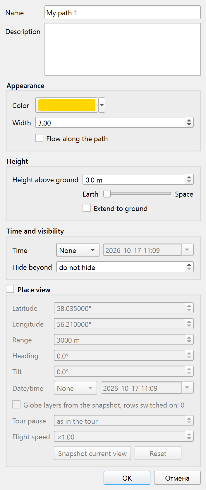

The Properties… item opens the properties window. The window does not
block the globe, the view can be turned and zoomed. Each change shows
on the globe at once. While the window is open, the vertices of the
placemark, path or polygon show on the globe as circles and can be
dragged, a circle in the middle of a segment adds a vertex. OK writes
the changes to the place together with the shape, Cancel brings the
previous look and shape back.

| Field | What it sets |
|---|---|
| Name | Name in the list and label on the globe |
| Description | Text of the placemark, it goes into KML too |
| Icon | Point icon from the QGIS set, in KML a standard icon of the same theme |
| Color, Width | Color of the point icon, color and width of the line and outline |
| Icon size | Points only. The icon size as a share of the usual one, as scale in KML. 0 - only the label on the globe |
| Label colour, Label size | Points only. The colour and size of the label on the globe, as LabelStyle in KML. Size 0 - only the icon, the name stays in the list |
| Fill | Fill color of the polygon and of the wall |
| Altitude mode | What the altitude is measured from, as in KML. Clamped to ground - the placemark lies on the ground, over the sea on the water. Clamped to sea floor - on the floor. Relative to ground and Relative to sea floor - the rise above them. Absolute - the altitude above sea level, it may be below zero too |
| Height | The rise above the surface or the floor, in the absolute mode the altitude above sea level, in metres. The Ground - Space slider under the field sets it from the ground to 100 km. In the Clamped to ground and Clamped to sea floor modes the field is not available |
| Extend to ground | A wall from the object to the ground, a post for a placemark |
| Flow along the path | Paths only. Short dashes of the line colour run along the path from the first point to the last one, like a flow of goods |
| Time | Moment or interval of the placemark for the time slider |
| Hide beyond | The placemark is visible only while the eye is closer than this distance. 0 - always visible. In KML the field is written as Region |
| Place view | Look point, range, heading, tilt of the camera at the place and the view date |
| Object fields | A table of name and value, as ExtendedData in KML. Add field and Remove field change the set. The fields are shown in the placemark card and in the Objects window. An edit of fields from a GIS export does not go back to the source layer, it goes into KML |

Extending works with a height above zero. A path becomes a wall, a
polygon becomes a block.

A path with flow lies on the ground, light dashes of the line colour
run evenly along it from the start to the end. The dash step is a share
of the width of the visible part of the globe, so the flow looks the
same from afar and up close. The order of the path points sets the
direction of the flow. The flow is kept in the places file, a scene and
KML, in KML it is ExtendedData, other programs do not show it.

### Place view

Any place can have a view of its own.
A view is the point the camera looks at, the range to it, the heading
and the tilt. The look point may differ from the place. Fly to, a double
click on the place and a tour stop follow the view.

Snapshot view in the place menu makes the current globe view the view of
the place. The properties window has the same values in the Place view
section. The Snapshot current view button takes the globe view, Reset
brings back the view the place had when the window opened. Clearing the
section check box removes the view, then the camera frames the whole
place. The view goes into KML as a LookAt element and is read from it.

The Snapshot current view button also remembers the rows switched on
in the Layers section - the Globe layers from the snapshot check box
under the view time. With this check box a flight to the place and a
tour switch these rows on and the others off, and each tour stop shows
its own layers - for example gravity anomalies first, then the Earth
cutaway with earthquake foci. The view time sets the timeline. The
layers switch on at the start of the flight to the stop, so the data
arrive by the time the camera does. In KML the view layers go into the
ExtendedData of the placemark, other programs skip them.

Along with the rows the snapshot remembers the opacity of the rows that
are on, the sector of the Earth cutaway and the ground above the
subsurface model - its opacity, the cut and the camera below ground. A
tour stop restores them too. Foci, fires, flow streaks and tile
colourings fade in and out at the stop over half a second instead of
switching at once.

The Tour pause and Flight speed fields of the same section set the pace
of the stop. The pause is how many seconds the camera stays at the place,
as in the tour means the pause from the tour panel. The speed is how many
times faster than usual the flight to the place goes, from ×0.25 to ×4,
below one is slower and smoother.

### Copy and paste

Copy or Ctrl+C puts the selected places and folders into the
clipboard as KML text. The text can be pasted
into a text editor, edited and copied back. Paste or Ctrl+V puts the
places from the clipboard into a folder. On a place it is the folder
of that place, on empty space the root of My Places. Folders from the
clipboard come in as folders. KML copied in Google Earth pastes the
same way.

### Placemark time and the time slider

The time slider is one time of the whole view. Coverages - NASA themes -
take the moment, the right handle. Events - placemarks with time and
earthquakes - take the range between the handles. When a theme is on
and there are no events, the slider has one handle. The ‹ and › buttons
move the moment by a step of the theme series, ▶ shows the days of the
series one after another and waits until each day has loaded. The
legends of the layers - theme, foci, cutaway, beds, insolation, slope
and temperature - stand as one panel in the bottom left corner of the
view.

A placemark can have a time of its own. It is a
moment or an interval, the Time field of the placemark properties. In
KML the time is written as TimeStamp and TimeSpan. The view of a
placemark has its own time, the Date/time field of the Place view
section.

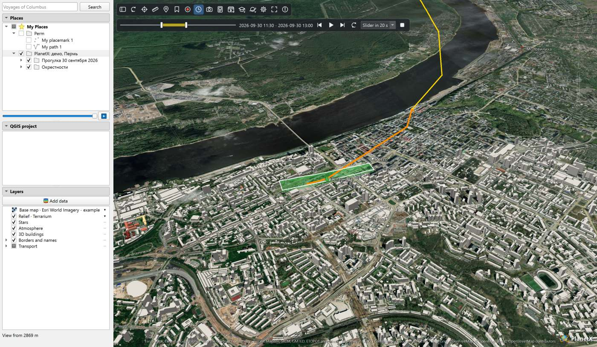

The time slider opens with the Time slider button on the icon bar.
The button is available when visible placemarks have a time. The
slider spans the placemark times from the earliest to the latest. A
closed slider hides no placemarks, all of them show.

| Part | What it does |
|---|---|
| Handles | Set the interval. Placemarks outside it are hidden, placemarks without a time always show |
| Bar between the handles | Dragging moves the whole interval, a click on the bar centres it on the click |
| ⏮, ⏭ | The interval of the same width moves to the start or the end of the slider |
| ▶, ⏸ | Playback and pause, the interval moves along the slider. If the interval covers the whole slider, the left handle goes to the start and the right one runs from it to the end |
| 🔁 | Playback in a loop, after the end of the slider the interval starts from the beginning |
| Speed | Slider in 20 s crosses the whole slider in 20 seconds. ×1 - time runs as on a clock, ×60 - a minute per second, ×3600 - an hour, ×86400 - a day |
| Now | The moment goes to the computer clock, time runs at ×1. The button is there when the Sun, satellites or the sky are on |
| ⏹ | Closes the slider |

A flight to a placemark and a tour set the slider to the time of the
placemark view, without it to the time of the placemark itself. A
closed slider opens then. The
slider is its own and does not depend on the QGIS Temporal
Controller.

The Sun and Satellites layers and the sky view depend on the moment,
not on data. With them the slider opens without timed placemarks
too, on the computer clock, with one handle. The slider spans a day
before the moment and a day after it. Playback at a clock speed
does not stop at the edge of the span, the span moves after the
moment. So at ×3600 the line between day and night runs over the
Earth, and the satellites pass their revolutions. A closed slider
returns the Sun and the satellites to the computer clock.

### KML and KMZ

Open KML or KMZ… puts a KML or KMZ file, including one from Google
Earth, into My Places as a new folder named after the file.
Folders, styles, icons, times and placemark views are kept.
`gx:Tour` becomes a recorded tour. The
Region of placemarks and folders is kept too. A placemark is visible
while its box on the screen is not smaller than `minLodPixels` and
not larger than `maxLodPixels`. The box size is counted for a window
1000 pixels high with a 60° field of view. A placemark therefore hides
at the same distance in any globe window. The camera flies to the
contents of the file.

These parts of the file are carried over too:

- polygon holes (`innerBoundaryIs`) - a lake inside a field or the yard
  of a building stays unfilled. A click in a hole does not select the
  polygon.
- object fields from `ExtendedData` - `Data` and `SchemaData`, as GIS
  write them when exporting to KML. The fields are shown in the
  placemark card and in the Objects window, Explain this passes them
  to the assistant.
- the colour and size of the label (`LabelStyle`) and the size of the
  point icon. Label size 0 - a placemark without a label, icon size 0 -
  a label without an icon.
- the `Camera` view of placemarks, folders and tour steps. It becomes a
  placemark view - the look point is where the camera looks, the roll
  is not carried over.
- the balloon template (`BalloonStyle`) - the placemark card shows the
  text by the template, the places `$[name]`, `$[description]` and
  `$[field]` are replaced with the name, the description and the
  object fields.
- the icon heading (`heading` in `IconStyle`) - the icon keeps its
  direction from north and turns with the view.
- placemark changes during a tour (`gx:AnimatedUpdate`) - visibility,
  colours, icon size, line width and the point position. The size,
  width, colours and position change smoothly. The changes act while the
  tour plays, the placemarks in My Places stay as they were.
- the tour flight with a climb (`gx:flyToMode bounce`).
- a model inside a track (`gx:Track` with `Model`) - the 3D model moves
  along the track by the time slider, turns come from `gx:angles`,
  without them - along the motion. Outside the track time there is no
  model, with the slider closed it stands at the end of the path.

All these parts are kept in My Places and go back to KML.

#### Project layer to KML

The To My Places… item of the menu of a vector layer in the QGIS
project section puts the layer features into My Places as a folder
named after the layer. With a selection the selected features go,
otherwise all of them. For a layer with more than 5000 features the
window asks whether to take only the features in the visible part of
the globe. Carried over:

- geometry in degrees, polygons with holes, a multipart feature -
  placemarks by parts with one name. Z values are not carried over.
- attributes - object fields.
- name - the QGIS layer label, without labels - the display
  expression of the layer.
- colours - the symbol of each feature by the layer style, rules and
  categories included.
- point label - the colour and font size of the simple QGIS labels.
  A point layer without labels shows only icons on the globe.
- time - the start and end fields of the temporal properties of the
  layer.

Save as KML… writes the folder to KML or KMZ.

Save as KML… saves a folder or the whole My Places to KMZ or KML. The
file extension chooses the format. The placemark view is written as
`LookAt`. A project layer goes to KML through My Places, see
[Project layer to KML](#project-layer-to-kml).

#### Network links

A network link is a My Places folder with the contents of a KML or
KMZ document at an address, as `NetworkLink` in KML. The address is a
web page (http, https) or a file on disk. The Add - Network link…
item of a folder menu opens a window with the name, the address and
the refresh interval. A network link from an opened KML file goes into
My Places as the same kind of folder.

The document is loaded while the folder and its parents are checked.
Without an interval it is loaded once per session, with an interval
it is loaded again after it, but not more often than every 10 s. A
file on disk is read again when another program changes it. A new
document replaces the folder contents, edits inside the folder are
lost then. Addresses inside the document count from the address of
the document itself. Nested network links are loaded the same way,
down to the third level. The Reload item of the link menu loads the
document at once, Properties… change the name, the address and the
interval. On a loading error the status bar shows its reason, the old
contents stay. In KML a link is saved as `NetworkLink`, without
contents.

An example lies in the plugin repository, folder
`examples/network_link`. The `link.kml` file opens with Open KML or
KMZ…. It holds two links. The first is the `planetx_demos.kml` file
with demo places from the same repository on GitHub, it is loaded
again once an hour. The second is the USGS feed of earthquakes of
magnitude 2.5 and above for a week, it is loaded again every 5
minutes. USGS gives ready link files for its feeds with the
`_link.kml` ending, for example
`https://earthquake.usgs.gov/earthquakes/feed/v1.0/summary/4.5_week_depth_link.kml`.

#### Super-overlays

A super-overlay is a large image or map cut into tiles. The document of
a tile carries its image and network links to the documents of more
detailed tiles, the links and the images have their own `Region`, the
links load with the `viewRefreshMode` value `onRegion`. Such a file
opens with Open KML or KMZ…. The super-overlay link stands in My Places
as a folder, but the places file does not keep its tiles. The globe
loads only the documents and images of the tiles near the view. A tile
gives way to more detailed ones when it is wider than `minLodPixels`
pixels on the screen. The tiles lie on the relief under the ground
overlays, a coarse tile under the arrived detailed ones is not drawn.
Clearing the folder check box removes the super-overlay from the globe.

An example is the Google sample, a 1991 image of Mountain View, more
than 900 tiles, the address `https://mw1.google.com/mw-earth-vectordb/kml-samples/mv-doqq.kml`.
The Super-overlay, Mountain View demo of the Imagery and maps group
opens it by a link. A saved file opens with Open KML or KMZ….

### Image overlays

The Add submenu of a folder adds an image from a PNG, JPEG or GIF file
in three ways:
- Ground overlay - the image lies on the terrain by four corners, in
  the middle of the view at half of its width. It lies under the
  borders and project layers.
- Photo - the image stands as a plane in 3D in front of the current
  camera. Fly to puts the eye at the camera point of the photo, and
  the photo covers the view.
- Screen overlay - the image stands in a corner of the view and does
  not move with the globe, for example a logo or a legend.

The overlay opens in a properties window. It changes the name,
description, image and opacity, for a screen overlay also the corner
of the view and the width. OK saves the changes, Cancel brings back the
previous state.

A ground overlay is placed in one of two ways, as in KML:
- Box - north, south, east, west and rotation, fields of the
  properties window. While the window is open, handles stand on the
  globe. The centre moves the image, the handle above the north side
  rotates it, the corners and the middles of the sides stretch it from
  the opposite corner or side, with Shift from the centre. A new image
  is placed as a box.
- Four corners - the Convert to four corners button. Each corner is
  dragged with the mouse on its own, the image can become an irregular
  quadrilateral. It does not convert back to a box.

The image is kept in one of two ways, the Storage field:
- In the places file - a copy inside My Places, shown without the
  source file.
- Link to a file or address - a file path or an http(s) address. The
  image is read when shown, an edit of the file shows on the globe.

The Refresh field sets the interval after which a linked image is read
again while it is shown. A web address is requested past the cache, so
the globe shows a fresh image or map that the server updates by itself.
An interval shorter than 10 s is raised to 10 s. In KML this is
`refreshMode` `onInterval` and `refreshInterval` of `Icon`.

KML and KMZ with Google Earth overlays - GroundOverlay, ScreenOverlay
and PhotoOverlay - open the same way. The image of a KMZ goes into the
places file, the image of a plain KML stays a link to a file next to it
or to a web address. Save as KML… to KMZ puts into the archive the
images from the places file and the ones linked to files. To KML the
images from the places file go into a folder next to it, links stay
links.

Image to the QGIS project… in the menu of a ground overlay writes it to
a GeoTIFF file in WGS84 by the corners of the image. The file is added
to the project as a raster layer in the PlanetX - images group, with
the opacity of the overlay. Ground overlays to the QGIS project… in the
folder menu does the same for all ground overlays of the folder, into a
chosen directory.

Clear My Places… removes all placemarks and folders after a
confirmation. The removal cannot be undone, so the places needed are
better saved to KML first.

### 3D models

Add → 3D model… places a model of a building or another object at the
view point. The model is read from a Collada file (.dae) with images
next to it, from glTF (.gltf, .glb) or from OBJ (.obj) with MTL files
and images next to it. A KMZ file with a Google Earth model opens as a
places file, and the model stands at its place.

An OBJ file has no units and no up axis. The plugin takes the unit as a
metre and the Y axis as up, as Blender and glTF write it. A model with
the Z axis up lies on its side, a tilt of 90° in the properties window
stands it up.

A model is a row of My Places. The checkbox hides it, Fly to puts the
camera to the side and above, and the model goes into tours and into
saved KML and KMZ.

The properties window of a model sets its place, as Model in KML:
- latitude and longitude of the model point, the origin of the model
  file coordinates
- altitude mode - on terrain, above terrain or above sea level
- heading, a clockwise turn as seen from above, at zero the Y axis of
  the model points north
- tilt and roll, turns around the X and Y axes of the model
- scale, where one means the sizes from the model file
- opacity.

Below the fields stand the count of triangles, materials and images
and the size of the model in metres.

While the properties window is open, a frame stands on the ground
around the model, the footprint of its box, like the frame of a
ground image. The frame handles put the model in place with the
mouse:
- the cross in the middle moves the model
- the diamond above the north side of the frame turns its heading
- a corner scales the model along all axes, the opposite corner stays
  in place, with Shift the centre stays
- the middle of a side stretches the model along one axis.

The window fields follow the handles. The frame is built by the
heading, the tilt and roll of the model are not taken into account.

A new model is kept as a link to the source file, like a Google Earth
model. The model is read from it and the images next to it, an edit of
the file in SketchUp or Blender shows on the globe. The Refresh field
sets how often the file is checked while the model is visible. The
Storage field of the properties window puts a copy of all model files
into the places file, then the source file is not needed. Browse…
chooses another model file, the place and the scale stay.

Save as KML… to KMZ puts the model files into the archive, for linked
models too. To KML a model in the places file goes into a folder next
to it, a linked model keeps the path to its file. A scene carries the
files of all models of its folder. Model images larger than
2048 pixels are reduced. A glTF model with Draco or meshopt compressed
meshes is not read, such a file is saved again without compression,
for example in Blender.

A glTF or Collada model with node animation moves on the globe. The
position, rotation and scale keys of its parts play in a loop while
the model is visible. For glTF the first animation of the file is
played. Skinned meshes and morphing are not played, such a model stands
in its bind pose. The model properties window shows the animation
length and the number of moving parts.

The module does not read IFC building models. Such a model is converted
to glTF with the free IfcConvert program of the IfcOpenShell set, the
command is `IfcConvert model.ifc model.glb`. Blender with the Bonsai
add-on and FreeCAD with the BIM workbench do the same conversion. The
.glb file is added with Add → 3D model… and set in place with the
model frame handles.

---

## Ruler

The Ruler icon opens a window with the tabs Line, Path, Polygon,
Circle, 3D path and 3D polygon. Points are put with clicks on the globe, a rubber band follows
the cursor.

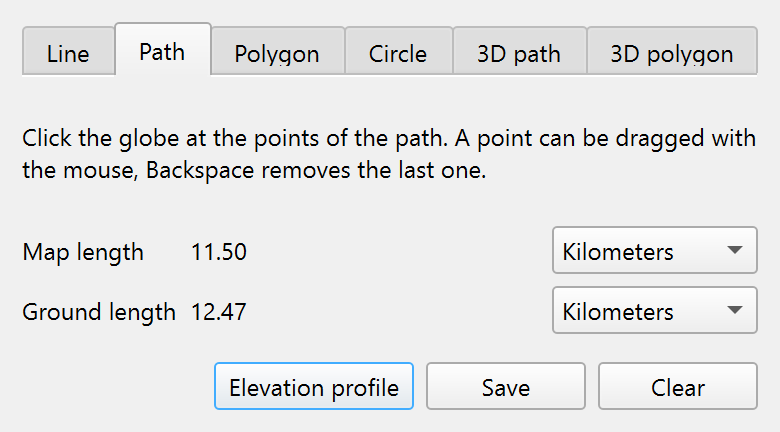

| Tab | Values |
|---|---|
| Line | Map length, ground length, heading. The third click starts a new line |
| Path | Map length, ground length |
| Polygon | Perimeter, area |
| Circle | Radius, perimeter, area. The first click is the center, the second sets the radius |
| 3D path | Length by straight segments in space |
| 3D polygon | Perimeter, area in the plane of the polygon, tilt of the plane |

Map length, perimeter and area are computed on the WGS84 ellipsoid.
Ground length runs along the surface with its rises and falls. Heading
is the azimuth of the start of the line clockwise from north. Each value
has its own units - metres, kilometres, miles, nautical miles, and for
the area square metres, hectares, square kilometres, square miles.

Heights for the ground length come from Mapzen Terrain Tiles. Missing
height tiles along the line are loaded, even when terrain is off. While
they load, the ground length is preceded by «≈».

A ruler point can be grabbed with the mouse and dragged, Backspace
removes the last point. Each segment on the globe is labelled with its
length.

The Save button puts the shape into My Places together with the
measurement. The name is offered with a number, for example Line 1. The
measurement shows in the row tooltip.

The 3D path and 3D polygon tabs put a point on the roof or wall of
a 3D building when the ray from the eye meets it before the
terrain. They keep the height of the point. Segments run straight
between the points and do not follow the terrain. The area of a
3D polygon is measured in its plane, so for a roof slope or a wall
it is the real one. Tilt is the angle of the plane to the horizon,
0 is a flat roof, 90 a wall. A saved 3D shape goes to KML with
altitudeMode absolute.

The Ruler and New placemark windows are open one at a time. Opening one
closes the other.

### Elevation profile

The Elevation profile button of the ruler opens a chart of height along
the line. The Elevation profile item in the menu of
a path in My Places does the same.

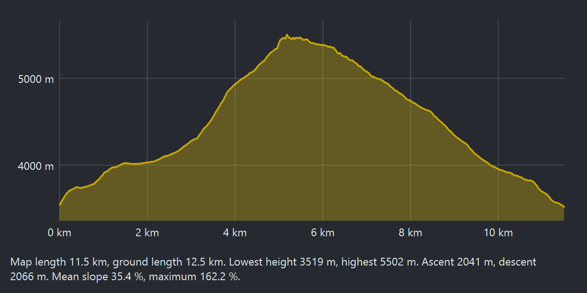

Under the chart are the map and ground length, the lowest and highest
height, ascent and descent, the mean and maximum slope. The cursor over
the chart shows the distance, height and slope at that place, and a
mark with the height shows the point on the globe. The profile of the
ruler follows its points.

Heights are taken as for the ground length. The slope is measured over a
stretch not shorter than three pixels of height data, so roughness of
the data does not pass for a cliff. On steep mountains the maximum slope
may exceed 100 %, that is 45°.

### Viewshed from a point

The Viewshed from here… item of the globe menu opens the Viewshed
from a point window for the point under the cursor. The window sets the observer height
above the terrain, the target height and the circle radius. The Build
button loads the heights under the circle and colours it. Visible places
are green, places hidden by the terrain are red. The Remove button
removes the colouring.

Rays leave the point with an equal azimuth step. The step along a ray
is one five-hundredth of the radius, 20 m for a radius of 10 km. A place
is visible if the ray from the eye to it does not touch the terrain on
the way. The computation takes the curvature of the body into account,
and on the Earth the refraction with the coefficient 0.13. Forest is
not taken into account.
The Include buildings box raises the terrain by the height of the
OpenFreeMap 3D buildings and of own buildings - extruded My Places
polygons, extruded project layers and placed 3D models. Buildings block
the view and cast shadows, the height of some OpenFreeMap buildings is
nominal, about 5 m. A building narrower than the computation step may be
missed, so streets need a small radius. The result line gives the number
of included buildings and own ones among them. A circle wider than 300
building tiles is computed without OpenFreeMap buildings. The window shows the visible
share of the circle area. If the heights are not loaded within 30 s,
the computation uses less detailed ones, and the window says so. The
viewshed is computed on the Earth, Mars and the Moon.

### Insolation

The Insolation here… item of the globe menu opens the Insolation
window for the point under the cursor. The window sets the first and the last day of the
period and the circle radius. The Build button loads the heights and
colours the circle by the mean number of hours of direct sunlight per
day. Blue means little light, red means much light. The scale in the
bottom left corner of the view runs from zero to the largest value in
the circle. The Remove button removes the colouring.

The position of the Sun is computed every 10 minutes of the UTC day. A
place is lit if the Sun is above the mountain horizon at its azimuth
and falls on the front side of the slope. The horizon is taken in 32
directions at a distance of at least the radius and at least 5 km. A
period longer than 15 days is computed over 15 evenly spaced days.
Clouds, refraction and forest are not taken into account. Buildings
are included by the same Include buildings box as in the viewshed, they
are taken 1 km beyond the circle too.
The height grid has 800 nodes per side, the step is 25 m for a radius
of 5 km. The computation runs in parts, and the globe responds to the
mouse meanwhile. The line under the fields shows the share done.
Insolation is computed only for the Earth.

---

## Subsurface mode

The Subsurface mode… button of the View properties window and the …
button of the Ground above grids row of the Layers section open the
Subsurface mode window. The mode shows drill holes, bed roofs, section walls and a block
cut under the surface.

### Data

The data are tables in the same layout as in Isoliner.

| Table | Fields | What it sets |
|---|---|---|
| collar | hole_id, z, eoh, point geometry | Hole collar, collar elevation, end-of-hole depth along the hole |
| interval | hole_id, from, to, code | Intervals along the hole, positive downward, code is the bed or lithology |
| survey | hole_id, depth, azimuth, dip or zenith | Survey. Without it the hole is vertical |
| beds | code, ord, color, surface | Order of beds from top to bottom, colour "#rrggbb", roof raster file |
| sections | line geometry | Section lines |
| cut | polygon geometry | Block cut |
| images | name, image, top, bottom, line geometry | Image section: a PNG or JPG file relative to the folder of the GeoPackage file, elevations of the top and bottom of the image in metres |
| tunnels | name, depth, depth_end, diameter, color, line geometry | Tunnel: depth of the axis below the surface at the start and the end of the line, diameter in metres, colour "#rrggbb" |

Fields are also found by other common names, for example bhid, elev,
td, from_m, to_m, litho. A dip angle with negative values is counted
from the horizontal, -90 is straight down. A bed roof is a raster of
elevations in metres in any coordinate system, GDAL reads it.

Geological project layers show in 3D as ordinary globe layers. A
layer is recognised by a table name from the list above or by its
fields, for example a point layer with the fields hole_id and eoh is
collars. A layer checked in QGIS project goes under the surface, an
unchecked box removes it. Such layers are not drawn as a flat image on
the surface. A roof is a raster whose file is named in the surface
field of the beds table. The interval, survey and beds tables are
taken from the project by themselves, first from the same layer group.

The path to a section image is relative to the folder of the file of
its layer. When the project has several layers of one role, the top one
in the layer tree is taken.

The style comes from QGIS, as with ordinary layers:
- a roof whose raster is coloured with a pseudocolour ramp, a palette
  or RGB takes this colouring. A grey raster without settings takes
  the bed colour from the beds table.
- a hole without intervals and a tunnel take the colour of the feature
  symbol when the layer style is categorized, graduated or rule-based.
  With a single symbol the colour comes from the color field, without
  it the mode uses its own colour.
- the opacity of a QGIS layer is the opacity of its objects under the
  surface.
- the labels above the collars are the labels of the QGIS collar layer,
  from a field or an expression. With the layer labels off there are
  no labels.

After the style or data of a layer is edited, the globe rebuilds the
model as with ordinary layers. The Create template… button of the
Subsurface mode window writes a GeoPackage file with all tables of the
mode and an example at the view point - a drill hole with two intervals,
a section, a tunnel and a cut - and adds it to the project as the
Subsurface template group. The template tables are filled with your own
data.

### Grids by elevations

A project raster whose values are absolute elevations in metres lies
under the ground as a surface. For this the Surface by elevations item
is checked in the raster menu of the QGIS project section. The layer
box shows and hides the surface. The raster coordinate system comes
from the QGIS layer, so an ASCII Grid without a .prj file also fits.

The surface colour is the QGIS raster colouring. A grey raster without
settings takes the bed colour. Grids whose names end with _top and
_bottom, for example B_top and B_bottom, are the top and the base of
one bed. They take one colour, end walls stand between them along the
data edge, and the bed looks like a slab. The endings roof, base and
their Russian words also fit.

Contour lines lie on a grid surface, about 12 lines over the range of
elevations, with an interval from the same series as the terrain
contours. Every fifth line is thicker and darker.

A vector layer with Z elevations - polygons or lines - stands as a solid
with the Solid by Z elevations item of its menu in the QGIS project
group. Polygons lie as planes at the elevations of their vertices, lines
as tubes. This way, for example, the 3D fence of an Isoliner3D section
stands - vertical bed polygons along the section line. The colour is the
color field of the form #rrggbb, without it the QGIS layer style. A
click in the Identify mode shows the fields of the object and the
elevation under the cursor. The elevations are stretched by the terrain
scale, as the grids, the Ground above grids slider makes the ground
above them transparent. Where nothing lies under the transparent ground,
a light background shows, from pale blue at the top of the frame to
almost white at the bottom. The background lies only under the frame of
the model, the sky and space around it do not change.

With terrain off, the elevation of a layer with Z is counted from the
surface by default, like the depth of drill holes and beds. So terrain
contours with Z lie on the ground without terrain. The True Z elevations
item of the same menu puts the vertices at their elevations above sea
level, and the contours rise above the flat Earth. With terrain on, the
item changes nothing.

The Contours to the QGIS project… item of the raster menu exports
contours of the raster values as a GeoPackage layer to the PlanetX -
contours group. The interval is the same as on the globe grid, every
fifth line is thicker and labelled.

A block is built under the grids. Walls with beds stand along the data
edge from the terrain to the model bottom, a floor lies at the model
bottom. The walls darken with depth. A wall facing the camera from
outside is not drawn, so the block is seen from inside from any side.
Above the block the ground is transparent by the Ground above grids
slider of the Layers section, outside the data outline it is opaque.
The slider row appears together with the underground model.

Thin beds are easier to see with the vertical terrain scale of the View
properties window. The scale stretches depths too.

### Display

The model is built when at least one geological layer is checked. The
globe loads the terrain heights under the model and puts it under the
surface.

- A drill hole follows the survey by the minimum curvature method.
  Intervals take the colour of their bed, the layer label stands
  above the collar.
- A bed roof is a surface in the colour of the bed.
- A tunnel is a tube of its diameter along the line below the
  terrain. The depth changes from depth at the start of the line
  to depth_end at its end, this sets a ramp to a portal. Without
  depth_end the depth is constant, without diameter it is 3.7 m.
- A section is a set of walls along the line from the terrain to the
  model bottom, beds between the roofs have their own colours.
- An image section is a vertical wall along the line from the top
  elevation to the bottom elevation with the image stretched on it.
  The left edge of the image is the start of the line, its top is the
  top elevation. An image larger than 4096 pixels on the longer side
  is scaled down.
- The model bottom is the end of the deepest hole, without holes it
  is 20 m below the deepest roof.

Depth is stretched by the terrain scale, like the surface. With the
terrain off, elevations are counted from the surface.

The Surface opacity slider makes the terrain inside the model frame
transparent, the drill holes and roofs show through it. Outside the
frame the surface stays opaque, with grids - outside their data
outline. The Block cut checkbox removes the
surface and the roofs inside the cut polygon. Walls with beds stand
along the cut edge, a plane at the model bottom lies at its floor. The
Camera under ground checkbox lets the camera go below the terrain down
to the model bottom. Inside the model frame the camera then moves along
its bottom. The window settings are kept in the project.

A polygon of My Places cuts the model with the Model cut item of
its menu, a path puts a wall with beds with the Model section wall
item. Choosing the item again removes the cut or the wall. Editing
the shape of the place changes the model at once. So a cut and a
section are drawn on the globe with the New placemark tool.

The Beds legend in the bottom left corner of the view shows the beds
of the model from top to bottom in their colours and the tunnels.

In the Identify mode a click on a drill hole shows its number, the
bed, the depth along the hole and below the collar, the elevation
and the end of hole at the point under the cursor. A click on a
tunnel shows its name, the depth and elevation of the axis and the
diameter.

The Model section… item of the path menu in My Places opens the window
of the same name. The horizontal axis is the distance along the path,
the vertical axis is the elevation in metres. The section shows the
terrain, the beds between the roofs, the drill holes in the colours of
their intervals and the tunnels at their diameter from a band along the
path. The Band of holes and objects field sets the band width. The
cursor over the chart marks the point on the globe, the caption at the
top of the chart gives the distance, the terrain and the roof elevations
under the cursor.

This is also a geological section by the project layers. The list on
the left of the window gives the project layers with checkboxes:

- Roofs - rasters - any single-band elevation rasters of the project,
  for example grids of bed roofs and bottoms. The Surface by elevations
  item and a subsurface model on the globe are not needed for the
  section. The order of the beds follows the beds table, without it the
  mean elevation of the roof from top to bottom.
- Drill holes - the project collars with intervals and surveys.
- Layers with Z - lines and polygons with Z elevations, for example the
  3D fence of a section from Isoliner3D. Their parts in the band along
  the path go onto the section in their colour - fence walls filled,
  lines as lines.

By default the layers of the subsurface model of the globe are checked,
without it the surfaces by elevations and the layers with the Solid by
Z elevations item, and if there are none, all rasters and layers with Z
of the project. A raster without its own coordinate system takes the
system of the QGIS layer. The bed colours are named in the top right
corner of the chart. The Picture… button writes the section to a PNG
file, CSV table… writes the elevations of the terrain and the roofs at
400 points of the path with latitude and longitude, an empty field where
there is no roof.

A bed between a roof and a bottom (grids ending in _top and _bottom,
roof and bottom) is shown in the bed colour, the gap below a bottom and
above the first roof in the colour of the rock between beds. Each roof
and bottom is outlined with a line in a darker bed colour. The right
button on the chart sets an own colour of the bed, of the rock between
beds or of the line under the cursor, the Default section colours item
removes the own colours. The own colours are kept in the QGIS project
and apply the next time the window opens.

The subsurface demos put their data into the QGIS project as a group of
ordinary layers and check them on the globe. The Permian deposits demo
in the Demo icon opens a synthetic site
near Berezniki, on the Verkhnekamsk deposit. It has 24 drill holes,
9 bed roofs of the Verkhnekamsk
section, two sections, a cut of the north-east quarter and the image
section 3-3. The data are
made up for the example, they are not a survey.

The Vegas Loop tunnels demo opens the tunnels of The Boring Company
under Las Vegas with their stations, about 8 km of lines. The
routes and stations come from OpenStreetMap. OpenStreetMap has no
depth, the tunnel axis is 12 m below the surface, about 40 feet
after public information on the Las Vegas Convention Center
tunnels, and ramps to the stations go from the surface down to
this depth.

---

## Tours

A tour flies over the checked places of a folder in the list order,
including nested folders. At a stop the name and the description of
the place stand large at the bottom of the frame - the stop caption. It
appears when the camera stands at the stop and fades before the next
flight, during a flight there is none. The caption also goes into the
tour recording. The 🔤 button of the tour bar turns the captions off,
then the description stands as a line under the buttons of the bar.

- A place with a view of its own brings back its look point, range,
  heading and tilt.
- Along a path the camera travels the line.
- Other places are framed whole.

A tour starts with Play tour in the menu of My Places or a folder. A path
has Tour along the path in its menu. The ▶ button under the places list
starts a tour too. It tours the selected folder or path, and with a
place selected it tours the folder holding the place. A tour goes
through the places of the body now on the globe. When no places are
checked, the status line says so.

The tour bar appears at the top of the view as a second row under the
time slider, and without the slider in its place:

| Button | What it does |
|---|---|
| Slider | Shows how much of the tour has passed and winds the tour. The camera moves to the chosen point at once, after release the tour goes on from it |
| ⏮, ⏭ | Previous and next stop |
| ⏸, ▶ | Pause and continue |
| Pause | How many seconds the camera stays at a stop |
| 🔁 | Loops the tour. After the last stop the tour starts again from the first. The button state is kept between sessions |
| 🔤 | Stop captions on the frame, on by default |
| ⏺ | Records the tour to an MP4 video or PNG frames |
| ⏹ | Ends the tour |

Moving the camera with the mouse during a flight pauses the tour. During
the pause at a stop the view can be turned with the mouse, the wheel and
the keys while the tour goes on. When the pause ends and the mouse
button is released, the camera flies from the new view to the next stop.

During the tour these keys work when the view has the focus:

| Key | What it does |
|---|---|
| → | Next stop |
| ← | Previous stop |
| Space | Pause and resume |
| Esc | Ends the tour. In Full screen mode the first Esc leaves the mode |

The arrows with Ctrl, Shift or Alt still move the camera.

### Recording a tour from the screen

The record button ⏺ on the icon bar records the camera movement.
The camera can be moved with the mouse,
keys, flights and the navigation controls. A second click ends the
recording and asks for a name. The tour goes into My Places with a film
icon and is not drawn on the globe.

Play tour in the menu of such a tour plays the recording. The camera
first flies to the start of the recording. The slider of the tour bar
and tour recording work as for a tour over places. In KML a
recorded tour is saved as `gx:Tour`, and Google Earth plays it.

The path of a recorded fly-around is edited in the Properties… window
of the tour. While the window is open, the path of the view point is
shown on the globe as a line with twenty key points. A key point is
dragged with the mouse, the poses between key points follow it
smoothly. The Fly-around height slider lowers the camera in all poses
down to a quarter of the recorded height or raises it up to four
heights. Time, heading and tilt of the poses do not change. OK saves
the edit, Cancel discards it.

### How to make a video

1. Put the stop places into one folder of My Places. Snapshot view
   in the menu of a place sets its view.
2. Check the places you need and drag them into the flight order.
3. Switch on the layers of the video - a NASA theme, the sun, clouds
   or the time slider at the day you need.
4. Play tour in the folder menu plays the tour. The pause at a stop
   is set on the tour bar.
5. The ⏺ button of the tour bar opens the Tour recording window. The
   MP4 video at the window size mode gives the video at once. The
   video size equals the size of the globe window, so stretch the
   window beforehand.

Instead of places, the ⏺ button on the icon bar can record the camera
movement, see Recording a tour from the screen. A tour along a My
Places path leads the camera along the line.

### Recording a tour for a video

The ⏺ button opens the Tour recording window with two modes. Both
write 25 frames per second of the tour, the source credits stand in
the corner of each frame.

- MP4 video at the window size is the quick mode. The window asks for
  a file name, at the end of recording an H.264 clip is ready.
  Windows itself encodes it, no other programs are needed. The mode
  exists only on Windows. A tour of two stops, 71 frames of 2592 ×
  1860, is written in about 45 s and takes 10 MB.
- PNG frames to a folder is the professional mode. The window asks
  for a folder and a size - as the window, 1920 × 1080, 2560 × 1440 or
  3840 × 2160. A frame larger than the window is drawn anew at this
  size, labels and lines grow in the same proportion. The files are
  named `frame_00000.png`, `frame_00001.png` and on, frames with the
  same numbers in the folder are replaced.

Each frame waits for the tiles, so recording takes longer than the tour
and the frames have no blurred spots. A frame that waits longer than 20
seconds is taken as it is. Recording always starts at the first stop, so
a repeated recording gives the same frames.

A file `frames.json` lies next to the PNG frames - frame rate, size, camera
pose and data time of each frame, numbers of frames that did not fully
load.

The bar shows the frame number. The cross on the bar stops the
recording. A stopped video stays a valid file of the frames already
written.

### Making a video from the frames

Any program that opens an image sequence assembles a video from the
PNG frames.

The free program ffmpeg (ffmpeg.org) makes an MP4 with one command in
the folder with the frames:

```
ffmpeg -framerate 25 -i frame_%05d.png -vf "pad=ceil(iw/2)*2:ceil(ih/2)*2" -c:v libx264 -pix_fmt yuv420p -crf 18 tour.mp4
```

The rate 25 matches the recording rate, so the video runs at the pace
of the tour. The `pad` filter adds a pixel when a frame side is odd, the
H.264 codec needs even sides. A smaller `-crf` value gives better
quality and a larger file.

The video editors Shotcut and DaVinci Resolve open numbered frames as
one clip. Music, captions and several tours joined together can be
added there.

---

## Tracks

A track shows the path of moving objects over time. The source is a
point layer of the project with a time field, and the time slider of
the globe sets the time. The QGIS Temporal Controller does not act on
the globe.

The Track… item in the menu of a point layer opens the settings window:

| Field | What it sets |
|---|---|
| Time | A field with date and time, ISO 8601 text or seconds since 1970 |
| Object | A field that tells the objects apart. One object - all points form one path |
| Color | Color of the travelled path |
| Camera follows | The camera keeps the first object in the middle of the view along the motion |
| 3D model | A glTF, Collada or OBJ model file. An empty field shows the object as a placemark |
| Model scale | The size factor of the model, 1 - the size from the file in metres |
| Model turn | The clockwise turn of the model to the direction of travel |
| Height | Where the height of a point comes from: the point Z or a numeric field. On the ground - the object stands on the terrain |
| Height reference | Above sea level - the flight altitude, above the ground - the rise over the terrain under the point |
| Height units | Metres or feet. ADS-B aircraft altitude is given in feet |

With a model file every object of the track gets its own model moving
along the path. Its front faces the direction of travel. The direction
is taken along the track path over the last 30 s. A glTF model facing
the viewer gets a turn of 180°. A model with node animation moves
along and moves its parts.

A track is shown while its layer is checked in the QGIS project
section. The Track window checks the layer itself, an unchecked layer
removes the path, the objects and the models from the globe.

The Camera follows item of the right-click menu over a track object
makes the camera follow this object rather than the first one. The
object stays in the middle of the view along the motion. The mouse
wheel changes the distance to the object, the right button with a drag
the tilt. Esc or the unchecked menu item releases the camera. So in the
Haul trucks, Kachkanar demo one can ride with a truck from the pit
bottom to the dump.

With a height the object and the model rise above the ground. Between
points the height changes evenly in time. A path with the height above
sea level is drawn in the air at the heights of its points, a path with
the height above the ground lies on the terrain. A track of an aircraft
by GPS or ADS-B points shows the take-off and the landing this way.

The time of a track enters the extent of the time slider. Each object
grows its travelled path up to the right handle of the slider, and a
label with its name marks the current point. With the slider closed,
whole tracks are shown. The Remove track button returns the layer to
its usual look. Track settings are stored in the project.

During a tour recording the tracks grow along the tour over the range
of the open slider, with the slider closed over the whole track time.

---

## Trains of Finland

The Trains of Finland row of the Transport category of the Add data
catalogue shows all trains of Finland in real time. The train
positions are Fintraffic Digitraffic open data under the CC BY 4.0
licence. The service updates them every 10 s, and the plugin asks at
the same step. It asks for the type and category of the trains every
5 minutes.

From afar a train is a dot in the colour of its category with a label,
for example "IC 9", or "R 9123" for a commuter train of line R. When
the view strip is narrower than 6 km, a train is shown as a consist of
schematic cars in the colour of its category. A long-distance train
has 6 cars, a commuter train 4, a cargo train 12, a locomotive one.
The service gives the real length of a consist with a separate
request, and the plugin does not ask for it.

| Colour | Category |
|---|---|
| red | Long-distance |
| purple | Commuter |
| blue | Cargo |
| orange | Locomotives |
| grey | Shunting |
| yellow | On-track machines |

A train whose type the service has not given yet is light grey.

Between updates a train moves at its own speed for no longer than 30 s.
When the view strip is narrower than 8 km, the plugin takes the rails
from the OpenStreetMap vector base map tiles at the point of view. A
train point closer than 40 m to the rails is set on them. The train
moves along the rails and through switches, and the cars of the consist
bend along the track. The train takes a new position smoothly over 2 s.

A click on a train opens the Features window with the type, category,
line, operator, number, speed and time of the position. The Camera
follows item of the right-click menu over a train puts it in the
middle of the view with the heading along its travel. The camera starts
1.5 km from the train, the wheel moves it closer and farther, the middle
mouse button changes the tilt. Esc, clearing the item, turning the row
off or recording a flight releases the camera.

While a flight is recorded the trains move by the tour time, a frame of
the video is 1/25 s of their travel even when the frame with loading
took several seconds. The start is the computer clock at the moment of
the recording, and new positions are not requested during it. After
the recording the trains follow the computer clock again. The Trains of
Finland, live demo puts the camera above the tracks at Pasila station
in Helsinki.

---

## Baltic ships and aircraft

The Baltic ships and Aircraft rows of the Transport category of the
Add data catalogue show ships and aircraft in real time. From afar an
object is a dot in the colour of its group with a label, no more than
600 nearest to the point of view are shown. Close up an object is a
schematic model that keeps its course and speed between updates. A
click opens the Features window with details. A flight recording moves
ships and aircraft by the tour time, like trains.

Close up an object keeps its dot with the label while it is farther
than 150 of its lengths from the eye - the model is smaller than about
10 pixels there. An aircraft 40 m long is shown as a dot farther than
6 km, a ship 100 m long farther than 15 km. The dot of an aircraft is at
its altitude.

The Camera follows item of the right-click menu over a ship or an
aircraft, as for a train, keeps the object in the middle of the view
with the heading along its course. The aircraft lies on the view ray at
its altitude, the point of view is the ray continued to the ground
ahead. The wheel changes the distance to the aircraft, the middle
button the tilt. Under the follow camera the object is shown as a model
at any distance.

Ships are AIS signals of the Gulfs of Finland and Bothnia and the
Baltic near Finland, Fintraffic Digitraffic open data under the CC BY
4.0 licence. The positions come every 20 s, the names, types and sizes
every 10 minutes. The ship model close up (view strip narrower than
20 km) is a hull of its AIS length and width with a superstructure at
the stern, at the water level. The colour shows the type group - passenger,
cargo, tankers, fishing, tugs and service, high-speed, yachts and boats.

Aircraft are ADS-B signals of the adsb.lol volunteer network in a circle
around the point of view, every 10 s. An aircraft in the air is shown at
its altitude, on the ground on the terrain. Between updates a turning
aircraft follows an arc, its turn rate comes from ADS-B or from the
difference of the courses of two positions. The model nose rises with
the vertical speed, the bank comes from ADS-B, without it from the turn
rate. The model close up (view
strip narrower than 15 km) is a schematic aircraft of the size of its
ADS-B category with its bank. The fin colour shows the category - light,
small, airliners and freighters, heavy, helicopters. The network has
almost no receivers over Russia, and no aircraft are seen there. The
licence of the adsb.lol output is not named as of 19 October 2026.

---

## Flight mode

The Fly from here submenu of the right-click menu on the globe puts
your own aircraft 1000 m above the clicked point - a fighter jet or a
propeller aircraft. The aircraft flies along the view heading, and the
camera follows it from behind and above. The flight works above the Earth
and above the other bodies of the Body menu.

| Aircraft | Start speed | Top speed | Stall |
|---|---|---|---|
| Fighter jet | 900 km/h | about 2000 km/h | 250 km/h |
| Propeller aircraft | 250 km/h | about 340 km/h | 100 km/h |

| Key | Action |
|---|---|
| up arrow | nose down |
| down arrow | nose up |
| left and right arrows | bank and turn to the same side |
| PageUp, PageDown | more and less thrust |
| V | cockpit view and back |
| H | cockpit instruments or the readout |
| Esc | end of the flight |

Without keys the bank returns to zero by itself, the pitch stays. The
fighter jet banks twice as fast as the propeller aircraft. Below the stall
speed the nose drops by itself. At the bottom of the view a readout
shows the speed, the altitude above sea level and above the ground, the
heading, the vertical speed and the thrust. The wheel changes the
distance from the camera to the aircraft, the middle mouse button the
view tilt. From the cockpit the model is not shown, the view looks
along the heading with the aircraft pitch, and the frame tilts with the
bank. In level flight the horizon is in the middle of the frame, with the
sky above it. In the cockpit green instruments on the windscreen replace
the readout. These are the pitch ladder with the horizon line turned by
the bank, the aircraft symbol in the middle, the heading tape at the
top, the speed tape in km/h on the left and the altitude tape above sea
level in metres on the right. Below them are the vertical speed, the
thrust and the height above the ground. The horizon line of the ladder
matches the horizon in the frame.

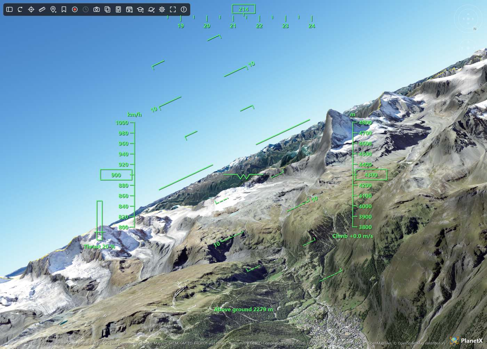
Touching the ground ends the flight. A flight recording also
ends it - the recording drives the camera.

---

## Project layers with time

A project layer with time switched on in its QGIS temporal properties
is shown on the globe within the range of the time slider. The time of
the layer enters the extent of the slider. The picture of the layer
and its labels are redrawn after the handles stop. With the slider
closed, the layer is shown in full.

---

## Historical maps

A historical map is a raster, XYZ tiles or a ground image with a year. Maps
of one group replace each other on the time slider. The last map not
later than the slider moment is shown, before the year of the first
map of the group none is shown. The ◂ ▸ steps of the slider go by the
map years. With the slider closed, all maps are shown.

The Map year… item of the layer menu in the QGIS project section
sets the year of a project raster or tiles. Maps of one QGIS layer
group replace each other. The years are kept in the project.

The year of a ground image is the Time field of its properties
window, for example «1890». Maps of one My places folder replace each
other. In KML the map year is a `TimeStamp` of a `GroundOverlay`. An
image with a span, for example «1890/1910», is shown within its span,
like a place.

The ⇆ button of the slider opens the swipe of two years. Left of the
swipe is the map of the previous map year, right of it is the map of
the slider moment. The swipe is dragged with the mouse, the arrows on
the left label change its year. A step before the first map leaves
the imagery without maps on the left.

The Moscow, historical maps demo puts maps of Moscow of 1813, 1860, 1900,
1917 and 1935 from Wikimedia Commons into the project. The maps are in
the public domain, members of the Wikimaps Warper project
georeferenced them, the tiles come from its server.

The Rumsey historical maps here… item of the globe menu opens the
Rumsey maps window - maps of the David Rumsey collection at the view.
The collection holds about 57 thousand georeferenced maps from the 13th
to the 21st century. The list goes by year, a click on a column header
sorts by title or scale. The list holds 400 maps closest to the place
by extent. The search line picks maps by year or title, the Whole
catalogue check box searches among all maps of the collection. Frames
of the listed maps are shown on the globe, the frame of the chosen map
is brighter, the Show on the globe button flies to it. The To QGIS
project button builds the chosen map from the collection image and
georeferences it by the collection control points. The map goes into
the Rumsey maps group at the top of the project with the map year and
takes its place on the time slider, with maps changing by year and the
swipe of two years. Building takes 5-15 s, a ready map is kept in the
QGIS profile and is not downloaded again. The Map page button opens
the page of the map on the collection site.

The collection images are published under CC BY-NC-SA 3.0, it allows
only non-commercial use with credit to the source. The georeferencing was done by members of
the collection, for some maps it is rough or wrong.

The Eto Mesto old maps here… item of the globe menu opens the catalogue
of the Eto Mesto site (etomesto.com) - georeferenced old maps of Russia
and the former USSR - city plans, survey atlases, the Schubert and
Strelbitsky maps, Red Army maps, wartime aerial photos. The window shows
the year and title of the maps that cover the point, near Perm there
are more than two hundred. The search line picks maps by words of the
title or by year. A double click or the Open on the site button opens
the map page in the browser at this point. There the map is overlaid on
a modern one and downloaded under the site rules, the site gives the
files for personal non-commercial use. The plugin does not show the
maps themselves on the globe. The catalogue has no map frames, so the
globe shows none either.

---

## Satellites

The Satellites layer of the Add data catalogue shows artificial
satellites of the Earth as dots at their height. The Satellites tab
of the catalogue chooses the groups, any of them can be on:

| Group | What it holds |
|---|---|
| Space stations | the ISS, Tiangong and the docked spacecraft |
| Bright satellites | about a hundred satellites and stages visible without binoculars |
| Navigation | GPS, GLONASS, Galileo, BeiDou |
| Weather satellites | weather satellites |
| Earth observation | imaging satellites, Landsat and Sentinel among them |
| Science | science satellites and observatories |
| Geostationary | active satellites at about 36 000 km |
| Starlink, OneWeb | communication satellites, thousands of dots |

CelesTrak gives the orbital elements of the groups. The position is
calculated by the SGP4 model for the right handle of the time slider.
With the slider closed, the satellites follow the computer clock. A
satellite whose elements are older than 30 days at that moment is not
shown.

CelesTrak updates the elements once in 2 hours and asks to download a
group no more often. A downloaded group is kept in the QGIS profile,
and a new request goes no earlier than 2 hours later. After a refusal
of CelesTrak the group is not requested for 2 hours.

A click on a satellite dot with identification on opens the Identify
window with the name, the NORAD number, the group, the height, the
speed and the age of the elements. The satellite becomes the selected
one.

The selected satellite shows its orbit loop at its height and its
ground track. The loop shows one revolution ahead of the moment, the
track shows the path of the point under the satellite half a
revolution back and ahead. A right click on a satellite dot opens a
menu with its name and two items:

- Orbit and ground track shows or removes the loop and the track.
- Camera follows puts the look point under the satellite, the view
  turned along its motion. The distance and the tilt of the view
  change with the wheel and the mouse as usual. Choosing the item
  again releases the camera.

---

## Scenes

A scene saves the whole view and can be passed to other people. The
Scene icon opens the menu Save Scene… and Open Scene…. A scene file has
the extension `.planetx`.

A scene holds:

- the camera pose.
- the range of the open time slider.
- the project layers checked on the globe, as a link to their source.
- the base map, terrain, terrain exaggeration, groups of the Layers
  section and the label language.
- the rows of the Layers section, the grid, stars, clouds,
  temperature and 3D buildings.
- the selected folder of My Places with its tour. The overlay images
  and 3D model files of the folder are stored in the scene file with
  it.

A database password does not go into the file, a link to a QGIS
connection setting stays. When the whole My Places folder or nothing is
selected, no places go into the scene.

When a scene opens, a layer is looked up in the project by its source
and added if missing. The other project layers are unchecked on the
globe. The places of the scene come in as a new folder, and the camera
flies to the scene pose. The status line lists the layers that were not
found and did not open.

### Share view

The Share View… item of the Scene icon menu writes an HTML page. It
opens in a browser without QGIS and PlanetX, it can be sent as a file
or published on a site. After writing the page opens in the system
browser.

The page holds:

- the globe with the camera of this view - the look-at point,
  distance, heading and tilt.
- the OpenStreetMap base in the OpenFreeMap style and Terrarium
  terrain with the terrain exaggeration of the view. Without terrain on
  the globe the page has no terrain either.
- the placemarks, paths and polygons selected in My Places, with
  their colours and labels. A click on a placemark shows its name and
  description.
- the Initial view button and the ▶ Tour button. The tour is the
  recorded tour from the selection. Without it the camera flies to the
  views of the placemarks in turn, to a point without its own view -
  from above at 3 km with a tilt of 45°.

The Esri base map, QGIS project layers, overlay pictures, placemark
times and rows of the Layers section do not go to the page. The camera
tilt on the page is not more than 85°. The page is built for the Earth
only. The globe of the page is drawn by the MapLibre GL JS library,
the browser loads it from unpkg.com, the tiles from the OpenFreeMap and
Amazon servers. Without internet access the page is empty.


### Demo

The Demo icon with an academic cap on the icon bar opens prepared scenes.
Each scene puts its places into My Places as a new folder, the ▶ button
under the list plays a tour over them. The folder can be deleted.

The files of the Quarry, own terrain, Lake Brienz, own bathymetry and
3D models, Suzdal and Perm demos are not part of the plugin. On the
first opening the demo downloads them from GitHub into the PlanetX
folder of the QGIS profile, from 0.8 to 3.5 MB. The status line tells
about the download, then the scene opens by itself. Later the files are
taken from the profile without the network.

| Section | Scene | What it holds |
|---|---|---|
| Placemarks and tours | Boca Chica, Starbase | The Starbase launch site and factory, the beach, nearby towns, the highway from Brownsville, a recorded flight around the launch site |
| Placemarks and tours | Flow of goods, a scheme | Paths with flow from Berezniki to the ports of Ust-Luga and Vostochny by rail and from Ust-Luga to Rotterdam by sea. The paths are schemes through large cities and straits, not real routes |
| Imagery and maps | Aral Sea | MODIS images of 2000, 2014 and 2023 as a group of radio buttons, a photo of the ships at Moynaq and a basin map on the screen. All images are links to web addresses, see [Image overlays](#image-overlays) |
| Imagery and maps | Super-overlay, Mountain View | Mountain View imagery in tiles of the Google sample - a network link onRegion, detailed tiles arrive when zooming in. See [Super-overlays](#super-overlays) |
| Imagery and maps | Moscow, historical maps | Maps of Moscow of 1813, 1860, 1900, 1917 and 1935 as tiles in the QGIS project with map years, the Kremlin and the Cathedral of Christ the Saviour. See [Historical maps](#historical-maps) |
| Subsurface | Japan Trench | Earthquakes, the Earth cutaway with a sector from the equator to 38.5° N, the Slab2 slab under Japan, the epicentre of the 2011 Tohoku earthquake, Mount Fuji. The Section window along 38.5° N opens with the demo, the foci band is 300 km |
| Subsurface | Permian deposits | A synthetic site near Berezniki with drill holes, roofs, sections and a cut. A tour of five stops explains the subsurface mode, see [Subsurface mode](#subsurface-mode) |
| Subsurface | Vegas Loop tunnels | The Boring Company tunnels under Las Vegas with their stations, see [Subsurface mode](#subsurface-mode) |
| Own terrain | Quarry, own terrain | A synthetic 1 m survey of a quarry near Berezniki as the globe terrain: 10 benches of 15 m, a waste dump, a path for the elevation profile. The raster goes into the QGIS project, see [Own terrain](#own-terrain) |
| 3D models and motion | 3D models, Suzdal and Perm | Models of the Church of the Conception in Suzdal and of the Church of the Intercession of the Theotokos in Perm from Google Earth Pro, licence CC BY 4.0. See [3D models](#3d-models) |
| 3D models and motion | Animated model, wind turbines | Three glTF wind turbines with a rotating rotor at an arbitrary place near Perm. The model is synthetic, the rotor is a node with rotation keys. See [3D models](#3d-models) |
| 3D models and motion | Trains of Finland, live | Live trains of Finland as consists on the rails at the Pasila, Helsinki and Tikkurila stations. See [Trains of Finland](#trains-of-finland) |
| Haul trucks in open pits | Haul trucks, Kachkanar and Haul trucks, Lebedinsky | Six model haul trucks in the Main pit of Kachkanar or in the Lebedinsky pit near Gubkin: loading, the loaded haul, dumping, the empty return. The route is a pit road traced on Esri World Imagery: in Kachkanar from the face at the bottom along the east wall, in the Lebedinsky pit along the switchbacks from the face with an excavator. The trucks are KML tracks with a 3D model (`gx:Track` with `Model`) in My Places, with no project layer, the time slider plays ×10 in a loop, the right-click menu over a truck has Camera follows. The "…, QGIS layer" items show the same haul as a track of a project point layer, as with own data through Track…. The trucks and their motion are a model, not data of the mine. See [Tracks](#tracks) |
| Mars | Rover landing sites | Olympus Mons, Valles Marineris, the landing sites of Curiosity, Perseverance, Zhurong, Spirit and Opportunity |
| Mars | Jezero crater | The Perseverance landing site, the surroundings of the crater, an elevation profile across the crater, a point on the rim for the viewshed, a flight around the crater, the Slope layer and terrain with scale 3 |
| Moon | Apollo and Lunokhod sites | The landing sites of six Apollo missions, Lunokhod 1 and Lunokhod 2 |
| Sky | Constellations and bright sky objects | Orion, the Pleiades, the Andromeda Galaxy (M31), Cassiopeia, Ursa Major, Lyra with Vega, the Southern Cross |

Landing coordinates are rounded to hundredths of a degree.

---

## View snapshot and view to layout

### View snapshot

The View snapshot icon opens a window with the snapshot width and height
in pixels. A snapshot can be larger than the window, the globe loads
detailed tiles for it. The Window proportions check box keeps the height
in step with the width.

The Save… button asks for a PNG or JPEG file and starts the snapshot.
The camera stands still meanwhile. The Take now button does not wait
for the remaining tiles. The source credits stand in the bottom right
corner of the snapshot.

The Copy view icon next to it puts the view of the window on the
clipboard with one click, it can be pasted into a letter, a chat or a
document at once. The copy has the globe, the layer scales, the labels,
the source credits and the PlanetX mark. The icon bar, the navigation
controls, the time slider and the tour bar are not in it, on the
screen they stay. The size of the copy is the size of the view in
screen pixels. The Copy the view to the clipboard action of the Search
field does the same.

### View to layout

The View to layout icon puts the view as a fixed picture into a QGIS
layout, an existing one or a new one.

| Field | What it sets |
|---|---|
| Layout | An existing layout or New layout |
| Width, Height | Size of the picture on the page in millimetres |
| Resolution | Output resolution of the layout, it sets the snapshot size in pixels |

The picture is kept inside the project. The layout window opens after
the insertion.

---

## Other bodies

The Body icon on the icon bar opens the menu of bodies. The Earth is
at the top, the Moon and Mars are below a separator, then come
submenus:

| Submenu | Bodies |
|---|---|
| Planets | Mercury, Venus, Jupiter |
| Moons of Jupiter | Io, Europa, Ganymede, Callisto |
| Moons of Saturn | Mimas, Enceladus, Tethys, Dione, Rhea, Titan, Iapetus |
| Asteroids | Ceres, Vesta |

The menu holds only bodies imaged by spacecraft in full. On Pluto,
Charon and Triton 24 to 33 % of the globe is not imaged, they are not
in the menu.

The chosen body replaces the Earth. The size of the globe, the imagery
and the atmosphere change, and the camera flies to the start point of
the body. On Mars it is Olympus Mons, on the Moon it is the Sea of
Tranquility, the Apollo 11 landing site, on Mercury the Caloris basin,
on Venus Maxwell Montes. On other bodies it is a point on the equator
and the prime meridian.

Imagery of the bodies other than Mars and the Moon comes from global
mosaics of USGS Astrogeology and NASA, made from MESSENGER, Magellan,
Galileo, Voyager, Cassini and Dawn data. A tile pixel at
the equator ranges from 100 m on Enceladus and Vesta to 120 km on
Jupiter. Some imagery does not look as the eye would see it:

- Venus is shown by the Magellan radar, the colour shows the height
- Jupiter is a Cassini cloud map of December 2000, its clouds do not
  move
- Titan is imaged in near infrared light through the haze
- Mercury, Io and Ganymede are in colour, other bodies are grey

The globe of each body is a sphere, Jupiter is an oblate ellipsoid.
Vesta, Ceres and small moons are not spherical in reality, their
imagery is slightly distorted on the sphere.

Mars imagery is the Viking MDIM2.1 colour mosaic, about 650 m per
pixel. Moon imagery is the LOLA albedo map with hill shading, about
670 m per pixel. Mars has a thin, dusty atmosphere, the Moon has none.

Mars terrain is built from the MOLA MEGDR heights, Moon terrain from
the LOLA GDR heights. Heights are rounded to 10 m on Mars and to 20 m
on the Moon. A height pixel at the equator is 2.6 km on Mars and
1.3 km on the Moon. The terrain is switched on with the same Terrain
row of the Layers section, the vertical scale is set in the view
properties. Mars heights refer to the areoid, Moon heights refer to
a sphere of radius 1737.4 km. Depressions below zero are kept, the
floor of the Hellas plain lies 7-8 km below zero.

On other bodies the navigation, grid, stars, ruler, My Places, tours,
view snapshot and scenes work, on Mars and the Moon terrain works too.
Functions with Earth-only data are off:

- vector base, clouds, temperature, 3D buildings and sunlight
- project layers and their labels, tracks
- synchronization with the QGIS map and feature identification
- place search by name. Coordinates in the search field work

Each place remembers its body. My Places lists the places of all
bodies, the globe shows only the places of the current one. A flight
to a place on another body switches the body first. A tour goes
through the stops of the current body. A scene keeps its body and
opens on it.

## Assistant

The assistant answers topics and requests from the Search field. Its
buttons stand in the Assistant group of the View properties window.
Conversation… opens the Assistant window, Settings… the Assistant
settings window. The conversation window with an AI model is Assistant. The model controls the globe on a request in words, for
example "show a section across the Japan Trench" or "where are the
deepest earthquakes near Japan this month". An API key of your own for
the chosen service is needed.

The conversation goes in the Assistant window. The line at the top
names the service and the model, the Settings button opens the
Assistant settings window. There the service, address and model are
chosen, the key is entered and the check boxes are set. By default
OpenRouter with a free model is chosen.

- **Service.** Each service has its own key, address and model.
  - Claude (Anthropic) - Claude models, by default
    `claude-sonnet-5-5`.
  - Grok (xAI) - Grok models, by default `grok-4.7`.
  - DeepSeek - DeepSeek models, by default `deepseek-flash`.
  - OpenRouter (free models available) - models of many developers
    with one key. Models with `:free` in the name are free, the number
    of requests per day is limited. By default `openrouter/free`, it
    picks a free model that is available itself. If the chosen `:free`
    model is busy, the request goes to `openrouter/free`.
  - Own service, for example Ollama - any service of the OpenAI Chat
    format. A service on this computer needs no key. By default the
    Ollama address `http://localhost:11434/v1` and the model `qwen3`.
  The model must be able to call tools, otherwise the assistant only
  answers with text.
- **Key.** The key is entered in the Key field of the Assistant
  settings window and saved with the Save key button. The Keep the key
  without the master password box is checked by default. With it the
  key is saved as plain text in the QGIS profile settings, the master
  password is not asked. Anyone with access to the profile folder can
  read such a key. Without the box the key goes to the QGIS password
  manager, and QGIS may ask for the master password.
- **What the assistant does.** Flight to a point and place search, body
  change, rows of the Layers section and the time slider, the Earth
  cutaway and a section down along points, point information and an
  earthquake summary in a box. All actions of the Search field are
  available to the assistant as well - catalog layers and maps,
  windows and tools, demos and bodies. It also changes the opacity of
  a shown layer. The assistant does not open file choice windows and
  does not start tour recording, the user opens them.
- **Placemarks in KML.** The assistant proposes placemarks, paths,
  polygons, folders and tours as a KML document. Below the conversation
  a proposal appears with the Write to My Places and Cancel buttons.
  Nothing is written without the button. Placemarks selected in My
  Places can be read by the assistant as KML and returned corrected.
- **What goes to the model server.** The request text, the look-at
  point, the body and the rows switched on in the Layers section. Names
  of project layers and My Places do not go, except placemarks selected
  by the user.

The assistant's actions show in the conversation as Action lines. It
makes no more than six rounds of actions in a row, then it stops.

### Places from a description

A topic in the Search field, for example "voyages of Columbus" or
"battles of the Hundred Years' War", becomes placemarks if no place
with that name is found. Ctrl+Enter in the field and the Make places
button of the Assistant window make placemarks at once, without a
place search. The model
answers with one KML document, it is written to My Places as a new
folder at once, the camera flies to the places.

The model receives the rules of the document. They list everything the
globe shows in space and in time:

- Places and events come as points, routes, fronts and borders - as
  lines along the real path, territories - as polygons.
- Time stands on every placemark with at least a known date or year.
  An event gets a moment, a campaign, a siege or a reign - an interval.
- A route is split into legs. Each leg is a line with its own time
  interval, on the time slider it grows from start to end.
- A change of a territory or a front line comes as several shapes with
  intervals in a row, on the time slider they replace one another.
- The document holds 100 placemarks at most.

The answer comes as a stream. While it comes, the line below the field
shows the count of placemarks received and the Stop link. Stopping
keeps the placemarks received whole. The plugin does the same when the
answer breaks off or hits the length limit. The answer time grows with
the size of the document.

The finished answer below the field names the folder, the number of
placemarks and the number of placemarks with time. The time slider
opens on the interval from the first to the last date. The Cancel link
removes the made folder.

A topic like "World War I" searched with Enter finds places with these
words in the name. Then the link Make places on the topic stands below
the field, it does the same as the button.

The coordinates and dates come from the model, they need checking.

### Requests from the Search field

A request can also be typed in the Search field of the left panel. The
assistant receives a request with a question mark, a request of six
words or more and a request that starts with a request or question
word, for example "show", "where", "how many". A topic for which
Nominatim finds no places, for example "Voyages of Columbus", turns
into placemarks at once, as with the button next to the field. A
question for which no places are found goes to the conversation.
Outside the Earth any request except coordinates goes to the
assistant. The answer appears below the field, the Conversation link
opens the Assistant window with the history. Placemarks that the
assistant proposes in the conversation are shown below the field with
the Write to My Places link. The Answer
requests from the Search field box of the Assistant settings window
switches this off, then the field finds only places and coordinates. Without a
saved API key the field also finds only places.

---

## Starry sky

The Sky item of the Body menu shows the sky from the centre of the
celestial sphere. It holds the Milky Way, 5080 stars down to
magnitude 6, lines and names of 88 constellations and names of bright
stars. The Sun, the Moon and the planets from Mercury to Neptune are
there too. The north celestial pole is up and east is on the left, as
on a star chart.

| Action | What it does |
|---|---|
| Drag with the left button | The sky follows the cursor |
| Wheel, PageUp, PageDown, plus, minus | Changes the field of view from 2° to 110° |
| Double click with the left button | The point moves to the centre, the field of view halves |
| Double click with the right button | The field of view doubles |
| Arrows | The view moves by a tenth of the window height |

The status bar shows the field of view, the right ascension and the
declination of the point under the cursor. Equatorial coordinates
refer to the epoch J2000.0. The Sun, the Moon and the planets are
placed at the end of the open time slider range, otherwise at the
computer clock time. Planet positions differ from the JPL Horizons
ephemerides by at most 0.2° in the years 1800-2050, the Moon position
by at most 0.3°.

The Constellations item of the same menu hides and shows the
constellation lines and names. Stars, their names, the Sun, the Moon
and the planets stay.

Places and tours work in the sky. Save view puts a place with the
view direction and the field of view. New place puts a point with a
click on the sky. Record a flight records the motion over the sky. Sky
places are kept in My Places with the others and are shown in the sky
as yellow circles with a label. A tour and the ▶ button in the sky go through the
sky places, between distant points the field of view widens on the
way. A flight to a sky place from the list opens the sky.

The ruler, synchronization and feature identification are off in the
sky. A view snapshot saves the sky with its labels. A scene keeps the
view direction and the field of view. To return to a body, choose it
in the same menu.

---

## Telegram bot

The [@PlanetXQgisBot](https://t.me/PlanetXQgisBot) bot answers
questions about this manual and the manuals of the other plugins of the
line - Isoliner, Isoliner3D, Topoliner, Routeliner, Repoliner. A plugin
name in the question limits the search to its manual. A question is written as plain text, for
example "how to add a 3D model" or "record a tour to video". The bot
sends up to three manual sections with a paragraph and a link, the
button under a section sends it whole. The answer language is the
Telegram language of the user, Russian or English.

Bot commands:

- /latest - the latest release of a plugin - PlanetX, Isoliner,
  Isoliner3D, Topoliner, Routeliner or Repoliner, what is new in it,
  a link to the archive and the page in the QGIS catalog.
- /docs - the plugins, their pages on GitHub and in the QGIS
  catalog, the PlanetX manual.
- /report text - a bug report or a wish for the developers. The
  Telegram name and user name go with the text.

The Telegram bot button of the About window opens the bot. Posts about
releases of the plugin line appear in the
[@qgis_isolines](https://t.me/qgis_isolines) channel.

---

## Log

The plugin keeps a log in the file `PlanetX/planetx.log` of the QGIS
profile folder. The Log button of the About window opens it in the
system program. The log records the versions of the plugin, QGIS, Qt
and Python, the graphics card, the opening and closing of the globe
window, the choice of maps and layers, the base map, the body and
the demo, the SSL errors of QGIS network requests with the
certificate owner. The log receives all unhandled Python errors in
QGIS, including those in worker threads. An error of another plugin
is marked with its name. Every 15 minutes the log records the memory
of QGIS and the count of Windows GDI and USER objects.

When QGIS does not respond for more than 30 s, a separate watch
process of the plugin writes next to the log a process dump
`hang-<process number>-<time>.dmp` with the stacks of all threads,
about 300 KB without memory contents, and writes its analysis at once -
for every thread the QGIS and Qt functions it stands in. It shows which
thread waits for what. The watch runs outside QGIS and writes the dump
even when QGIS hangs completely. The last three dumps are kept.

The log records a QGIS crash at the next start. The log gets the
process number and the start time of the crashed session, the Python
stacks at the crash and the path to the Windows dump, if there is
one. While the Windows error window keeps the crashed QGIS open, the
session counts as alive. A normal QGIS exit is marked with the line
"QGIS is closed".

When QGIS does not respond for more than 10 s, the log receives the
stacks of all Python threads. When QGIS responds again, the log gets
a line with the length of the pause. This shows where QGIS hung even
when it had to be closed. A log larger than 1 MB is renamed to
`planetx.1.log`, and a new one starts. The log file helps with an
error report.

## Limitations

- Project layers lie on the terrain as a picture, a layer cannot be
  raised or extruded by a field. Your own places have lift and extrusion.
- A layer with time from an expression does not enter the extent of
  the time slider, its range is set with the handles manually.
- The Web Mercator tile grid ends at latitude 85°. With an imagery
  base map the poles are covered with the imagery of the Esri polar
  services Arctic Imagery and Antarctic Imagery, about 930 m per pixel,
  with a map base map - with the color of the map edge.
- Recording a tour takes longer than the tour itself.
- Buildings are blocks with flat roofs, roof shapes and facades
  are not shown.
- Mars and Moon heights are coarser than Earth heights, a height pixel
  at the equator is 2.6 km and 1.3 km. Craters smaller than 5-10 km
  do not show in the heights.
- KML does not store the body of a place, places from a KML file go
  to the current body.
- The sky is shown from the centre of the Earth, without the horizon
  of an observing site. Coordinates are not reduced to the date, by
  2026 precession shifts them by about 0.36°.

## Data sources

Imagery - Esri World Imagery, Esri sets the terms. Map data ©
OpenStreetMap contributors. Vector tiles and 3D buildings - OpenFreeMap. Terrain - Mapzen
Terrain Tiles, SRTM, GMTED, ETOPO1 and other data. Clouds - NASA GIBS,
VIIRS imagery. Temperature - NASA GIBS, MODIS and GHRSST MUR. Stars - the Yale Bright Star Catalogue. Milky Way -
NASA/Goddard Space Flight Center Scientific Visualization Studio, Gaia
DR2 - ESA/Gaia/DPAC. Place search - Nominatim. Mars - NASA, USGS,
Viking MDIM2.1, the Moon - USGS, LRO LOLA, tiles of both bodies -
OpenPlanetaryMap. Mars heights - NASA MGS MOLA MEGDR, Moon heights -
NASA LRO LOLA GDR. Imagery of other bodies - global mosaics of USGS
Astrogeology and NASA Photojournal from data of NASA, JPL, DLR and
mission institutes, the credit of each body is in the corner of the
view. Constellation lines, names and star names -
d3-celestial, © Olaf Frohn. Planet positions are computed from JPL
orbital elements, the Moon position from the formulae of the
Astronomical Almanac.

The terms of all sources are described in [SOURCES.md](SOURCES.md).
Tiles go through the QGIS network settings and cache, the plugin keeps
no cache of its own.

Developed with the support of Inform++ LLC. License GNU GPL version 3.
