# PlanetX. Руководство

[English version](MANUAL.en.md)

Версия 0.88.0

PlanetX - трёхмерный глобус внутри QGIS. Глобус
открывается в отдельном окне и показывает всю Землю с рельефом
и атмосферой, от вида из космоса до отдельных улиц. На глобус ложатся
слои текущего проекта, свои метки, пути и многоугольники. Туры облетают
метки, запись тура даёт кадры для видео.

Страница модуля - [www.informpp.ru](https://www.informpp.ru/главная-страница/qgis-planetx).
Глобус PlanetX без QGIS, отдельной программой, - [PlanetX Lite](https://www.informpp.ru/главная-страница/planetx-lite).

---

## Установка

Модуль работает в QGIS 3.36 и новее, в том числе в QGIS 4. Проверен
на QGIS 3.36 с Qt 5 и на QGIS 4.0 с Qt 6. Нужны видеокарта с OpenGL 3.3
и модуль Python PyOpenGL. В сборках QGIS для Windows PyOpenGL есть.

Меню **Модули → Управление модулями**, поиск по слову PlanetX, кнопка
установки. Перезапуск QGIS не нужен.

Глобус открывается значком на панели инструментов PlanetX или из меню
**Интернет → PlanetX**. Там же стоит пункт «О модуле PlanetX». Если
в сборке QGIS нет PyOpenGL, модуль сообщает об этом и окно не открывает.

## Язык интерфейса

Язык берётся из настроек QGIS, а не системы. При русском языке QGIS
интерфейс модуля русский, при любом другом - английский. Язык подписей
на глобусе задаётся отдельно, в свойствах вида.

---

## Окно глобуса

Слева лежит панель, справа - вид глобуса. В левом верхнем углу вида
стоит панель значков. В правом нижнем углу - знак PlanetX, левее -
короткая неяркая подпись источников того, что сейчас на глобусе. Щелчок по
подписи открывает окно «Источники данных» с полными подписями,
ссылками и условиями, щелчок по PlanetX - окно «О модуле». Граница
между панелью и видом перетаскивается мышью.

Свойства метки, папки, картинки, батиметрии водоёма и выдавливания
слоя открываются в панели справа от вида. Вид сужается на её ширину,
ширина панели меняется разделителем и запоминается. В панели одно
окно свойств. Новое закрывает прежнее его «Отменой» - правки
прежнего без «OK» не сохраняются. Кнопка ✕ в заголовке панели
работает как «Отмена».

При первом открытии окна в профиле QGIS идёт знакомство с модулем -
пять подсказок поверх окна. Они показывают глобус под мышью, строку
«Поиск», раздел «Слои», меню правой кнопки и шкалу времени. Подсказка
затемняет окно, кроме своего места, глобус под ней можно пробовать.
Кнопки «Назад» и «Далее» листают подсказки, «Закрыть» и Escape
заканчивают знакомство. Повторить его можно через строку «Поиск» -
действие «Знакомство с модулем».

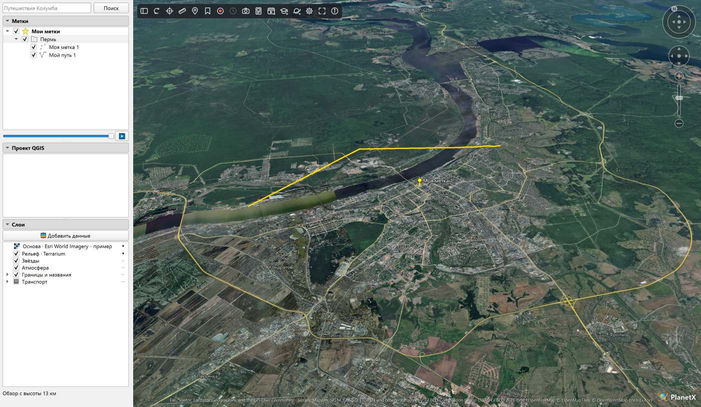

### Панель значков

| Значок | Что делает |
|---|---|
| Боковая панель | Скрывает и показывает левую панель, вид занимает её место |
| Обновить | Показывает новые настройки и слои. Значок виден, только когда автообновление в окне «Свойства вида» выключено. Когда есть что показать, значок оранжевый |
| Синхронизация | Связывает глобус с окном карты QGIS |
| Определить объекты | Включает опрос щелчком по глобусу |
| Линейка | Открывает окно «Линейка» |
| Новая метка | Открывает окно «Новая метка» |
| Сохранить вид | Ставит метку в точке взгляда с высотой, азимутом и наклоном |
| Записать облёт | Записывает движение камеры туром в «Мои метки». Видео тура пишет кнопка ⏺ панели тура |
| Шкала времени | Открывает и закрывает шкалу времени. Шкала общая для меток, треков, слоёв проекта, событий, карт и часов глобуса. Доступна, когда у видимых данных есть время |
| Снимок вида | Сохраняет вид в файл PNG или JPEG |
| Копия вида | Кладёт вид в буфер обмена без инструментов |
| Вид в макет | Кладёт вид картинкой в макет QGIS |
| Сцена | Меню «Сохранить сцену…» и «Открыть сцену…» |
| Демо | Готовые сцены по телам, см. [Демо](#демо) |
| Тело | Меню планет, спутников, астероидов и «Небо», см. [Другие тела](#другие-тела) и [Звёздное небо](#звёздное-небо) |
| Свойства вида | Подложка и источники данных, рельеф, подписи, связь с картой, обновление, формат координат, подземный режим, помощник |
| Во весь экран | Вид глобуса на весь экран для показа, клавиша F11, см. [Во весь экран](#во-весь-экран) |
| О модуле | Управление, источники данных, кнопки руководства, журнала и страниц в сети |

### Во весь экран

Значок «Во весь экран» или клавиша F11 разворачивает окно глобуса на
весь экран монитора, на котором оно стоит. Левая панель, панель
значков и значок загрузки прячутся. Органы навигации, шкала времени,
панель тура, шкалы слоёв и подписи источников остаются, тур можно
проиграть и остановить. Клавиша Esc или повторная F11 возвращает
прежнее окно и панели. Строка «Поиск» находит то же действие по словам
«весь экран», «показ», «презентация».

### Строка состояния

Под левой панелью стоит строка состояния. Обычно в ней высота камеры,
например «Обзор с высоты 2 000 км». Вторая строка показывает координаты
и высоту точки под курсором. Формат координат выбирается в свойствах
вида.

Строка сообщает и о загрузке:

- «загрузка 12» - столько тайлов, картинок слоёв и надписей ещё ждёт
  загрузки.
- «загрузка стоит 7 с» - данные ждут, а ничего не приходит 5 секунд
  и дольше.
- «метки тяжёлые, 250 тыс. вершин» - свои объекты превысили 200 тысяч
  вершин, поворот может стать медленным.
- «Подложка не загрузилась» и «Векторная основа не загрузилась» -
  источник ответил ошибкой.

Пока идёт загрузка, справа от панели значков крутится синий значок.
Короткая подгрузка его не зажигает, он появляется через полсекунды.
Когда загрузка встаёт, значок становится оранжевым. Подсказка значка
говорит, сколько ещё ждёт.

Сообщения поиска, сцен, туров и записи держатся 5 секунд.

---

## Навигация

Навигация идёт мышью, клавишами и инструментами управления.

### Мышь

| Действие | Что происходит |
|---|---|
| Левая кнопка с перетаскиванием | Земля поворачивается вслед за курсором. После отпускания она вращается по инерции |
| Колесо | Приближает и отдаляет. Точка под курсором остаётся на месте |
| Двойной щелчок левой кнопкой | Перелёт к точке под курсором с приближением в 2.5 раза |
| Двойной щелчок правой кнопкой | Отдаление в 2.5 раза |
| Правая кнопка с перетаскиванием | Вверх - ближе, вниз - дальше, к точке нажатия |
| Щелчок правой кнопкой | Меню точки под курсором |
| Средняя кнопка или левая с Shift | Поворот и наклон вокруг точки взгляда |
| Левая кнопка с Ctrl | Сдвиг вида вдоль экрана, направление взгляда прежнее |
| Левая кнопка с Ctrl и Shift | Взгляд по сторонам, глаз стоит на месте |

Сдвиг вида с Ctrl ведёт картинку за курсором, как лист бумаги, и не
поворачивает Землю вокруг центра. Так часть разреза Земли у края окна
встаёт в середину под тем же углом зрения. При сдвиге вбок кадр может
оказаться повёрнут относительно севера, клавиши N и R возвращают
север вверх.

Камера не опускается ниже 50 м над рельефом. Наклон ограничен 85°.
Когда включена линейка, рисование или опрос, двойной щелчок остаётся
двумя обычными щелчками и ставит точки.

### Клавиши

Клавиши работают, когда вид глобуса в фокусе. Для этого достаточно
щёлкнуть по глобусу.

| Клавиша | Что происходит |
|---|---|
| Стрелки | Сдвиг вида на двадцатую долю ширины окна |
| Shift и стрелки | Поворот и наклон на 3° |
| Ctrl и стрелки | Взгляд по сторонам на 3° |
| PageUp, плюс | Приближение на шаг колеса |
| PageDown, минус | Отдаление на шаг колеса |
| N | Север вверху |
| U | Взгляд отвесно |
| R | Север вверху и взгляд отвесно |
| Пробел | Остановка инерции и перелёта |

### Инструменты управления на экране

В правом верхнем углу вида стоят инструменты управления.

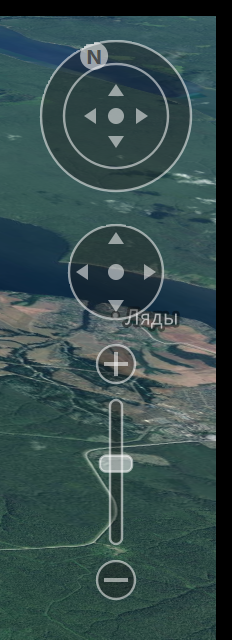

| Инструмент | Что делает |
|---|---|
| Кольцо компаса | Перетаскивание поворачивает вид. Буква N показывает север |
| Буква N | Щелчок ставит север вверху |
| Джойстик в кольце | Пока кнопка нажата, взгляд поворачивается в сторону нажатия |
| Точка в середине кольца | Щелчок возвращает отвесный взгляд без наклона и крена, как клавиша U. Азимут и высота остаются |
| Нижний джойстик | Пока кнопка нажата, вид едет в сторону нажатия |
| Плюс и минус | Пока кнопка нажата, камера плавно приближается или отдаляется |
| Ползунок | Бегунок стоит по высоте камеры, перетаскивание задаёт новую |

Скорость джойстиков растёт с отклонением от середины. Из космоса
нижний джойстик сдвигает вид не быстрее радиуса Земли в секунду.
Инструменты
видны всегда. Пока курсор далеко, они стоят слабым контуром
и не заслоняют вид. Когда курсор подходит к углу вида, они
рисуются целиком.

### Поиск места

В поле «Поиск» вверху панели вводится название места, например
`Пермь`, координаты или тема, например «Путешествия Колумба» - этот
пример стоит серым в пустом поле. Enter или кнопка «Поиск» запускают
поиск. Тема, для которой не нашлось места на карте, становится метками,
о них рассказывает раздел «Метки по описанию».

| Формат | Пример |
|---|---|
| Десятичные градусы | `58.0105, 56.2294` |
| Градусы, минуты, секунды | `58°00′37.8″ с. ш., 56°13′45.8″ в. д.` или `58 00 37.8 N 56 13 45.8 E` |
| UTM | `40V 454464 6430139` |
| MGRS | `40V DK 54464 30138` |

Поиск понимает и строку координат из строки состояния глобуса
вместе с высотой.

- Координаты сразу дают перелёт. Камера садится не выше 2 км
  от точки.
- Название уходит в службу Nominatim на языке подписей. Камера
  перелетает к первому найденному месту и охватывает его целиком.
- Если найдено несколько мест, они показываются списком под полем.
  Щелчок по строке даёт перелёт.
- Найденное место отмечено красной меткой. Очистка поля снимает
  метку и закрывает список.

При вводе под полем появляются подсказки пяти видов:

- Метки «Моих меток» на теле, которое на экране, с подходящим
  названием.
- Действия модуля - слои, карты каталога, окна, инструменты
  панели значков, демо и тела глобуса. Подсказка называет действие
  и то, что оно сделает, например «Течения - включить» или «Линейка -
  открыть окно». Действие находится и по близкому слову - «лэп»,
  «тэц», «космоснимки», «изолинии», «мкс».
- Прежние запросы.
- Звёзды и созвездия, когда открыт вид неба.
- Разделы этого руководства, не больше трёх, в конце списка, например
  на вопрос «как добавить модель ветряка». Раздел подходит, если в нём
  есть хотя бы половина слов запроса, слова в заголовке весят больше.
  Слова сравниваются началом, так «модель» находит и «модели».
  Вопросительные слова вроде «как» и «где» не считаются. Подсказка
  у курсора показывает абзац со словами запроса.

Щелчок по подсказке или Enter на ней даёт перелёт к метке или объекту
неба или выполняет действие, прежний запрос ищется заново. Раздел
руководства открывается справа от вида на абзаце со словами запроса.
Ссылка на другой раздел открывает его там же, кнопка «Открыть на
GitHub» показывает раздел в браузере с картинками. Руководство
в модуле - на языке интерфейса QGIS, без картинок, сеть для него
не нужна.
Ctrl+K из любого места окна глобуса ставит курсор в поле и показывает
включённые слои и прежние запросы. Клавиша «вниз» переводит в список
подсказок, в пустом поле она показывает прежние запросы. Escape
закрывает список. Названия мест из сети при вводе не подсказываются.
Служба Nominatim принимает запрос только по Enter.

Enter в поле разбирает запрос по порядку:

1. Координаты дают перелёт.
2. Точное название своей метки даёт перелёт к ней без запроса в сеть.
   В виде неба так же работает название звезды или созвездия.
3. Точное название действия или его слово выполняет действие. Демо
   по Enter не открываются, «Пермь» остаётся поиском места.
4. Просьба словами уходит помощнику, о нём рассказывает раздел
   «Помощник».
5. Остальное ищется как название места.

Запросы по Enter хранятся в профиле QGIS, не больше 30. Кнопка
«Очистить историю поиска» группы «Помощник» окна «Свойства вида»
стирает их.

На дальнее расстояние камера поднимается и плавно садится. Мышь прерывает перелёт.

---

## Левая панель

Панель делится на три раздела - «Метки», «Проект QGIS» и «Слои».
Щелчок по заголовку сворачивает раздел, его место занимают открытые. Какие разделы свёрнуты,
глобус запоминает.

### Раздел «Слои»

Раздел одним списком показывает то, что сейчас на глобусе. Флажки
в нём срабатывают сразу, без кнопки «Обновить». Строки идут так:

| Строки | Что в них |
|---|---|
| Основа | Подложка - снимки или карта. Щелчок по строке открывает меню - Esri World Imagery, OpenStreetMap, подключения XYZ Tiles QGIS и «Добавить источник тайлов…» |
| Рельеф | Флажок включает высоты и отмывку склонов. Щелчок по названию открывает меню - высоты суши Terrarium, Copernicus DEM 30 м, GEDTM30, ALOS AW3D30, NASADEM или USGS 3DEP 10 м, «Глубины морей и океанов» с источником глубин - тайлы высот или GEBCO 2026 - и «Источники данных…» |
| Включённые слои | Слои и карта каталога, координатная сетка, 3D-здания, горизонтали - всё, что включено |
| Группы векторной основы | «Границы и названия», «Транспорт», «Природа», пока в них что-то включено |

Строка в одну линию. У строки справа «⋯» - меню, то же меню открывает
правая кнопка. Снятый флажок выключает слой, строка остаётся, и слой
включается тем же флажком. Пункт «Убрать с глобуса» меню убирает
и строку. Ползунок «Непрозрачность» меню меняет непрозрачность слоя -
точек, раскраски поверхности или линий, значение помнится. У
месторождений, электростанций, шахт, землетрясений, пожаров, границ
плит, горных разработок, ЛЭП и кабелей меню ещё сохраняет видимое
в проект QGIS. Пункт «В проект QGIS…» спрашивает файл
GeoPackage и пишет в него объекты в рамке вида с полями записи. Слой
ложится в группу «PlanetX - слои глобуса» вверху дерева проекта. Точки
сохраняют цвет и размер глобуса, линии и контуры - свой стиль.
Повторная выгрузка заменяет в группе прежний слой с тем же названием.
Выгруженный слой - копия слоя глобуса, поэтому на глобус он сам
не встаёт, и в режиме «Слои как на карте QGIS» тоже. Показать его можно
флажком в разделе «Проект QGIS».
Раскраски тоже уходят в проект. Поле прогноза погоды и течения -
растром значений в рамке вида (градусы, мм/ч, м/с, у ветра и течений
ещё полосы скоростей на восток и на север) со шкалой глобуса. Тема
NASA, облака и температура поверхности - картинкой NASA GIBS той же
даты, у температуры два растра - море и суша.

Кнопка «Добавить данные» вверху раздела открывает окно каталога,
см. «Каталог «Добавить данные»». Группы векторной основы
делятся на строки - «Границы и названия» (Границы, Населённые пункты,
Названия водоёмов, Реки, Водоёмы), «Транспорт» (Дороги, Номера дорог,
Железные дороги, Аэропорты) и «Природа» (Вершины, Заповедники
и нацпарки). Реки и водоёмы по умолчанию выключены.

Векторная основа берётся из тайлов OpenFreeMap. При первом открытии
включены границы, населённые пункты, рельеф и звёзды. Подсказка
каждой строки говорит, как объект нарисован и с какой высоты он виден.

Шаг сетки меняется с высотой камеры, от 30° из космоса до секунд
у земли. Звёзды стоят так, как они стоят над Землёй в эту минуту, и
гаснут, когда камера опускается ниже 150 км. Картинка Млечного пути,
около 10 МБ, скачивается при первом показе звёзд и дальше берётся
из кэша QGIS. Строка «Атмосфера» включена по умолчанию. Без неё нет
свечения воздуха у края шара, неба над горизонтом и дымки над далёкой
поверхностью, фон вида - чёрный космос. Облака лежат пеленой
поверх снимка. Снег и лёд в облака тоже попадают, они того же цвета.

Карта «Температура поверхности» каталога раскрашивает сушу и море
своими шкалами, шкалы в градусах Цельсия стоят в левом нижнем углу
вида. Суша - температура самой
поверхности днём, а не воздуха, сводка за 8 дней. Под облаками на суше
бывают пропуски. Море - температура воды у поверхности за сутки.

Слой «Солнце» освещает рельеф и здания со стороны солнца.
Ночная сторона Земли тёмная, воздух над ней не светится. На ней
горят огни городов - снимок NASA Black Marble 2016 года, пиксель
около 600 м. В сумерках огни гаснут вместе с ночью, под облаками
они слабее. Время
солнца - конец промежутка открытой шкалы времени, так видно
освещение в час метки. Без шкалы солнце идёт по часам компьютера.
Без слоя «Солнце» свет падает с северо-запада под 45°, как на
карте рельефа. Положение солнца считается с точностью около
0.01°.

Вблизи камеры слой «Солнце» даёт тени - рельеф, 3D-здания и 3D-модели
затеняют землю, здания и модели за собой. Тени видны, пока расстояние
до точки взгляда не больше 40 км, в квадрате до 5 км от точки взгляда,
к краю квадрата они гаснут. Склоны и дома вдали от точки взгляда
освещены без теней. Тень берётся из того, что сейчас в кадре, - гора
за спиной камеры тени не даёт. Снимок вида и запись облёта идут с тенями.
Пункт «Тени» меню «⋯» строки «Солнце» выключает их, кадр тогда
рисуется быстрее. Видеокарте нужно не меньше 17 текстурных блоков
фрагментного шейдера, иначе теней нет.

Надписи остаются ровными при любом повороте и наклоне и не налезают
друг на друга. Пункт за горой или за горизонтом не подписан.

Слои «Уклон» и «Экспозиция» раскрашивают поверхность по высотам
рельефа. Уклон - угол склона к горизонту, классы 0-2°, 2-5°, 5-10°,
10-15°, 15-25°, 25-35° и круче 35°, от зелёного к лиловому.
Экспозиция - сторона света, куда склон обращён вниз, у каждой из
восьми сторон свой цвет, место ровнее 0.5° серое. Шкала стоит
в левом нижнем углу вида. Уклон считается по настоящим высотам, без
вертикального масштаба вида. Слой есть у Земли, Марса и Луны,
у других тел высот нет. Точность ограничена пикселем высот. На
Земле он около 5 м у экватора на самом подробном уровне, на Марсе
2.6 км, на Луне 1.3 км.

Уклон и горизонтали рисуются не дальше трёх расстояний от камеры
до точки взгляда. При виде, наклонённом к горизонту, дальняя
местность остаётся без них. Так расчёт не задерживает вид на сотнях
дальних тайлов.

Слой «Горизонтали» категории «Карта» каталога рисует на поверхности линии
равных высот, как на
топографической карте. Сечение рельефа зависит от приближения - шаг
из ряда 1, 2, 2.5 и 5 метров, умноженных на 10 в нужной степени.
Вблизи над средними широтами он 5 м, с высоты в десятки километров
20-50 м. Каждая пятая горизонталь утолщённая. Ниже уровня моря
линии синие, это изобаты. Где горизонтали сливаются на крутом склоне,
они бледнеют. Горизонтали строятся по тем же высотам, что уклон, и
у них та же точность. Слой есть у Земли, Марса и Луны.

Сечение не мельче 5 м. Открытые высоты Земли сняты с шагом 20-90 м,
подробные тайлы - их пересчёт. Поэтому вблизи горизонтали строятся
по сглаженным высотам с шагом около 20 м, пересчитанным плавно. Линии
идут без ступеней, мелкие формы рельефа на них не видны. Глубины
открытого моря в этих данных есть только на обзорных уровнях, поэтому
изобаты в открытом море строятся по ним и вблизи. Свой рельеф
растром проекта и свой источник высот горизонтали берут с полной
подробностью.

Утолщённые горизонтали подписаны отметкой, как на топографической
карте. Отметка стоит в разрыве линии, верх цифр обращён к подъёму.
Подписи нет у края тайла, на крутом изгибе линии и там, где соседние
горизонтали ближе высоты цифр. Ровная поверхность озера на отметке
горизонтали линией не считается и не заливается.

На космоснимке горизонтали жёлтые, изобаты голубые, на карте -
коричневые и синие. Снимком считаются Esri World Imagery, снимки других
тел и подложки со словами imagery, satellite, aerial, ortho и подобными
в названии или адресе.

Пока слой включён, в левом нижнем углу вида стоит его шкала - цвет
линии, сечение в середине вида и шаг утолщённых. Крестик шкалы
выключает горизонтали.

Ссылка «В проект QGIS…» шкалы и пункт «Горизонтали вида в проект
QGIS…» меню на глобусе выгружают горизонтали участка вокруг точки
взгляда слоем GeoPackage. Выгрузка есть только на Земле. Участок -
полоса вида шириной и высотой окна в точке взгляда, сечение - как на
экране. Высоты догружаются до 30 с. Слой ложится в группу «PlanetX -
горизонтали» вверху дерева слоёв. Поле `elev` - отметка, утолщённые
линии толще и подписаны.

Глубины морей и океанов - часть рельефа. Дно лежит на своих глубинах,
а над ним на уровне моря лежит полупрозрачная вода. Мельче 200 м вода
прозрачнее, у берега видно дно. Строка состояния ниже уровня моря
пишет глубину под курсором. Глубины берутся из сетки GEBCO 2026
с шагом около 450 м поверх тайлов Terrarium, мельче уровня 5 - из
самих тайлов, в океане это данные ETOPO1. Источник глубин выбирает
меню строки «Рельеф» и окно «Источники данных». Для навигации
глубины не годятся. Названия
морей остаются на уровне моря. Профиль высот, линейка и уклон считают
дно, видимость из точки и инсоляция - поверхность воды. Профиль ниже
уровня моря показывает воду и пунктир уровня моря. Сухие впадины ниже
нуля, например Мёртвое море, высоты от моря не отличают, на профиле
они залиты. На глобусе вода лежит только там, где она есть на
векторной основе. Дно карьера и сухая впадина ниже нуля остаются
сушей, метки, пути и подписи на них стоят на рельефе. Пока слой воды
основы не загружен, такое место показывается водой. Флажок «Глубины морей и океанов» в группе «Рельеф»
окна свойств вида их отключает, тогда высоты ниже уровня моря
считаются нулём и море ровное. Глубины есть только у Земли.

Слой «Палеогеография» показывает Землю в прошлом, до 540 млн лет
назад, по картам PaleoDEM PALEOMAP (Scotese и Wright, 2018). Карта
возраста - высоты суши и глубины моря с сеткой 0.1°, около 11 км,
раскрашенные по высоте с отмывкой. Возраст в миллионах лет задаёт
ползунок в левом нижнем углу вида, шаг 5 млн лет, рядом подписан
геологический период. Кнопка ▶ показывает возрасты подряд
к настоящему. Нынешний снимок, границы, подписи и рельеф на это время
убраны, настройка рельефа при этом не меняется. Карты лежат тайлами
в хранилище planetx-terrain, при первом показе возраста нужен
интернет. Новый возраст встаёт сразу в грубом виде и уточняется
по мере загрузки. При открытии окна строка выключена.

#### Каталог «Добавить данные»

Кнопка «Добавить данные» раздела «Слои» открывает каталог отдельным
окном поверх глобуса. Окно немодальное - глобус, панель и список
«Слоёв» остаются как были, каталог можно держать открытым. Место
и размер окна запоминаются. Слева - разделы с группами. Щелчок по
разделу показывает строки всех его групп, щелчок по группе - только её.
- «Основа» - «Подоснова», «Локальные данные», «Карта» (векторная
  основа, координатная сетка, 3D-здания, горизонтали, кадастр),
  «Наложения карт» и «Энциклопедия».
- «Земля сейчас» - «Погода», темы NASA по группам, «Почвы» и «Все
  слои NASA GIBS».
- «Архив и съёмка» - «Архив снимков» (Esri Wayback, снимки событий),
  «Исторические карты» и «Снимки у точки».
- «Недра» - «Геология» (Геологическая карта, Литология, Разрез Земли,
  Палеогеография), «Землетрясения и плиты» (Землетрясения, Исторические
  землетрясения, Границы плит, Активные разломы, Скорости плит,
  Вулканы), «Геофизика» (Магнитные полюса, Линии склонения, Магнитные
  аномалии, Аномалии силы тяжести, Аномалии Буге, Геоид, Возраст
  океанического дна, Тепловой поток) и «Полезные ископаемые»
  (Месторождения, Горные разработки, Шахты и карьеры OSM).
- «Небо» - «Небо и свет» (Звёзды, Атмосфера, Облака, Солнце, Спутники)
  и «Спутники» - группы спутников.
- «Энергетика и транспорт» - «Энергетика» (Электростанции, ЛЭП
  и трубопроводы, Подводные кабели) и «Транспорт».
- «Анализ рельефа» - Уклон, Экспозиция.

Строка «Найти» ищет по названию и описанию во всём каталоге.

Строки «Окна у точки взгляда» - «Космоснимки», «Облака точек лидара», «Исторические карты Рамсея» и «Старые карты «Это Место»». Флажка у них нет, кнопка «Открыть окно» и двойной
щелчок открывают окно источника у точки взгляда, как те же пункты
меню на глобусе.

Строки разделены на «Карта на глобусе - одна» и «Слои - включаются
вместе». У строки флажок, превью, название и второй строкой источник
и день карты. Превью карты - её тайл над Евразией на последний
готовый день поверх подложки, у полей прогноза и пожаров - полоса
цветов шкалы. Флажок показывает карту или слой на глобусе. Щелчок по
строке показывает под списком описание и кнопки «Показать на глобусе»
или «Убрать с глобуса» и «В проект QGIS…». На глобусе одна карта
каталога, её убирает и крестик на её шкале в левом нижнем углу вида.
Карточка группы спутников включает или убирает группу. Первая группа
включает слой «Спутники», последняя убранная его выключает.

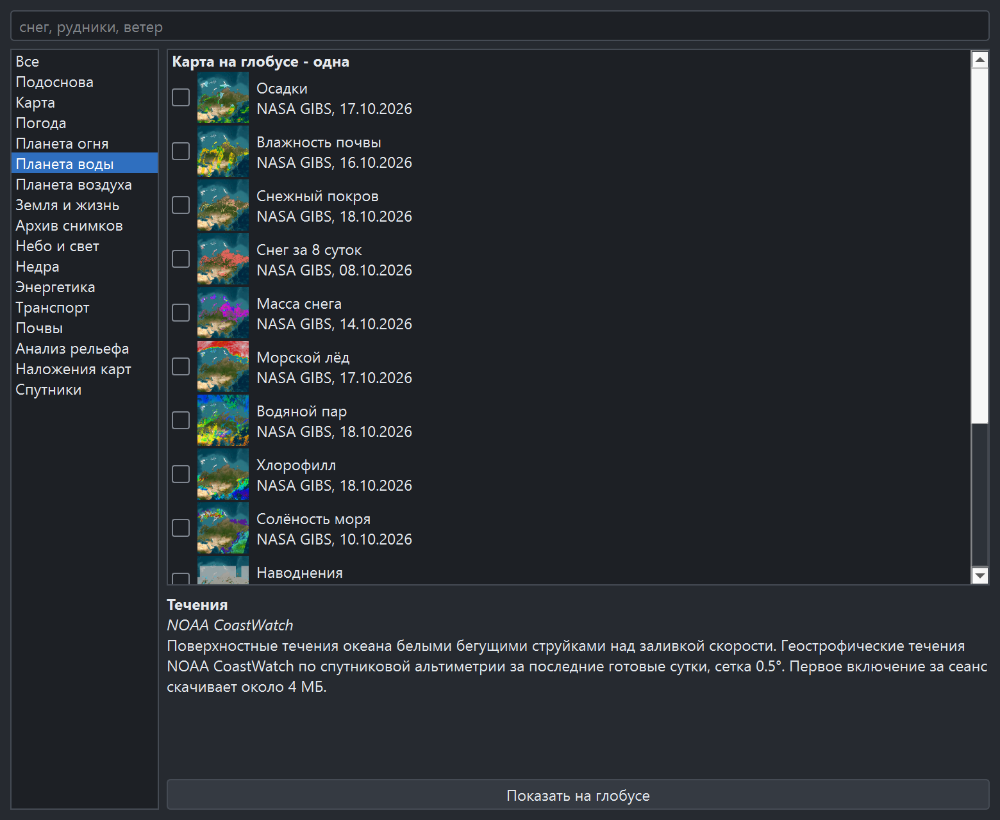

Темы NASA - растры по дням, месяцам или годам из службы NASA GIBS.
День ряда считается готовым через сутки, раньше его снимок пуст.
Группы тем NASA в каталоге такие:
- «Планета огня» - очаги пожаров, дым, оптическая толщина аэрозоля,
  угарный газ и его выбросы.
- «Планета воды» - осадки, влажность почвы, снег за сутки, снег
  за 8 суток, масса снега, морской лёд, водяной пар, хлорофилл,
  солёность моря и наводнения.
- «Планета воздуха» - диоксид азота, диоксид серы, метан,
  углекислый газ и озон.
- «Земля и жизнь» - растительность, пыль и ночные огни.

Тема лежит полупрозрачной раскраской поверх снимка, там, где данных
нет, снимок виден. Шкала с названием, единицами и датой стоит
в левом нижнем углу вида. День темы задаёт правый бегунок шкалы
времени, см. «Время меток и шкала времени». Выбранная тема открывает
шкалу на последнем дне ряда. Из бегунка берётся ближайший не более
поздний день ряда, пропущенные дни ряда пропускаются. Новая тема при
открытой шкале берёт тот же момент. Часть
рядов отстаёт от сегодняшнего дня на месяцы, это сказано в подсказке
темы. Темы есть только у Земли.

Снег за сутки по снимкам MODIS виден только там, где в тот день
не было облаков и было светло. 15 января 2026 года над Западной
Сибирью снег закрыт на 78 % площади облаками и полярной ночью.
Сводка за 8 суток закрыта на 40 %. Масса снега - расчёт модели SMAP
по данным спутника, пропусков под облаками у неё нет. Снежные темы
показывают только сушу. Лёд на озёрах есть в сводке за 8 суток,
лёд на море - тема «Морской лёд».

Категория «Все слои NASA GIBS» показывает весь каталог службы - больше
тысячи растровых слоёв снимков и карт. Список приходит из каталога
GIBS при первом показе категории или при поиске от трёх знаков, первый
раз около 10 секунд. Строка «Найти» находит слой по всем словам
запроса, например «snow cover daily terra», названия слоёв
английские. Во «Всех» эти строки не показываются. Слой каталога ведёт
себя как тема - одна карта на глобусе, ряд дат и шкала времени, шкала
цветов, шторка дней. Снимки в JPEG, например «Corrected Reflectance
(True Color, MODIS, Terra)», ложатся без прозрачности. Слои без ряда
дат показывают одну картинку. Выбранный слой глобус помнит и после
перезапуска. Слои с шагом меньше суток и векторные слои GIBS в список
не входят.

#### Шторка сравнения дней

Кнопка ⇆ шкалы времени делит вид шторкой. Правее шторки тема
показана на день шкалы, левее - на свой день. По умолчанию это тот же
день год назад, у ряда короче года - его первый день. Над шторкой
стоят бирки с днями обеих частей. Кнопки ‹ и › левой бирки сдвигают её
день по ряду темы, крестик убирает шторку. Шторка тянется мышью
за полосу с кружком.

Белая линия по границе есть и на снимке вида, и в записи тура.
Шторка работает с темами NASA. У полей прогноза GFS, пожаров
и температуры поверхности шторки нет. Смена темы оставляет шторку,
её день ищется в ряду новой темы. Выключенная тема убирает шторку.

#### Архив снимков Esri Wayback

Карта «Esri Wayback» категории «Архив снимков» каталога показывает
прежние выпуски подложки Esri World Imagery. Выпуски идут
с 20 февраля 2014 года, на октябрь 2026 года их 197. Карта открывает
шкалу времени на последнем выпуске. Правый бегунок выбирает выпуск
не позже своего дня.

Шаги ‹ и › шкалы идут только по выпускам, где снимок в середине вида
менялся. Вид постоял 0.7 с - модуль спрашивает службу Esri, из какого
выпуска на самом деле взят тайл в середине вида. Чем ближе вид, тем
мельче этот тайл. У центра Перми с 3 км таких выпусков 12 из 197.
До ответа службы шаги идут по всем выпускам.

Шторка ⇆ сравнивает два выпуска так же, как два дня темы NASA. Слева
по умолчанию выпуск годом раньше.

Дата выпуска - не дата съёмки. «Сведения о точке» и режим «Определить
объекты» дают группу «Архив снимков Esri Wayback» - дату съёмки,
источник, съёмочную систему, разрешение и точность снимка выпуска
в точке щелчка. «В проект QGIS…» строки «На глобусе» добавляет выпуск
слоем тайлов XYZ, файл не пишется.

Условия - те же, что у Esri World Imagery, раздел «Источники данных».

#### Снимки событий

Карта «Снимки событий» категории «Архив снимков» показывает снимки
землетрясений, наводнений, пожаров и ураганов из двух открытых
каталогов. Vantor (прежде Maxar) даёт полосы спутников WorldView,
Planet - сцены PlanetScope, SkySat и Pelican и квартальную мозаику
Planet до события. На 25 октября 2026 года в каталогах 18 событий -
11 у Vantor и 7 у Planet. Ключ не нужен.

Карта открывает окно «Снимки событий» со списком событий. В строке -
событие, дата и источник, под списком - описание каталога. Окно открывает и строка «Поиск»
по словам «снимки событий», «землетрясение», «наводнение» и подобным.
«Показать на глобусе» загружает список снимков события, летит к нему
и открывает шкалу времени на последнем дне снимков. У землетрясения
в Колумбии 10 августа 2026 года 164 снимка за 5 дней.

Правый бегунок шкалы выбирает день. На глобусе - все снимки не позже
этого дня, новые поверх старых. Шаги ‹ и › идут по дням снимков. Если
у события есть снимки до него, сразу включается шторка ⇆. Слева -
последний день до события, справа - день шкалы. Снимки приходят из
облачных GeoTIFF частями, только то, что видно. Первый показ большого
события идёт несколько минут.

«В проект QGIS…» строки «На глобусе» добавляет снимки дня в рамке
вида растрами по сети в группу «PlanetX - снимки событий», не больше
12 снимков, файлы не пишутся. «Убрать с глобуса» окна снимает снимки.

Лицензия снимков - CC BY-NC 4.0. Она разрешает только некоммерческое
использование и требует подпись Vantor или Planet Labs PBC. Подпись
стоит в углу вида.

#### Погода

Категория «Погода» стоит в каталоге перед темами NASA. Первая её карта -
«Температура поверхности» суши и моря по NASA. Остальные -
«Температура воздуха» на высоте 2 м, «Осадки, прогноз GFS» в мм/ч,
«Ветер» на высоте 10 м в м/с и «Облачность, прогноз GFS» в процентах.
Осадки по снимкам спутников - строка «Осадки по спутникам IMERG»
«Планеты воды». Поля даёт модель
прогноза NOAA GFS с шагом сетки 0.25°, около 28 км. Поле выбирается
в каталоге, как тема NASA.

Карта «Полярное сияние» показывает вероятность видимого сияния
в процентах по прогнозу OVATION службы космической погоды NOAA
на ближайшие 30-90 минут, сетка 1°. Слабее 3 % поле прозрачно,
слабое сияние зелёное, сильное - жёлтое и красное. Прогноз один,
на сейчас, шкала времени его не меняет. Карта просит прогноз заново
не чаще раза в 10 минут. Огни городов на ночной стороне даёт слой
«Солнце», их можно включить вместе с сиянием.

Поверх раскраски «Ветра» бегут белые струйки - частицы, которые плывут
по ветру и тянут за собой след. Струйка слабого ветра бледнее. Струйки
ускорены - за секунду ветер типичной силы проходит около восьмой части
ширины вида, поэтому их видно и издалека, и вблизи. Они рождаются
в пределах вида и следуют за ним.

Слой «Течения» группы «Планета воды» каталога показывает поверхностные
течения океана такими же белыми струйками, под ними - заливка скорости
от тёмно-синего для медленных до красного для 2.5 м/с. Медленная вода
почти не закрашена, струйка медленного течения бледнее. Издалека
частицы рождаются в видимом круге Земли и за кадр проходят не больше
трети клетки сетки, поэтому след не петляет через вихри. Течения
геострофические, их рассчитывает NOAA CoastWatch по спутниковой
альтиметрии за сутки, данные отстают на две-три недели. Ряд идёт
с 13 февраля 2017 года, день течений задаёт правый бегунок шкалы
времени, без шкалы - последний готовый день. Сетка 0.25°
берётся через узел, через 0.5°. Первое включение за сеанс QGIS
скачивает около 4 МБ. Видны Гольфстрим, Куросио, круговое течение
вокруг Антарктиды и вихри размером в десятки километров. У берегов и
подо льдом данных нет.

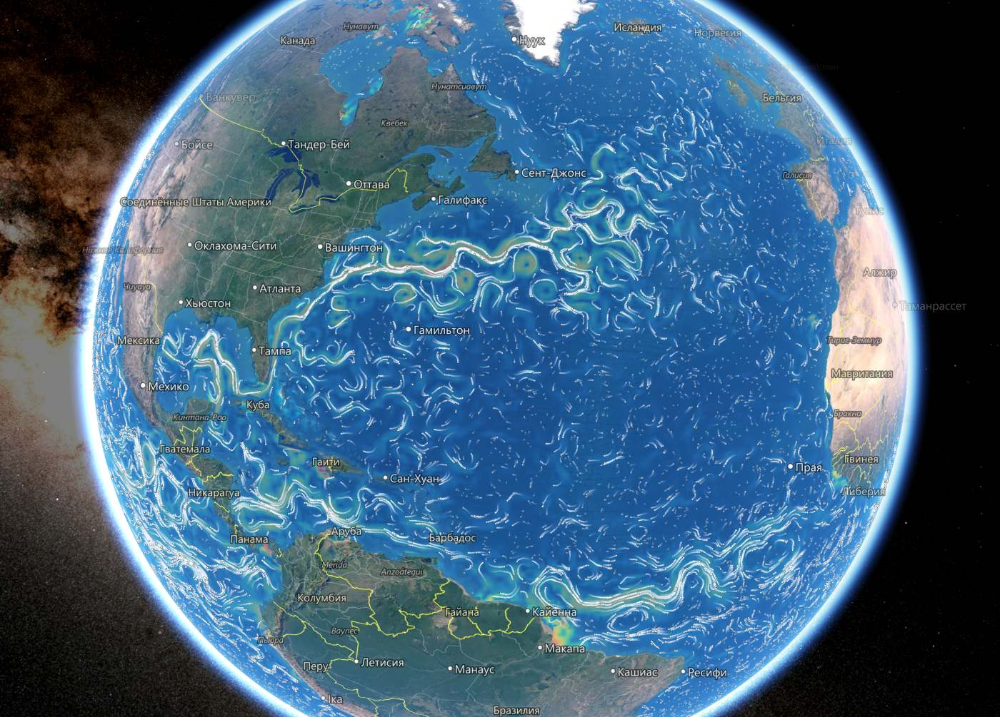

Момент поля задаёт шкала времени. Выбранное поле открывает шкалу
на нынешнем моменте. Шкала охватывает 10 суток до свежего выпуска
модели и 16 суток прогноза после него. Будущее - прогноз свежего
выпуска, на первые 5 суток по часу, дальше через 3 часа. Прошлое -
анализ модели на ближайший час. Кнопки ‹ и › шкалы сдвигают момент
на час, ▶ показывает часы подряд и ждёт загрузки каждого. Модель
выпускается 4 раза в сутки, новый выпуск выкладывается через 4-5
часов.

Поле на весь мир весит 0.5-0.8 МБ и приходит за несколько секунд.
Шкала в левом нижнем углу показывает единицы и срок поля по UTC.
Это расчёт модели. Облачность модели - не снимок облаков, снимок
даёт строка «Облака».

Поверх раскраски поля стоят его значения. Температура дана в градусах,
осадки в мм/ч, ветер в м/с, облачность в процентах. Значения стоят
в узлах сетки широт и долгот, около шести поперёк вида. Шаг узлов
меняется с высотой глаза, от 30° из космоса до 0.25° вблизи.
Значения берутся из того же поля, новых запросов в сеть нет. Там,
где осадков меньше 0.1 мм/ч, чисел осадков нет.

Первая карта «Планеты огня» - «Пожары». Она показывает очаги пожаров за последние 24 часа по снимкам VIIRS
спутника NOAA-20 из сводки NASA FIRMS, около 78 тысяч очагов. Точка
стоит на месте очага, цвет и размер показывают мощность излучения
от 1 до 1000 МВт, шкала стоит в левом нижнем углу вида. Сводка, около
6 МБ, загружается при каждом включении строки. Очаги стоят на шкале
времени по времени снимка. Щелчок по очагу в режиме
«Объекты» показывает его мощность, время снимка и достоверность.

Слой «Границы плит» показывает границы литосферных плит по модели
PB2002 (Bird, 2003). Красные линии - раздвиг плит на океанических
хребтах и континентальных рифтах, зелёные - сдвиг по трансформным
разломам, синие - схождение в зонах субдукции и коллизии. Названия плит
стоят надписями. Щелчок у границы в режиме «Объекты» показывает тип
границы, пару плит и скорость их относительного движения в мм/год.
В паре плит косая черта по записи Bird показывает, какая плита уходит
под какую. «PA\OK» - Тихоокеанская под Охотскую.

Слой «Активные разломы» показывает около 13.7 тысячи разломов мира по
базе GEM Global Active Faults (Styron и Pagani, 2020), сведённой из
региональных каталогов. Цвет линии показывает вид смещения. Синие -
сбросы, красные - взбросы, надвиги и зоны субдукции, зелёные - сдвиги,
оранжевые - срединные хребты, лиловые - складки, серые - вид не указан.
Шкала стоит в левом нижнем углу вида. Щелчок по линии показывает
название, вид смещения, запись базы, скорость смещения в мм/год,
падение и каталог-источник. Файл базы, около 11 МБ, скачивается при
первом включении и хранится в профиле QGIS. Лицензия базы - CC BY-SA
4.0.

Слой «Магнитные полюса» показывает северный и южный магнитные полюса -
точки, где стрелка компаса стоит отвесно. Красная точка - северный
полюс, синяя - южный, за каждым тянется его путь с 1590 года. Шкала
времени открывается сама. Правый бегунок ведёт полюса по годам, левый
обрезает начало пути - путь идёт от года левого бегунка. Положения
1590-2025 годов взяты из таблиц NOAA NCEI (модели gufm1 и IGRF),
после 2025 года полюс считается по модели IGRF-14 до 2030 года. Щелчок
по глобусу в режиме «Объекты» показывает в группе «Магнитное поле»
склонение - угол между севером по компасу и географическим севером,
наклонение и напряжённость поля в точке на год шкалы. Поле считается
по модели IGRF-14 для 1900-2030 годов и по модели gufm1 (Jackson
и соавторы, 2000) для 1590-1899 годов. Файл gufm1, около 1 МБ,
скачивается с сайта авторов при первом обращении к году до 1900,
до его прихода окно пишет только год. С 1900 по 2025 год северный
полюс сместился на 2475 км по прямой, из канадской Арктики к Сибири.

Слой «Линии склонения» показывает линии равного магнитного склонения
через 10° на год правого бегунка шкалы времени. Шкала открывается
сама, как у полюсов. Красные линии - склонение восточное, синие -
западное, зелёная - нулевое склонение, где компас показывает на
географический север. Подписи на линиях дают склонение в градусах.
У магнитных полюсов линии сходятся. Линии считаются по тем же
моделям gufm1 и IGRF-14 на сетке 2°, с 1590 по 2030 год. В 1800 году
у Лондона склонение было около 24° к западу, к 2020 году оно
приблизилось к нулю.

Слой «Скорости плит» показывает стрелки движения литосферных плит по
модели NNR-MORVEL56 (Argus, Gordon и DeMets, 2011) - скорость относительно
среднего движения всех плит. Стрелки стоят в узлах сетки, около семи
поперёк вида, шаг сетки меняется с высотой глаза. Длина стрелки растёт
со скоростью, подпись у начала стрелки - скорость в мм/год. Плита
в точке определяется по контурам PB2002. Тихоокеанская плита у Гавайев
идёт на северо-запад около 70 мм/год, Евразийская - около 25 мм/год.
Щелчок в режиме «Объекты» показывает в группе «Место» плиту, скорость
и направление движения.

Слой «Вулканы» показывает около 1200 вулканов, извергавшихся за
последние 12 тысяч лет, по списку Global Volcanism Program
Смитсоновского института. Цвет точки показывает время последнего
извержения. Красная точка - извержение после 1900 года, оранжевая -
с 1500 по 1899 год, жёлтая - раньше, серая - время неизвестно. Размер точки растёт с высотой вулкана.
Шкала стоит в левом нижнем углу вида. Щелчок по точке показывает
название, тип вулкана, высоту, год последнего извержения,
тектоническую обстановку и ссылку на страницу вулкана на сайте GVP.
Список скачивается при первом включении, около 2 МБ, и хранится
файлом в профиле QGIS.

Слой «Магнитные аномалии» показывает отклонение магнитного поля Земли
от нормального по сетке EMAG2v3 NOAA NCEI на высоте 4 км над
эллипсоидом, шаг сетки около 4 км. Красные места - поле сильнее
нормального, синие - слабее, шкала в углу вида - от -250 до +250 нТл.
Аномалии выдают строение коры, например Курскую магнитную аномалию,
полосы океанского дна по обе стороны срединных хребтов, древние щиты.
Там, где съёмки нет, слой пустой. Щелчок в режиме «Объекты» показывает
значение в точке, у Курска - около +270 нТл. Тайлы лежат в хранилище
planetx-terrain, около 50 МБ на весь мир, грузятся по мере показа.

Слои «Аномалии силы тяжести», «Аномалии Буге», «Возраст океанического
дна» и «Тепловой поток» - карты значений, как магнитные аномалии. На глобусе одна карта
значений, включение другой снимает прежнюю. У каждой своя шкала в углу
вида, щелчок в режиме «Объекты» показывает значение в точке. Тайлы
лежат в хранилище planetx-terrain и грузятся по мере показа.

Слой «Геологическая карта» показывает геологическую карту мира
Macrostrat (университет Висконсин-Мэдисон), сведённую из карт разного
масштаба. Цвет показывает возраст пород по стратиграфической шкале.
Издалека видна обзорная карта мира, ближе - подробные карты там, где
они есть. В России и Европе самая подробная карта - Международная
геологическая карта Европы 1:5 000 000, в США карты намного подробнее.
Глубже самой подробной карты места тайлы пусты, и на экране остаётся
увеличенная карта мельче. Щелчок в режиме «Объекты» показывает в группе
«Геология» подразделение, литологию, возраст по шкале и в млн лет,
карту-источник и ссылку на страницу Macrostrat у точки. У Перми -
пермские глины, 274-252 млн лет, по карте Европы. Геологическая карта
делит место с картами значений геофизики, на глобусе одна из них.
«В проект QGIS…» строки раздела «На глобусе» добавляет карту слоем
тайлов XYZ. Данные Macrostrat - CC BY 4.0.

Слой «Литология» показывает литологическую карту мира GLiM (Hartmann
и Moosdorf, 2012) - породы на поверхности 16 классами. Это рыхлые
отложения, обломочные, смешанные и карбонатные осадочные породы,
эвапориты, пирокластика, кислые, средние и основные вулканические
и плутонические породы, метаморфические породы, лёд и ледники. Карта
сведена из 92 региональных карт, масштаб около 1:3 750 000. Шкала
классов стоит в левом нижнем углу вида. Щелчок в режиме «Объекты»
показывает в группе «Литология» класс пород в точке. Тайлы лежат
в хранилище planetx-terrain. Литология, как и геологическая карта,
делит место с картами значений геофизики.

Слой «Исторические землетрясения» показывает каталог ISC-GEM - около
74 тысяч сильных землетрясений мира с 1904 по 2024 год магнитудой от 5,
места, глубины и моментные магнитуды которых пересчитаны одним
способом. Кружки стоят так же, как у слоя «Землетрясения», цвет
показывает глубину, размер - магнитуду. Каталог входит
в охват шкалы времени, её бегунки отбирают события по годам. Щелчок по
кружку показывает место, дату, магнитуду, глубину и ссылку на страницу
события USGS. Первое включение скачивает каталог по частям, около 13 МБ,
итог хранится файлом в профиле QGIS. Лицензия каталога - CC BY-SA 3.0.

Слой «Покрытие земель» группы «Земля и жизнь» показывает карту ESA WorldCover за 2021 год по снимкам Sentinel-1 и Sentinel-2 с пикселем 10 м. Классов 11 - лес, кустарник, луга, пашня, застройка, голые и редкие земли, снег и лёд, постоянные водоёмы, травяные болота, мангры, мхи и лишайники. Шкала классов стоит в левом нижнем углу вида. Издалека карта приходит из хранилища planetx-terrain, вблизи - из службы Microsoft Planetary Computer. Щелчок в режиме «Объекты» показывает класс в точке. Лицензия карты - CC BY 4.0.

Слои «Повторяемость воды» и «Изменения воды» группы «Планета воды»
показывают набор Global Surface Water JRC (Pekel и соавторы, 2016) по
снимкам Landsat 1984-2021 годов с пикселем 30 м. Повторяемость - доля
наблюдений, когда место было под водой, от красного (редко) до синего
(всегда). Изменения делят воду на классы - постоянная и сезонная вода, новая
и исчезнувшая, переходы сезонной в постоянную и обратно, временная
вода. На них видны новые водохранилища, обмелевшие озёра, например
Аральское море, и блуждающие русла. Щелчок в режиме «Объекты»
показывает повторяемость в процентах или класс.

Слои группы «Почвы» - «Глина в почве», «Песок в почве», «Органический
углерод почвы» и «Кислотность почвы» - показывают свойства слоя почвы
0-5 см по SoilGrids 2.0 ISRIC, модели по почвенным разрезам мира
с сеткой 250 м. Глина и песок - в процентах, органический углерод -
в г/кг, кислотность - pH в водной вытяжке. Картинки приходят от
службы WMS SoilGrids, щелчок в режиме «Объекты» запрашивает у неё
значение в точке. Вода и места без данных прозрачны. Лицензия
SoilGrids - CC BY 4.0.

На глобусе одна карта из литологической, геологической, водной,
почвенной и карт значений геофизики, включение другой снимает прежнюю.
«В проект QGIS…» строки раздела «На глобусе» добавляет такую карту
в проект слоем тайлов XYZ или слоем WMS службы.

Слой «Аномалии силы тяжести» показывает аномалию силы тяжести
в свободном воздухе - отличие силы тяжести от нормальной по модели
XGM2019e (Zingerle и соавторы, 2020), рассчитанное до степени 719, шаг
около 28 км. Красные места - сила тяжести больше нормальной, синие -
меньше, шкала от -200 до +200 мГал. Над глубоководными желобами
аномалия опускается до -300 мГал, у Марианского жёлоба около -305 мГал,
над Гавайями поднимается до +370 мГал. Подводные горы видны красными
пятнами.

Слой «Аномалии Буге» показывает ту же аномалию за вычетом притяжения
рельефа - простую поправку Буге 2πGρh по рельефу ETOPO 2022 NOAA.
Порода выше уровня моря снимается с плотностью 2670 кг/м³, лёд - 917
кг/м³, вода и лёд ниже уровня моря заменяются породой. Поправка
считается по клеткам 1' и осредняется на клетку 0.25°. К ней
прибавлена поправка на рельеф вокруг в круге 167 км - горы и долины
рядом с точкой, в горах от 10 до 25 мГал на клетку, на равнине почти 0.
Под горами аномалия отрицательная, у Тибета около
-510 мГал, у Альп около -155 мГал - это толстая лёгкая кора под ними.
Над океаном она положительная, в середине Тихого океана около
+330 мГал. Шкала от -400 до +400 мГал.

Слой «Возраст океанического дна» показывает возраст океанической коры
по сетке Seton и соавторов 2020 года, шаг 0.1°. Молодое дно
у срединных хребтов красное, древнее у окраин океанов - синее
и фиолетовое, самое древнее дно, около 180 млн лет, лежит
в западной части Тихого океана. Суша и континентальная кора не
закрашены.

Слой «Тепловой поток» показывает поток тепла из недр через
поверхность Земли в мВт/м² по сетке 0.5°, построенной кригингом по
91 тысяче измерений базы IHFC 2024. Синие места - холодные древние
щиты, красные - рифты, срединные хребты и вулканические области,
у Йеллоустоуна около 180 мВт/м². Вдали от измерений сетка сглажена.

Слой «Геоид» показывает форму геоида - уровенной поверхности Земли, по
которой отсчитывают высоты над уровнем моря, - по модели EGM2008 NGA.
Пока строка включена, высоты глобуса - высоты геоида над эллипсоидом,
от -107 до +86 м, растянутые в 10 000 раз, и Земля выглядит
«измятой». Горбы стоят там, где сила тяжести больше, например у Новой
Гвинеи и в Северной Атлантике, впадины - где меньше, самая глубокая -
к югу от Индии. Рельеф, вода и дымка над поверхностью на это время
убраны, свечение атмосферы у края шара остаётся. Ползунок «Масштаб»
в меню «⋯» строки «Геоид» растягивает высоты от 1000 до 20 000 раз.
Разрез Земли в этом режиме идёт до «измятой» поверхности, все оболочки
растянуты в ту же долю. Выключение строки возвращает рельеф, масштаб
и глубины морей. Щелчок в режиме «Объекты» показывает в группе «Геоид»
высоту геоида над эллипсоидом в точке.

Слой «Месторождения» показывает месторождения, рудники и проявления
полезных ископаемых Геологической службы США (USGS) из трёх наборов.
База MRDS - около 300 тысяч точек, из них около 267 тысяч в США
и около 1400 в России, USGS не обновляет её с 2011 года. «Крупные
месторождения мира» (USGS OFR 2005-1294) - 3161 месторождение, из них
300 в России, они показаны большими точками. «Рудники и заводы мира»
(USGS Mineral operations outside the United States) - 6478 рудников,
обогатительных и металлургических заводов вне США на 2006-2010 годы
с оператором и мощностью, в том числе Верхнекамское месторождение,
Североуральские бокситы и Сарановский хромитовый комплекс. У части
записей место указано по району, окно сведений тогда пишет «примерное,
по району». Цвет точки - группа
первого полезного ископаемого, шкала групп стоит в левом нижнем углу
вида. Размер точки MRDS - стадия освоения, действующий рудник крупнее
проявления. Щелчок по точке показывает название, полезные ископаемые,
тип, стадию, оператора, мощность, страну и ссылку на запись USGS, режим
«Определить объекты» для этого не нужен. Так же открываются очаги
землетрясений, пожары и спутники. Первое
включение скачивает архивы USGS, около 25 МБ, и разбирает их
в фоновом потоке, это 15-20 с. Итог хранится файлом в профиле QGIS,
следующие включения берут его за 1-2 с. Над большой областью, например
над всеми США, видны не больше 80 тысяч точек. Сначала идут крупные
месторождения, рудники и заводы мира, затем остальные. Крупные
точки рисуются поверх мелких.

Слой «Горные разработки» показывает контуры карьеров, отвалов,
хвостохранилищ и промплощадок мира - около 45 тысяч участков,
обведённых по снимкам Sentinel-2 2019 года (Maus и соавторы, 2022,
CC BY-SA 4.0). Контуры лежат оранжевой заливкой в картинке тайлов.
Щелчок по контуру показывает страну и площадь. Первое включение
скачивает файл около 25 МБ в профиль QGIS.

Слой «Шахты и карьеры OSM» показывает шахты, рудники, стволы
и карьеры из OpenStreetMap с названиями. Они загружаются по месту
вида, когда камера ниже 150 км, - участок около 100 км вокруг
точки взгляда одним запросом к серверу Overpass. Цвет точки - группа
ископаемого из тега resource, без него точка белая, «Прочие». Щелчок
по точке показывает название, вид, оператора и ссылку на объект
OpenStreetMap. Сервер Overpass в часы нагрузки отвечает с задержкой
или отказом. Тогда запрос сам повторяется на другом сервере Overpass
или на том же после паузы.

Категория «Энергетика» каталога содержит слои «Электростанции»,
«ЛЭП, кабели и трубопроводы OSM» и «Подводные кабели».

Слой «Подводные кабели» показывает подводные линии
связи бирюзовым и подводные силовые кабели лиловым с любой высоты.
Данные - OpenStreetMap, выборка 11 октября 2026 года - 909 линий связи
и 1040 силовых кабелей длиннее 5 км. В OSM нанесена часть кабелей мира,
больше всего в Атлантике и у Европы. Щелчок по линии показывает
название, вид, владельца и ссылку на объект OpenStreetMap.

Слой «Электростанции» показывает около 35 тысяч электростанций мира
из базы WRI Global Power Plant Database, данные на 2021 год (CC BY
4.0). Цвет точки - вид топлива, размер - мощность. Точки видны
с любой высоты, щелчок по точке показывает название, мощность, год
ввода, владельца и ссылку на источник сведений. У части станций место
в базе указано неверно. Первое включение скачивает архив около 4 МБ,
итог хранится файлом в профиле QGIS.

Слой «ЛЭП, кабели и трубопроводы OSM» показывает линии электропередачи, подстанции, кабели
и трубопроводы из OpenStreetMap. Цвет и толщина линии
показывают класс напряжения - 500 кВ и выше, 220-330 кВ, 110-150 кВ
или ниже. Силовой кабель, подземный или подводный, нарисован
лиловым пунктиром, линия связи - бирюзовым. Трубопровод нарисован
пунктиром, его цвет показывает вещество - газ, нефть и продукты, вода
и тепло. Подстанция - квадрат цвета своего напряжения. Объекты
загружаются по месту вида, когда камера ниже 150 км, так же, как шахты
OSM. Щелчок по линии или подстанции показывает вид, напряжение,
вещество, владельца и ссылку на объект OpenStreetMap.

Слой «Землетрясения» показывает землетрясения магнитудой от 4.5
за последние 30 суток по сводке Геологической службы США (USGS).
Сводка загружается при каждом включении строки. Кружок стоит
в эпицентре на поверхности. Цвет кружка показывает глубину очага,
от красного у поверхности до лилового на 700 км, шкала стоит в левом
нижнем углу вида. Размер кружка растёт с магнитудой. Очаги
на обратной стороне Земли скрыты. На своей глубине очаг виден
в вынутом секторе строки «Разрез Земли» - там кружок стоит в очаге.
Глубина растягивается
вертикальным масштабом рельефа, как высоты. У каждого
события есть время. При включённой строке становится доступна шкала
времени, на ней видны события из выбранного промежутка. Строка
есть только у Земли.

Слой «Разрез Земли» вынимает из Земли сектор под точкой взгляда.
Сектор - четверть полушария шириной 90° по долготе, от экватора
до полюса того полушария, где стоит точка взгляда. Его три грани
раскрашены оболочками по радиусам модели PREM. Это кора до 24.4 км,
верхняя мантия до 400 км, переходная зона до 670 км, нижняя мантия
до 2891 км, внешнее ядро до 5149.5 км и внутреннее ядро. Шкала
оболочек стоит в левом нижнем углу вида. Край граней лежит
на эллипсоиде, глубины не растягиваются масштабом рельефа. Кору на
гранях показывает модель CRUST1.0 по ячейкам 1°. Это вода, лёд,
верхние, средние и нижние осадки, верхняя, средняя и нижняя кора,
ниже до Мохо начинается мантия. Под океаном кора 6-7 км, под Тибетом
около 70 км. Континентальная и океаническая кора раскрашены по-разному,
океаническая - серо-зелёными тонами. Тип коры определяется по скорости
продольных волн в верхней коре из той же модели. У океанической коры
она ниже 5.5 км/с, это базальты. Где грань проходит через зону субдукции, на ней видна
погружающаяся плита по модели Slab2 Геологической службы США - полоса
от верхней поверхности плиты вниз на её толщину. Плиты есть в 27
зонах. Файл зоны запрашивается, когда грань её касается, это видно
по значку загрузки. Модель скачивается с сайта её авторов при первом
включении строки, до её прихода кора - слой PREM толщиной 24.4 км.
Если модель не пришла, первая строка шкалы называет причину, а кора
остаётся слоем постоянной толщины. Следующее включение строки просит
модель снова. Пришедший архив записывается в папку PlanetX профиля
QGIS, следующие сеансы берут его оттуда без сети. Если сайт авторов
не отвечает, архив crust1.0.tar.gz можно скачать браузером по адресу
https://igppweb.ucsd.edu/~gabi/crust1/crust1.0.tar.gz и положить
в эту папку с тем же именем, затем выключить и включить строку
«Разрез Земли». Папка профиля открывается в QGIS пунктом меню
«Установки» - «Профили пользователя» - «Открыть папку активного
профиля», папка PlanetX лежит в ней.
Вблизи глубины на гранях настоящие. С удалением камеры глубины до
400 км растягиваются, чтобы кора оставалась видна. У поверхности
растяжение доходит до 8 раз, к 400 км оно сходит на нет, ниже масштаб
настоящий. Множитель пишет шкала оболочек, очаги землетрясений
растягиваются так же. Пункт «Растягивать кору» меню «⋯» строки
«Разрез Земли» в разделе «Слои» выключает растяжение, тогда все
глубины на любом расстоянии настоящие.
Пункт «Томография мантии» того же меню раскрашивает мантию на гранях
по сейсмической томографии - отклонению скорости поперечных волн от
модели PREM по модели SEISGLOB2 (Durand и соавторы, 2017). Красная
мантия медленнее и обычно горячее, синяя быстрее и холоднее, шкала
от -2 до +2 %. Под Исландией и Гавайями видны медленные столбы, под
Японией - быстрая погружённая плита, у границы ядра под Африкой и Тихим
океаном - две большие медленные области. Модель скачивается с сайта
EarthScope при первом включении, около 28 МБ, и хранится файлом
в профиле QGIS. Кора и ядро на гранях остаются в прежних цветах.

Пункт «Кора CRUST1.0 в проект QGIS…» того же меню записывает в выбранную
папку поверхности коры в рамке вида - растры GeoTIFF отметок в метрах
над уровнем моря с шагом 1°. Поверхностей семь - кровли верхних,
средних и нижних осадков, кровли верхней, средней и нижней коры и Мохо.
Растры ложатся в проект группой «PlanetX - кора CRUST1.0». Слои осадков
и коры в CRUST1.0 выделены по скорости сейсмических волн, это не
стратиграфия. Где слоя нет, его кровля совпадает с кровлей следующего.
У Перми, например, кровля верхней коры лежит на -3850 м, Мохо - на
-40 870 м. Растры можно показать на глобусе пунктом «Поверхность по
отметкам» меню растра.
Подписи
мест вынутого сектора не показываются. Сектор ставится заново при
каждом включении строки. Углы сектора отмечены точками с широтой
и долготой, их можно тянуть мышью. Боковой угол меняет свою долготу
и свою широту. Если широта не 0° и не полюс, нижняя или верхняя
грань становится конусом к центру Земли. Строка есть только у Земли.

Пункт «Разрез вниз…» в меню пути «Моих меток» открывает окно
«Разрез». В нём разрез Земли вниз вдоль пути. По горизонтали
отложено расстояние от начала пути, по вертикали глубина. На разрезе видны
слои коры CRUST1.0, оболочки PREM, плиты Slab2 и очаги
землетрясений из полосы вдоль пути. Цвета те же, что на гранях
разреза Земли, шкала слоёв стоит справа от графика. Глубину разреза
задаёт список «Глубина», от 100 км до центра Земли. Ширину полосы
очагов задаёт поле «Полоса очагов». Очаг переносится на разрез
по ближайшей точке пути. Пока включена строка «Исторические
землетрясения», на разрез ложатся и очаги каталога ISC-GEM с 1904 года.
Они обведены светлым и лежат под очагами сводки за 30 суток, строка
под графиком считает их отдельно. При открытой шкале времени на
разрезе только очаги её промежутка, как на глобусе. Разрез
пересобирается, когда бегунки останавливаются. Курсор над графиком отмечает точку на
глобусе и пишет глубину Мохо и плиты в ней. Кора, плиты и сводка
землетрясений загружаются при открытии окна, если их ещё нет,
строка под графиком пишет, что ещё загружается. Пока окно открыто,
на глобусе вдоль пути висит стенка того же разреза. Она видна сквозь
поверхность, глубины на ней настоящие. Когда окно закрыто, стенка
исчезает.

### Основа и свой источник тайлов

Меню строки «Основа» перечисляет Esri World Imagery, OpenStreetMap,
добавленные готовые источники и подключения XYZ Tiles из обозревателя
QGIS, выбранная подложка отмечена. Выбор сразу меняет подложку
на глобусе. На других телах в строке стоят снимки тела, выбора нет.

Все подложки с превью собраны в категории «Подоснова» каталога
«Добавить данные», щелчок по строке ставит подоснову глобуса. Пункт
«Ещё подосновы…» меню «Основа» открывает каталог на этой категории.
Категория «Локальные данные» того же каталога - подробные снимки
отдельных районов из служб их владельцев. Первая строка - ортофото
весны 2020 года девяти округов вокруг Филадельфии (PASDA DVRPC 2020).
Строка ставит подоснову, вне района глобус показывает снимки Esri.

Готовые источники категории «Подоснова» ставятся одним щелчком:

| Источник | Что показывает | Предупреждение |
|---|---|---|
| Google Спутник, Гибрид, Схема, Рельеф | снимки, снимки с подписями, карта, карта с отмывкой рельефа | есть |
| Bing Спутник, Схема | снимки и карта Microsoft | есть |
| Яндекс Спутник, Схема | снимки и карта Яндекса | есть |
| 2ГИС Схема | карта городов | есть |
| OpenTopoMap | топографическая карта по OpenStreetMap и SRTM, до уровня 17 | нет |
| Esri World Topo Map | топографическая карта Esri | нет |
| Esri Улицы, Светло-серая, Тёмно-серая, National Geographic, Океаны, Рельеф, Отмывка, Физическая, Отмывка подробная | карты Esri, у океанов, рельефа и отмывки до уровня 13, у физической до 8 | нет |
| OSM Гуманитарная, OSM Франция, CyclOSM | карты по OpenStreetMap - гуманитарная, французская и велосипедная | нет |
| NASA Blue Marble | снимок Земли без облаков с отмывкой рельефа и глубин, до уровня 8 | нет |
| USGS Снимки, Снимки с картой, Топокарта, Отмывка | карты Национальной карты США, только США, до уровня 16 | нет |

Условия Google, Bing, Яндекса и 2ГИС не разрешают брать их тайлы
в сторонних программах по прямому адресу. Перед первым добавлением
такого источника окно говорит об этом и даёт ссылку на условия
сервиса. Источник добавляется только кнопкой «Добавить», решение
и ответственность за использование остаются за пользователем. Ответ
окно запоминает и второй раз не спрашивает. Снимки Яндекса сняты
в другой проекции, эллиптическом Меркаторе. Модуль собирает тайл
глобуса из двух тайлов Яндекса и пересчитывает его по широте,
иначе у Перми снимок лёг бы на 36 км южнее места. Добавленный
готовый источник стоит в списке подложек и в окне «Источники данных»,
кнопка «Удалить» там убирает его из списка. Готовые источники находит
и строка «Поиск» - по названию, например «яндекс» или «bing».

Помощник тоже ставит подложку - готовый источник или свой адрес
шаблона, если попросить, например, «поставь снимки Bing». Готовый
источник проходит то же предупреждение, свой адрес окно сначала
показывает пользователю и добавляет только после ответа «Да».

Категория «Наложения карт» каталога «Добавить данные» кладёт поверх
подложки прозрачные карты - морские знаки OpenSeaMap, пешие
и велосипедные маршруты Waymarked Trails. Включать можно несколько
сразу, непрозрачность - в меню «⋯» строки, «В проект QGIS…» добавляет
слой тайлов XYZ. Морские знаки видны вблизи, с масштаба около
1:500 000.

Пункт «Добавить источник тайлов…» меню открывает окно нового
источника.
В поле «Адрес» вставляется адрес в любом из видов:

- шаблон с `{z}`, `{x}`, `{y}`, например
  `https://{s}.tile.opentopomap.org/{z}/{x}/{y}.png`
- адрес одного тайла, скопированный из браузера, например
  `https://server.arcgisonline.com/ArcGIS/rest/services/World_Topo_Map/MapServer/tile/5/10/17`
- адрес с уровнем, столбцом и рядом в параметрах запроса
- адрес службы WMS, например
  `https://imagery.pasda.psu.edu/arcgis/services/pasda/DVRPC2020/MapServer/WMSServer`

Окно приводит адрес к шаблону и предлагает название по имени сервера.
Ниже оно собирает мозаику всего мира из четырёх тайлов уровня 1. Если
север в мозаике внизу, ряды сервера идут снизу вверх, это исправляет
флажок «Ряды снизу вверх (TMS)». Самый подробный уровень окно находит
само, опросом тайлов в точке взгляда глобуса. Заглушки «нет данных»
в счёт не идут. Подпись источника стоит в углу вида и на снимках, для
известных серверов она подставляется сама.

Источник сохраняется подключением XYZ Tiles QGIS и сразу становится
подложкой. Он виден и в обозревателе QGIS, там же его можно изменить
или удалить. Условия использования тайлов задаёт их владелец.

Адрес службы WMS окно узнаёт по словам `WMSServer`, `/wms` или
`service=WMS` и читает список слоёв службы (GetCapabilities). В списке
«Слой» выбирается слой. Строка «Все слои» показывает все слои группы
вместе. Вместо мозаики окно показывает одну картинку охвата слоя. Глобус
запрашивает у службы картинку каждого тайла в проекции Web Mercator
(EPSG:3857). Многие службы покрывают только свой район. Вне охвата слоя
и на мелких масштабах глобус показывает снимки Esri World Imagery, на
краю района картинка службы ложится поверх них. Такой источник хранится
в настройках PlanetX, а не подключением QGIS. Изменить или удалить его
можно в окне «Источники данных». Служба WMS рисует каждую картинку
заново, поэтому подложка из неё загружается медленнее тайлов.

### Кадастр Росреестра

Строка «Кадастр Росреестра» категории «Карта» каталога «Добавить
данные» кладёт поверх снимка земельные участки из Национальной
системы пространственных данных Росреестра (НСПД, nspd.gov.ru) -
границы красным, участки бледной заливкой. Данные есть только по
России. Участки видны вблизи, примерно с 10 км и ниже. Мельче тайлы
не запрашиваются, в них тысячи участков. Служба отказывает на частые
запросы подряд, поэтому модуль просит тайлы по одному с паузой
0.5 с, вид заполняется участками за 30-60 с. Сертификат сервера НСПД
выдан удостоверяющим центром Минцифры, которому Windows по умолчанию
не доверяет. Корневой сертификат Минцифры лежит в модуле и действует
только на запросы модуля к nspd.gov.ru, в систему и в остальной QGIS
он не ставится. Непрозрачность слоя задаёт ползунок строки в списке
«Слоёв». Подпись «Rosreestr NSPD» стоит в углу вида.

При включённом кадастре щелчок в режиме «Определить объекты» или пункт
«Сведения о точке» меню на глобусе спрашивает НСПД об участке под
точкой. В окне «Объекты» появляется группа «Кадастр Росреестра». В ней
кадастровый номер, адрес, площадь, категория земель и вид разрешённого
использования. Там же форма собственности, вид права, кадастровая
стоимость с датами, статус и кадастровый квартал. Контур участка
подсвечивается на глобусе. Строка «Карта НСПД» ведёт на этот участок
на карте Росреестра. Двойной щелчок по строке окна «Объекты» копирует
значение, например кадастровый номер, в буфер обмена, а ссылку
открывает в браузере. Запрос идёт один на щелчок, сведения приходят
за 1-3 с.

### 3D-здания

Строка «3D-здания» раздела «Слои» ставит на глобус объёмные здания
OpenStreetMap. Контуры и высоты берутся из тех же векторных тайлов
OpenFreeMap, что и векторная основа. По умолчанию строка выключена.

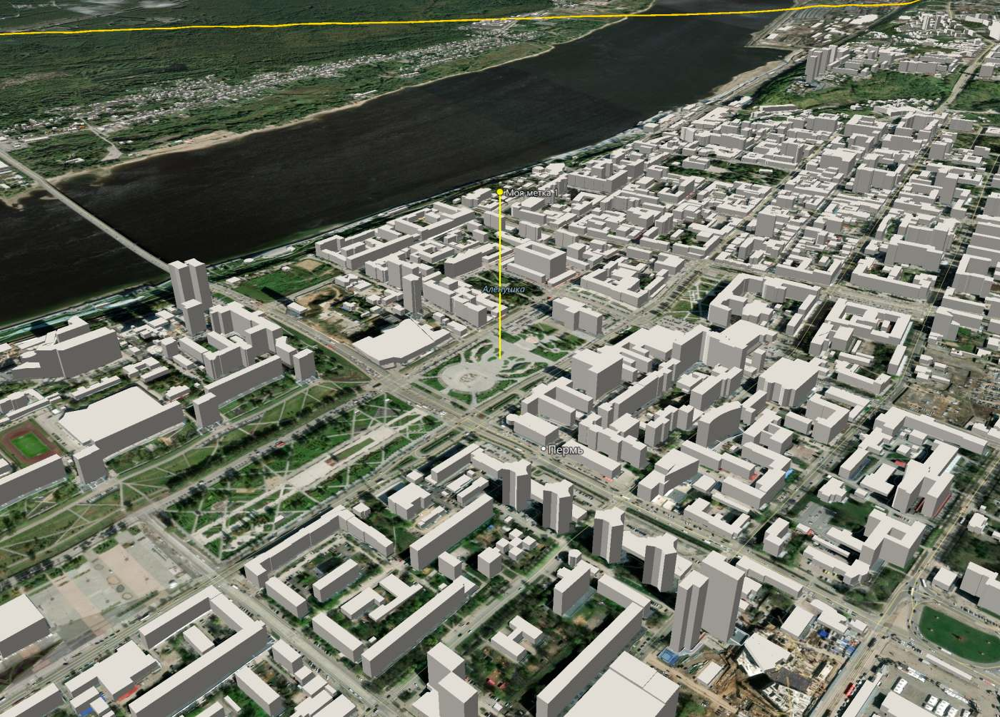

Здания видны, когда камера ближе 6 км к земле. Глобус держит до 32
тайлов зданий вокруг камеры, ближние первыми. Тайлы за спиной камеры
не загружаются.

Высота здания - высота из OpenStreetMap, иначе количество этажей,
умноженное на 3.66 м. Здание без этих сведений получает высоту 5 м.
В центре Перми своя высота есть у двух третей зданий, в центре Москвы
почти у всех. На окраинах многие дома одной высоты. Цвет здания
берётся из OpenStreetMap, иначе здание светло-серое. Крыши плоские.

Низ здания стоит на самой низкой точке рельефа под его контуром.
Снимок вида ждёт, пока загрузятся все здания кадра. Сцена помнит,
включены ли здания.

Список «3D-здания» в группе «Своя векторная основа» окна «Источники
данных» меняет источник зданий на Overture Maps. Это здания
OpenStreetMap вместе с открытыми наборами Microsoft, Google Open
Buildings и Esri одним архивом PMTiles. Там, где OpenStreetMap неполон,
зданий больше. Над центром крупнейшего города Нигерии в тех же 22 тайлах
у Overture 158 тысяч
зданий, у основы около 45 тысяч в половине этих тайлов. Высота здания
у Overture - поле высоты, иначе количество этажей, умноженное
на 3.66 м. Глобус берёт последний выпуск Overture из его каталога.
Подпись Overture стоит в углу вида, пока здания из него на глобусе.

### Свойства вида

Значок «Свойства вида» на панели значков открывает одноимённое окно.

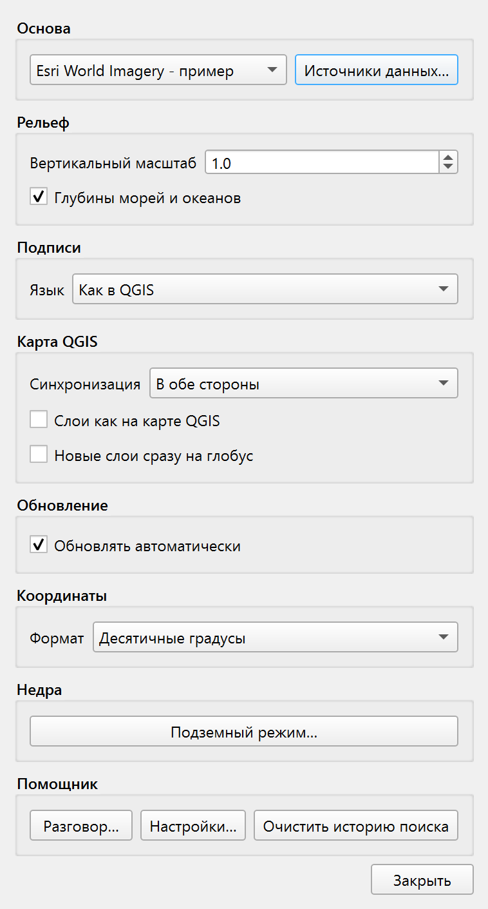

Окно не мешает работать с глобусом.

| Группа | Поле | Что задаёт |
|---|---|---|
| Основа | Список | Источник снимков или карты |
| Рельеф | Вертикальный масштаб | Множитель высот от 0.5 до 10 |
| Рельеф | Глубины морей и океанов | Дно на своих глубинах и вода над ним, по умолчанию включено |
| Подписи | Язык | Язык надписей и поиска |
| Карта QGIS | Синхронизация | Направление связи с картой |
| Карта QGIS | Слои как на карте QGIS | Глобус показывает слои, включённые в легенде QGIS |
| Карта QGIS | Новые слои сразу на глобус | Новый слой проекта сразу отмечен на глобусе |
| Обновление | Обновлять автоматически | Глобус обновляется после каждой правки без кнопки «Обновить», по умолчанию включено |
| Координаты | Формат | Десятичные градусы, градусы-минуты-секунды, UTM или MGRS в строке состояния и окне «Объекты». Выше 84° северной и ниже 80° южной широты UTM и MGRS заменяются десятичными градусами |
| Оформление | Оформление | «Тёмное» (по умолчанию) - тёмные плашки на виде и тёмные окна модуля. «Светлое» - серые плашки с тёмными значками и светлые окна. «Как в QGIS» - тёмные плашки, окна модуля в оформлении QGIS. Оформление меняется сразу |
| Недра | Подземный режим… | Открывает окно «Подземный режим», см. [Подземный режим](#подземный-режим) |

Подложка по умолчанию - Esri World Imagery, в списке она названа
«Esri World Imagery - пример». Условия её использования задаёт Esri.
Следом идёт OpenStreetMap, потом подключения XYZ Tiles из обозревателя
QGIS. Подключения рельефа в список не попадают. Новое подключение
появляется в списке при следующем открытии окна.

Кнопка «Источники данных…» рядом со списком подложек открывает окно
всех источников глобуса. В таблице по группам стоят подложки, рельеф,
векторная основа, данные NASA и наук о Земле. У каждого источника
видно, что он показывает, и ссылка «открыть» на его условия
использования. Кнопка «Проверить» запрашивает у каждого источника один
тайл или файл мимо кэша и пишет время ответа и размер или ошибку.
Большие файлы, картинка звёздного неба, не запрашиваются.

В том же окне ставится свой рельеф - шаблон тайлов высот с {z}, {x},
{y} в записи Terrarium или Mapbox Terrain-RGB - и своя векторная
основа - адрес TileJSON в схеме OpenMapTiles. У каждого есть подпись
для угла вида. «Применить» берёт данные по новому адресу, «Как было»
возвращает источник по умолчанию. Кнопки «Добавить подложку…»,
«Изменить…» и «Удалить» работают с подключениями XYZ Tiles QGIS,
удалённое подключение пропадает и из обозревателя QGIS.

Группа «Рельеф - откуда берутся высоты» того же окна объясняет, что
высоты складываются из четырёх слоёв - тайлов высот по миру, уточнения
суши 30 м, глубин морей GEBCO и своего растра проекта. Список «Уточнение суши 30 м» помещает поверх
тайлов высот модель рельефа 30 м:

- «Нет - только тайлы высот» - рельеф Mapzen Terrain Tiles, как прежде. Он
  грузится быстрее всех. Севернее 60° на суше в нём данные около 250 м.
- «Copernicus DEM 30 м» - модель поверхности Copernicus GLO-30, файлы
  по градусу на открытом хранилище AWS. Лес и дома входят в высоту.
- «GEDTM30 30 м» - модель рельефа самой земли без леса и домов, OpenGeoHub,
  CC BY 4.0. Это один большой файл, его участки читаются дольше.
- «ALOS AW3D30 30 м» - модель поверхности JAXA, как Copernicus, лес
  и дома входят в высоту.
- «NASADEM 30 м» - доработанный SRTM без пустот, NASA, только между
  60° ю. ш. и 60° с. ш.
- «USGS 3DEP 10 м» - модель рельефа земли без леса и домов, только
  США.

Файлы ALOS, NASADEM и 3DEP - копии Microsoft Planetary Computer.
Модуль берёт к ним временный ключ доступа без учётной записи. Вне
покрытия модели остаются тайлы высот.

Тайлы высот по-прежнему дают дно морей и вид издалека. С уровня 9
высоты суши берёт модель, глубже уровня 12 участки модели не читаются
заново, а пересчитываются из прочитанных. Подпись модели стоит в углу
вида. Модель читается из сети при каждом новом участке, без сети
остаются тайлы высот. У горы Народной тайлы высот дают 1816 м,
Copernicus и GEDTM30 - 1888 м, ALOS AW3D30 - 1892 м, высота вершины
1895 м. У Пайкс-Пика в США 3DEP даёт 4302 м при высоте вершины
4302 м.

Список «Глубины морей» выбирает дно морей и океанов:

- «Тайлы высот - дно до уровня 10» - дно из тех же тайлов Mapzen. Ближе
  уровня 10 в открытом море в них бывают пустые места на нуле, например
  у Японского жёлоба.
- «GEBCO 2026 - сетка около 450 м» - сетка глубин мира GEBCO 2026 Grid,
  общественное достояние с подписью источника. Она заменяет дно тайлов
  с уровня 5 там, где и у тайла, и у сетки ниже нуля, суша и берег
  остаются от тайлов. Сетка читается из сети по участкам. Это выбор
  по умолчанию.

Язык подписей выбирается из списка. «Как в QGIS» берёт язык интерфейса
QGIS, «Местные названия» оставляет названия на языке страны. Дальше
идут пятнадцать языков. Если названия на выбранном языке нет, для
языков на латинице ставится латинское название, для остальных -
местное.

Подписи нового места грузятся, когда камера останавливается. В облёте
и перелёте их загрузка не отнимает время у кадров, на остановке они
появляются за доли секунды.

Без автообновления смена подложки, масштаба рельефа и слоёв проекта
видна после кнопки «Обновить» на панели значков. Строка состояния
напоминает об этом.
Язык подписей меняется сразу.

### Раздел «Проект QGIS»

Раздел «Проект QGIS» стоит между «Метками» и «Слоями». В нём слои
текущего проекта в порядке карты QGIS, у каждого
его тип - растр, точки, линии, полигоны, облако точек или таблица.
Флажок слоя
показывает его на глобусе и не меняет видимость на карте. В новом
проекте флажки сняты. Отметки хранятся в проекте.

Слои ложатся на глобус картинкой, которую рисует QGIS, со стилями
карты. Картинка лежит на рельефе, поднять или выдавить её нельзя.

Подписи векторных слоёв идут отдельно, как названия городов. Они
стоят ровно при любом повороте и наклоне, не налезают друг на друга
и прячутся за горами и горизонтом. Текст, цвет и кегль берутся из
подписей слоя в QGIS, подписи по правилам тоже. Подпись точки стоит
справа от неё, линии - на середине, многоугольника - внутри него.
Подписываются объекты вокруг точки взгляда, не больше 500 на слой.
Масштаб видимости подписей QGIS на глобусе не учитывается.

Двойной щелчок по слою даёт перелёт к его охвату, взгляд отвесный.
Меню по правой кнопке:

- «Подлететь» - перелёт к охвату слоя.
- ползунок «Прозрачность» - прозрачность самого слоя QGIS, она
  меняется и на карте.
- «Трек…» - для точечных слоёв, см. [Треки](#треки).
- «Рельеф глобуса» - для растров, см. [Свой рельеф](#свой-рельеф).
- «Выдавливание…» - для векторных слоёв, см.
  [Выдавливание по полю](#выдавливание-по-полю).
- «В «Мои метки»…» - для векторных слоёв. Объекты слоя ложатся
  в «Мои метки» папкой с именем слоя, выделенные, иначе все. Дальше
  папку можно сохранить в KML, см. [KML и KMZ](#kml-и-kmz).
- «Цвет точек», «Размер точек», «Классы точек» - для облаков точек,
  см. [Облака точек](#облака-точек).
- «Свойства слоя…» - штатное окно свойств слоя QGIS.

### Облака точек

Облако точек - лидарная съёмка или съёмка с дрона в файле LAS, LAZ
или COPC. Оно добавляется в проект как обычный слой облака точек QGIS
и отмечается флажком в разделе «Проект QGIS». На глобусе облако стоит
точками в объёме на своих отметках, с проверкой глубины, как 3D-модели.

Точки читает программа PDAL из состава QGIS, отдельными процессами,
окно при этом не ждёт. Файл COPC читается сразу. Файл LAS или LAZ один
раз переводится в COPC, копия ложится в папку PlanetX/pointclouds
профиля QGIS, исходный файл не меняется. Тайл с дрона в 5.7 млн точек
переводится около 15 с, следующие показы берут копию.

Подробность облака зависит от расстояния. Облако делится на клетки,
вблизи клетки мельче и точек в них больше, вдали - наоборот. Точек
в кадре не больше 3 млн. Пока клетки догружаются, виден значок загрузки
справа от панели значков.

Отметки облака переводятся в метры по системе координат файла,
например из футов. С рельефом высоты растягиваются масштабом рельефа,
как у 3D-моделей, без рельефа облако стоит низом на поверхности. Точки
слегка выдвинуты к глазу, около 0.5 % расстояния. Рельеф глобуса
сглажен на десятки метров, и без этого точки земли съёмки уходили бы
под него.

Меню слоя облака:

- «Цвет точек» - цвет съёмки (RGB из файла, без него - по классу),
  по классу ASPRS, по высоте от синего к красному или по интенсивности
  оттенками серого.
- «Размер точек» - от 1 до 6 пикселей.
- «Классы точек» - все классы, только земля или выбранные классы
  из встреченных в облаке.

Шкала в углу вида показывает классы облака или высоты в метрах.
Щелчок в режиме «Определить объекты» даёт точку облака под курсором -
класс, отметку, широту и долготу, интенсивность, номер отражения
и цвет. Настройки облака хранятся в проекте.

#### Облака точек лидара по сети

Пункт «Облака точек лидара» меню на глобусе находит у точки
плитки открытых лидарных съёмок и кладёт их слоями облаков в группу
«PlanetX - облака точек лидара» проекта, слои сразу отмечены
на глобусе. Источников два:

- IGN LiDAR HD - вся Франция плитками 1 км, не меньше 10 точек на
  квадратный метр, классы ASPRS, Licence Ouverte 2.0. У точки берутся
  две ближайшие плитки.
- USGS 3DEP - съёмки США плитками около 1 км, общественное достояние.
  У точки берутся до четырёх плиток, у одного места бывает несколько
  съёмок разных лет.

Файлы COPC не скачиваются целиком, PDAL и QGIS читают их частями по
сети. Файлы 3DEP лежат в хранилище Microsoft Planetary Computer, ключ
доступа модуль просит у службы сам, без учётной записи. Ключ живёт час,
слой в проекте QGIS после этого перестаёт читаться, глобус берёт новый
ключ. Сервер IGN ограничивает частоту запросов, поэтому облака IGN
приходят медленнее, клетки после отказа сервера просятся снова через
10 с. У Гренобля две плитки IGN дают около миллиона точек за 2-3
минуты. Облака по сети открываются в QGIS 4, в QGIS 3.36 открытие
такого слоя останавливает QGIS, пункт меню об этом сообщает.

### Выдавливание по полю

Объекты векторного слоя проекта поднимаются над рельефом на высоту
из числового поля. Многоугольник становится призмой, точка -
столбиком-восьмиугольником, линия - стенкой. Пункт «Выдавливание…»
меню слоя открывает окно с полем высоты и множителем. Высота в метрах
равна значению поля, умноженному на множитель. У поля этажей
множитель около 3. Объект с пустым, нулевым или отрицательным
значением не выдавливается. Строка «Не выдавливать» снимает
выдавливание.

Цвет объекта - его символ в стиле слоя QGIS, как на карте. Низ призмы
и столбика лежит на самой низкой точке рельефа под объектом, крыша
ровная. Стенка линии идёт по рельефу. Радиус столбика - 1/150
поперечника слоя, от 2 м до 2 км. Слой выдавлен, пока он отмечен
на глобусе. Настройки хранятся в проекте. Читается до 20 000 объектов
слоя.

### Свой рельеф

Растр высот проекта QGIS становится рельефом глобуса в своём охвате.
Пример - карьер с маркшейдерской съёмкой. Пункт «Рельеф глобуса» меню
растра в разделе «Проект QGIS» включает и выключает врезку. Растр
может быть в любой системе координат, нужен файл, который читает GDAL.
Флажок показа слоя на глобусе для врезки не нужен.

Там, где у растра есть данные, его высоты заменяют общий рельеф.
На полосе вдоль края данных высоты плавно переходят к общему рельефу,
ширина полосы - 5 % меньшей стороны охвата. Внутри охвата рельеф
подробнее общего, до пикселя растра, но не мельче пикселя уровня 17
(около 0.6 м на широте 60°). Высоты растра берутся как есть. Если
у съёмки своя система высот, расхождение с общим рельефом сглаживает
полоса края.

Врезку видят сетка поверхности, высота под курсором, линейка, профиль
высот, видимость, инсоляция, уклон и экспозиция. Если врезок
несколько, сверху лежит та, что выше в проекте. Выбор хранится
в проекте и в сцене.

При первом включении растр пересчитывается в файл профиля QGIS. Для
съёмки 2400 × 2400 пикселей это около 2 с.

### Выемка и насыпь

Две съёмки одного участка, например карьера с отвалами, дают объёмы
выемки и насыпи. Пункт «Выемка и насыпь…» меню растра новой съёмки
в разделе «Проект QGIS» открывает окно:

- «Прежняя съёмка» - растр того же участка на прежнюю дату.
- «Участок» - многоугольники, вне которых разность не считается, или
  весь охват новой съёмки.
- «Порог» - разность меньше порога по модулю не входит в объёмы, это
  шум съёмки. По умолчанию 0.1 м.

Прежняя съёмка пересчитывается на сетку новой. Расчёт идёт в метрах -
в системе координат новой съёмки или в зоне UTM, если она в градусах.
Окно сводки показывает объёмы выемки и насыпи, их площади, наибольшую
глубину выемки и высоту насыпи и разность объёмов. Растр разности
ложится в проект в группу «PlanetX - выемка и насыпь» и виден на
глобусе - выемка красная, насыпь синяя.

### Своя батиметрия

Растр глубин или отметок дна озера, моря или водохранилища ложится
в рельеф глобуса так же, как свой рельеф, а над ним рисуется
полупрозрачная вода на уровне водоёма. Пункт «Батиметрия водоёма…»
меню растра в разделе «Проект QGIS» открывает окно с тремя полями:

- «Значения - глубины» - глубина под поверхностью воды, со знаком плюс
  или минус. Отметка дна - уровень воды минус модуль глубины.
- «Значения - отметки дна» - высота дна над уровнем моря.
- «Уровень воды» - высота поверхности воды. По умолчанию - высота
  рельефа в середине растра, у озера это обычно поверхность воды.

Вода рисуется над всеми точками растра, где дно ниже уровня, дно видно
сквозь неё. Без рельефа вода не рисуется - дно и вода легли бы в одну
плоскость. «Убрать батиметрию» выключает и врезку, и воду. Выбор
хранится в проекте. Профиль высот через водоём показывает воду над
дном и пунктир уровня водоёма с подписью.

Демо «Бриенцское озеро, своя батиметрия» значка «Демо» - дно
Бриенцского озера в Швейцарии по данным swissBATHY3D swisstopo с шагом
10 м, вода на 564 м. Самое глубокое место - 308 м, на 256 м ниже
воды. Профиль высот через озеро показывает котловину.

#### Батиметрия по промерам

Промеры эхолота - точечный слой проекта с глубиной в поле или в Z
точки, например CSV с широтой, долготой и глубиной, открытый
в QGIS как текстовый слой. Пункт «Батиметрия по промерам…» меню
точечного слоя строит из них растр глубин и делает его своей
батиметрией. В окне задаются:

- «Глубина» - поле с глубиной или Z точки. Знак глубины не важен.
- «Ячейка» - размер ячейки растра. По умолчанию - корень из площади
  промеров на точку. У галсов через 20 м с точкой через метр это 5 м.
- «Предел от промера» - ячейка дальше этого расстояния от ближайшего
  промера остаётся пустой. По умолчанию - 10 ячеек. Предел должен быть
  больше расстояния между галсами.
- «Уровень воды» - высота воды в день промеров.
- «Файл» - GeoTIFF растра глубин, по умолчанию в профиле QGIS.

Растр строится триангуляцией в метрах зоны UTM середины промеров
и ложится в проект в группу «PlanetX - батиметрия».

### Раздел «Метки»

Раздел держит папку «Мои метки», её описывает глава
[Мои метки](#мои-метки).

---

## Связь с картой QGIS

### Синхронизация

Значок синхронизации на панели значков связывает глобус с окном карты
QGIS. Направление выбирается в свойствах вида:

- «В обе стороны» - по умолчанию.
- «Карта ведёт глобус» - глобус переходит к охвату карты, наклон
  и азимут глобуса сохраняются.
- «Глобус ведёт карту» - карта встаёт центром в точку взгляда
  глобуса, когда глобус остановится.

Система координат карты любая. Ширина карты на местности равна ширине
вида глобуса.

### Выделение

Объекты, выделенные на карте QGIS, подсвечены на глобусе.

### Определение объектов

Значок «Определить объекты» включает опрос, курсор становится
перекрестием. Щелчок по глобусу ставит метку с координатами и открывает
окно «Объекты».

- В заголовке окна - координаты и высота точки.
- Ниже - слои проекта, отмеченные на глобусе, их объекты под точкой
  и поля объектов. У растра показываются значения в точке.
- Кнопка «Выделить на карте» выделяет найденные объекты в слоях QGIS.
  Выделение видно на карте, в таблице атрибутов и на глобусе.
- Группа «Мои метки» - видимые метки, пути и многоугольники под
  точкой. У каждой показаны тип, координаты или длина, измерение
  и описание.
- Группа «Землетрясения» - очаги у точки щелчка на экране. У каждого
  показаны магнитуда, глубина, время UTC, место и страница события
  USGS.
- Группа «Место» - высота или глубина моря, глубина Мохо, толщина
  коры и осадочного чехла, тип коры по CRUST1.0 и плита Slab2 под
  точкой. Модель коры
  и файл зоны плит загружаются при первом щелчке, окно уточняется
  по их приходу.

---

## Мои метки

«Мои метки» - папка вверху раздела «Метки», она отмечена звездой.
В ней лежат метки, пути, многоугольники, сохранённые виды и измерения.
Метки хранятся в одном файле `PlanetX/myplaces.gpkg` в папке профиля
QGIS и видны в любом проекте.

Значок точечной метки виден всегда, даже когда меток на экране тысячи.
Подпись стоит у тех меток, которым хватает места, остальные подписи
появляются при приближении.

### Временные метки

Под «Моими метками» стоит строка «Временные метки». При открытии
окна глобуса она выделена, поэтому новые метки, пути, измерения
и метки помощника ложатся в неё. Метку, которую надо сохранить
сразу, перетащите в «Мои метки». Меню строки - «Сохранить в «Мои
метки»» и «Очистить «Временные метки»…».

Если при закрытии окна глобуса во «Временных метках» что-то есть,
окно спрашивает, что с этим делать. «Сохранить» переносит
содержимое в конец «Моих меток», «Не сохранять» удаляет его,
«Отмена» оставляет окно открытым. «Очистить «Мои метки»…»
«Временные метки» не трогает.

### Строки списка

Значок строки показывает вид объекта - метка, путь, многоугольник,
сохранённый вид или папка. Флажок показывает и скрывает объект на
глобусе, флажок папки - всё её содержимое. Двойной щелчок по метке
даёт перелёт к ней.

Метки и папки переставляются перетаскиванием, в том числе из папки
в папку. По порядку списка идёт тур.

Несколько строк выделяются с Ctrl и Shift. Выделенное перетаскивается
вместе, клавиша Del удаляет его после вопроса.

Ползунок под списком меняет непрозрачность выделенного - меток,
путей, многоугольников, картинок и всего содержимого выделенных
папок. Он встаёт на непрозрачность выделения, влево - прозрачнее.
У многоугольника заливка остаётся прозрачнее линии в той же доле.
Значение сохраняется в «Моих метках» и в KML альфой цвета, его видит
и Google Earth.

### Меню

| Где | Пункты |
|---|---|
| «Мои метки» | Добавить, Запустить тур, Сортировать от А до Я, Открыть KML или KMZ…, Сохранить как KML…, Копировать, Вставить, Добавить слои меток в проект, Очистить «Мои метки»… |
| Папка | Подлететь, Добавить, Вырезать, Копировать, Вставить, Удалить, Открыть KML или KMZ…, Сохранить как KML…, Снимок вида папки, Сортировать от А до Я, Запустить тур, Свойства… |
| Метка | Подлететь, Тур по пути, Снимок вида метки, Свойства…, Новая папка, Вырезать, Копировать, Вставить, Удалить |
| Несколько строк | Копировать, Показать выбранное, Скрыть выбранное, Удалить выбранное |
| Пустое место | Новая папка, Открыть KML или KMZ…, Вставить |

Пункт «Тур по пути» есть только у путей. Подменю «Добавить» создаёт
в папке папку, метку, путь, многоугольник или записанный тур. Метка,
путь и многоугольник рисуются в окне «Новая метка», тур записывается
кнопкой записи. «Вырезать» копирует строку в буфер обмена и убирает
её из списка, «Вставить» кладёт её на новое место. «Сортировать от А
до Я» ставит метки и папки по названию.

### Свойства папки

Окно «Свойства папки» открывается из меню папки:

| Поле | Что задаёт |
|---|---|
| Название | Название папки в списке |
| Разрешить раскрывать папку | Без флажка папка в списке не раскрывается, флажок папки показывает и скрывает всё её содержимое |
| Показать содержание как группу переключателей | На глобусе видна одна строка папки, флажок одной снимает флажки остальных |
| Скрывать дальше | Все метки папки видны, только пока глаз ближе этого расстояния. В KML поле пишется Region папки |
| Описание | Текст о папке, подсказка строки в списке |
| Вид | Точка взгляда, расстояние, азимут и наклон, кнопки «Снимок текущего вида» и «Сброс» |

Двойной щелчок по папке и пункт «Подлететь» её меню дают перелёт
к виду папки. Без своего вида перелёт берёт в кадр все метки папки.
Вид задаётся вручную числами на вкладке «Вид» или снимком. Пункт
«Снимок вида папки» ставит виду папки вид глобуса. Описание, вид
и способ показа содержимого переходят в KML и обратно.

Новая папка появляется сразу с названием «Новая папка», название
правится в окне «Свойства…». На папке она создаётся внутри, на метке -
сразу под ней. Папка удаляется вместе с содержимым после вопроса.

Пункт «Добавить слои меток в проект» добавляет в проект три слоя
файла меток - точки, линии и многоугольники. Атрибуты и отмена у них
штатные.

### Новая метка

Значок «Новая метка» открывает окно с вкладками «Метка», «Путь»,
«Многоугольник» и «Круг».

- Метка ставится щелчком по глобусу, новый щелчок переносит её.
- Точки пути и вершины многоугольника ставятся щелчками по глобусу.
- Круг задают два щелчка - центр и точка окружности. Обе точки
  перетаскиваются мышью. Круг сохраняется многоугольником
  из 128 вершин по окружности на эллипсоиде.
- Поле «Название» сразу заполнено названием с номером - «Моя метка 1»,
  «Мой путь 1», «Мой многоугольник 1», «Мой круг 1». У каждого вида свой счёт.
  Название можно сменить в том же поле.
- «Цвет» задаёт цвет линии и контура, заливка многоугольника того же
  цвета, полупрозрачная. «Толщина» задаётся в пикселях экрана.

Кнопка «Сохранить» записывает объект в выбранную папку «Моих меток».
Окно остаётся открытым для следующего объекта. Кнопка «Очистить»
убирает поставленные точки.

Вершины показаны кружками и перетаскиваются мышью. Кружок в середине
отрезка ставит на нём новую вершину. Щелчок по первой точке замыкает
фигуру, путь при этом становится многоугольником. Щелчок по последней
точке завершает путь. У курсора при этом стоит подсказка. После
завершения щелчки точек не добавляют, вершины по-прежнему правятся.

### Меню правой кнопки на глобусе

Щелчок правой кнопкой по глобусу открывает меню.

| Пункт | Что делает |
|---|---|
| Координаты точки, первая строка | Щелчок копирует их в буфер обмена в формате строки состояния |
| Удалить вершину | Убирает вершину рисуемого объекта под курсором |
| Завершить рисование, Продолжить рисование | Останавливает и возобновляет добавление точек щелчками |
| Свойства… | Открывает свойства метки под курсором |
| Добавить метку | Открывает окно «Новая метка» с точкой под курсором |
| Измерить расстояние | Открывает «Линейку» с первой точкой под курсором |
| Подлететь | Перелёт к точке с прежними высотой и наклоном |
| Облететь вокруг | Перелёт к точке и медленный облёт вокруг неё, оборот за минуту. Любое движение мыши или клавиш его останавливает |
| Начало маршрута, Конец маршрута | Начало и конец маршрута, см. «Маршрут» |
| Сведения о точке | Окно «Объекты» для точки под курсором без режима «Определить объекты». В группе «Место» - адрес из Nominatim, геокодера OpenStreetMap |
| Анализ участка | Подменю «Уклон и экспозиция…», «Видимость…», «Инсоляция…», «Тени…», «Изменения местности…», «Классификация…» (последние четыре только на Земле), «Затопление…», «Сток воды…» и «Уровень моря…» для точки под курсором, см. «Уклон и экспозиция квадрата», «Видимость из точки», «Инсоляция», «Тени», «Изменения местности», «Классификация» и «Затопление» |
| Космоснимки… | Окно «Космоснимки» для участка вокруг точки под курсором - Sentinel-2, Landsat, ASTER и MODIS, спутник выбирается в окне, см. «Космоснимки» |
| Открыть в браузере | Подменю сайтов. Пункт открывает в браузере сайт на точке под курсором, например Google Карты или прогноз погоды на windy.com. Пункт «Добавить или изменить сайты…» открывает окно списка. Кнопка «Добавить сайт» ставит готовый сайт - Google Карты, Яндекс Карты, 2ГИС, OpenStreetMap, Windy - или пустую строку для своего адреса, двойной щелчок по ячейке меняет название или адрес. В адресе `{lat}` и `{lon}` - широта и долгота в градусах, `{zoom}` - масштаб карты по виду. Адрес начинается с https:// или http://, список хранится в настройках QGIS |
| Номенклатура листа | Подменю с номерами листов карт в точке. Международная карта мира 1:1 000 000 (IMW), российская номенклатура 1:1 000 000, 1:500 000 и 1:200 000, лист NATO JOG 1:250 000 и квадрат 100 км MGRS. Щелчок по строке копирует номер. Пункт «Все номера в окне…» открывает окно с теми же номерами |

Форма 3D-пути, 3D-многоугольника и тура так не правится. У метки
с сохранённым измерением текст измерения после правки формы
стирается.

### Космоснимки

Окно «Космоснимки» ищет сцены спутников Sentinel-2
или Landsat над участком и добавляет выбранные каналы и индексы в проект QGIS. Сцены -
обработки L2A, то есть отражение у поверхности, 10-20 м на пиксель.
Окно открывают два пункта:

- «Космоснимки…» меню на глобусе - участок квадратом
  вокруг точки. Сторона квадрата при открытии равна ширине видимой
  полосы глобуса, от 1 до 100 км. Поле «Сторона участка» её меняет.
- «Космоснимки…» меню пути и многоугольника «Моих меток» - участок
  по метке. У многоугольника это его контур, у пути - рамка пути.

Поля «Съёмка с» и «по» задают промежуток дат. «Облачность сцены до» -
предел облачности всей сцены 110 × 110 км по каталогу. «Над участком
до» - предел облаков и теней над самим участком. Её окно считает по
маске классов сцены SCL после поиска, сцены облачнее предела
скрываются. Кнопка «Найти» выводит список, новые сверху. Столбцы -
дата и время съёмки по UTC, облачность над участком, облачность
сцены, высота Солнца и тайл MGRS. Выбранная строка показывает превью
участка в естественных цветах.

Флажки списка продуктов выбирают, что ляжет в проект:

| Продукт | Каналы | Что видно |
|---|---|---|
| Естественные цвета | B4 B3 B2 | как видит глаз |
| Ложные цвета, ближний ИК | B8 B4 B3 | растительность красным |
| Сельское хозяйство | B11 B8 B2 | посевы и пашня |
| Коротковолновый ИК | B12 B8A B4 | влага и гари, дымка почти прозрачна |
| Геология | B12 B11 B2 | горные породы и обнажения |
| Застройка | B12 B11 B4 | город и голый грунт |
| NDVI - растительность | (B8 - B4) / (B8 + B4) | зелёная масса |
| NDWI - открытая вода | (B3 - B8) / (B3 + B8) | вода выше нуля |
| NDMI - влажность растительности | (B8A - B11) / (B8A + B11) | влага в листве |
| NBR - гари | (B8 - B12) / (B8 + B12) | гари ниже, разность двух дат - тяжесть пожара |
| NDSI - снег | (B3 - B11) / (B3 + B11) | снег и лёд выше 0.4 |
| Все каналы сцены | B1-B12 и B8A | 12 каналов одним файлом для своих расчётов |

«Все каналы сцены» - один GeoTIFF со всеми каналами по порядку
номеров, у каждого канала в файле подпись вида «B8A nir08», её видно
в свойствах слоя QGIS. У Sentinel-2 это 12 каналов продукта L2A
(канала B10 в нём нет), каналы 20 и 60 м пересчитаны на шаг 10 м.
У Landsat 8-9 каналов 8, у Landsat 4-7 - 7, тепловой канал в файле -
температура поверхности в кельвинах. Слой показывает естественные
цвета, другое сочетание выбирается в свойствах слоя без новой
загрузки. Файл большой - у Sentinel-2 участок 3 км весит около 1.5 МБ,
20 км - около 190 МБ, поэтому участок со стороной больше 20 км
с «Всеми каналами» идёт на шаге 20 м.

Список внизу окна выбирает способ:

- «Обрезка по участку, GeoTIFF» - файлы отражения в float32 в папке,
  которую задаёт кнопка «Папка…». Пиксели вне многоугольника пусты.
  С флажком «Облака и тени - пусто» пусты и пиксели облаков, теней
  и снега по маске SCL. Шаг пикселя - 10 м, у крупного участка 20
  или 60 м, чтобы сторона не превышала 4000 пикселей.
- «Вся сцена по ссылке, без скачивания» - файл VRT, ссылки на каналы
  сцены в сети. Ссылкой ложатся только сочетания каналов, индексы -
  обрезкой по участку. Способ есть только у Sentinel-2.
- «Вся сцена, исходные файлы» - файлы сцены как есть, в исходных
  значениях и разрешении, в папку сцены внутри папки «Папка…». Это
  все каналы, маска облаков и у Landsat файл метаданных MTL. В проект
  ложится один слой-набор VRT всех каналов, он показывает естественные
  цвета, у MSS и ASTER - ложные, у MODIS - первый слой продукта
  в серой шкале. Отмеченные продукты при этом не строятся. Сцена
  Sentinel-2 весит около 1 ГБ, Landsat - около 0.8 ГБ, ASTER -
  50-200 МБ, MSS - около 30 МБ. У MODIS скачиваются файлы всех тайлов
  дня. Строка состояния показывает, сколько файлов скачано. Уже
  скачанный файл при повторе не скачивается снова. Способ есть у всех
  спутников списка.

Кнопка «В проект QGIS» помещает слои в группу дня внутри группы
«Sentinel-2». Сочетания каналов растянуты по 2-98 % значений,
индексы раскрашены своей шкалой. Слои отмечены на глобусе, в их
метаданных стоит подпись «Contains modified Copernicus Sentinel data»
с годом съёмки. Загрузка участка 3 км идёт 10-20 с.

Каталог сцен - Earth Search (Element 84), снимки - Copernicus
Sentinel-2 (ESA), файлы Element 84 на открытом хранилище AWS. Ключ
и учётная запись не нужны.

Список «Спутник» вверху окна переключает на Landsat 4-9 - снимки
с 1982 года, 30 м на пиксель, отражение и температура поверхности
обработки Collection 2 Level-2 Геологической службы США (USGS).
Каталог и файлы - Microsoft Planetary Computer. Файлы читаются по
временному ключу доступа, его окно получает у Planetary Computer
само, без учётной записи, и просит заново каждые 45 минут. Если
служба ключей не ответила трижды, строка внизу окна говорит об этом.
Облачность над участком у Landsat считается по маске qa_pixel -
облака, перистые облака и тени. Столбец тайла показывает спутник,
виток и ряд WRS, например «L9 167/020». Продукты те же, что
у Sentinel-2, без номеров каналов - у Landsat 4-7 и 8-9 они разные,
и ещё «Температура поверхности, °C» по тепловому каналу. Это
температура поверхности продукта USGS Level-2 (ST_B10 у Landsat 8-9,
ST_B6 у Landsat 4-7), а не радиационная температура. USGS уже
пересчитал излучение с учётом излучательной способности поверхности
по базе ASTER GED и атмосферы. Модуль переводит значение файла
в кельвины по множителю и сдвигу продукта и вычитает 273.15. Там,
где в базе ASTER GED нет излучательной способности, USGS температуру
не считает. На большей части России это половина участка и больше,
у Якутска летом 2024 года - 86-100 %. Флажок «Дыры температуры - по
формуле», по умолчанию включён, считает такие пиксели той же формулой
USGS из излучения и атмосферы сцены (слои ST_TRAD, ST_ATRAN, ST_URAD,
ST_DRAD), излучательная способность берётся по NDVI. У воды она 0.991,
у голой почвы 0.973, у растительности 0.986-0.99. Где USGS посчитал сам, отличие
в среднем меньше 0.5 °C, у 95 % пикселей не больше 1.9 °C. Описание
слоя говорит, какая доля пикселей посчитана формулой. Слои ложатся
в группу «Landsat» с подписью «Landsat N image courtesy of the U.S.
Geological Survey». Способ «Вся сцена по ссылке» у Landsat
недоступен - ключ живёт час, слой из сохранённого проекта потом бы не
открылся. У Landsat 7 после мая 2003 года на снимках пустые полосы
из-за поломки прибора. Над водой отражение Landsat 4-5 в ближнем ИК
бывает выше красного, и NDVI воды выходит около +0.1.

Действие строки «Поиск» по словам «ASTER», «минералы», «каолинит»
открывает окно сразу на этих снимках.
Строка «ASTER» того же списка даёт снимки ASTER спутника Terra
2000-2006 годов - 14 каналов, видимый и ближний ИК 15 м, шесть
коротковолновых ИК 30 м, пять тепловых 90 м. Каталог и файлы -
Microsoft Planetary Computer, вход не нужен. ASTER снимал по заявкам,
сцен мало - у Перми 5, у Куприта в Неваде 24. Каналы VNIR и TIR
работают и после 2006 года, но в открытой копии съёмка кончается 2006
годом, более поздние сцены есть только у NASA и в Earth Engine со
входом. Если даты поиска позже 2006 года, при выборе строки окно
ставит 2000-2006 годы. Продукты:

| Продукт | Каналы | Что видно |
|---|---|---|
| Ложные цвета (3N 2 1) | 3N 2 1 | растительность красная, 15 м |
| Коротковолновый ИК (4 6 8) | 4 6 8 | породы и минералы |
| Каолинит, алунит | (4 + 6) / 5 | глинистые изменения пород |
| Серицит, мусковит | (5 + 7) / 6 | серицитизация |
| Mg-OH и карбонаты | (7 + 9) / 8 | карбонаты, хлорит, эпидот |
| Оксиды железа | 2 / 1 | гематит, гётит |
| Кварц | 11² / (10 × 12) | кварц по тепловым каналам |
| Все каналы сцены | 1-14 | 14 каналов одним файлом |

Отношения каналов - принятые в поисках руд (Rowan, Mars 2003,
Ninomiya 2003), шкала растянута по участку, тёплые цвета - больше
минерала. На Куприте индекс каолинита и алунита выделяет обе
известные зоны изменённых пород. Значения - отражение на верху
атмосферы и яркостная температура, К, они посчитаны для нормального
усиления каналов. Режим усиления сцены в открытой копии не записан,
при другом усилении отражение канала умножено на постоянный
множитель, поэтому NDVI у ASTER не выдаётся. Маски облаков у ASTER L1T нет,
облачность над участком - облачность сцены, флажок «Облака и тени -
пусто» недоступен. У части сцен нет коротковолновых каналов, продукты
по ним тогда не строятся. Слои ложатся в группу «ASTER» с подписью
«ASTER data courtesy of NASA/METI/AIST/Japan Spacesystems and
U.S./Japan ASTER Science Team».

Строка «ASTER с 2007 года - NASA, нужен ключ Earthdata» даёт снимки
ASTER после 2006 года из архива NASA LP DAAC. Поиск по каталогу NASA
CMR идёт без входа, превью - открытая картинка всей сцены. Файлы
NASA отдаёт только по ключу Earthdata. Ключ бесплатный, как его
получить и ввести, сказано в разделе «Ключ NASA Earthdata». Если NASA
ключ не принимает, окно стирает его и при следующей загрузке
спрашивает новый. Файлы читаются по временным адресам, которые
выдаёт NASA. Коротковолновые каналы ASTER отказали в 2008 году,
поэтому у этих сцен только каналы VNIR и TIR - ложные цвета, оксиды
железа, кварц и 8 каналов в «Всех каналах сцены», столбец тайла
пишет «ASTER VNIR TIR». У сцен 2026 года у Куприта нет и тепловых
каналов, тогда «Все каналы сцены» - три канала VNIR, а кварц
не строится. Ночные сцены, где есть только тепловые
каналы, в список не попадают. Каталог NASA знает только рамку сцены,
а полоса съёмки ASTER внутри неё повёрнута. Участок у края рамки может
оказаться за краем снимка. Тогда окно не добавляет слоёв и пишет,
что в каналах нет данных.

Действие строки «Поиск» по словам «MSS», «ранние снимки», «старые
снимки» открывает окно сразу на этих снимках.
Строка «Landsat 1-5 MSS» того же списка даёт самые старые снимки
Landsat - сканер MSS, 1972-1993 годы, 60 м на пиксель, обработка
Collection 2 Level-1 USGS из того же каталога Planetary Computer.
У Перми их 778 сцен 1973-1993 годов. Каналов четыре - зелёный,
красный и два ближних инфракрасных, синего и теплового нет. Поэтому
продукты другие - «Ложные цвета, ближний ИК», «Все четыре канала MSS»
одним файлом, NDVI и NDWI. Значения - отражение на верху атмосферы
по множителям файла метаданных сцены и высоте солнца, без поправки
на атмосферу. NDVI по ним с NDVI Landsat 4-9 напрямую не сравнивается.
Облачность над участком - по маске qa_pixel, у MSS в ней только
облака. Если даты поиска позже 2013 года, при выборе строки окно
ставит лето 1975 года, а при уходе на другой спутник возвращает
прежние даты. На многих сценах MSS есть косые полосы сбойных строк -
насыщенные пиксели одного канала и провалы рядом с ними. Окно находит
их по маске насыщения qa_radsat, по отношению канала к остальным
вдоль полосы и по всплескам одного канала и заменяет средним
соседних целых пикселей. Широкие насыщенные области - облака и снег -
остаются, как есть. Привязка всех сцен MSS у Перми - класс T2,
грубее, чем у Landsat 4-9. Снимки MSS добавлены после обсуждения
с Надеждой (https://github.com/nadiopt-cell), автором модулей QGIS
для загрузки спутниковых снимков.

Тот же список «Спутник» даёт готовые продукты MODIS спутников Terra
и Aqua версии 061 с 2000 года, каталог и файлы - Planetary Computer,
ключ доступа окно получает само:

- «Температура за сутки, 1 км» и «за 8 суток» - температура
  поверхности днём и ночью в °C (MOD11A1 и MOD11A2, у Aqua - MYD).
- «NDVI и EVI за 16 суток, 250 м» - индексы растительности MOD13Q1.
- «Снег за сутки, 500 м» - доля снега в пикселе в процентах MOD10A1,
  «за 8 суток» - классы «нет снега», «снег», «лёд на озере» MOD10A2.
- «Гари по месяцам, 500 м» - день года выгорания MCD64A1.

Сцена MODIS - день или период одного спутника. Тайлы MODIS, которые
задевает участок, читаются вместе, слои ложатся в системе UTM середины
участка с шагом продукта. Столбец «Над участком» у MODIS - доля облаков
по каналу качества продукта, у температуры - доля пикселей без
значения. Облачности всей сцены у MODIS нет, её поле недоступно.
Суточные продукты зимой на широте Перми часто закрыты облаками целиком,
у сводок за 8 и 16 суток пропусков меньше. Слои ложатся в группу
«MODIS» с подписью продукта и архива NASA, например «MOD11A1 v061, NASA
EOSDIS LP DAAC».

### Ряд по датам

Кнопка «Ряд по датам…» окна «Космоснимки» строит график величины
участка по всем сценам списка - то есть по найденным сценам, которые
не облачнее заданного над участком. Величина выбирается в окне ряда
из индексов спутника - NDVI, NDWI, NDMI, NBR, NDSI, у Landsat ещё
температура поверхности, у MODIS - температура, NDVI, EVI и доля
снега. Сочетание каналов - картинка, а не одна величина, у ASTER нет
маски облаков, ряда у них нет.

Точка графика - медиана величины по участку без облаков и теней по
маске сцены. Вертикальный отрезок - от 10-го до 90-го процентиля, он
показывает разброс внутри участка. Медиана меньше сдвигается от
остатков облаков и сбойных строк, чем среднее. Сцена, у которой
чистых пикселей меньше 10 % участка, точки не получает. Ряд считается
на грубой сетке - не больше 200 пикселей по стороне участка, точки
появляются по мере расчёта. У Перми 43 сцены Sentinel-2 участка 2 км
посчитаны за 1.5 минуты.

Курсор над точкой показывает дату, медиану, разброс и долю участка
без облаков. Щелчок по точке выбирает эту сцену в списке окна
«Космоснимки» - видно её превью, и её можно сразу добавить в проект.
Кнопка «Таблица CSV…» записывает ряд в файл - дата, номер сцены,
медиана, 10-й и 90-й процентили, доля участка без облаков. Сцены без
значения идут строками с пустыми полями.

Пример - центр Перми, участок 2 км, Sentinel-2 за год, NDVI. Зимние
точки под снегом стоят около нуля, с мая по октябрь - 0.15-0.22,
в городе растительности немного. Для многолетнего ряда удобнее
Landsat с 1982 года или NDVI MODIS за 16 суток.

#### Карта тренда

Кнопка «Карта тренда…» окна ряда считает тренд величины в каждом
пикселе участка по сценам ряда и кладёт его растром в группу «PlanetX -
карты тренда» проекта. Ряд для этого считается на одной сетке во всех
сценах, сцены другой зоны UTM пересчитываются в зону большинства.

- Полоса 1 - наклон Тейла-Сена, изменение величины за год. Это медиана
  наклонов по всем парам сцен пикселя, остатки облаков её почти
  не сдвигают. Шкала - от красного (убыль) через белый к синему
  (рост), у температуры наоборот.
- Полоса 2 - p теста Манна-Кендалла, есть ли монотонный тренд. Тренд
  с p меньше 0.05 считается значимым.
- Полоса 3 - количество чистых сцен пикселя.

Пиксель без 6 чистых сцен тренда не получает. Тест не вычитает
сезонный ход. Ряд из сцен одного сезона нескольких лет, например
только июль - август, даёт тренд между годами. Ряд всех месяцев
смешивает сезон и тренд - у Перми ряд NDVI от ноября до октября даёт
рост 0.27 за год, это весна и лето, а не многолетний тренд. Расчёт
по 44 сценам участка 2 км занимает 2-3 секунды.

### Ключ NASA Earthdata

Снимки ASTER после 2006 года NASA отдаёт только по ключу Earthdata.
Ключ бесплатный, у каждого пользователя он свой.

1. Учётная запись. Откройте https://urs.earthdata.nasa.gov/users/new и
   заполните форму - имя пользователя, пароль, адрес почты, страна,
   род занятий. Подтвердите почту по ссылке из письма NASA. Если
   учётная запись уже есть, войдите на https://urs.earthdata.nasa.gov.
2. Ключ. На странице профиля откройте вкладку «Generate Token» вверху
   и нажмите кнопку «Generate Token». Появится длинная строка из
   латинских букв, цифр и точек - это ключ. Скопируйте её целиком.
3. Ключ в PlanetX. Щёлкните правой кнопкой по глобусу в нужном месте и
   выберите «Космоснимки…». В списке «Спутник» выберите «ASTER
   с 2007 года - NASA, нужен ключ Earthdata». Нажмите «Найти»,
   выберите сцену и нажмите «В проект QGIS». Окно спросит ключ.
   Вставьте скопированную строку и нажмите «OK». Окно запоминает ключ
   и больше его не спрашивает.

Ключ действует 60 дней. Когда он истечёт, внизу окна появится строка
«Ключ Earthdata не принят», и при следующей загрузке окно спросит
новый. Новый ключ делает та же кнопка «Generate Token». Ключ хранится
в настройках QGIS этого компьютера и уходит только на сервер NASA. Кто
знает ключ, тот загружает данные от имени его владельца, поэтому ключ
никому не пересылается. Ключ, попавший в чужие руки, отзывает кнопка
«Revoke» напротив него на той же вкладке. Поиск сцен и превью работают
и без ключа.

### Маршрут

Маршрут по дорогам строится между двумя точками на Земле. Пункт
«Начало маршрута» меню на глобусе ставит начало,
«Конец маршрута» - конец. Если под курсором точечная метка, маршрут берёт её точку
и название. Когда обе точки стоят, маршрут строится сам и ложится
путём в «Мои метки» с названием «Маршрут N». Камера летит к нему.
Под строкой поиска стоят длина и время в пути. Ссылки «На машине»,
«На велосипеде» и «Пешком» пересчитывают маршрут другим способом,
«Сбросить» убирает точки.

Маршрут строит сервис OSRM на сервере FOSSGIS по данным
OpenStreetMap, на любое расстояние. Маршрут Пермь - Сочи, 2664 км,
приходит за 1 с. Точки маршрута уходят на сервер сервиса. Сервис
обновляет данные раз в двое суток. Ссылка «Ошибка на карте» открывает
страницу OpenStreetMap, где сообщают об ошибке в дорогах. Запросы
к серверу идут не чаще раза в секунду, это условие FOSSGIS. Флажок
«Строить маршрут через сервис» и адрес своего сервера OSRM - группа
«Маршруты» окна «Источники данных».

Без флажка или когда сервис не ответил, маршрут строится в модуле по
дорогам векторной основы, это данные OpenStreetMap в тайлах
OpenFreeMap. Машина едет по дорогам от магистралей
до грунтовок, учитывает одностороннее движение и не едет по тропам.
Пешеход идёт по всем дорогам и тропам, кроме магистралей,
в обе стороны. Велосипед едет там же, где пешеход, кроме дорог
класса trunk. Время в пути считается по классу дороги, от 90 км/ч
на магистрали до 15 км/ч на грунтовке, на велосипеде - 15 км/ч,
пешком - 5 км/ч. Пробок,
ограничений скорости и запретов поворотов в данных нет.

По тайлам точки маршрута лежат не дальше 50 км друг от друга по
прямой. Точка встаёт на ближайшую дорогу связной сети, островок дорог
без выезда, например внутри Кремля, пропускается.
Тайлы дорог грузятся в полосе вдоль прямой между точками, ход
загрузки показывает строка под поиском. Если пути в полосе нет,
полоса расширяется. Маршрут из центра Перми в Мотовилиху, 5 км,
строится за 3 с вместе с загрузкой. Готовый путь - обычная метка,
у него есть профиль высот, тур и запись в KML.

### Сохранённый вид

Значок «Сохранить вид» ставит метку в точке взгляда. Название
предлагается с номером - «Вид 1», «Вид 2». В метке хранятся расстояние,
азимут и наклон камеры. Перелёт к такой метке возвращает вид целиком.

### Карточка метки

Щелчок по метке на глобусе, когда не включены линейка, новая метка
и режим «Определить объекты», открывает справа от вида карточку
метки - её название и описание. Описание - текст или HTML, как
в KML, ссылки открываются браузером системы. Точечная метка под
курсором поднимается и держится, пока курсор на ней, так видно, по
какой метке придётся щелчок. Если у метки из KML есть стиль
`highlight` в `StyleMap`, под курсором она рисуется им, например
крупнее. Стиль `highlight` сохраняется в «Моих метках» и пишется
в KML обратно. Кнопки карточки:

| Кнопка | Что делает |
|---|---|
| Объясни это | Спрашивает помощника, что это за объект и чем интересно место. Ответ стоит в карточке и под строкой «Поиск» |
| Подлететь | Перелёт к метке, как остановка тура |
| Свойства… | Окно свойств метки на месте карточки |
| Закрыть | Закрывает карточку, так же действует Esc |

«Объясни это» отдаёт помощнику название, вид, координаты и описание
этой одной метки и названия включённых слоёв глобуса, например
«Аномалии силы тяжести». Названия слоёв проекта QGIS с этим вопросом
не уходят.
Нажатие кнопки - согласие на отправку. Без нажатия названия меток
в модель не уходят. Кнопка доступна, когда помощник подключён, см.
раздел «Помощник».

Пока справа открыто окно свойств, щелчок по метке карточку
не открывает, правка в окне не прерывается.

### Карточка объекта слоя проекта

Щелчок по объекту векторного слоя проекта, отмеченного на глобусе,
открывает справа карточку объекта. Метки «Моих меток» и статьи
Википедии под тем же щелчком главнее. В карточке - имя слоя, текст
поля описания и таблица остальных полей. Полем описания считается
первое из полей `description`, `descr`, `comment`, `note`, `remarks`,
«описание», «комментарий», «примечание», регистр букв не важен.
Пустые поля не показываются. Название объекта - выражение отображения
слоя QGIS. Растры карточки не дают, их значения в точке показывает
режим «Определить объекты». Кнопки карточки:

| Кнопка | Что делает |
|---|---|
| Объясни это | Спрашивает помощника, что это за объект и чем интересно место. Ответ стоит в карточке и под строкой «Поиск» |
| Подлететь | Перелёт к охвату объекта |
| Выделить на карте | Выделяет объект в слое QGIS - на карте, в таблице атрибутов и на глобусе |
| Закрыть | Закрывает карточку |

«Объясни это» отдаёт помощнику имя слоя, название, описание и поля
этого одного объекта, точку щелчка и названия включённых слоёв
глобуса. Нажатие кнопки - согласие на отправку. Без нажатия имена
слоёв проекта и поля объектов уходят в модель, только когда вы
разрешаете их чтение, см. раздел «Помощник».

### Википедия рядом

Строка «Википедия рядом» категории «Энциклопедия» каталога
«Добавить данные» показывает статьи Википедии с координатами -
города, памятники, реки, вершины. Статья - подпись с голубым кружком.
Статьи просятся, когда камера ниже 40 км, на языке интерфейса QGIS.
Где подписей много, видны важные - области и города прежде
достопримечательностей - и ближние к точке взгляда.

Щелчок по подписи открывает справа карточку статьи - её первый
абзац и ссылку на статью. Кнопки карточки:

| Кнопка | Что делает |
|---|---|
| Объясни это | Спрашивает помощника об этом месте по тексту статьи. Ответ стоит в карточке и под строкой «Поиск» |
| Подлететь | Перелёт к точке статьи |
| В «Мои метки» | Метка в точке статьи с первым абзацем и ссылкой в описании |
| Закрыть | Закрывает карточку |

«Объясни это» отдаёт помощнику заголовок, первый абзац и координаты
статьи и названия включённых слоёв глобуса. Помощник отвечает по
тексту статьи. В режиме «Определить объекты» статьи у щелчка стоят
в окне «Объекты» группой «Википедия» со ссылками.

Тексты Википедии распространяются по лицензии CC BY-SA 4.0. Подпись
«Wikipedia» стоит в углу вида, пока статьи на глобусе.

### Свойства метки

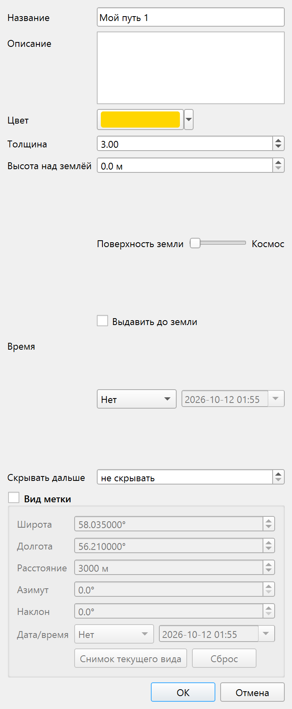

Пункт «Свойства…» открывает окно свойств. Окно не мешает работать
с глобусом, вид можно поворачивать и приближать. Каждая правка сразу
видна на глобусе. Пока окно открыто, вершины метки, пути или
многоугольника стоят на глобусе кружками и тянутся мышью, кружок
в середине отрезка ставит новую вершину. «OK» записывает правки в метку
вместе с формой, «Отмена» возвращает прежний вид и прежнюю форму.

| Поле | Что задаёт |
|---|---|
| Название | Название в списке и подпись на глобусе |
| Описание | Текст метки, он уходит и в KML |
| Значок | Значок точки из набора QGIS, в KML - стандартный значок той же темы |
| Цвет, Толщина | Цвет значка точки, цвет и толщина линии и контура |
| Размер значка | Только у точки. Доля обычного размера значка, как scale в KML. 0 - на глобусе только подпись |
| Цвет подписи, Размер подписи | Только у точки. Цвет и размер подписи на глобусе, как LabelStyle в KML. Размер 0 - только значок, название остаётся в списке |
| Заливка | Цвет заливки многоугольника и стены |
| Отсчёт высоты | От чего отсчитывается высота, как в KML. «На поверхности» - метка лежит на земле, над морем на воде. «Вдоль морского дна» - на дне. «Относительно поверхности» и «Относительно морского дна» - подъём над ними. «Абсолютная» - высота над уровнем моря, она может быть и ниже нуля |
| Высота | Подъём над поверхностью или дном, в абсолютном режиме - высота над уровнем моря, в метрах. Ползунок «Земля - Космос» под полем задаёт её от земли до 100 км. В режимах «На поверхности» и «Вдоль морского дна» поле недоступно |
| Выдавить до земли | Стена от объекта до земли, у метки - столбик |
| Поток по пути | Только у пути. По пути от первой точки к последней бегут короткие штрихи цвета линии, как поток грузов |
| Время | Момент или промежуток метки для шкалы времени |
| Скрывать дальше | Метка видна, только пока глаз ближе этого расстояния. 0 - видна всегда. В KML поле пишется Region |
| Вид метки | Точка взгляда, расстояние, азимут, наклон камеры у метки и дата вида |
| Поля объекта | Таблица имя и значение, как ExtendedData в KML. «Добавить поле» и «Удалить поле» меняют состав. Поля видны в карточке метки и в окне «Объекты». Правка полей из выгрузки ГИС в исходный слой не возвращается, она уходит в KML |

Выдавливание работает при высоте больше нуля. Путь становится стеной,
многоугольник - объёмом.

Путь с потоком лежит на земле, по нему от начала к концу ровно бегут
светлые штрихи цвета линии. Шаг штрихов - доля ширины видимой части
глобуса, поэтому поток выглядит одинаково и издалека, и вблизи.
Направление потока задаёт порядок точек пути. Поток хранится в файле
меток, сцене и KML, в KML это ExtendedData, другие программы его
не показывают.

### Вид метки

У любой метки может быть свой вид.
Вид - это точка, на которую смотрит камера, расстояние до неё, азимут
и наклон. Точка взгляда может не совпадать с меткой. По виду идут
«Подлететь», двойной щелчок по метке и остановка тура.

«Снимок вида метки» в меню метки делает текущий вид глобуса видом
метки. В окне свойств те же величины стоят в разделе «Вид метки».
Кнопка «Снимок текущего вида» берёт вид глобуса, «Сброс» возвращает
вид, который был при открытии окна. Снятый флажок раздела убирает
вид, тогда камера берёт метку в кадр целиком. Вид уходит в KML
элементом LookAt и читается из него.

Кнопка «Снимок текущего вида» запоминает и включённые строки раздела
«Слои» - флажок «Слои глобуса со снимка» под временем вида. С этим
флажком перелёт к метке и тур включают эти строки и выключают остальные,
и каждая остановка тура показывает свои слои - например, сначала
аномалии силы тяжести, потом разрез Земли с очагами землетрясений.
Время вида ставит шкалу времени. Слои включаются в начале перелёта
к остановке, данные успевают прийти к прилёту. В KML слои вида уходят
в ExtendedData метки, другие программы их пропускают.

Вместе со строками снимок запоминает непрозрачность включённых строк,
сектор разреза Земли и землю над подземной моделью - её
непрозрачность, вырез и камеру под землёй. Остановка тура
восстанавливает и их. Очаги, пожары, струйки и раскраски тайлов
у остановки проявляются и гаснут за полсекунды, а не включаются
сразу.

Поля «Пауза в туре» и «Скорость перелёта» того же раздела задают темп
остановки. Пауза - сколько секунд камера стоит на метке, «как у тура» -
пауза с панели тура. Скорость - во сколько раз перелёт к метке быстрее
обычного, от ×0.25 до ×4, меньше единицы - медленнее и плавнее.

### Копировать и вставить

«Копировать» или Ctrl+C кладёт выделенные метки и папки в буфер
обмена текстом KML. Текст вставляется в блокнот,
правится и копируется обратно. «Вставить» или Ctrl+V кладёт метки
из буфера в папку. На метке это её папка, на пустом месте - корень
«Мои метки». Папки из буфера вставляются папками. KML, скопированный
в Google Earth, вставляется так же.

### Время меток и шкала времени

Шкала времени - одно время всего вида. Покрытия - темы NASA - берут
момент, правый бегунок. События - метки со временем и землетрясения -
берут промежуток между бегунками. Когда включена тема, а событий нет,
у шкалы один бегунок. Кнопки ‹ и › сдвигают момент на шаг ряда темы,
▶ показывает дни ряда подряд и ждёт, пока загрузится каждый день.
Шкалы слоёв - темы, очагов, разреза, пластов, инсоляции, уклона
и температуры - стоят одной панелью в левом нижнем углу вида.

У метки может быть своё время. Это момент или
промежуток, поле «Время» в свойствах метки. В KML время пишется как
TimeStamp и TimeSpan. У вида метки время своё, поле «Дата/время»
в разделе «Вид метки».

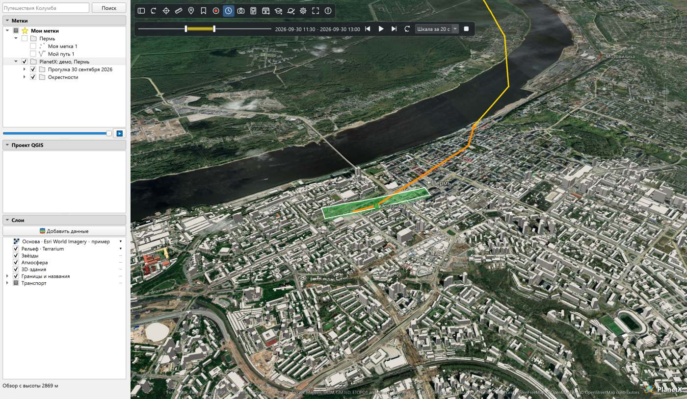

Шкала времени открывается кнопкой «Шкала времени» на панели значков.
Кнопка доступна, когда у видимых меток есть время. Шкала охватывает
время меток от самого раннего до самого позднего. Закрытая шкала
метки не скрывает, видны все.

| Часть шкалы | Что делает |
|---|---|
| Бегунки | Задают промежуток. Метки вне промежутка скрыты, метки без времени видны всегда |
| Полоса между бегунками | Перетаскивание сдвигает промежуток целиком, щелчок по полосе ставит его серединой в точку щелчка |
| ⏮, ⏭ | Промежуток той же ширины встаёт в начало или конец шкалы |
| ▶, ⏸ | Проигрывание и пауза: промежуток идёт вдоль шкалы. Если промежуток занимает всю шкалу, левый бегунок встаёт в начало, правый идёт от него к концу |
| 🔁 | Проигрывание по кругу, после конца шкалы промежуток идёт с начала |
| Скорость | «Шкала за 20 с» проходит всю шкалу за 20 секунд. ×1 - время идёт как на часах, ×60 - минута за секунду, ×3600 - час, ×86400 - сутки |
| Сейчас | Момент встаёт на часы компьютера, время идёт со скоростью ×1. Кнопка есть, когда включены Солнце, спутники или небо |
| ⏹ | Закрывает шкалу |

Перелёт к метке и тур ставят шкалу на время вида метки, а без него - на
время самой метки. Закрытая шкала при этом открывается. Шкала своя и не зависит от «Временного контроллера»
QGIS.

Слои «Солнце» и «Спутники» и вид неба зависят от момента, а не от
данных. С ними шкала открывается и без меток со временем, на часах
компьютера, с одним бегунком. Охват шкалы - сутки до момента и сутки
после него. Показ со скоростью часов не останавливается на краю
охвата, охват сдвигается вслед за моментом. Так при ×3600 видно,
как граница дня и ночи идёт по Земле, а спутники проходят витки.
Закрытая шкала возвращает Солнце и спутники к часам компьютера.

### KML и KMZ

«Открыть KML или KMZ…» кладёт файл KML или KMZ, в том числе
из Google Earth, в «Мои метки» новой папкой с именем файла. Папки,
стили, значки, время и виды меток сохраняются, `gx:Tour` становится записанным туром. Region
меток и папок тоже сохраняется. Метка видна, пока её рамка на экране
не меньше `minLodPixels` и не больше `maxLodPixels`. Размер рамки
считается для окна высотой 1000 пикселей с полем зрения 60°, поэтому
метка скрывается на одном расстоянии при любом окне глобуса. Камера
перелетает к содержимому файла.

Из файла переносятся и такие части:

- дыры многоугольника (`innerBoundaryIs`) - озеро внутри поля или двор
  здания остаются незакрашенными. Щелчок в дыру многоугольник
  не выбирает.
- поля объекта из `ExtendedData` - `Data` и `SchemaData`, как их пишут
  ГИС при выгрузке в KML. Поля видны в карточке метки и в окне
  «Объекты», «Объясни это» отдаёт их помощнику.
- цвет и размер подписи (`LabelStyle`) и размер значка точки. Размер
  подписи 0 - метка без подписи, размер значка 0 - подпись без значка.
- вид `Camera` у меток, папок и шагов тура. Он переводится в вид метки -
  точка взгляда там, куда смотрит камера, крен не переносится.
- шаблон всплывающего окна (`BalloonStyle`) - карточка метки показывает
  текст по шаблону, места `$[name]`, `$[description]` и `$[поле]`
  заменяются названием, описанием и полями объекта.
- поворот значка (`heading` в `IconStyle`) - значок держит направление
  от севера и поворачивается вместе с видом.
- изменения меток по ходу тура (`gx:AnimatedUpdate`) - видимость, цвета,
  размер значка, толщина линии и положение точки. Размер, толщина,
  цвета и положение меняются плавно. Изменения действуют, пока тур
  проигрывается, метки в «Моих метках» остаются прежними.
- перелёт тура с подъёмом (`gx:flyToMode bounce`).
- модель внутри трека (`gx:Track` с `Model`) - 3D-модель едет по треку
  по шкале времени, повороты - из `gx:angles`, без них - по ходу.
  Вне времени трека модели нет, при закрытой шкале она стоит в конце
  пути.

Все эти части сохраняются в «Моих метках» и уходят обратно в KML.

#### Слой проекта в KML

Пункт «В «Мои метки»…» меню векторного слоя в разделе «Проект QGIS»
кладёт объекты слоя в «Мои метки» папкой с именем слоя. Есть выделение -
переносятся выделенные объекты, иначе все. При слое больше 5000
объектов окно спрашивает, брать ли только объекты в видимой части
глобуса. Переносятся:

- геометрия в градусах, многоугольники с дырами, составной объект -
  метками по частям с одним названием. Отметки Z не переносятся.
- атрибуты - поля объекта.
- название - подпись слоя QGIS, без подписи - выражение отображения
  слоя.
- цвета - символ каждого объекта по стилю слоя, в том числе правила
  и категории.
- подпись точки - цвет и размер шрифта простых подписей QGIS.
  У точечного слоя без подписей на глобусе только значки.
- время - поля начала и конца временных свойств слоя.

Папку «Сохранить как KML…» записывает в KML или KMZ.

«Сохранить как KML…» сохраняет папку или все «Мои метки» в KMZ или KML.
Формат выбирается расширением файла. Вид метки записывается как
`LookAt`. Слой проекта переводится в KML через «Мои метки», см.
[Слой проекта в KML](#слой-проекта-в-kml).

#### Сетевые ссылки

Сетевая ссылка - папка «Моих меток» с содержимым документа KML или
KMZ по адресу, как `NetworkLink` в KML. Адрес - страница в сети
(http, https) или файл на диске. Пункт «Добавить» - «Сетевую
ссылку…» меню папки открывает окно с названием, адресом
и промежутком обновления. Сетевая ссылка из открытого файла KML
ложится в «Мои метки» такой же папкой.

Документ загружается, пока папка отмечена вместе с родителями.
Без промежутка - один раз за сеанс, с промежутком - снова через него,
но не чаще раза в 10 с. Файл на диске перечитывается, когда его
меняет другая программа. Новый документ заменяет содержимое папки,
правки внутри неё при этом теряются. Адреса внутри документа
считаются от адреса самого документа. Вложенные сетевые ссылки
загружаются так же, до третьего уровня. Пункт «Загрузить заново»
меню ссылки загружает документ сразу, «Свойства…» меняют название,
адрес и промежуток. При ошибке загрузки строка состояния пишет её
причину, прежнее содержимое остаётся. В KML ссылка сохраняется как
`NetworkLink`, без содержимого.

Пример лежит в хранилище модуля, папка `examples/network_link`.
Файл `link.kml` открывается пунктом «Открыть KML или KMZ…». В нём две
ссылки. Первая - файл `planetx_demos.kml` с местами демо из того же
хранилища на GitHub, он загружается заново раз в час. Вторая - лента
землетрясений USGS магнитудой от 2.5 за неделю, она загружается
заново раз в 5 минут. Готовые файлы-ссылки на свои ленты USGS даёт
с окончанием `_link.kml`, например
`https://earthquake.usgs.gov/earthquakes/feed/v1.0/summary/4.5_week_depth_link.kml`.

#### Суперналожения

Суперналожение - большой снимок или карта, нарезанные тайлами. Документ
тайла несёт его картинку и сетевые ссылки на документы более подробных
тайлов, у ссылок и картинок свой `Region`, ссылки загружаются по
`viewRefreshMode` со значением `onRegion`. Такой файл открывается
пунктом «Открыть KML или KMZ…». Ссылка суперналожения стоит в «Моих
метках» папкой, но её тайлы файл меток не хранит. Глобус загружает
только документы и картинки тайлов у вида. Тайл заменяется более
подробными, когда шире `minLodPixels` пикселей на экране. Тайлы
ложатся на рельеф под картинками на поверхности, грубый тайл под
пришедшими подробными не рисуется. Снятый флажок папки убирает
суперналожение с глобуса.

Пример - образец Google, снимок Маунтин-Вью 1991 года, больше 900
тайлов, адрес `https://mw1.google.com/mw-earth-vectordb/kml-samples/mv-doqq.kml`.
Его открывает по ссылке демо «Суперналожение, Маунтин-Вью» группы
«Снимки и карты». Сохранённый на диск файл открывает пункт «Открыть
KML или KMZ…».

### Наложения картинок

Подменю «Добавить» папки добавляет картинку из файла PNG, JPEG или GIF
тремя способами:
- «Картинку на поверхности» - картинка ложится на рельеф четырьмя
  углами, по середине вида на половину его ширины. Она лежит под
  границами и слоями проекта.
- «Фото» - картинка встаёт плоскостью в 3D перед нынешней камерой.
  «Подлететь» ставит глаз в точку камеры фото, и фото закрывает вид.
- «Картинку на экране» - картинка стоит в углу вида и не двигается
  с глобусом, например логотип или легенда.

Наложение открывается в окне свойств. В нём меняются название,
описание, картинка и непрозрачность, у картинки на экране - угол вида
и ширина. «OK» записывает правки, «Отмена» возвращает прежнее.

Картинка на поверхности привязана одним из двух способов, как в KML:
- Рамка - север, юг, восток, запад и поворот, поля окна свойств. Пока
  окно открыто, на глобусе стоят ручки. Середина сдвигает картинку,
  ручка над северной стороной поворачивает её, углы и середины сторон
  растягивают от противоположного угла или стороны, с Shift - от
  середины. Новая картинка ставится рамкой.
- Четыре угла - кнопка «Перевести в четыре угла». Каждый угол тянется
  мышью сам, картинка может стать неправильным четырёхугольником.
  Обратно в рамку она не переводится.

Картинка хранится одним из двух способов, поле «Хранение»:
- «В файле меток» - копия внутри «Моих меток», видна и без исходного
  файла.
- «Ссылка на файл или адрес» - путь к файлу или адрес http(s).
  Картинка читается при показе, правка файла видна на глобусе.

Поле «Обновлять» задаёт промежуток, через который картинка по ссылке
читается заново, пока она видна. Адрес в сети просится мимо кэша,
поэтому на глобусе стоит свежий снимок или карта, которую сервер
обновляет сам. Промежуток короче 10 с поднимается до 10 с. В KML это
`refreshMode` `onInterval` и `refreshInterval` у `Icon`.

KML и KMZ с наложениями Google Earth - GroundOverlay, ScreenOverlay
и PhotoOverlay - открываются так же. Картинка из KMZ ложится в файл
меток, картинка простого KML остаётся ссылкой на файл рядом с ним или
на адрес в сети. «Сохранить как KML…» в KMZ кладёт в архив картинки
из файла меток и по ссылке на файл. В KML картинки из файла меток
ложатся в папку рядом с ним, ссылки остаются ссылками.

«Картинку в проект QGIS…» меню картинки на поверхности записывает её
в файл GeoTIFF в WGS84 по углам картинки. Файл добавляется в проект
растровым слоем в группе «PlanetX - картинки», с непрозрачностью
наложения. «Картинки на поверхности в проект QGIS…» меню папки делает
то же для всех картинок на поверхности папки, в выбранную папку
на диске.

«Очистить «Мои метки»…» удаляет все метки и папки после подтверждения.
Отменить удаление нельзя, поэтому нужные метки лучше заранее сохранить
в KML.

### 3D-модели

«Добавить → 3D-модель…» ставит модель здания или другого объекта
в точку взгляда. Модель читается из файла Collada (.dae) с картинками
рядом, glTF (.gltf, .glb) или OBJ (.obj) с файлами MTL и картинками
рядом. Файл KMZ с моделью Google Earth открывается как файл меток,
модель встаёт на своё место.

Единиц и оси вверх в OBJ нет. Модуль считает единицу метром, а осью
вверх - ось Y, так пишут Blender и glTF. Модель с осью Z вверх ложится
на бок, её ставит наклон 90° в окне свойств.

Модель - строка «Моих меток». Флажок прячет её, «Подлететь» ставит
камеру сбоку и сверху, модель входит в тур и в сохранённые KML и KMZ.

Окно свойств модели задаёт место, как Model в KML:
- широта и долгота точки модели, это начало координат файла модели
- отсчёт высоты - на рельефе, над рельефом или над уровнем моря
- азимут - поворот по часовой стрелке, если смотреть сверху, у нуля
  ось Y модели смотрит на север
- наклон и крен - повороты вокруг осей X и Y модели
- масштаб, единица - размеры из файла модели
- непрозрачность.

Под полями стоит количество треугольников, материалов и картинок
и размер модели в метрах.

Пока окно свойств открыто, вокруг модели на земле стоит рамка - след
её коробки, как рамка картинки на поверхности. Ручки рамки ставят
модель на место мышью:
- крест в середине сдвигает модель
- ромб над северной стороной рамки поворачивает её по азимуту
- угол меняет масштаб модели по всем осям, противоположный угол стоит
  на месте, с Shift - середина
- середина стороны растягивает модель по одной оси.

Поля окна следуют за ручками. Рамка строится по азимуту, наклон
и крен модели в ней не учитываются.

Новая модель хранится ссылкой на исходный файл, как модель Google
Earth. Модель читается из него и из картинок рядом, правка файла
в SketchUp или Blender видна на глобусе. Поле «Обновлять» задаёт,
как часто файл проверяется, пока модель видна. Поле «Хранение» окна
свойств кладёт копию всех файлов модели в файл меток, тогда исходный
файл не нужен. «Обзор…» выбирает другой файл модели, место и масштаб
остаются.

«Сохранить как KML…» в KMZ кладёт файлы модели в архив, и модели по
ссылке тоже. В KML модель в файле меток ложится папкой рядом с ним,
у модели по ссылке остаётся путь к её файлу. Сцена увозит файлы всех
моделей своей папки. Картинки моделей больше 2048 пикселей
уменьшаются. Модель glTF со сжатыми сетками Draco и meshopt не
читается, такой файл сохраняется заново без сжатия, например в
Blender.

Модель glTF или Collada с анимацией узлов движется на глобусе. Ключи
положения, поворота и масштаба частей проигрываются по кругу, пока
модель видна. У glTF берётся первая анимация файла. Сетка со скелетом
и морфинг не проигрываются, такая модель стоит в позе привязки. Окно
свойств модели пишет длительность анимации и количество движущихся
частей.

Модель здания IFC модуль не читает. Её переводят в glTF бесплатной
программой IfcConvert из набора IfcOpenShell, команда
`IfcConvert model.ifc model.glb`. Тот же перевод делают Blender
с дополнением Bonsai и FreeCAD с модулем BIM. Файл .glb добавляется
пунктом «Добавить → 3D-модель…» и ставится на место ручками рамки
модели.

---

## Линейка

Значок «Линейка» открывает окно с вкладками «Линия», «Путь»,
«Многоугольник», «Круг», «3D-путь» и «3D-многоугольник». Точки ставятся щелчками по глобусу,
за курсором тянется резинка.

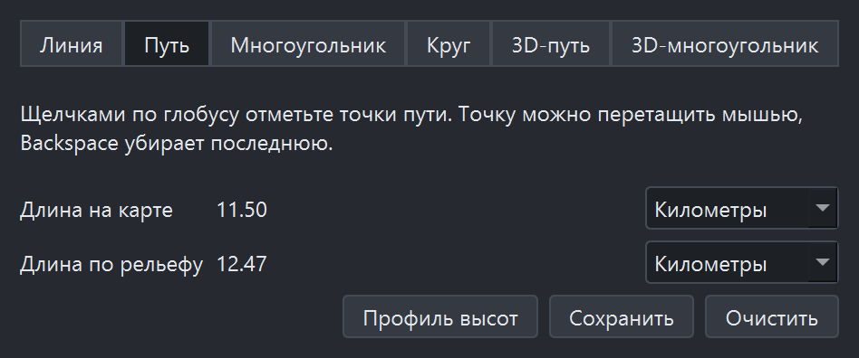

| Вкладка | Величины |
|---|---|
| Линия | Длина на карте, длина по рельефу, курс. Третий щелчок начинает новую линию |
| Путь | Длина на карте, длина по рельефу |
| Многоугольник | Периметр, площадь |
| Круг | Радиус, периметр, площадь. Первый щелчок - центр, второй - радиус |
| 3D-путь | Длина прямыми отрезками в пространстве |
| 3D-многоугольник | Периметр, площадь в плоскости многоугольника, наклон плоскости |

Длина на карте, периметр и площадь считаются на эллипсоиде WGS84. Длина
по рельефу идёт вдоль поверхности с подъёмами и спусками. Курс - азимут
начала линии от севера по часовой стрелке. Единицы выбираются у каждой
величины - метры, километры, мили, морские мили, для площади
квадратные метры, гектары, квадратные километры, квадратные мили.

Высоты для длины по рельефу берутся из Mapzen Terrain Tiles. Недостающие
тайлы высот вдоль линии загружаются, даже если рельеф выключен. Пока
они загружаются, перед длиной по рельефу стоит «≈».

Точку линейки можно перетащить мышью, Backspace убирает
последнюю точку. У каждого отрезка на глобусе подписана его длина.
У многоугольника и 3D-многоугольника над первой точкой появляется
подсказка «Замкнуть фигуру». Щелчок по ней замыкает фигуру
и завершает рисование, точки после этого тянутся мышью.

Кнопка «Сохранить» кладёт фигуру в «Мои метки» вместе с измерением.
Название предлагается с номером, например «Линия 1». Измерение видно
в подсказке строки.

Вкладки «3D-путь» и «3D-многоугольник» ставят точку на крышу
или стену 3D-здания, если луч из глаза встречает его раньше
рельефа, и запоминают высоту точки. Отрезки между точками прямые
и на рельеф не садятся. Площадь 3D-многоугольника
меряется в его плоскости, так у ската крыши или стены она
настоящая. Наклон - угол плоскости к горизонту, 0 - ровная
крыша, 90 - стена. Сохранённый 3D-объект уходит в KML
с altitudeMode absolute.

Окна «Линейка» и «Новая метка» открыты по одному. Открытие одного
закрывает другое.

### Профиль высот

Кнопка «Профиль высот» линейки и пункт «Профиль высот» в меню пути
«Моих меток» открывают график высоты вдоль линии.

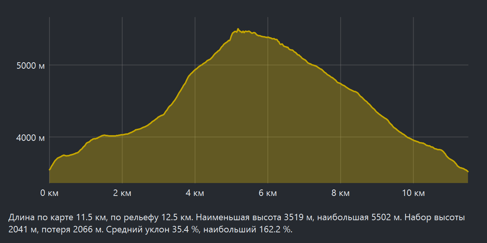

Под графиком стоят длина по карте и по рельефу, наименьшая
и наибольшая высота, набор и потеря высоты, средний и наибольший уклон.
Курсор над графиком показывает расстояние, высоту и уклон в этом месте,
на глобусе точка отмечена меткой с высотой. Профиль линейки меняется
вместе с её точками.

Высоты берутся так же, как для длины по рельефу. Уклон меряется
на отрезке не короче трёх пикселей данных высот, так шероховатость
данных не выдаётся за обрыв. На крутых горах наибольший уклон может
превышать 100 %, это 45°.

### Участок и результаты анализа

Уклон и экспозиция, видимость, инсоляция, изменения местности
и классификация, затопление, сток воды и уровень моря собраны в подменю
«Анализ участка» меню на глобусе. Окна этих инструментов, кроме
видимости и уровня моря, считают по участку, как Google Earth.

Белый контур на глобусе - участок. При открытии окна это квадрат
с серединой в точке под курсором, его сторону задаёт поле «Участок»,
кнопка «Квадрат» возвращает квадрат. Вершины участка тянутся мышью,
кружок на середине стороны ставит новую вершину. Кнопка «Нарисовать»
стирает участок, вершины ставятся щелчками по глобусу. У первой
вершины появляется подсказка «Замкнуть фигуру», щелчок по ней замыкает
участок. Расчёт идёт по рамке участка, вне многоугольника результатов
нет. Наибольший размер участка у каждого окна свой, подсказка поля его
называет. Видимость считается в круге от наблюдателя.

Участок общий у всех этих окон. Участок, заданный в одном окне, берут
окна, открытые в это время, и окна, открытые потом для точки внутри
него. Так один участок считается разными инструментами. Строка итога
окна сообщает, что участок общий. Точка вне участка, кнопки «Квадрат»
и «Нарисовать» начинают новый участок. Если участок больше предела
окна, окно просит его уменьшить.

У окон уклона и экспозиции, видимости, инсоляции, изменений местности,
классификации и затопления одинаковые кнопки. «Построить» показывает
результат на глобусе, его можно строить заново сколько угодно. OK
записывает результат в проект QGIS и закрывает окно. Каждый расчёт -
подгруппа «<инструмент> <время>» в группе «PlanetX - анализ участка»,
в ней слой «Участок» с контуром участка и все слои этого расчёта.
Слои, которые кнопки окна добавляют до OK, например вершины и ямы
или места изменений, ложатся в ту же подгруппу. У окна «Сток воды»
кнопки OK нет, его слои ложатся в подгруппу сразу, новый участок или
новое открытие окна заводят новую подгруппу. Удаление подгруппы
убирает расчёт целиком.

Файлы ложатся в папку проекта, а если проект не сохранён - в папку
PlanetX профиля QGIS, имя - инструмент и время. Дальше результат -
обычный слой проекта. Глобус показывает его как слой проекта, флажок
и непрозрачность - в QGIS. «Отмена» и крестик окна убирают результат
с глобуса, в проект ничего не записывается.

Окна уклона и экспозиции, инсоляции и затопления показывают в строке
итога сводку значений участка - среднее, разброс и квантили 10, 25, 50,
75 и 90 %. Разброс - стандартное отклонение. Та же сводка стоит
в описании растра в метаданных слоя, у растра изменений местности
тоже. Клетки вне участка в неё не входят, у затопления входят только
залитые клетки.

Пока идёт долгий расчёт - загрузка высот, векторов AlphaEarth, расчёт
видимости или инсоляции, - вращается значок загрузки справа от панели
значков, подсказка значка называет расчёт. Щелчок по значку открывает
меню «Остановить» - расчёт прерывается, прежний результат остаётся.

### Уклон и экспозиция участка

Пункт «Уклон и экспозиция…» подменю «Анализ участка» открывает
окно «Уклон и экспозиция» для точки под курсором. Участок - до 100 км,
шаг сетки - около шестисотой доли его наибольшего размера. Кнопка
«Построить» загружает высоты участка и раскрашивает его на глобусе.
Высоты те же, что у рельефа глобуса, - с уточнением суши 30 м и своим
рельефом растром проекта, если они включены.

Уклон и экспозиция считаются по ядру 3 × 3 (Horn, как в gdaldem), расчёт
перенесён из модуля Isoliner. Экспозиция - сторона света, куда обращён
склон, у ровного места положе 0.5° её нет. Список «Показывать» выбирает
раскраску участка - уклон или экспозицию, цвета и шкала те же, что
у строк «Уклон» и «Экспозиция» раздела «Слои». Участок занимает тот же
слой глобуса, поэтому строки на это время гаснут, а включённая строка
снимает участок. Под полями стоит сводка - наименьший, наибольший
и средний по медиане уклон, площади по классам уклона и три стороны
света, куда чаще всего смотрят склоны.

OK записывает растры уклона и экспозиции в градусах в подгруппу
расчёта, на глобусе - тот, что показывал участок. Кнопка «Вершины
и ямы» находит вершины и замкнутые понижения участка и записывает их
слоем точек GeoPackage в ту же подгруппу, у точки - вид, отметка
и перепад.
Вершина выше всего вокруг себя в радиусе поля «Радиус вершины», яма
ниже, перепад до низшей или высшей точки вокруг не меньше поля
«Перепад от».

### Видимость из точки

Пункт «Видимость…» подменю «Анализ участка» меню на глобусе
открывает окно «Видимость из точки» для точки под курсором. В окне задаются высота наблюдателя над рельефом,
высота цели и радиус круга. Кнопка «Построить» загружает высоты под
кругом и раскрашивает его. Видимые места зелёные, скрытые рельефом -
красные. OK записывает видимость растром в подгруппу расчёта, контур
участка в ней - круг.

Из точки расходятся лучи с равным шагом по азимуту. Шаг вдоль луча -
пятисотая доля радиуса, при радиусе 10 км это 20 м. Место видно, если
луч из глаза к нему не задевает рельеф по дороге. Учитываются кривизна
тела и у Земли рефракция с коэффициентом 0.13. Лес не учитывается.
Флажок «Учитывать здания» поднимает рельеф на высоту 3D-зданий
OpenFreeMap и своих зданий - выдавленных многоугольников «Моих меток»,
выдавленных слоёв проекта и 3D-моделей на месте. Здания закрывают обзор
и отбрасывают тени, у части зданий OpenFreeMap высота условная, около 5
м. Здание уже шага расчёта может не попасть в расчёт, поэтому для улиц
нужен малый радиус. Строка итога называет количество учтённых зданий и
своих среди них. Круг шире 300 тайлов зданий считается без зданий
OpenFreeMap. Под окном стоит доля видимой площади круга. Если высоты
не загрузились за 30 с, расчёт идёт по менее подробным, окно об этом
пишет. Видимость считается на Земле, Марсе и Луне.

### Инсоляция

Пункт «Инсоляция…» подменю «Анализ участка» меню на глобусе
открывает окно «Инсоляция» для точки под курсором.
В окне задаются первые и последние сутки промежутка и участок до 40 км.
Кнопка «Построить» загружает высоты и раскрашивает участок по среднему
количеству часов прямого солнца в сутки. Синий цвет - мало света,
красный - много. Шкала в левом нижнем углу вида идёт от нуля до
наибольшего значения. OK записывает часы растром в подгруппу расчёта
с теми же цветами.

Положение солнца считается через каждые 10 минут суток UTC. Место
освещено, если солнце выше горизонта гор по своему азимуту и падает
на склон с его лицевой стороны. Горизонт берётся по 32 направлениям
на расстоянии не меньше половины участка и не меньше 5 км. Промежуток длиннее
15 суток считается по 15 суткам, взятым равномерно. Облака, рефракция
и лес не учитываются. Здания учитывает тот же флажок «Учитывать
здания», что у видимости, здания берутся и на 1 км за участком.
Расчёт идёт в круге, накрывающем участок, сетка высот - 800 узлов
на сторону, у квадрата 7 км шаг около 25 м. Расчёт идёт частями, глобус в это время
отвечает мыши. Строка под полями показывает долю сделанного.
Инсоляция считается только для Земли.

### Тени

Пункт «Тени…» подменю «Анализ участка» меню на глобусе открывает
окно «Тени» для точки под курсором. Глобус показывает, где на участке
тень и где солнце в выбранный момент. Тень - тёмная синеватая заливка,
место на солнце - лёгкая тёплая дымка. Строка «Момент» показывает
местное время компьютера и время UTC.

Момент - правый бегунок шкалы времени, без шкалы - часы компьютера.
Кнопка «Построить» загружает высоты и считает горизонт участка один раз,
потом открывает шкалу времени. Дальше тени идут за шкалой - бегунок
двигается мышью или показом ▶, новая карта появляется через 0.3 с после
остановки бегунка без новой загрузки. Строка под полями показывает высоту
солнца и долю участка на солнце. Солнце ниже горизонта - тень везде.

Горизонт и сетка высот - те же, что у инсоляции, флажок «Учитывать
здания» добавляет здания OpenFreeMap, свои 3D-модели и выдавленные
многоугольники. OK записывает карту на текущий момент растром
в подгруппу расчёта - 1 солнце, 0 тень, вне участка значений нет.
Тени и инсоляция занимают один слой глобуса, построенная карта
одного окна снимает карту другого. Тени считаются только для Земли.

### Изменения местности

Пункт «Изменения местности…» подменю «Анализ участка» меню на
глобусе открывает окно «Изменения местности» для точки под курсором
и включает строку «Изменения местности» раздела «Слои». Глобус
показывает, где местность изменилась между двумя годами. Чёрный - без
изменений, жёлтый - стройка, вырубка, новый карьер, разлив воды. Шкала
степени изменения от 0 до 1 стоит в левом нижнем углу вида.

Данные - набор AlphaEarth Foundations Satellite Embedding, CC BY 4.0.
Каждая клетка 10 м суши описана на каждый год с 2017 по 2025 вектором
из 64 чисел - сводкой снимков Sentinel-2, Landsat и радара за год.
Степень изменения - несходство векторов двух лет, единица минус косинус
угла между ними. У неизменённой местности она около 0.05, у сильных
изменений 0.5 и выше. Расчёт идёт по файлам набора в сети, ключ
и учётная запись не нужны.

В окне задаются годы сравнения и промежуток степени изменения, клетки
вне промежутка прозрачны. Глобус сам показывает обзор вида с пикселем
160 м и крупнее, его тайлы видны до масштаба около 20 км на тайл.
Подробнее - подробный участок до 20 км, список «Пиксель участка» -
пиксель 10, 20, 40 или 80 м. Файлы набора хранят блоки по 1024 × 1024
пикселя, блок за год весит 40-50 МБ при любом пикселе, поэтому под
полями стоит оценка загрузки. Пиксель 10 м покрывает блоком 10 км,
80 м - 82 км. Кнопка «Подробно» показывает подробные значения внутри
участка, они грузятся при приближении к нему.

OK записывает степень изменения участка растром в системе UTM в
подгруппу расчёта, вне многоугольника значений нет, «Отмена» снимает
участок. Обзор остаётся строкой раздела «Слои» в обоих случаях. Кнопка
«Места изменений» находит до десяти мест самых сильных изменений
участка и записывает их слоем точек GeoPackage в ту же подгруппу. Что именно изменилось, дальше
видно архивом снимков Esri Wayback и шторкой.

Изменения местности, карты значений геофизики, геологическая карта,
литология, воды и почвы - один слой глобуса, на нём одна карта.
Включённая карта снимает прежнюю, крестик шкалы выключает строку.
Изменения местности считаются только для Земли.

### Классификация

Пункт «Классификация…» подменю «Анализ участка» меню на глобусе
открывает окно «Классификация» для точки под курсором. Классификация
делит клетки участка на классы по тем же векторам AlphaEarth, что
у изменений местности.

Участок - не больше 10 км, классы считаются только внутри него.

У класса есть цвет и название, кнопка «Добавить класс» заводит новый,
✕ убирает класс с его точками. Кружок у класса выбирает его, и щелчок
по глобусу ставит точку этого класса. Точка - образец класса, например
лес, поле, застройка или вода. Нужно хотя бы два класса по три точки,
точек может быть больше. Щелчок по точке любого класса убирает её,
у курсора подсказка «Убрать точку».

Кнопка «Построить» относит каждую клетку участка к классу пяти
ближайших контрольных точек по сходству векторов выбранного года.
Классы ложатся на глобус своими цветами, строка под полями называет
долю каждого класса. Точки ставятся по снимку глобуса, а год снимка
может отличаться от года в окне. Пиксель 10, 20, 40 или 80 м и оценка
загрузки - как у подробного участка изменений местности. Пиксель
«Авто» берёт пиксель с наименьшей загрузкой, при котором на участке
от 14 до 640 тысяч клеток, строка под полем называет его. Блок файла
за год весит 40-50 МБ при любом пикселе, пока он грузится, строка
состояния считает блоки.

Ползунок «Непрозрачность» меняет прозрачность классов. OK записывает
классы растром в системе UTM в подгруппу расчёта, с цветами, названиями классов и той же непрозрачностью, рядом -
контрольные точки слоем GeoPackage с номером и названием класса. Точки
и классы окна остаются до следующего открытия окна. Классы и
видимость из точки - один слой глобуса, новый расчёт видимости
снимает классы. Карта изменений местности остаётся видна вместе с
классами.

### Затопление

Затопление, сток воды и уровень моря стоят в подменю «Анализ участка»
меню на глобусе. Пункт «Затопление…» открывает окно «Затопление»
для точки под курсором, участок - до 100 км. Кнопка «Построить»
загружает высоты участка и ставит уровень
воды на 2 м выше точки. Поле «Уровень воды» задаёт отметку поверхности
воды над уровнем моря, ползунок «Подъём» поднимает воду до 50 м над
точкой. Вода на глобусе и итог под полями меняются сразу, без нового
расчёта.

Вода заливает всё ниже уровня внутри участка, куда она доходит
от точки по местам ниже уровня. Котловина за гребнем выше уровня остаётся сухой, даже
если её дно ниже. Итог - площадь, объём воды и наибольшая глубина.
Если вода дошла до края участка, окно об этом пишет, тогда нужен
больший участок. Точка в реке или в море показывает подъём воды
в них. Сетка - 601 узел на сторону, у участка 10 км шаг около 17 м.
Высоты берутся из рельефа глобуса - с моделью 30 м и своим рельефом,
если они включены. Вода видна при включённом рельефе.

OK записывает растр глубин и контур затопления GeoPackage рядом с ним
в подгруппу расчёта. Вода на глобусе остаётся вместе
с растром глубин. Снятый флажок растра или удалённый растр убирает
и её.

### Сток воды и водосбор

Пункт «Сток воды…» подменю «Анализ участка» открывает окно «Сток воды»
для точки под курсором, участок - до 100 км. Кнопка «Линия стока»
строит путь воды от точки
вниз по рельефу и записывает его слоем линии с длиной и падением.
Кнопка «Водосбор» строит площадь, с которой вода стекает к точке,
и главный водоток - двумя слоями. Все они ложатся в подгруппу
расчёта и сразу отмечены на глобусе. У контура водосбора
записаны площадь, высоты, длина, падение и уклон
главного водотока, средний уклон склонов по СП 33-101-2003 и густота
речной сети. Водосбор строится от русла - места с наибольшим
водосбором в радиусе поля «Радиус поиска русла» от точки, по умолчанию
150 м, поэтому щелчок рядом с рекой даёт водосбор реки. При 0 водосбор
строится ровно от точки.

Расчёт - направления стока D8 по рельефу, в котором впадины заполнены
до перелива. Поэтому линия проходит через озёра и бессточные
котловины. Вне участка высот нет, вода уходит туда, как за край.
Линия кончается у края участка, водосбор больше участка учитывается
не целиком, окно об этом пишет. Расчёт перенесён
из модуля Isoliner.

Флажок «Обрывать на водотоке» кончает линию там, где она доходит
до водотока с водосбором не меньше поля «Водотоки от». Флажок
«Обрывать на выполаживании» кончает её там, где средний уклон
на длине поля «Длина участка» ниже поля «Уклон выполаживания», по
умолчанию 2° на 50 м. Это подножие склона, терраса или пойма, короткая
полка на крутом склоне линию не обрывает. У линии записано, чем она
кончилась.

Кнопка «Бассейны» делит участок на бассейны устьев - мест, где
водотоки с водосбором не меньше поля «Водотоки от» уходят из участка.
Бассейны ложатся слоем многоугольников GeoPackage в подгруппу
расчёта, у каждого записаны номер и площадь, крупные первыми.

Кнопка «Речная сеть» строит водотоки участка с водосбором не меньше
поля «Водотоки от» и записывает их слоем линий GeoPackage в подгруппу
расчёта. У линии записаны порядок по Стралеру
и площадь водосбора, толщина линии растёт с порядком. Чем меньше поле
«Водотоки от», тем гуще сеть. Поле «Порядок от» оставляет водотоки
не ниже заданного порядка. Исток - порядок 1, после слияния двух
водотоков одного порядка порядок растёт на единицу. Порядки считаются
по всей сети, поэтому у крупной реки он тот же при любом значении
поля.

Пункт «Водосбор метки» меню пути и многоугольника «Моих меток» строит
площадь, с которой вода приходит в метку. Путь служит створом поперёк
долины или канавой, многоугольник - участком. Контур водосбора ложится
слоем многоугольника в подгруппу «Водосбор метки» с контуром квадрата
расчёта, у него записаны площадь и высоты. Если водосбор доходит
до края квадрата, квадрат расширяется в 2.5 раза и расчёт повторяется,
пока половина его стороны не дойдёт до 50 км.

Пункт «Линии стока от метки…» того же меню открывает окно «Сток воды»
для метки, участок - квадрат, он накрывает её. Кнопка «Линия стока» строит
линии от всех узлов сетки под меткой, например от отвала, и записывает
их одним слоем линий. С флажком «Обрывать при слиянии» линия
кончается, вливаясь в построенную раньше, и общее русло идёт одной
линией. Линии строятся от высоких узлов к низким, в слой идут
не больше 300 самых длинных. Флажки остановки на водотоке
и выполаживании действуют и для этих линий.

### Уровень моря

Пункт «Уровень моря…» подменю «Анализ участка» открывает окно
«Уровень моря». Поле и ползунок задают уровень над нынешним, от -130 до +100 м.
Вода заливает всё ниже уровня по всему глобусу. Связь с морем
не проверяется, поэтому низины внутри материков тоже заливаются, при
поднятом уровне - и суша ниже нуля, например польдеры Нидерландов.
Уровень ниже нуля открывает шельф и включает глубины морей и океанов.
Около -120 м - последний ледниковый максимум, около +70 м - таяние всех
ледников. Кнопка «Нынешний» возвращает уровень 0. Вода видна при
включённом рельефе.

---

## Подземный режим

Окно «Подземный режим» открывает кнопка «Подземный режим…» окна
«Свойства вида» и кнопка «…» строки «Земля над гридами» раздела
«Слои». Режим показывает под поверхностью скважины, кровли пластов,
стенки разрезов и вырез блока.

### Данные

Данные - таблицы в той же разметке, что у Isoliner.

| Таблица | Поля | Что задаёт |
|---|---|---|
| collar | hole_id, z, eoh, геометрия - точка | Устье скважины, отметка устья, глубина забоя по стволу |
| interval | hole_id, from, to, code | Интервалы по стволу, вниз положительные, code - пласт или литология |
| survey | hole_id, depth, azimuth, dip или zenith | Инклинометрия. Без неё скважина вертикальная |
| beds | code, ord, color, surface | Порядок пластов сверху вниз, цвет «#rrggbb», файл растра кровли |
| sections | геометрия - линия | Линии разрезов |
| cut | геометрия - многоугольник | Вырез блока |
| images | name, image, top, bottom, геометрия - линия | Разрез с картинкой: файл PNG или JPG от папки файла GeoPackage, отметки верха и низа картинки в метрах |
| tunnels | name, depth, depth_end, diameter, color, геометрия - линия | Тоннель: глубина оси под поверхностью в начале и в конце линии, диаметр в метрах, цвет «#rrggbb» |

Поля ищутся и по другим принятым именам, например bhid, elev, td,
from_m, to_m, litho. Угол dip с отрицательными значениями считается
от горизонта, -90 - вниз отвесно. Кровля пласта - растр отметок
в метрах в любой системе координат, его читает GDAL.

Геологические слои проекта показываются в 3D как обычные слои глобуса.
Слой узнаётся по имени таблицы из списка выше или по полям, например
точечный слой с полями hole_id и eoh - устья. Отмеченный в разделе
«Проект QGIS» слой встаёт под поверхность, снятый флажок убирает его.
Плоской картинкой на поверхности такие слои не рисуются. Кровля -
растр, чей файл назван в поле surface таблицы пластов. Таблицы
интервалов, инклинометрии и пластов берутся из проекта сами, сначала
из той же группы слоёв.

Путь к картинке разреза отсчитывается от папки файла её слоя. Если
в проекте несколько слоёв одной роли, берётся верхний в дереве слоёв.

Стиль берётся из QGIS, как у обычных слоёв:
- кровля, растр которой раскрашен псевдоцветом, палитрой или RGB,
  окрашена этой раскраской. Серый растр без настройки окрашен цветом
  пласта из таблицы beds.
- ствол без интервалов и тоннель берут цвет символа объекта, если стиль
  слоя по категориям, градуированный или по правилам. При простом
  символе цвет - из поля color, без него - свой цвет режима.
- прозрачность слоя QGIS - прозрачность его объектов под поверхностью.
- подписи над устьями - подписи слоя устьев QGIS, из поля или
  выражения. Подписи слоя выключены - подписей нет.

После правки стиля или данных слоя глобус пересобирает модель, как
обычные слои. Кнопка «Создать шаблон…» окна «Подземный режим»
записывает файл GeoPackage со всеми таблицами режима и примером у точки
взгляда - скважиной с двумя интервалами, разрезом, тоннелем и вырезом -
и добавляет его в проект группой «Шаблон подземного». Таблицы шаблона
заполняются своими данными.

### Гриды по отметкам

Растр проекта, значения которого - абсолютные отметки в метрах, ложится
под землю поверхностью. Для этого в меню растра раздела «Проект QGIS»
отмечается пункт «Поверхность по отметкам». Флажок слоя показывает
и скрывает поверхность. Система координат растра берётся из слоя QGIS,
поэтому годится и ASCII Grid без файла .prj.

Цвет поверхности - раскраска растра QGIS. Серый растр без настройки
окрашен цветом пласта. Гриды с окончаниями имён _top и _bottom,
например В_top и В_bottom, - кровля и подошва одного пласта. Они
окрашены одним цветом, между ними по краю данных встают торцы, и пласт
выглядит плитой. Подходят и окончания roof, base, кровля, подошва.

Векторный слой с отметками Z - многоугольники или линии - встаёт
объёмом по пункту «Объёмом по отметкам Z» своего меню в группе «Проект
QGIS». Многоугольники ложатся плоскостями на отметки своих вершин,
линии - трубками. Так встаёт, например, «3D-забор» разреза Isoliner3D -
вертикальные многоугольники пластов вдоль линии разреза. Цвет - поле
color вида «#rrggbb», без него - стиль слоя QGIS. Щелчок в режиме
«Объекты» показывает поля объекта и отметку под курсором. Отметки
растягиваются масштабом рельефа, как гриды, ползунок «Земля над
гридами» делает землю над ними прозрачной. Где под прозрачной землёй
ничего нет, виден светлый фон, от голубого вверху кадра к почти белому
внизу. Фон лежит только под рамкой модели, небо и космос вокруг неё
не меняются.

При выключенном рельефе отметка слоя с Z по умолчанию считается от
поверхности, как глубина скважин и пластов. Поэтому горизонтали рельефа
с Z без рельефа лежат на земле. Пункт «Истинные отметки Z» того же меню
ставит вершины на их отметки над уровнем моря, и горизонтали поднимаются
над плоской Землёй. С рельефом пункт ничего не меняет.

Пункт «Изолинии в проект QGIS…» меню растра выгружает изолинии
значений растра слоем GeoPackage в группу «PlanetX - горизонтали».
Шаг тот же, что на гриде глобуса, каждая пятая линия толще
и подписана.

На поверхности грида лежат изолинии - около 12 линий на размах
отметок, шаг из того же ряда, что у горизонталей. Каждая пятая
изолиния толще и темнее.

Под гридами строится блок. По краю данных от рельефа до низа модели
встают стенки с пластами, на низу модели лежит дно. Стенки темнеют
с глубиной. Стенка, обращённая к камере снаружи, не рисуется, поэтому
блок виден изнутри с любой стороны. Над блоком земля прозрачна по
ползунку «Земля над гридами» раздела «Слои», вне контура данных она
непрозрачна. Строка с ползунком появляется вместе с подземной моделью.

Тонкие пласты лучше видны с вертикальным масштабом рельефа в окне
«Свойства вида». Масштаб растягивает и глубины.

### Показ

Модель строится, когда отмечен хотя бы один геологический слой.
Глобус загружает высоты рельефа под моделью и ставит её под
поверхность.

- Ствол скважины идёт по инклинометрии методом минимальной кривизны.
  Интервалы окрашены цветом своего пласта, над устьем - подпись слоя.
- Кровля пласта - поверхность цвета пласта.
- Тоннель - трубка своего диаметра вдоль линии под рельефом.
  Глубина меняется от depth в начале линии до depth_end в конце,
  так задаётся спуск к порталу. Без depth_end глубина постоянная,
  без diameter - 3.7 м.
- Разрез - стенки вдоль линии от рельефа до низа модели, между
  кровлями - пласты своих цветов.
- Разрез с картинкой - вертикальная стенка вдоль линии от отметки
  top до отметки bottom, на неё натянута картинка. Левый край картинки -
  начало линии, верх - отметка top. Картинка больше 4096 пикселей
  по большей стороне уменьшается.
- Низ модели - забой самой глубокой скважины, без скважин - на 20 м
  ниже самой глубокой кровли.

Глубина растягивается масштабом рельефа, как и поверхность. При
выключенном рельефе отметки отсчитываются от поверхности.

Ползунок «Непрозрачность поверхности» делает рельеф в рамке модели
прозрачным, сквозь него видны скважины и кровли. Вне рамки поверхность
остаётся непрозрачной, у гридов - вне контура их данных. Флажок «Вырез блока» убирает поверхность
и кровли внутри многоугольника выреза. По краю выреза встают стенки
с пластами, на дне лежит плоскость низа модели. Флажок «Камера под
землёй» позволяет опустить камеру ниже рельефа до низа модели. В рамке
модели камера тогда ходит по её низу. Настройки окна хранятся
в проекте.

Многоугольник «Моих меток» режет модель пунктом «Вырез модели» своего
меню, путь ставит стенку с пластами пунктом «Стенка разреза модели».
Повторный выбор пункта убирает вырез или стенку. Правка формы метки
сразу меняет модель. Вырез и разрез так рисуются на глобусе
инструментом «Новая метка».

Шкала «Пласты» в левом нижнем углу вида показывает пласты модели
сверху вниз своими цветами и тоннели.

В режиме «Объекты» щелчок по стволу скважины показывает её номер,
пласт, глубину по стволу и под устьем, отметку и глубину забоя в точке
под курсором. Щелчок по тоннелю показывает его название, глубину
и отметку оси и диаметр.

Пункт «Разрез модели…» меню пути «Моих меток» открывает окно с тем же
названием. По горизонтали - расстояние вдоль пути, по вертикали -
отметки в метрах. На разрезе рельеф, пласты между кровлями, стволы
скважин цветами интервалов и тоннели своим диаметром из полосы вдоль
пути. Ширину полосы задаёт поле «Полоса скважин и объектов». Курсор
над графиком отмечает точку на глобусе, подпись вверху графика даёт
расстояние, рельеф и отметки кровель под курсором.

Это и геологический разрез по слоям проекта. Список слева в окне
даёт слои проекта с флажками:

- «Кровли - растры» - любые одноканальные растры отметок проекта,
  например гриды кровель и подошв пластов. Пункт «Поверхность по
  отметкам» и подземная модель на глобусе для разреза не нужны.
  Порядок пластов - по таблице пластов, без неё - по средней отметке
  кровли сверху вниз.
- «Скважины» - устья проекта с интервалами и инклинометрией.
- «Слои с Z» - линии и многоугольники с отметками Z, например
  «3D-забор» разреза из Isoliner3D. Их части в полосе вдоль пути
  ложатся на разрез своим цветом - стенки забора заливкой, линии
  линией.

По умолчанию отмечены слои подземной модели глобуса, без неё -
поверхности по отметкам и слои с пунктом «Объёмом по отметкам Z»,
а если таких нет - все растры и слои с Z проекта. Растр без своей
системы координат берёт систему слоя QGIS. Цвета пластов подписаны
в правом верхнем углу графика. Кнопка «Картинка…» записывает разрез
файлом PNG, «Таблица CSV…» - отметки рельефа и кровель по 400 точкам
пути с широтой и долготой, нет кровли - пустое поле.

Пласт между кровлей и подошвой (гриды с окончаниями _top и _bottom,
«кровля» и «подошва») идёт цветом пласта, промежуток под подошвой
и над первой кровлей - цветом породы между пластами. Каждая кровля
и подошва обведена линией цвета пласта темнее. Правая кнопка по
графику задаёт свой цвет пласта, породы между пластами или линии под
курсором, пункт «Цвета разреза по умолчанию» снимает свои цвета. Свои
цвета запоминаются в проекте QGIS и действуют при следующем открытии
окна.

Подземные демо кладут свои данные в проект QGIS группой обычных
слоёв и отмечают их на глобусе. Демо «Пермские отложения» в значке
«Демо» открывает синтетический участок у Березников, на Верхнекамском месторождении. На нём
24 скважины, 9 кровель пластов Верхнекамского
разреза, два разреза, вырез северо-восточной четверти и разрез 3-3
с картинкой. Данные
выдуманы для примера, это не съёмка.

Демо «Тоннели Vegas Loop» открывает тоннели компании The Boring
Company под Лас-Вегасом со станциями, около 8 км линий. Трассы
и станции взяты из OpenStreetMap. Глубины в OpenStreetMap нет, ось
тоннеля стоит на 12 м под поверхностью, около 40 футов по открытым
сведениям о тоннелях выставочного центра Лас-Вегаса, спуски к
станциям идут от поверхности до этой глубины.

---

## Туры

Тур облетает отмеченные метки папки по порядку списка, включая
вложенные папки. На остановке внизу кадра крупно стоят название
и описание метки - подпись остановки. Она проявляется, когда камера
встала на остановке, и гаснет перед следующим перелётом, в полёте её
нет. Подпись попадает и в запись тура. Кнопка 🔤 панели тура снимает
подписи, тогда описание стоит строкой под кнопками панели.

- Метка со своим видом возвращает его точку взгляда, расстояние,
  азимут и наклон.
- Вдоль пути камера едет по линии.
- Остальные метки берутся в кадр целиком.

Тур запускается пунктом «Запустить тур» в меню «Моих меток» или папки,
пунктом «Тур по пути» в меню пути или кнопкой ▶ под списком меток.
Кнопка ведёт тур по выделенной папке или пути, а при выделенной метке -
по папке, в которой метка лежит. Тур проходит метки тела, которое
сейчас на глобусе. Если отмеченных меток нет, строка состояния об этом
сообщает.

Панель тура появляется вверху вида второй строкой под шкалой
времени, а без шкалы - на её месте:

| Кнопка | Что делает |
|---|---|
| Ползунок | Показывает, сколько тура прошло, и перематывает тур. Камера сразу встаёт в выбранную точку, после отпускания тур идёт дальше с неё |
| ⏮, ⏭ | Предыдущая и следующая остановка |
| ⏸, ▶ | Пауза и продолжение |
| Пауза | Сколько секунд камера стоит на остановке |
| 🔁 | Тур по кругу. После последней остановки тур начинается с первой. Состояние кнопки сохраняется между сеансами |
| 🔤 | Подписи остановок на кадре, по умолчанию включены |
| ⏺ | Запись тура в видео MP4 или кадрами PNG |
| ⏹ | Конец тура |

Движение мышью в перелёте ставит тур на паузу. На паузе остановки вид
можно вертеть мышью, колесом и клавишами, тур при этом идёт. Когда
пауза кончается, а кнопка мыши отпущена, камера летит от нового вида
к следующей остановке.

Во время тура работают клавиши, если вид в фокусе:

| Клавиша | Что делает |
|---|---|
| → | Следующая остановка |
| ← | Предыдущая остановка |
| Пробел | Пауза и продолжение |
| Esc | Конец тура. В режиме «Во весь экран» первый Esc выключает режим |

Стрелки с Ctrl, Shift или Alt по-прежнему двигают камеру.

### Запись тура с экрана

Кнопка записи ⏺ на панели значков записывает движение камеры.
Камеру можно вести мышью, клавишами, перелётами
и инструментами управления. Повторный щелчок заканчивает запись
и спрашивает название. Тур ложится в «Мои метки» со значком фильма,
на глобусе он не рисуется.

Пункт «Запустить тур» в меню такого тура проигрывает запись. Камера
сначала подлетает к началу записи. Ползунок панели тура и запись
тура работают так же, как у тура по меткам. В KML записанный
тур сохраняется как `gx:Tour`, Google Earth его проигрывает.

Путь записанного облёта правится в окне «Свойства…» тура. Пока окно
открыто, путь точки взгляда виден на глобусе линией с двадцатью
опорными точками. Опорная точка тянется мышью, позы между опорными
сдвигаются вслед за ней плавно. Ползунок «Высота облёта» опускает
камеру во всех позах до четверти высоты записи или поднимает до
четырёх высот. Время, азимут и наклон поз не меняются. «OK»
записывает правку, «Отмена» её отменяет.

### Как снять ролик

1. Поставьте метки остановок в одну папку «Моих меток». Вид каждой
   метки задаёт пункт «Снимок вида метки» её меню.
2. Отметьте флажками нужные метки и расставьте их перетаскиванием
   в порядке облёта.
3. Включите слои ролика - тему NASA, солнце, облака или шкалу
   времени с нужным днём.
4. Пункт «Запустить тур» меню папки проигрывает тур. Пауза на
   остановке задаётся на панели тура.
5. Кнопка ⏺ панели тура открывает окно «Запись тура». Режим «Видео
   MP4 в размере окна» сразу даёт ролик. Размер ролика равен размеру
   окна глобуса, поэтому окно лучше растянуть заранее.

Вместо меток можно записать движение камеры кнопкой ⏺ на панели
значков, см. «Запись тура с экрана». Тур по пути «Моих меток» ведёт
камеру вдоль линии.

### Запись тура для видео

Кнопка ⏺ открывает окно «Запись тура» с двумя режимами. Оба пишут
25 кадров в секунду тура, подпись источников стоит в углу каждого
кадра.

- «Видео MP4 в размере окна» - быстрый режим. Окно спрашивает имя
  файла, по окончании записи готов ролик H.264. Его кодирует сама
  Windows, сторонние программы не нужны. Режим есть только в Windows.
  Тур из двух остановок, 71 кадр 2592 × 1860, пишется около 45 с
  и занимает 10 МБ.
- «Кадры PNG в папку» - профессиональный режим. Окно спрашивает папку
  и размер - как окно, 1920 × 1080, 2560 × 1440 или 3840 × 2160. Кадр
  крупнее окна рисуется заново в этом размере, надписи и линии
  крупнее в той же доле. Файлы называются `frame_00000.png`,
  `frame_00001.png` и дальше, кадры с теми же номерами в папке
  заменяются.

Каждый кадр ждёт загрузки тайлов, поэтому запись идёт дольше тура,
а на кадрах нет размытых мест. Кадр, который ждёт дольше 20 секунд,
снимается как есть. Запись всегда начинается с первой остановки,
поэтому повтор записи даёт те же кадры.

Рядом с кадрами PNG ложится файл `frames.json` - частота, размер, поза
камеры и время данных каждого кадра, номера недогруженных кадров.

Панель показывает номер кадра. Крестик на панели прерывает запись.
Прерванное видео остаётся годным файлом из уже записанных кадров.

### Как собрать ролик из кадров

Ролик из кадров PNG собирает любая программа, которая открывает
последовательность картинок.

Бесплатная программа ffmpeg (ffmpeg.org) собирает MP4 одной командой
в папке с кадрами:

```
ffmpeg -framerate 25 -i frame_%05d.png -vf "pad=ceil(iw/2)*2:ceil(ih/2)*2" -c:v libx264 -pix_fmt yuv420p -crf 18 tour.mp4
```

Частота 25 совпадает с частотой записи, поэтому ролик идёт в темпе
тура. Фильтр `pad` добавляет по пикселю, если сторона кадра нечётная,
кодек H.264 требует чётных сторон. Меньшее значение `-crf` даёт
лучшее качество и больший файл.

Видеоредакторы Shotcut и DaVinci Resolve открывают кадры с номерами
как один клип. Туда же можно добавить музыку, подписи и склейку
нескольких туров.

---

## Треки

Трек показывает путь движущихся объектов по времени. Источник - точечный
слой проекта с полем времени, время задаёт шкала времени глобуса.
«Временной контроллер» QGIS на глобус не действует.

Пункт «Трек…» в меню точечного слоя открывает окно настроек:

| Поле | Что задаёт |
|---|---|
| Время | Поле с датой и временем, текстом ISO 8601 или секундами с 1970 года |
| Объект | Поле, которое различает объекты. «Один объект» - все точки один путь |
| Цвет | Цвет пройденного пути |
| Камера следом | Камера держит первый объект в середине вида по ходу движения |
| 3D-модель | Файл модели glTF, Collada или OBJ. Пустое поле - объект показан меткой |
| Масштаб модели | Множитель размера модели, 1 - размер из файла в метрах |
| Поворот модели | Поворот модели по часовой стрелке к ходу движения |
| Высота | Откуда высота точки: Z точки или числовое поле. «По земле» - объект стоит на рельефе |
| Отсчёт высоты | Над уровнем моря - высота полёта, над землёй - подъём над рельефом под точкой |
| Единицы высоты | Метры или футы. Высоту самолётов ADS-B передают в футах |

С файлом модели у каждого объекта трека по пути едет своя модель.
Её перёд смотрит по ходу движения. Ход - по пути трека за последние
30 с. Модель glTF, повёрнутая передом к зрителю, получает поворот 180°.
Модель с анимацией узлов едет и двигает своими частями.

Трек виден, пока слой отмечен в разделе «Проект QGIS». Окно «Трек»
отмечает слой само, снятый флажок убирает с глобуса путь, объекты
и модели.

Пункт «Камера следом» меню правой кнопки над объектом трека ведёт
камеру за этим объектом, а не за первым. Объект стоит в середине вида
по ходу движения. Колесо мыши меняет расстояние до объекта, правая
кнопка с перетаскиванием - наклон. Esc или снятый пункт меню отпускают
камеру. Так в демо «Самосвалы, Качканар» можно проехать с самосвалом
от дна карьера до отвала.

С высотой объект и модель поднимаются над землёй. Между точками высота
меняется равномерно по времени. Путь с высотой над уровнем моря
рисуется в воздухе на высотах точек, путь с высотой над землёй лежит
на рельефе. Так трек самолёта по точкам GPS или ADS-B показывает
взлёт и посадку.

Время трека входит в охват шкалы времени. У каждого объекта растёт
пройденный путь до правого бегунка шкалы, в текущей точке стоит метка
с его названием. Когда шкала закрыта, треки показываются целиком.
Кнопка «Убрать трек» возвращает слою обычный вид. Настройки треков
хранятся в проекте.

Во время записи тура треки растут по ходу тура через промежуток
открытой шкалы, при закрытой шкале - через всё время треков.

---

## Поезда Финляндии

Строка «Поезда Финляндии» категории «Транспорт» каталога «Добавить
данные» показывает все поезда Финляндии в реальном времени. Положения
поездов - открытые данные Fintraffic Digitraffic, лицензия CC BY 4.0.
Служба обновляет их раз в 10 с, модуль спрашивает с тем же шагом.
Вид и категорию поездов он спрашивает раз в 5 минут.

Издалека поезд - точка цвета категории с подписью, например «IC 9»
или «R 9123» у пригородного поезда линии R. Когда полоса вида уже 6 км,
поезд показан составом условных вагонов цвета категории. У поезда
дальнего следования 6 вагонов, у пригородного 4, у грузового 12,
у локомотива один. Настоящую длину состава служба даёт отдельным
запросом, модуль её не спрашивает.

| Цвет | Категория |
|---|---|
| красный | Дальнего следования |
| фиолетовый | Пригородные |
| синий | Грузовые |
| оранжевый | Локомотивы |
| серый | Маневровые |
| жёлтый | Путевые машины |

Поезд, вид которого служба ещё не дала, - светло-серый.

Между обновлениями поезд едет со своей скоростью не дольше 30 с.
Когда полоса вида уже 8 км, модуль берёт рельсы из тайлов векторной
основы OpenStreetMap у точки взгляда. Точка поезда ближе 40 м
к рельсам встаёт на них. Поезд едет по рельсам и через стрелки,
вагоны состава изгибаются по пути. Новое положение поезд принимает
плавно за 2 с.

Щелчок по поезду открывает окно «Объекты» с видом, категорией, линией,
оператором, номером, скоростью и временем положения. Пункт «Камера
следом» меню правой кнопки над поездом ставит его в середину вида
с азимутом по ходу движения. Камера встаёт в 1.5 км от поезда,
колесо приближает и отдаляет её, средняя кнопка мыши меняет наклон.
Esc, снятие флажка, выключение строки или запись облёта отпускают
камеру.

При записи облёта поезда идут по времени тура, кадр ролика - 1/25 с
их хода, даже если кадр с догрузкой снимался несколько секунд. Начало -
часы компьютера в момент записи, новые положения на время записи не
просятся. После записи поезда снова идут по часам компьютера. Демо «Поезда
Финляндии, вживую» ставит камеру над путями у станции Пасила
в Хельсинки.

---

## Суда Балтики и самолёты

Строки «Суда Балтики» и «Самолёты» категории «Транспорт» каталога
«Добавить данные» показывают суда и самолёты в реальном времени.
Издалека объект - точка цвета группы с подписью, на экране не больше
600 ближайших к точке взгляда. Вблизи объект показан условной моделью,
которая между обновлениями идёт своим курсом со своей скоростью.
Щелчок открывает окно «Объекты» со сведениями. Запись облёта ведёт суда
и самолёты по времени тура, как поезда.

Вблизи точка с подписью остаётся у объекта, пока он дальше 150 своих
длин от глаза, - модель там меньше примерно 10 пикселей. Самолёт длиной
40 м показан точкой дальше 6 км, судно длиной 100 м - дальше 15 км.
Точка самолёта стоит на его высоте.

Пункт «Камера следом» меню правой кнопки над судном или самолётом, как
у поезда, держит объект в середине вида с азимутом по его курсу.
Самолёт лежит на луче взгляда на своей высоте, точка взгляда - продолжение
луча до земли впереди. Расстояние до самолёта меняет колесо, наклон -
средняя кнопка. Под камерой следом объект показан моделью на любом
расстоянии.

Суда - сигналы AIS Финского и Ботнического заливов и Балтики у
Финляндии, открытые данные Fintraffic Digitraffic по лицензии CC BY 4.0.
Положения приходят раз в 20 с, названия, типы и размеры - раз в 10
минут. Модель судна вблизи (полоса вида уже 20 км) - корпус своей
длины и ширины по данным AIS с надстройкой у кормы, на уровне воды.
Цвет показывает группу типа - пассажирские, грузовые, танкеры,
рыболовные, буксиры и служебные, скоростные, яхты и катера.

Самолёты - сигналы ADS-B сети добровольцев adsb.lol в круге у точки
взгляда, раз в 10 с. Самолёт в воздухе стоит на своей высоте, на земле -
на рельефе. Между обновлениями самолёт в развороте идёт по дуге, его
скорость поворота даёт ADS-B или разность курсов двух положений. Нос
модели поднимается по вертикальной скорости, крен - из ADS-B, без него -
по скорости поворота. Модель вблизи (полоса вида уже 15 км) - условный самолёт
размера своей категории ADS-B с креном. Цвет киля показывает категорию -
лёгкие, малые, пассажирские и грузовые, тяжёлые, вертолёты. Над Россией
приёмников сети почти нет, самолётов там не видно. Лицензия выдачи
adsb.lol на 19 октября 2026 года не названа.

---

## Режим полёта

Подменю «Полёт» меню правой кнопки на глобусе ставит свой
самолёт на 1000 м над точкой щелчка - истребитель или винтовой самолёт.
Самолёт летит курсом вида, камера идёт за ним сзади и сверху. Полёт
работает над Землёй и над другими телами меню «Тело».

| Самолёт | Скорость на старте | Наибольшая скорость | Сваливание |
|---|---|---|---|
| Истребитель | 900 км/ч | около 2000 км/ч | 250 км/ч |
| Винтовой самолёт | 250 км/ч | около 340 км/ч | 100 км/ч |

| Клавиша | Действие |
|---|---|
| стрелка вверх | нос вниз |
| стрелка вниз | нос вверх |
| стрелки влево и вправо | крен и поворот в ту же сторону |
| PageUp, PageDown | больше и меньше тяги |
| V | вид из кабины и обратно |
| H | приборы в кабине и строка показаний |
| Esc | конец полёта |

Без клавиш крен сам возвращается к нулю, тангаж остаётся. Истребитель
кренится вдвое быстрее винтового самолёта. Ниже скорости сваливания нос
опускается сам. Внизу вида строка показаний -
скорость, высота над уровнем моря и над землёй, курс, вертикальная
скорость и тяга. Колесо меняет расстояние от камеры до самолёта,
средняя кнопка мыши - наклон взгляда. Из кабины модели не видно,
взгляд направлен по курсу с тангажом самолёта, кадр наклоняется вместе
с креном. В ровном полёте горизонт стоит посередине кадра, над ним
небо. В кабине вместо строки показаний на стекле стоят зелёные приборы.
Это шкала тангажа с линией горизонта, повёрнутая на крен, знак самолёта
в середине, лента курса сверху, лента скорости в км/ч слева и лента
высоты над уровнем моря в метрах справа. Ниже стоят вертикальная
скорость, тяга и высота над землёй. Линия горизонта шкалы совпадает
с горизонтом на кадре.

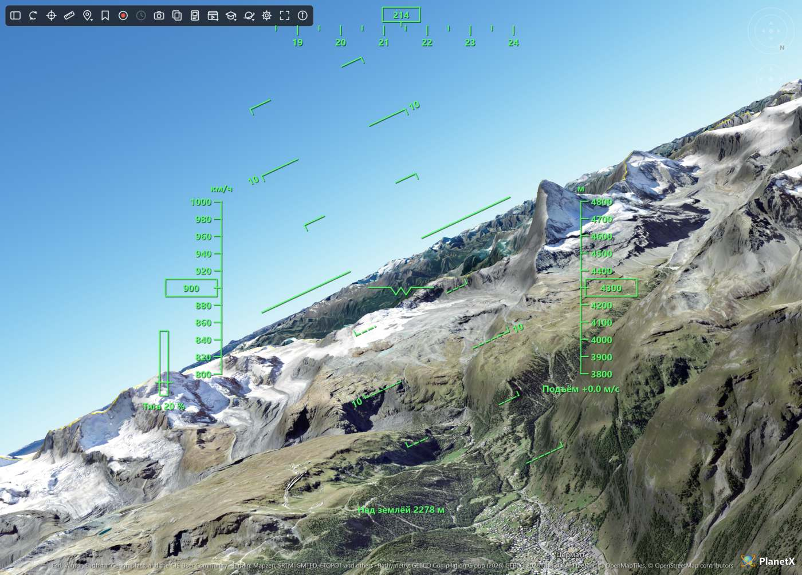
Касание земли кончает полёт.
Запись облёта тоже кончает полёт - камеру ведёт запись.

---

## Слои проекта со временем

Слой проекта, у которого во временных свойствах QGIS включено время,
показывается на глобусе в промежутке шкалы времени. Время слоя входит
в охват шкалы. Картинка слоя и его подписи перерисовываются после
остановки бегунков. Когда шкала закрыта, слой показывается целиком.

---

## Шторка слоёв проекта

Шторка сравнивает слои проекта без годов и шкалы времени, например
ортофото двух съёмок или проект и снимок. Подменю «Шторка» меню слоя
в разделе «Проект QGIS» задаёт сторону слоя - «Слева», «Справа» или
«На обеих сторонах». Слой «Слева» виден только левее шторки, слой
«Справа» - только правее, прочие слои видны на обеих сторонах. Перед
названием слоя стоит знак его стороны - ◧ или ◨.

Первая сторона включает шторку и ставит слой на глобус. Шторка
тянется мышью, бирки над ней называют слои сторон. Если на стороне
нет своих слоёв, там видны общие слои и подоснова. Кнопка «⇆ Шторка
слоёв» под списком раздела включает и снимает шторку, крестик бирки
тоже её снимает. Стороны слоёв хранятся в проекте.

Шторка дней темы NASA и шторка лет исторических карт снимают шторку
слоёв - левая часть вида у шторок одна.

---

## Исторические карты

Историческая карта - растр, тайлы XYZ или картинка на поверхности с годом.
Карты одной группы сменяют друг друга на шкале времени. Видна последняя
карта не позже момента шкалы, до года первой карты группы не видно ни
одной. Шаги ◂ ▸ шкалы идут по годам карт. Когда шкала закрыта, видны
все карты.

Год растра или тайлов проекта задаёт пункт «Год карты…» меню слоя
в разделе «Проект QGIS». Карты одной группы слоёв проекта QGIS
сменяют друг друга. Годы хранятся в проекте.

Год картинки на поверхности - поле «Время» окна её свойств, например
«1890». Карты одной папки «Моих меток» сменяют друг друга. В KML год
карты - `TimeStamp` у `GroundOverlay`. Картинка с промежутком,
например «1890/1910», видна в своём промежутке, как метка.

Кнопка ⇆ шкалы открывает шторку двух лет. Слева от шторки стоит карта
прошлого года карт, справа - карта момента шкалы. Шторка тянется
мышью, стрелки на бирке левой части меняют её год. Шаг раньше первой
карты оставляет слева снимок без карт.

Демо «Москва, исторические карты» помещает в проект карты Москвы 1813, 1860,
1900, 1917 и 1935 годов из Wikimedia Commons. Карты - общественное
достояние, их привязали участники проекта Wikimaps Warper, тайлы
приходят с его сервера.

Пункт «Исторические карты Рамсея…» меню на глобусе открывает окно
«Карты Рамсея» - карты коллекции Дэвида Рамсея у вида. В коллекции
около 57 тысяч привязанных карт с XIII по XXI век. Список идёт
по годам, щелчок по заголовку столбца сортирует по названию или
масштабу. В список входят 400 карт, ближайших к месту по охвату.
Строка поиска отбирает карты по году или названию, флажок «По всему
каталогу» ищет среди всех карт коллекции. Рамки карт списка видны на
глобусе, рамка выбранной карты - ярче, кнопка «Показать на глобусе»
перелетает к ней. Кнопка «В проект QGIS» собирает выбранную карту
из изображения коллекции и привязывает её по опорным точкам коллекции.
Карта ложится в группу «Карты Рамсея» вверху проекта с годом карты
и встаёт на шкалу времени, со сменой карт по годам и шторкой двух лет.
Сборка занимает 5-15 с, готовая карта хранится в профиле QGIS
и второй раз не скачивается. Кнопка «Страница карты» открывает
страницу карты на сайте коллекции.

Изображения коллекции выложены по лицензии CC BY-NC-SA 3.0, она
разрешает только некоммерческое использование с указанием источника. Привязку делали участники
коллекции, у части карт она грубая или ошибочна.

Пункт «Старые карты «Это Место»…» меню на глобусе открывает
каталог сайта «Это Место» (etomesto.com) - старые карты России
и бывшего СССР с привязкой - планы городов, межевые атласы, карты
Шуберта, Стрельбицкого, РККА, аэрофото войны. Окно показывает год
и название карт, которые накрывают точку, у Перми их больше двухсот.
Строка поиска отбирает карты по словам названия или по году.
Двойной щелчок или кнопка «Открыть на сайте» открывают страницу карты
в браузере на этой точке. Там карту накладывают на современную
и скачивают по правилам сайта, файлы сайт даёт для личного
некоммерческого использования. Сами карты модуль на глобусе не
показывает. Рамок карт в каталоге нет, поэтому на глобусе их тоже нет.

---

## Спутники

Слой «Спутники» каталога «Добавить данные» показывает искусственные
спутники Земли точками на их высоте. Группы выбирает вкладка
«Спутники» каталога, включать можно любые:

| Группа | Что в ней |
|---|---|
| Космические станции | МКС, «Тяньгун» и пристыкованные корабли |
| Яркие спутники | около ста спутников и ступеней, видимых без бинокля |
| Навигация | GPS, ГЛОНАСС, Galileo, BeiDou |
| Метеоспутники | метеорологические спутники |
| Наблюдение Земли | спутники съёмки, в том числе Landsat и Sentinel |
| Научные | научные спутники и обсерватории |
| Геостационарные | действующие спутники на высоте около 36 000 км |
| Starlink, OneWeb | спутники связи, тысячи точек |

Орбитальные элементы групп даёт CelesTrak. Положение считается по
модели SGP4 на момент правого бегунка шкалы времени. Когда шкала
закрыта, спутники идут по часам компьютера. Спутник, элементы
которого старше 30 суток на этот момент, не показывается.

CelesTrak обновляет элементы раз в 2 часа и просит скачивать группу
не чаще. Скачанная группа хранится в профиле QGIS, и раньше чем
через 2 часа новый запрос не уходит. После отказа CelesTrak группа
не запрашивается 2 часа.

Щелчок по точке спутника при включённом определении объектов
открывает окно «Объекты» с названием, номером NORAD, группой,
высотой, скоростью и возрастом элементов. Спутник при этом становится
выбранным.

У выбранного спутника видны виток орбиты на его высоте и след на
земле. Виток показывает один оборот вперёд от момента, след - путь
точки под спутником за полоборота назад и вперёд. Щелчок правой
кнопкой по точке спутника открывает меню с его названием и двумя
пунктами:

- «Орбита и след» показывает или убирает виток и след.
- «Камера следом» ставит точку взгляда под спутник, вид повёрнут
  по ходу его движения. Расстояние и наклон вида меняются колесом
  и мышью, как обычно. Повторный выбор пункта отпускает камеру.

---

## Сцены

Сцена сохраняет вид целиком и передаётся другим людям. Значок «Сцена»
открывает меню «Сохранить сцену…» и «Открыть сцену…». Файл сцены имеет
расширение `.planetx`.

В сцене хранятся:

- поза камеры.
- промежуток открытой шкалы времени.
- слои проекта, отмеченные на глобусе, ссылкой на источник.
- подложка, рельеф, масштаб рельефа, группы раздела «Слои», язык
  подписей.
- строки раздела «Слои» - сетка, звёзды, облака, температура
  и 3D-здания.
- выбранная папка «Моих меток» с её туром. Картинки наложений
  и файлы 3D-моделей папки хранятся в файле сцены вместе с ней.

Пароль базы данных в файл не попадает, ссылка на настройку подключения
QGIS остаётся. Если выбрана папка «Мои метки» целиком или не выбрано
ничего, метки в сцену не попадают.

При открытии сцены слой ищется в проекте по источнику, если его нет -
добавляется. Остальные слои проекта на глобусе снимаются. Метки сцены
ложатся новой папкой, камера перелетает в позу сцены. Слои, которые
не нашлись и не открылись, перечисляет строка состояния.

### Поделиться видом

Пункт «Поделиться видом…» меню значка «Сцена» записывает страницу HTML.
Она открывается в браузере без QGIS и PlanetX, её можно переслать
файлом или выложить на сайт. После записи страница открывается
в браузере системы.

На странице:

- глобус с камерой этого вида - точка взгляда, расстояние, азимут
  и наклон.
- основа OpenStreetMap в стиле OpenFreeMap и рельеф Terrarium
  с масштабом рельефа вида. Без рельефа на глобусе страница тоже
  без рельефа.
- метки, пути и многоугольники, выделенные в «Моих метках», со
  своими цветами и подписями. Щелчок по метке показывает её название
  и описание.
- кнопка «Исходный вид» и кнопка «▶ Облёт». Облёт - записанный тур
  из выделенного. Если его нет, камера по очереди перелетает к видам
  меток, к точке без своего вида - сверху на 3 км с наклоном 45°.

Подложка Esri, слои проекта QGIS, картинки наложений, время меток
и строки раздела «Слои» на страницу не попадают. Наклон камеры
на странице не больше 85°. Страница строится только для Земли.
Глобус страницы рисует библиотека MapLibre GL JS, браузер загружает
её с unpkg.com, тайлы - с серверов OpenFreeMap и Amazon. Без доступа
в интернет страница пустая.


### Демо

Значок «Демо» с академической шапочкой на панели значков открывает
подготовленные сцены. Каждая сцена помещает метки новой папкой в «Мои
метки», кнопка ▶ под списком проводит по ним тур. Папку можно удалить.

Файлы демо «Карьер, свой рельеф», «Бриенцское озеро, своя батиметрия»
и «3D-модели, Суздаль и Пермь» не входят в модуль. При первом
открытии демо скачивает их с GitHub в папку PlanetX профиля QGIS, это
от 0.8 до 3.5 МБ. Строка состояния пишет о загрузке, потом сцена
открывается сама. Дальше файлы берутся из профиля без сети.

| Раздел | Сцена | Что в ней |
|---|---|---|
| Метки и туры | Бока-Чика, Starbase | Стартовая площадка и завод Starbase, пляж, соседние города, шоссе из Браунсвилла, записанный облёт площадки |
| Метки и туры | Поток грузов, схема | Пути с потоком от Березников к портам Усть-Луга и Восточный по железной дороге и от Усть-Луги до Роттердама морем. Пути - схемы по крупным городам и проливам, а не настоящие маршруты |
| Снимки и карты | Аральское море | Снимки MODIS 2000, 2014 и 2023 годов группой переключателей, фото кораблей у Муйнака и карта бассейна на экране. Все картинки - ссылки на адреса в сети, см. [Наложения картинок](#наложения-картинок) |
| Снимки и карты | Суперналожение, Маунтин-Вью | Снимки Маунтин-Вью тайлами образца Google - сетевая ссылка onRegion, подробные тайлы приходят при приближении. См. [Суперналожения](#суперналожения) |
| Снимки и карты | Москва, исторические карты | Карты Москвы 1813, 1860, 1900, 1917 и 1935 годов тайлами в проекте QGIS с годами карт, Кремль и храм Христа Спасителя. См. [Исторические карты](#исторические-карты) |
| Недра | Японский жёлоб | Землетрясения, разрез Земли с сектором от экватора до 38.5° с. ш., плита Slab2 под Японией, эпицентр землетрясения Тохоку 2011 года, вулкан Фудзи. Окно «Разрез» по 38.5° с. ш. открывается вместе с демо, полоса очагов 300 км |
| Недра | Пермские отложения | Синтетический участок у Березников со скважинами, кровлями, разрезами и вырезом. Тур из пяти остановок объясняет подземный режим, см. [Подземный режим](#подземный-режим) |
| Недра | Тоннели Vegas Loop | Тоннели The Boring Company под Лас-Вегасом со станциями, см. [Подземный режим](#подземный-режим) |
| Свой рельеф | Карьер, свой рельеф | Синтетическая съёмка карьера у Березников 1 м рельефом глобуса: 10 уступов по 15 м, отвал, путь для профиля высот. Растр ложится в проект QGIS, см. [Свой рельеф](#свой-рельеф) |
| 3D-модели и движение | 3D-модели, Суздаль и Пермь | Модели Зачатьевской церкви в Суздале и церкви Покрова Пресвятой Богородицы в Перми из Google Earth Pro, лицензия CC BY 4.0. См. [3D-модели](#3d-модели) |
| 3D-модели и движение | Анимированная модель, ветряки | Три ветряка glTF с вращающимся ротором на условном месте у Перми. Модель синтетическая, ротор - узел с ключами поворота. См. [3D-модели](#3d-модели) |
| 3D-модели и движение | Поезда Финляндии, вживую | Живые поезда Финляндии составами на рельсах у станций Пасила, Хельсинки и Тиккурила. См. [Поезда Финляндии](#поезда-финляндии) |
| Самосвалы в карьерах | Самосвалы, Качканар и Самосвалы, Лебединский | Шесть условных самосвалов в Главном карьере Качканара или в Лебединском карьере у Губкина: погрузка, рейс гружёным, разгрузка, обратный рейс порожним. Путь - дорога карьера, снятая по снимку Esri World Imagery: в Качканаре от забоя на дне вдоль восточного борта, в Лебединском карьере по серпантину от забоя с экскаватором. Самосвалы - треки KML с 3D-моделью (`gx:Track` с `Model`) в «Моих метках», слоя в проекте нет, шкала времени идёт ×10 по кругу, меню правой кнопки над самосвалом - «Камера следом». Пункты «…, слой QGIS» - тот же рейс треком слоя точек проекта, как свои данные через пункт «Трек…». Самосвалы и их движение - модель, а не данные предприятия. См. [Треки](#треки) |
| Марс | Места посадок марсоходов | Гора Олимп, долины Маринер, места посадок «Кьюриосити», «Персеверанс», «Чжужуна», «Спирита» и «Оппортьюнити» |
| Марс | Кратер Езеро | Место посадки «Персеверанса», окрестности кратера, профиль высот через кратер, точка на краю для видимости, облёт кратера, слой «Уклон» и рельеф с масштабом 3 |
| Луна | «Аполлоны» и «Луноходы» | Места посадок шести «Аполлонов», «Лунохода-1» и «Лунохода-2» |
| Небо | Созвездия и яркие объекты неба | Орион, Плеяды, галактика Андромеды (M31), Кассиопея, Большая Медведица, Лира с Вегой, Южный Крест |

Координаты посадок округлены до сотых градуса.

---

## Снимок вида и вид в макет

### Снимок вида

Значок «Снимок вида» открывает окно с шириной и высотой снимка
в пикселях. Снимок может быть больше окна, глобус догружает для него
подробные тайлы. Флажок «Пропорции окна» держит высоту по ширине.

Кнопка «Сохранить…» спрашивает файл PNG или JPEG и начинает снимок.
Камера на это время стоит. Кнопка «Снять сейчас» не ждёт остальных
тайлов. Подпись источников стоит в правом нижнем углу снимка.

Значок «Копия вида» рядом кладёт вид окна в буфер обмена одним
щелчком, его можно сразу вставить в письмо, чат или документ. В копии
есть глобус, шкалы слоёв, надписи, подпись источников и знак PlanetX.
Панели значков, органов навигации, шкалы времени и панели тура в ней
нет, на экране они остаются. Размер копии - размер вида в пикселях
экрана. То же делает действие «Копия вида в буфер обмена» строки
«Поиск».

### Вид в макет

Значок «Вид в макет» кладёт вид неизменной картинкой в макет QGIS,
существующий или новый.

| Поле | Что задаёт |
|---|---|
| Макет | Существующий макет или «Новый макет» |
| Ширина, Высота | Размер картинки на листе в миллиметрах |
| Разрешение | Разрешение вывода макета, от него размер снимка в пикселях |

Картинка хранится внутри проекта. После вставки открывается окно
макета.

---

## Другие тела

Значок «Тело» на панели значков открывает меню тел. Вверху стоит
Земля, под разделителем Луна и Марс, ниже подменю:

| Подменю | Тела |
|---|---|
| Планеты | Меркурий, Венера, Юпитер |
| Спутники Юпитера | Ио, Европа, Ганимед, Каллисто |
| Спутники Сатурна | Мимас, Энцелад, Тефия, Диона, Рея, Титан, Япет |
| Астероиды | Церера, Веста |

В меню только тела, снятые аппаратами целиком. У Плутона, Харона
и Тритона не снято от 24 до 33 % шара, их в меню нет.

Выбранное тело встаёт на место Земли. Меняются размер шара,
снимки и атмосфера, камера перелетает к начальной точке тела. У Марса
это гора Олимп, у Луны - Море Спокойствия, место посадки
«Аполлона-11», у Меркурия - бассейн Калорис, у Венеры - горы
Максвелла. У прочих тел это точка на экваторе и нулевом меридиане.

Снимки тел, кроме Марса и Луны, - глобальные мозаики USGS
Astrogeology и NASA по съёмке аппаратов MESSENGER, Magellan, Galileo,
Voyager, Cassini и Dawn. Пиксель тайлов у экватора -
от 100 м у Энцелада и Весты до 120 км у Юпитера. Часть снимков
не похожа на вид глазом:

- Венера показана радаром Magellan, цвет передаёт высоту
- Юпитер - карта облаков Cassini декабря 2000 года, облака на ней
  неподвижны
- Титан снят в ближнем инфракрасном свете сквозь дымку
- Меркурий, Ио и Ганимед цветные, остальные тела серые

Шар каждого тела - сфера, у Юпитера - сжатый эллипсоид. Веста, Церера
и малые спутники на деле несферичны, на сфере их снимки слегка
искажены.

Снимки Марса - цветная мозаика Viking MDIM2.1, около 650 м
на пиксель. Снимки Луны - мозаика LROC WAC, около 330 м на пиксель
у экватора. У Марса разреженная пыльная атмосфера, у Луны
атмосферы нет.

Рельеф Марса построен по мозаике высот MOLA 463 м, рельеф Луны - по
мозаике высот LOLA 118 м, обе - USGS Astrogeology. Пиксель высот
у экватора - около 650 м у Марса и около 330 м у Луны. Рельеф включается
той же строкой «Рельеф» раздела «Слои», вертикальный масштаб задаётся
в свойствах вида. Высоты Марса отсчитываются от ареоида, высоты Луны -
от сферы радиусом 1737.4 км. Впадины ниже нуля сохраняются, дно
равнины Эллада лежит на 7-8 км ниже нуля.

На других телах работают навигация, сетка, звёзды, линейка,
«Мои метки», туры, снимок вида и сцены, на Марсе и Луне ещё и рельеф.
Выключены функции, данные которых есть только для Земли:

- векторная основа, облака, температура, 3D-здания и солнце
- слои проекта и их подписи, треки
- синхронизация с картой QGIS и определение объектов
- поиск места по названию. Координаты в поле поиска работают

Каждая метка помнит своё тело. В «Моих метках» видны метки всех тел,
на глобусе - только метки текущего. Перелёт к метке другого тела
сначала переключает тело. Тур проходит остановки текущего тела.
Сцена хранит тело и открывается на нём.

## Помощник

Помощник отвечает на темы и просьбы из строки «Поиск». Его кнопки
стоят в группе «Помощник» окна «Свойства вида». «Разговор…» открывает
окно «Помощник», «Настройки…» - окно «Настройки помощника». Окно
разговора с ИИ-моделью - «Помощник». Модель управляет глобусом по запросу словами, например
«покажи разрез через Японский жёлоб» или «где самые глубокие
землетрясения у Японии за месяц». Нужен свой ключ API выбранного
сервиса.

В окне «Помощник» идёт разговор. Строка сверху называет сервис
и модель, кнопка «Настройки…» открывает окно «Настройки помощника».
В нём выбираются сервис, адрес и модель, вводится ключ и стоят
флажки. По умолчанию выбран OpenRouter с бесплатной моделью.

- **Сервис.** У каждого сервиса свои ключ, адрес и модель.
  - «Claude (Anthropic)» - модели Claude, по умолчанию
    `claude-sonnet-5-5`.
  - «Grok (xAI)» - модели Grok, по умолчанию `grok-4.7`.
  - «DeepSeek» - модели DeepSeek, по умолчанию `deepseek-flash`.
  - «OpenRouter (есть бесплатные модели)» - модели многих
    разработчиков через один ключ. Модели с `:free` в названии
    бесплатны, количество запросов в сутки ограничено. По умолчанию
    `openrouter/free` - он сам выбирает свободную бесплатную модель.
    Если выбранная модель `:free` занята, запрос уходит
    в `openrouter/free`.
  - «Свой сервис, например Ollama» - любой сервис формата OpenAI Chat.
    Сервису на этом компьютере ключ не нужен. По умолчанию адрес
    Ollama `http://localhost:11434/v1` и модель `qwen3`.
  Модель должна уметь вызывать инструменты, иначе помощник только
  отвечает текстом.
- **Ключ.** Ключ вводится в поле «Ключ» окна «Настройки помощника»
  и сохраняется кнопкой «Сохранить ключ». Флажок «Хранить ключ без
  мастер-пароля» по умолчанию отмечен. С ним ключ сохраняется
  открытым текстом в настройках профиля QGIS, мастер-пароль
  не спрашивается. Такой ключ прочитает любой, у кого есть доступ
  к папке профиля. Без флажка ключ уходит в менеджер паролей QGIS,
  и QGIS может спросить мастер-пароль.
- **Что умеет помощник.** Перелёт к точке и поиск места, смена тела,
  строки раздела «Слои» и шкала времени, разрез Земли и разрез вниз
  вдоль точек, сведения о точке и сводка землетрясений в рамке.
  Помощнику доступны и все действия строки «Поиск» - слои и карты
  каталога, окна и инструменты, демо и тела. Он же меняет
  непрозрачность включённого слоя. Окна выбора файла, запись облёта
  и выгрузку коры CRUST1.0 помощник открывает только с разрешения.
- **Руководство.** На вопрос, как что-то сделать в модуле, помощник
  ищет ответ в этом руководстве и читает нужный раздел, а не угадывает.
- **Метки - в KML.** Метки, пути, многоугольники, папки и туры помощник
  предлагает документом KML. Под историей разговора появляется
  предложение с кнопками «Записать в «Мои метки»» и «Отменить». Запись
  идёт только по кнопке. Метки, выделенные в «Моих метках», помощник
  может прочитать в KML и вернуть исправленными.
- **Слои проекта.** Помощник может попросить список слоёв проекта -
  названия, поля, системы координат и количество объектов - и строки
  векторного слоя, не больше 200 за раз, с отбором выражением QGIS.
  Каждое такое чтение разрешаете вы.
- **Что уходит на сервер модели.** Текст запроса, точка взгляда,
  тело и включённые строки раздела «Слои». Слои проекта, их поля
  и строки уходят, только когда вы разрешили чтение. Из «Моих меток»
  уходят только выделенные метки.

Действия помощника видны в истории разговора строками «Действие».

### Разрешения помощника

Чтение слоёв проекта, окна выбора файла и запись облёта помощник
делает только с разрешения. Под историей разговора появляется вопрос,
что помощник хочет сделать, и три кнопки. Если вопрос пришёл
из строки «Поиск», окно «Помощник» открывается само.

| Кнопка | Что делает |
|---|---|
| Разрешить | Выполняет действие один раз |
| Разрешить в этом разговоре | Точно такой же запрос больше не спрашивается до нового разговора. Другой слой или другой отбор спрашивается снова |
| Отказать | Помощник получает отказ и отвечает без этого действия |

Новый вопрос, пока ждёт ответа прежний вопрос о разрешении, снимает
его - помощник получает отказ.

Подряд помощник делает не больше 16 кругов действий. Потом под
историей появляется кнопка «Продолжить» - помощник продолжает с того
места, где остановился, - и «Остановить». Если сервис модели занят
или ограничил частоту запросов, помощник повторяет запрос до трёх
раз с паузами 2, 5 и 10 с. Длинные ответы действий сокращаются -
в модель уходит начало и конец, в длинном разговоре старые ответы
заменяются пометкой.

### Метки по описанию

Тема в строке «Поиск», например «путешествия Колумба» или «битвы
Столетней войны», становится метками, если места с таким названием
не нашлось. Ctrl+Enter в строке и кнопка «Создать метки» окна
«Помощник» создают метки сразу, без поиска места. Модель отвечает одним документом KML, он сразу
записывается новой папкой в «Мои метки», камера летит к меткам.

Модель получает правила документа. В них перечислено всё, что глобус
показывает в пространстве и во времени:

- Места и события приходят точками, маршруты, фронты и границы -
  линиями по настоящему пути, территории - многоугольниками.
- Время стоит у каждой метки, для которой известна хотя бы дата или
  год. У события это момент, у похода, осады или правления -
  промежуток.
- Путь разбит на этапы. Каждый этап - линия со своим промежутком
  времени, на шкале времени она растёт от начала к концу.
- Смена территории или линии фронта приходит несколькими фигурами
  с промежутками подряд, на шкале времени они сменяют друг друга.
- В документе не больше 100 меток.

Ответ идёт потоком. Пока он идёт, под строкой виден счёт пришедших
меток и ссылка «Остановить». Остановка оставляет метки, которые
пришли целиком. Так же поступает модуль, если ответ оборвался или
упёрся в предел длины. Время ответа растёт с размером документа.

Готовый ответ под строкой называет папку, количество меток
и количество меток со временем. Шкала времени открывается на
промежуток от первой до последней даты. Ссылка «Отменить» удаляет
созданную папку.

Тема вроде «Первая мировая война» обычным поиском по Enter находит
места с этими словами в названии. Тогда под строкой стоит ссылка
«Создать метки по теме», она делает то же, что кнопка.

Координаты и даты даёт модель, они требуют проверки.

### Просьбы из строки «Поиск»

Просьбу можно ввести и в строку «Поиск» левой панели. Помощнику уходит
запрос с вопросительным знаком, запрос от шести слов и запрос, который
начинается словом просьбы или вопроса, например «покажи», «где»,
«сколько». Тема, для которой Nominatim не нашёл мест, например
«Путешествия Колумба», сразу превращается в метки, как по кнопке
у строки. Вопрос, для которого мест не нашлось, уходит в разговор.
Вне Земли помощнику уходит любой запрос, кроме координат. Ответ
появляется под строкой, ссылка «Разговор…» открывает окно «Помощник»
с историей. Метки, которые предложил помощник в разговоре, стоят под
строкой со ссылкой «Записать в «Мои метки»».
Флажок «Отвечать на просьбы из строки «Поиск»» окна «Настройки
помощника» выключает эту работу, тогда строка ищет только места и координаты.
Без сохранённого ключа API строка тоже ищет только места.

---

## Звёздное небо

Пункт «Небо» меню «Тело» показывает небо из центра небесной сферы.
На нём Млечный путь, 5080 звёзд до 6-й звёздной величины, линии
и названия 88 созвездий, имена ярких звёзд, Солнце, Луна и планеты
от Меркурия до Нептуна. Северный полюс мира вверху, восток слева, как
на звёздной карте.

| Действие | Что делает |
|---|---|
| Перетаскивание левой кнопкой | Небо тянется за курсором |
| Колесо, PageUp, PageDown, плюс, минус | Меняет поле зрения от 0.1° до 110° |
| Двойной щелчок левой | Точка встаёт в середину, поле зрения вдвое меньше |
| Двойной щелчок правой | Поле зрения вдвое больше |
| Стрелки | Взгляд сдвигается на десятую часть высоты окна |

Строка состояния показывает поле зрения, прямое восхождение
и склонение точки под курсором. Экваториальные координаты отнесены
к эпохе J2000.0. Солнце, Луна и планеты показаны на конец промежутка
открытой шкалы времени, иначе на момент часов компьютера. Положения
планет отличаются от эфемерид JPL Horizons не больше чем на 0.2°
в 1800-2050 годах, положение Луны - не больше чем на 0.3°.

Пункт «Созвездия» того же меню убирает и возвращает линии и названия
созвездий. Звёзды, их имена, Солнце, Луна и планеты остаются.

Пункт «Снимки неба при приближении» того же меню включён по умолчанию.
Издалека небо - картинка Млечного пути NASA SVS и звёзды каталога
точками. При поле зрения от 50° до 35° вместо неё плавно проявляется
подробная карта неба NASA SVS Deep Star Maps 2020 по звёздам Gaia
и Tycho, около 40″ на пиксель. При поле зрения от 6° до 3° поверх
карты проявляются снимки обзора DSS службы CDS (Страсбург), до 0.8″
на пиксель. Тайлы DSS приходят не сразу, пока их нет, видна карта.
Снимки DSS - сканы фотопластинок, у соседних пластинок разная яркость,
на краю пластинки она меняется.

Пункт «Объекты глубокого неба» того же меню показывает подписи
галактик, туманностей и скоплений. Это все объекты каталога Мессье
и объекты каталогов NGC и IC ярче 10-й звёздной величины или с общим
названием, всего 617, данные OpenNGC. Объекты Мессье подписаны при любом
поле зрения, прочие - при поле уже 40°. Кружок показывает размер
объекта. Щелчок по подписи открывает в панели справа карточку - вид,
обозначения, созвездие, звёздную величину, размер, координаты
и ссылку на базу SIMBAD. Кнопка «Подлететь» ведёт взгляд к объекту,
«Объясни это» задаёт вопрос помощнику.

Строка «Поиск» в виде неба находит объекты каталога по обозначению
и названию - «M31», «M 31», «NGC 224», «Андромеды». Объект вне
каталога ищет по Enter служба имён Sesame CDS, например «Crab» или
«NGC 6543».

На небе работают метки и туры. «Сохранить вид» ставит метку
с направлением взгляда и полем зрения. «Новая метка» ставит точку
щелчком по небу. «Записать облёт» записывает движение по небу. Метки
неба хранятся в «Моих метках» вместе с прочими, на небе они показаны
жёлтыми кружками с подписью. Тур и кнопка ▶ на небе проходят метки неба,
между далёкими точками поле зрения по пути расширяется. Перелёт
к метке неба из списка включает небо.

Линейка, синхронизация и опрос объектов на небе выключены. Снимок вида
сохраняет небо вместе с подписями. Сцена хранит направление взгляда
и поле зрения. Чтобы вернуться к телу, его выбирают в том же меню.

---

## Бот в Telegram

Бот [@PlanetXQgisBot](https://t.me/PlanetXQgisBot) отвечает на вопросы
по этому руководству и руководствам других модулей линейки - Isoliner,
Isoliner3D, Topoliner, Routeliner, Repoliner. Имя модуля в вопросе
ограничивает поиск его руководством. Вопрос пишется обычным текстом, например «как
добавить 3D-модель» или «запись тура в видео». Бот присылает до трёх
разделов руководства с абзацем и ссылкой, кнопка под разделом
присылает его целиком. Язык ответа - язык Telegram пользователя,
русский или английский.

Команды бота:

- /latest - последний выпуск модуля - PlanetX, Isoliner, Isoliner3D,
  Topoliner, Routeliner или Repoliner, что в нём нового, ссылка
  на архив и страница в каталоге QGIS.
- /docs - модули, их страницы на GitHub и в каталоге QGIS,
  руководство PlanetX.
- /report текст - сообщение разработчикам об ошибке или пожелание.
  Вместе с текстом уходят имя и ник в Telegram.

Кнопка «Бот в Telegram» окна «О модуле» открывает бота. Посты
о выпусках модулей линейки выходят в канале
[@qgis_isolines](https://t.me/qgis_isolines).

---

## Журнал работы

Модуль ведёт журнал в файле `PlanetX/planetx.log` папки профиля
QGIS. Кнопка «Журнал работы» окна «О модуле» открывает его программой
системы. В журнале записаны версии модуля, QGIS, Qt и Python,
видеокарта, открытие и закрытие окна глобуса, выбор карт и слоёв,
подложки, тела и демо, ошибки SSL сетевых запросов QGIS с владельцем
сертификата. Журнал получает все необработанные ошибки Python в QGIS,
в том числе в рабочих потоках. Ошибка другого модуля помечается его
именем. Раз в 15 минут журнал записывает память QGIS и количество
объектов GDI и USER Windows.

Если QGIS не отвечает дольше 30 с, отдельный процесс-сторож модуля
записывает рядом с журналом
дамп процесса `hang-<номер процесса>-<время>.dmp` со стеками всех
потоков, около 300 КБ без содержимого памяти, и сразу пишет
разбор - для каждого потока функции QGIS и Qt, в которых он стоит.
По нему видно, какой поток чего ждёт. Сторож работает вне QGIS
и пишет дамп, даже когда QGIS завис намертво. Хранятся три последних
дампа.

Падение QGIS журнал записывает при следующем запуске. В журнале
появляются номер процесса и время начала упавшего сеанса, стеки
Python в момент падения и путь к дампу Windows, если он есть. Пока
окно ошибки Windows держит упавший QGIS открытым, сеанс считается
живым. Обычное закрытие QGIS отмечается строкой «QGIS закрыт».

Если QGIS не отвечает дольше 10 с, журнал получает стеки всех потоков
Python. Когда QGIS снова отвечает, в журнале появляется строка
с длительностью паузы. Так видно, на чём QGIS зависал, даже если его
пришлось закрыть. Журнал больше 1 МБ переименовывается в
`planetx.1.log`, новый начинается заново. Файл журнала помогает при
сообщении об ошибке.

## Ограничения

- Слои проекта лежат на рельефе картинкой, поднять или выдавить слой
  по полю нельзя. Подъём и выдавливание есть у своих меток.
- Слой со временем по выражению в охват шкалы времени не входит,
  его промежуток задаётся бегунками вручную.
- Выше широты 85° кончается сетка тайлов Web Mercator. При подложке
  из снимков полюса закрыты снимками полярных служб Esri Arctic Imagery
  и Antarctic Imagery, около 930 м на пиксель, при подложке-карте -
  цветом края карты.
- Запись тура идёт медленнее самого тура.
- Здания - коробки с плоской крышей, формы крыш и фасады
  не передаются.
- Высоты Марса и Луны грубее земных, пиксель высот у экватора
  2.6 км и 1.3 км. Кратеры меньше 5-10 км по высотам не видны.
- В KML тело метки не пишется, метки из файла KML встают на текущее
  тело.
- Небо показано из центра Земли, без горизонта места наблюдения.
  Координаты не приводятся к дате, к 2026 году прецессия смещает их
  примерно на 0.36°.

## Источники данных

Космоснимки - Esri World Imagery, условия задаёт Esri. Картографические
данные © участники OpenStreetMap. Векторные тайлы и 3D-здания - OpenFreeMap.
Рельеф - Mapzen Terrain Tiles, данные SRTM, GMTED, ETOPO1 и других
источников. Облака - NASA GIBS, снимки VIIRS. Температура - NASA
GIBS, MODIS и GHRSST MUR. Звёзды - каталог ярких
звёзд Йельского университета. Млечный путь - NASA/Goddard Space
Flight Center Scientific Visualization Studio, Gaia DR2 - ESA/Gaia/DPAC.
Поиск мест - Nominatim. Марс - NASA, USGS, Viking MDIM2.1, тайлы
OpenPlanetaryMap, Луна - NASA, GSFC, ASU, LRO LROC WAC, USGS. Высоты
Марса - NASA MGS MOLA, USGS, высоты Луны - NASA LRO LOLA, USGS. Снимки прочих
тел - глобальные мозаики USGS Astrogeology и NASA Photojournal
по данным NASA, JPL, DLR и институтов миссий, подпись каждого
тела стоит в углу вида. Линии, названия
созвездий и имена звёзд - d3-celestial, © Olaf Frohn. Положения планет
рассчитаны по элементам орбит JPL, положение Луны - по формулам
Астрономического альманаха.

Условия всех источников разобраны в [SOURCES.md](SOURCES.md).
Тайлы идут через сетевые настройки и кэш QGIS, свой кэш модуль
не заводит.

Разработка при поддержке ООО «Информ++». Лицензия GNU GPL версии 3.
